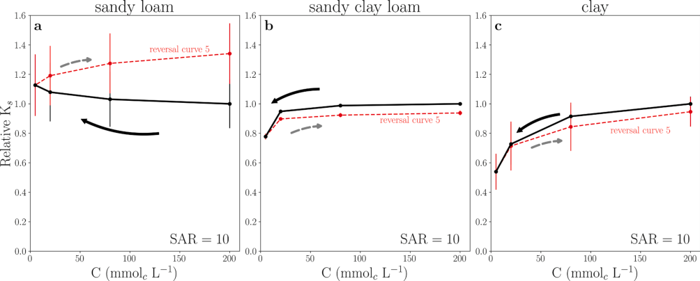
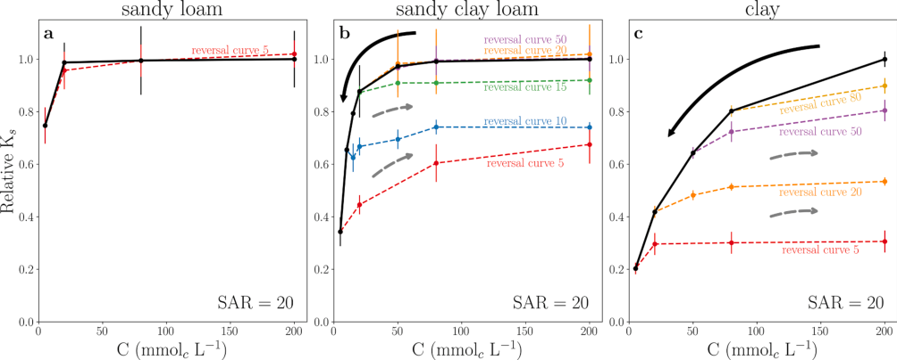
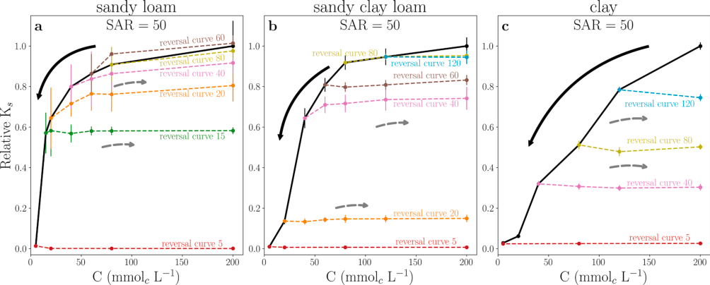
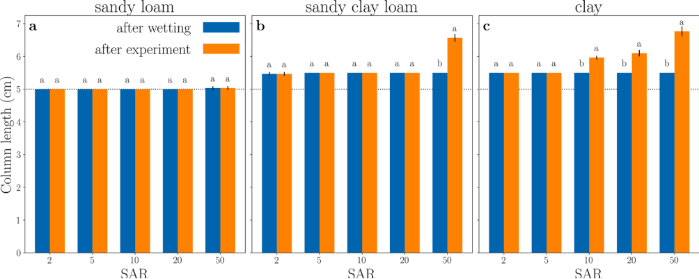
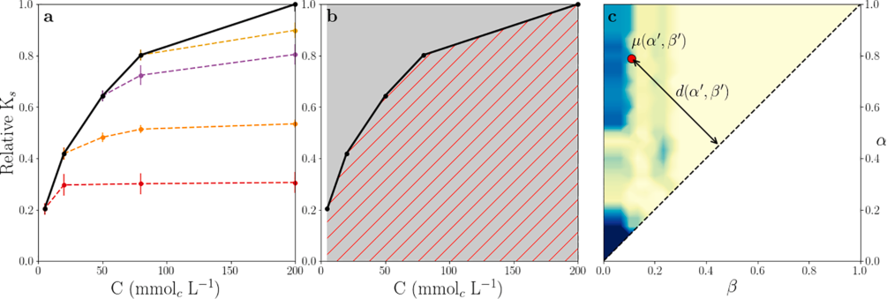
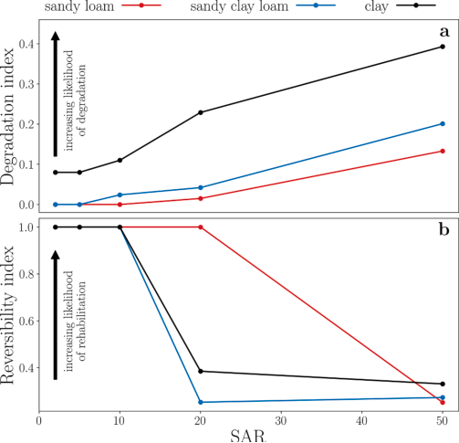

::: {.paper-authors}
Taiwo Adeyemo^a^, Isaac Kramer^a^, Guy J. Levy^b^, Yair Mau^a,\*^
:::

::: {.paper-affil}
^a^ Institute of Environmental Sciences, The Robert H. Smith Faculty of Agriculture, Food and Environment, The Hebrew University of Jerusalem, Rehovot, Israel &nbsp;&middot;&nbsp; ^b^ Institute of Soil, Water and Environmental Sciences, Agricultural Research Organization – Volcani Institute, Israel
:::

---

::: {.paper-meta}
Geoderma 413, 115765 &middot; 2022 &middot; doi: [10.1016/j.geoderma.2022.115765](https://doi.org/10.1016/j.geoderma.2022.115765)

Received 20 September 2021; revised 3 February 2022; accepted 6 February 2022

Correspondence: Yair Mau (yair.mau@mail.huji.ac.il)
:::

> **How to cite:** Adeyemo, T., Kramer, I., Levy, G.J. and Mau, Y. (2022). Salinity and sodicity can cause hysteresis in soil hydraulic conductivity. Geoderma, 413, 115765. https://doi.org/10.1016/j.geoderma.2022.115765

---

**Keywords:** Saturated hydraulic conductivity, Salinity, Sodicity, Hysteresis, Soil structure, Soil degradation

#### Abstract

Soil salinization and sodification can cause severe damage to soil structure, with important implications for irrigated agriculture. Knowledge of the extent to which degradation in soil structure due to salinization and sodification is reversible, however, is still lacking. The objective of our study is to examine how the history of solute composition affects the degree of reversibility in saturated hydraulic conductivity (Ksat). We systematically investigate the effects of salinity (electrolyte concentration) and sodicity (sodium adsorption ratio) on Ksat, for three soils of varying clay content. The soil column experiments yielded hysteresis graphs, in which Ksat does not go back to its original value after initial decay. We developed indices to quantify the degree of Ksat degradation and reversibility, and found that contrary to our expectations, high susceptibility to degradation does not always correlate with low capability to rehabilitate. Measurements of soil swelling helped us discern when degradation was mainly caused by swelling or clay dispersion. Our findings underscore the need for understanding hysteresis caused by salinity and sodicity, aiming at better management of agricultural soils for sustainable long-term use.

## 1. Introduction

Problems associated with sodic soils have long been recognized (e.g., special issue of the Australian Journal of Soil Research, vol. 31 no. 6, 1993; [Sumner and Naidu, 1998](#ref-sumner1998); [Levy 2012](#ref-levy2012a)) and are, unfortunately, expected to increase in the future. Yet, the ever increasing need to provide food to an expanding worldwide population, coupled with the increasing demand for good quality water from urban and industrial sectors, result in poorer quality water and soils (i.e., more sodic and saline) being used for food production. Consequently, improving our understanding of the combined impact of sodicity and salinity on agriculture and the soil ecosystem is essential to properly manage sodic soils for crop production and maintain sustainable agriculture worldwide. A recent review by [Hopmans et al. (2021)](#ref-hopmans2021) points out, however, that the current knowledge and understanding of the effects of sodicity and salinity on soil physical and hydraulic properties is still limited.

Two important parameters are generally used to define soil sodicity ([Levy 2012](#ref-levy2012a)). The first is the exchangeable sodium percentage (ESP, dimensionless) which describes the fraction of adsorbed sodium (Na~x~) from the cation exchange capacity (CEC) of the soil, and is defined as:

$$
\text{ESP} = 100\,\frac{\text{Na}_x}{\text{CEC}}. \tag{1}
$$

The second parameter indicates the sodicity level of the soil solution. It is termed sodium adsorption ratio (SAR) and is defined as:

$$
\text{SAR} = \frac{[\text{Na}]}{\sqrt{([\text{Ca}]+[\text{Mg}])/2}}, \tag{2}
$$

where the square brackets indicate cation concentration in mmol~c~ L^–1^. Thus, SAR has units of (mmol~c~ L^–1^)^1/2^.

To date there is no widely accepted definition of a sodic soil. It has been suggested that ESP of 15 should separate sodic from non-sodic soils ([USSL Staff, 1954](#ref-ussl1954); [McNeal and Coleman, 1966](#ref-mcneal1966a)), yet it was added that this limit must be regarded as somewhat arbitrary and tentative, and that the electrolyte concentration in the percolating solution must exceed 3 mmol~c~ L^–1^ in order for this ESP level to hold true. Later on, [Greene et al. (1978)](#ref-greene1978) proposed that the threshold value separating sodic from non-sodic soils should depend on soil texture; they proposed ESP values of 10 and 20 for fine and coarse textured soils, respectively. More recent hydraulic conductivity (HC) studies by [Mace and Amrhein (2001)](#ref-mace2001) and [Levy et al. (2005)](#ref-levy2005) for calcareous semi-arid soils indicated that soils with ESP greater than 5 exposed to solutions with electrolyte concentration (C) of 0.7 mmol~c~ L^–1^, should be considered as Na-affected (sodic) soils. The abovementioned discussion also highlights the importance of the interrelationship between the SAR and the C of the soil solution in dictating whether sodic or non-sodic behavior will be observed (see detailed discussion in section 4).

Colloidal clay determines much of the physical behavior of soils because of its large specific surface area and charge, which makes it very reactive in physicochemical processes and in particular swelling and dispersion (e.g., [Levy, 2012](#ref-levy2012a)). These two processes determine, to a large extent, soil microstructure ([Bennett et al., 2019](#ref-bennett2019)) and thus many of its hydraulic properties including saturated hydraulic conductivity. A comprehensive discussion of the processes involved in clay dispersion and swelling are presented by [Goldberg et al. (2012)](#ref-goldberg2012).

The realization that soil HC depends on both the SAR and the C of the percolating solution, led [Quirk and Schofield (1955)](#ref-quirk1955) to develop the "threshold concentration" concept, which was defined as the C required to prevent a decrease greater than 25% in the HC for a given soil ESP or SAR of the percolating solution. This concept explains observations of decreased HC even in Ca-soils and soils of low ESP, exposed to water of low salinity such as rain or snow water ([Emerson and Chi, 1977](#ref-emerson1977)). The observed decrease in HC was ascribed to salt concentration in the soil solution being insufficient to prevent clay swelling and dispersion ([Shainberg and Letey, 1984](#ref-shainberg1984)). The importance and dominance of clay swelling and dispersion in controlling the HC has been demonstrated in numerous studies (e.g., [McNeal et al., 1966](#ref-mcneal1966b); [Cass and Sumner, 1974](#ref-cass1974); [Radcliffe et al., 1987](#ref-radcliffe1987); [Dikinya et al., 2007](#ref-dikinya2007); [Bauder et al., 2008](#ref-bauder2008)). Moreover, the effect of swelling on HC has traditionally been deemed reversible: decreasing the C of the soil solution followed by an increase in the C leads to a decrease and subsequent increase in soil HC ([Shainberg and Letey, 1984](#ref-shainberg1984); [van Dijk et al., 2016](#ref-vandijk2016)). Conversely, when clay dispersion occurs, the dispersed clay particles can move through the soil profile and may even cause a complete blockage of conducting pores, and hence yield irreversible changes in HC ([Shainberg and Letey, 1984](#ref-shainberg1984)).

Although numerous studies have explored the relationship between electrolyte concentration, SAR, and their joint effect on soil HC, little research has focused on the extent to which changes in the HC of the soil are reversible under saline and sodic conditions. [McNeal and Coleman (1966)](#ref-mcneal1966a) reported that the decrease in saturated HC with a decrease in C and increasing SAR in montmorillonitic soils was largely irreversible even when high concentration calcium solutions were used; only soils containing more than 10% montmorillonite showed some reversibility. An increase in HC after an initial decrease, following leaching with solutions of known concentration and SAR, was noted only after the soil was dried and repacked ([Dane and Klute, 1977](#ref-dane1977)). Recently, [van der Zee et al. (2014)](#ref-vanderzee2014) stated that a decrease of saturated HC imposed by sodicity is practically irreversible at a time scale of decades.

The need to maintain sustainable irrigated agriculture in semi-arid and arid regions cannot be overstated. There is a large body of information on the combined adverse impact of sodicity and salinity on the degradation of soil HC. Yet, there are no systematic studies on possible hysteresis in saturated HC inflicted by salinity and sodicity. Hence, there are numerous questions that are left unanswered, such as: are there salinity and sodicity thresholds beyond which rehabilitation of HC is not possible? What role does soil texture play in this phenomenon? In order to fill, at least some of the gaps in our knowledge, we proposed to test the following hypotheses: (i) There are regions in the parameter space (C, SAR) where the degradation in saturated HC is reversible and there are others where it is irreversible or only partially reversible, and (ii) soils of different textures have different contour of regions in the parameter space where the HC hysteresis varies from total reversibility to total irreversibility. Consequently, the specific objective of our study was to examine the degree of reversibility in saturated HC through a systematic investigation of the effects of the history of solute composition (C, SAR) on the saturated HC of three different soils.

## 2. Materials and Methods

### 2.1. Soils

Three different non-sodic soils from Israel, varying in texture, were used for the experiment: a sandy loam from the Northern Negev, a sandy clay loam from Kiryat Gat, and a clay from Revadim. Soil samples from each soil type were collected from a depth > 50 cm to ensure that the samples contained limited amounts of organic matter, so that it would not markedly affect our study. The soil samples were brought to the laboratory, air-dried, passed through a 2 mm sieve, and stored in a cool place. Selected properties of the soils, determined using standard analytical methods ([Klute, 1986](#ref-klute1986); [Page et al., 1986](#ref-page1986)), are presented in Table 1.

**Table 1 | Selected properties of the three soil types used.**

| Site | Soil type | USDA Classification | Sand (%) | Silt (%) | Clay (%) | CEC (mmol~c~ kg^−1^) | ESP | CaCO₃ (%) | OC (%) | Hygroscopic Water (%) |
|---|---|---|---|---|---|---|---|---|---|---|
| Northern Negev | Sandy loam | Typic Haploxeralf | 72 | 18 | 10 | 7.67 | 2.04 | 12.8 | 0.06 | 1.95 |
| Kiryat Gat | Sandy clay loam | Typic Haploxerert | 50 | 25 | 25 | 19.61 | 1.07 | 16 | 0.39 | 3.99 |
| Revadim | Clay | Chromic Haploxerert | 25 | 30 | 45 | 29.88 | 0.70 | 11 | 0.97 | 5.42 |

Soil type is based on texture according to the US classification system; USDA Classification is based on the USDA Soil Taxonomy system; CEC = cation exchange capacity; ESP = exchangeable sodium percentage; OC = organic carbon.

### 2.2. Solutions Studied

For our experiment we used an array of solutions which comprised five different SAR levels, 2, 5, 10, 20 and 50 (mmol~c~ L^-1^)^1/2^ and four electrolyte concentrations, 5, 20, 80, and 200 mmol~c~ L^-1^. All together twenty solutions (5 SAR times 4 electrolyte concentrations), where the various combinations of electrolyte concentration and SAR were prepared using NaCl and CaCl~2~ salts. In what follows, SAR units will be omitted for simplicity's sake.

### 2.3. Saturated Hydraulic Conductivity Measurements

Saturated HC was determined in the laboratory using soil columns. Soil columns were prepared by packing 149.8 g of air-dried sieved soil (< 2.0 mm) into Perspex cylinders (5.4 cm internal diameter and 12 cm long) to a dry bulk density of 1.3 g cm^−3^. The bottom of each cylinder was closed with a rubber stopper with a single drilled hole which served as an exit for the leachate. The upper side of the stopper was lined with a geotextile (geotex) fiber that served as a filter for the soil. Another layer of geotex fibre was added to the top of the packed soil.

The soil columns were initially wetted from the bottom with a solution of a given SAR and high concentration of 200 mmol~c~ L^-1^ through capillary rise (using a Mariotte bottle) at a slow rate to avoid entrapment of air and aggregate slaking. After reaching saturation, the columns were wrapped with aluminum foil to avoid algae proliferation, aimed at reducing any changes in saturated hydraulic conductivity not caused by the treatment studied. Thereafter, flow rate was reversed, and the columns were leached from the top with a given solution using a constant head device (Mariotte bottle) of 34.5 cm.

The leachate was collected continuously over fixed time intervals that depended on the rate of leachate outflow, using tubes. Cumulative water volume (V, mL) was monitored over time (t, min), providing data (together with soil column length [L, cm], hydraulic head [ΔH, cm] and column cross sectional area [A, cm²]) necessary to calculate the saturated HC (Ksat, cm h^−1^), using Darcy's law:

$$
K_{\text{sat}} = \frac{V \cdot L}{A \cdot t \cdot \Delta H}. \tag{3}
$$

### 2.4. Experimental Setup

The soil columns were leached with solutions of a given fixed SAR and a successively decreasing electrolyte concentration, starting with a concentrated solution of 200 mmol~c~ L^-1^ and ending with a dilute solution of 5 mmol~c~ L^-1^. The switch from a concentrated to a more dilute solution took place when the following equilibrium conditions were attained: (i) the flow rate of the leachate volume collected over consecutive intervals was steady, and (ii) the measured EC (an expression for C) of and the Na concentration in the leachate were similar to those in the leaching solution placed in the Mariotte bottle. Switching of the leaching solutions was done carefully to avoid (i) air bubbles entering the system and (ii) sudden changes in the pressure formed in the system, that could adversely affect the Ksat measurements during the switch ([Moutier et al., 1998](#ref-moutier1998)).

Along the Ksat degradation curve with decreasing C, we selected several points where the trend was reversed to increasing C values. These curves are called reversal curves, and they help us check the system's capability of returning to the original Ksat values after degradation has set in. All measurements were carried out in three replicates.

In addition, to determine possible swelling of the soil, the height of the packed soil in each column was measured (i) immediately after dry packing (DP), (ii) after wetting (AW) and (iii) at the end of the leaching experiment (ALE), i.e., after completing a whole cycle of leaching from a concentrated (200 mmol~c~ L^-1^) to more dilute C solutions and back again to the concentrated solution.

### 2.5. Degradation and Reversibility Indices

To quantitatively compare the response of the three soils to changes in salinity and sodicity, we introduce degradation and reversibility indices.

Our degradation index measures the degree at which a soil's Ksat is prone to decay upon a monotonic decrease in C. It ranges from 0 to 1, where 1 means maximal susceptibility to degradation, and 0 denotes no degradation whatsoever.

The reversibility index is drawn from our recent developments in the modelling of Ksat hysteresis ([Kramer et al., 2021](#ref-kramer2021)). These authors used the concept of weight functions to fully encapsulate soil-specific Ksat response to changes in salinity and sodicity. Kramer et al. (2021) then introduced weight functions to calculate the reversibility index of each soil by measuring how the soil responds to Ksat degradation; an index of 1 indicates that the soil has complete capability of rehabilitating, while an index of 0 denotes that any degradation is completely irreversible. This index can be useful to quantify differences in Ksat behavior between soils of various textures, or even the response of the same soil to different SAR levels.

The calculation of these indices is presented in greater detail in Section 3.3, after we show all the hysteresis curves in Section 3.1. We will show a practical example of how the degradation and reversibility indices are calculated, and we will then compare the indices obtained for all soils and discuss the implications of the results.

### 2.6. Statistical Analyses

Significant differences between average Ksat values for the reversal and degradation curves were evaluated from p-values obtained from Welch's unequal variances *t*-test. Analysis of variance (ANOVA) and Tukey's HSD test (*p* < 0.05) were used to verify significant differences in clay swelling across all three soils resulting from the different SAR and C treatments.

## 3. Results

### 3.1. Hysteresis in Saturated Hydraulic Conductivity (Ksat)

The curves for Ksat vs C for SAR 2 and 5 showed either no hysteresis or even an increase in Ksat during the course of decreasing C, followed by an additional increase in Ksat during the subsequent course of increasing C (Figs. S1 and S2, Supplementary Material). It is evident that the response of Ksat to these SAR levels is not typical to sodic soils, therefore, from here onwards we will focus on the results obtained for SAR 10, 20 and 50.

Figure 1 shows the relative Ksat response to a decrease and subsequent increase in C for the three soils, when leaching with solution of SAR 10. Relative Ksat is the measured saturated hydraulic conductivity normalized by the Ksat value of the first measurement, namely, the rightmost data point in each solid black curve. The sandy loam Ksat was not significantly affected by stepwise decreases in the C of the leaching solution from 200 mmol~c~ L^-1^ (Ksat = 5.5 ± 0.9 cm h^−1^) to a concentration of 5 mmol~c~ L^-1^ (Ksat = 6.1 ± 1.1 cm h^−1^). Moreover, a subsequent stepwise increase in C back to a concentration of 200 mmol~c~ L^-1^ led to a gradual increase in Ksat to 7.4 ± 1.1 cm h^−1^ (Fig. 1a). This type of hysteresis was contrary to our expectations. In the sandy clay loam and clay soils, a relatively thin hysteresis loop in the Ksat values was noted between the course of decreasing C and the subsequent increase in C (Fig. 1b,c). However, Ksat in the clay soil seemed more sensitive to the reduction in C, decreasing 46% (p = 0.05) from 0.43 ± 0.02 to 0.23 ± 0.05 cm h^−1^ with the reduction in C from 200 to 5 mmol~c~ L^-1^, respectively, compared with the observed milder decrease of 22% (p = 2.2 × 10^-3^) in the sandy clay loam (Fig. 1b,c).

**Fig. 1 | Hysteresis curves for the (a) sandy loam, (b) sandy clay loam, and (c) clay soils, leached with SAR = 10 solutions.** Measurements start at the rightmost data point in the solid black curve and follow the arrows. Reversal curves start at the leftmost data point of the dashed lines (5 mmol~c~ L^-1^) and follow the dashed arrow. Bars indicate standard deviation.

Leaching the sandy loam with SAR 20 solutions of different concentrations did not yield any hysteresis. In addition, Ksat remained unchanged through the leaching except for the leaching with the 5 mmol~c~ L^-1^ solution, which led to a significant decrease (25%, p = 0.13) in Ksat (Fig. 2a).

Full hysteresis graphs were noted for the sandy clay loam and the clay soils, following initial Ksat degradation with decreasing C (Fig. 2b, c). By 'hysteresis graph' we denote the degradation curve (in black), together with all the reversal curves measured. The sandy clay loam (Fig. 2b) experienced Ksat reductions for C values below 50 mmol~c~ L^-1^. Complete reversibility existed for C dilutions down to 20 mmol~c~ L^-1^, i.e., the reversal curves for 50 and 20 mmol~c~ L^-1^ backtracked the degradation curve. Conversely, the reversal curves for 15, 10, and 5 mmol~c~ L^-1^ could not retrace the degradation curve, thus characterizing hysteresis. For these curves, a partial increase in Ksat took place, with diminishing returns as C was increased during the reversal process. It is worth noting that a small concentration difference separates total reversibility in Ksat (reversal curve 20), and partial reversibility (reversal curve 15).

The clay soil (Fig. 2c) is more sensitive to degradation, experiencing significant Ksat reductions from the onset of concentration decrease. All reversal curves show partial Ksat reversibility, with lower degrees of reversibility as more pronounced degradation took place. This observation implies that the greater the initial decrease in Ksat, the harder it is to increase it upon reversal in concentration trends.

**Fig. 2 | Hysteresis curves for the (a) sandy loam, (b) sandy clay loam, and (c) clay soils leached with SAR = 20 solutions.** Measurements start at the rightmost data point in the solid black curve and follow the solid line arrows. Reversal curves, where the trend in concentration change was shifted from decrease to increase, are marked by colored dashed curves, and follow the dashed arrows. The legend next to each dashed line indicates the concentration at which the reversal curve started. Bars indicate standard deviation.

Leaching the three soils with the SAR 50 solutions resulted in a sharp decrease in Ksat during the decrease in solution C, which led to relative Ksat values of close to zero, i.e., a near complete blockage of the soil column (reversal curve 5 in all panels of Fig. 3). In the case of the sandy loam and sandy clay loam (Fig. 3a,b) a sharper reduction in Ksat took place only once a threshold C level of 40 and 60 mmol~c~ L^-1^, respectively, was reached. Unlike the two loamy-textured soils, Ksat in the clay soil exhibited a nearly linear decrease from the outset of concentration decrease (Fig. 3c).

We found that the hysteretic behavior in Ksat varies widely among these three soils. The sandy loam showed regions of (i) complete Ksat reversibility (reversal curves 80 and 60 backtrack the solid black curve), (ii) partial reversibility (reversal curves 40 and 20 go up, but do not reach the initial Ksat value), and (iii) complete irreversibility (reversal curves 15 and 5 are horizontal, showing no Ksat rehabilitation). Once more, small differences in the degree of Ksat degradation can lead to very different results, e.g., reversal curve 20 was able to go back to 80% (p = 3.7 × 10^-3^) of the original Ksat value, while reversal curve 15 never rehabilitated, staying at 58% (p = 1.2 × 10^-2^) of the initial Ksat.

Both the sandy clay loam and the clay showed either very low Ksat reversibility or complete irreversibility (Fig. 3b,c). All the reversal curves are roughly horizontal, indicating no capability of regaining hydraulic conductivity, even for very high concentrations.

A full account of the significance of Ksat reduction between the beginning of the experiments (rightmost point in the degradation curve, at C = 200 mmol~c~ L^-1^) and the end of each treatment (rightmost point in the degradation curves, at C = 200 mmol~c~ L^-1^) is presented in Tables S1 to S3 in the Supplementary Material. These tables report the p-values for the data shown in Figs. 1 to 3 above.

**Fig. 3 | Hysteresis curves for the (a) sandy loam, (b) sandy clay loam, and (c) clay soils leached with SAR = 50 solutions.** Measurements start at the rightmost data point in the solid black curve and follow the solid line arrows. Reversal curves, where the trend in concentration change was shifted from decrease to increase, are marked by colored dashed curves, and follow the dashed arrows. The legend next to each dashed line indicates the concentration at which the reversal curve started. Bars indicate standard deviation.

### 3.2. Soil Swelling

The increase in height of the soils packed in the columns after (1) wetting (i.e., for a C concentration of 200 mmol~c~ L^-1^, AW), and (2) at the end of the leaching experiment (also for a C concentration of 200 mmol~c~ L^-1^, ALE), relative to the height of the packed dry soil (5 cm), was used as a proxy for evaluating soil clay swelling under the various SAR solutions studied. The results are shown in Fig. 4. No significant increase in soil height, compared with the dry soils, was noted in the columns of the sandy loam at any of the two aforementioned stages (panel a), irrespective of the SAR treatment. In the sandy clay loam (panel b), similar and significant increases in height, relative to the dry soil, were noted in soil columns leached with SAR 2, 5, 10 and 20 for both stages 1 and 2. In the columns leached with SAR 50, the increase in height at stage 2 was significantly greater than that at stage 1. In the clayey soil (panel c), significant differences in the increase in height of the soil in the columns between stage 1 and stage 2 were noted for SAR 10, 20 and 50. For SAR 2 and 5 the increase in height was similar for the two stages but significantly higher than that in the dry soil. Evidently, significant degrees of swelling, that depended on both the SAR of the leaching solution and soil type, took place in the soil columns during the experiment.

**Fig. 4 | Mean swelling response of the (a) sandy loam, (b) sandy clay loam, (c) clay, to the various SAR treatments after wetting (AW) and after the leaching experiment (ALE).** Within a given SAR, columns labeled by the same letter do not differ significantly at p < 0.05.

### 3.3. Degradation and Reversibility Indices

The degradation and reversibility indices are calculated from the hysteresis curves. Beginning with the degradation index, Fig. 5a shows the hysteresis diagram obtained for the clay soil at SAR 20 (previously seen in Fig. 2c). The solid black curve denotes the degradation curve, namely how Ksat responds to decreases in concentration, starting from C = 200 mmol~c~ L^-1^. This same curve is shown in Fig. 5b, where the region below it is hatched with red lines. If the soil were to experience no decrease in saturated hydraulic conductivity, then the curve for Ksat would be a horizontal line at relative Ksat = 1.0. The region below this horizontal line is shaded in gray in Fig. 5b. We define the degradation index (DI) as:

$$
\text{DI} = 1 - \frac{\int_{C_{\min}}^{C_{\max}} k(C)\, dC}{(C_{\max} - C_{\min})\, k(C_{\max})}, \tag{4}
$$

where k(C) is the degradation curve in black, and $C_{\max}$, $C_{\min}$ are the maximum and minimum values of C. The numerator in Eq. (4) is the area hatched with red lines, while the denominator is the area shaded in gray. The two areas coincide (i.e., degradation index is 0) when Ksat does not degrade with decreasing C. The earlier and more pronounced the degradation, the smaller the hatched area with respect to the gray area, and therefore the degradation index will increase, with one as the highest value for immediate and complete Ksat degradation.

The calculation of the reversibility index is more convoluted, as it is based on weight functions, $\mu(\alpha,\beta)$, first introduced in the context of irreversible Ksat degradation by [Kramer et al. (2021)](#ref-kramer2021). We provide here a short description of the weight function and its importance, and for a full account the reader is referred to the aforementioned paper.

Any hysteresis graph, such as the one in Fig. 5a, can be fully described by a weight function, $\mu(\alpha,\beta)$. The variables $\alpha$ and $\beta$ represent the concentration of the solution, C, when it is initially decreased ($\beta$) and subsequently increased ($\alpha$). The weights in $\mu(\alpha,\beta)$ are distributed in a right triangle in the ($\alpha,\beta$) plane, as seen in Fig. 5c. It is recommended to calculate a weight function based on a hysteresis graph with at least four or five reversal curves ([Kramer et al., 2021](#ref-kramer2021)). Hysteresis loops become thinner as the concentration of weights approaches the dashed diagonal line. In the limit where all the weights are on the diagonal, the hysteresis loop collapses into a straight line, such that any degradation is fully reversible, because the reversal curves fall exactly on the degradation curve. As weights are concentrated farther from the diagonal, the hysteresis loop gets thicker, meaning that the reversal curves will be further away from the degradation curve, exhibiting a lower degree of reversibility. The reversibility index (RI) is, therefore, defined as one minus the sum of all weights in $\mu(\alpha,\beta)$, themselves weighted (multiplied) by their distance to the diagonal ($d$, marked with an arrow in Fig. 5c), as follows:

$$
\text{RI} = 1 - \frac{\sqrt{2}\; I[\mu(\alpha,\beta)\,D(\alpha,\beta)]}{C_{\max}\; I[\mu(\alpha,\beta)]}, \tag{5}
$$

The function $I$ denotes the integral over the weight triangle as follows:

$$
I[\mu(\alpha,\beta)] = \int_0^{C_{\max}}\!\!\int_0^{\alpha} d\alpha\, d\beta\; \mu(\alpha,\beta), \tag{6}
$$

and

$$
D(\alpha,\beta) = \frac{\alpha-\beta}{\sqrt{2}} \tag{7}
$$

is the Euclidean distance of a point ($\alpha,\beta$) to the diagonal $\alpha=\beta$. A reversibility index of 1 means a collapsed hysteresis loop, or total reversibility in Ksat. A reversibility index of 0 means that the hysteresis loop is as wide as possible, and there is no reversibility in Ksat whatsoever.

**Fig. 5 | The constituents necessary for calculating the degradation and reversibility indices.** Panel a shows hysteresis curves, with the degradation curve in solid black and reversal curves in dashed lines. Panel b shows the two areas necessary to calculate the degradation index. Panel c depicts the weight function $\mu(\alpha,\beta)$ corresponding to the hysteresis curves in panel a, where the distance $d(\alpha',\beta')$ of the diagonal line to given point $\mu(\alpha',\beta')$ (in red) is shown. Lighter (darker) shades indicate lower (higher) values of $\mu(\alpha,\beta)$.

With those tools in hand, we can start quantitatively comparing the soils we measured. It is important to emphasize that both the degradation and the reversibility indices are not absolute measures of a soil, but useful tools to compare the behavior of soils measured under the same experimental conditions.

Figure 6 shows the degradation index (panel a) and the reversibility index (panel b) for the three soils, as a function of SAR. As expected, soil susceptibility to degradation increases with SAR, and larger clay content is associated with greater susceptibility. Our novel reversibility experiments revealed an interesting phenomenon whereby the degree of reversibility decreases with the increase in SAR (Fig. 6b). Yet, higher clay content does not necessarily mean lesser degree of reversibility. Moreover, there is no clear relationship between a soil's degradation index and its reversibility index. For instance, at SAR 20, the sandy loam (red curve) and the sandy clay loam (blue curve) have very similar degradation indices (0.015 and 0.042, respectively), but the sandy clay loam's reversibility index is much smaller (0.253) than that of the sandy loam (1.000). In fact, the reversibility index of the sandy clay loam is even smaller than that of the clay (0.385, in black), although the clay content in the latter is much higher.

**Fig. 6 | Degradation and Reversibility indices as a function of SAR for the three soils.**

We hypothesize that susceptibility to degradation or rehabilitation does not directly translate into real risks of irreversible soil degradation. As suggested by [Kramer and Mau (2020)](#ref-kramer2020), it is the interaction between intrinsic soil properties (e.g., soil texture), management decisions (irrigation water quality and scheduling, etc.) and rainfall regime that produces the actual response of the system, and therefore its associated risks. The results shown here underscore the need to further investigate Ksat reversibility, as our understanding of the mechanisms controlling it is still insufficient.

## 4. Discussion

The hysteresis graphs (Figs. 1-3), soil swelling (Fig. 4) and the degradation index (Fig. 6a) show a clear and known picture, namely soils are affected by sodicity, and more specifically, soils with a higher clay content are more susceptible to degradation by sodicity than coarse textured ones. More interestingly, the same hysteresis graphs reveal that Ksat rehabilitation is highly dependent on the leaching history of the soil. The rehabilitation is soil specific and depends on the regions in the (C, SAR) parameter space, as shown by reversal curves with varying degrees of reversibility, from complete reversibility to total irreversibility.

Our working assumption is that clay swelling and dispersion are the two main processes that control changes in Ksat following exposure to the (C, SAR) parameter space ([Shainberg and Letey, 1984](#ref-shainberg1984)). Comparing the relative Ksat curves with the swelling data may elucidate the (C, SAR) parameter space conditions under which swelling is the main cause for changes in Ksat and those where dispersion is the main cause. For instance, in the sandy loam (10% clay), the lack of change in Ksat for SAR 10 (Fig. 1a) and for SAR 20 up to C concentration of 10 mmol~c~ L^-1^ (Fig. 2a), is in agreement with the absence of swelling (Fig. 4). Conversely, although no swelling was noted in this soil for SAR 20, a drop in Ksat during stage 1 of the experiment (i.e., stepwise dilution of the leaching solution) when changing from 10 to 5 mmol~c~ L^-1^ solution, followed by a complete reversibility in Ksat during stage 2 (i.e., stepwise increase in the leaching solution concentration), was observed. This is a clear indication that clay swelling during stage 1 and subsequent shrinkage during stage 2 were the mechanisms controlling Ksat in this case. Yet, the hysteresis in the Ksat curves with SAR 50 solutions of 40, 20 and 15 mmol~c~ L^-1^ (Fig. 3a), is ascribed to clay dispersion, that has taken place under such high sodicity level, as no swelling was observed under these conditions (Fig. 4).

Similar argumentation can be used to explain the mechanisms that control the absence or existence of hysteresis in the Ksat in the sandy clay loam (25% clay) and clay (40% clay) soils. Our results suggest that the weight of clay dispersion, relative to that of swelling, in determining the reversibility in Ksat under the studied (C, SAR) parameter space, increases with increase in clay content.

Our results provide solid proof to the fact that even small variations in the parameter space may yield stark differences regarding the ability of a soil to rehabilitate. For instance, after the sandy clay loam has been leached with low concentrations of 10, 15, and 20 mmol~c~ L^-1^ (Fig. 2b), its relative Ksat increased to 0.74, 0.91, and 1.02 (respectively), upon an increase in concentration. These observations suggest that a relatively small concentration difference of 10 mmol~c~ L^-1^ can make a difference between full rehabilitation and a 26% irreversible decrease in Ksat. A similar picture exists for the sandy loam (Fig. 3a), where degradation at concentration of 15 and 20 mmol~c~ L^-1^ could only rehabilitate to relative Ksat of 0.58 and 0.80, respectively. It can be concluded that the impacts of swelling and dispersion on soil clays, as expressed by changes in Ksat, are very sensitive to small changes in the (C, SAR) parameter space.

As revealed by the reversal curves, there are many ways in which a soil can respond to an increase in C following an initial degradation in Ksat. We classified specific reversal curves by their degree of reversibility, and also characterized the soils using full hysteresis graphs, composed of many reversal curves. A hysteresis graph can be fully characterized by weight functions ([Kramer et al., 2021](#ref-kramer2021)), that comprehensively capture the response of a soil to any increase or decrease in soil salinity. From the weight functions and the degradation curve, we were able to derive useful metrics to quantify a soil's susceptibility to degradation (the degradation index, Fig. 6a), and the ability of a soil to rehabilitate (the reversibility index, Fig. 6b). Our results show that the degradation trends of soils associated with clay contents (and thus texture), as was specifically noted from the swelling measurements, do not determine the degree of reversibility of a soil. This is because the degree of reversibility is controlled by the magnitude of clay dispersion, rather than swelling.

In principle, soils can be found in any region of the space defined by the reversibility and rehabilitation indices. Put simply, we just cannot naively assume that because a soil degrades easily, it will be resistant to rehabilitation. Nor can we say that because a soil does not degrade easily, it will exhibit straight forward rehabilitation. All scenarios are possible. For example, Fig. 6 shows conditions in which a soil has a high susceptibility to degradation and low rehabilitation capabilities (e.g., the clay soil at SAR 20). Let us call this a (high, low) point in the (degradation, rehabilitation) space. The clay soil at SAR 10, in turn, can be described as a (high, high) point, while the sandy clay loam at SAR 20 is a (low, low) point, and the sandy loam at SAR 20 is a (low, high) point. Measuring how a soil's history of salinity and sodicity affects its structure is therefore crucial for devising informed irrigation practices aiming at maintaining healthy soils. [Kramer et al. (2022)](#ref-kramer2022b) explore the role of differential degrees of degradation and reversibility on the dynamics of Ksat, for soils subjected to treated wastewater irrigation and stochastic rainfall. Their findings underscore the crucial effects of Ksat hysteresis when considering the risk of long-term soil degradation.

## 5. Conclusions

Our results confirm both the first and the second aforementioned hypotheses, with the qualification that the effects of salinity and sodicity and the interactions between them are more complex than we first thought. Our findings indicate that soils could have any combination of high/low susceptibility to degradation and ability to rehabilitate under the (C, SAR) parameter space. The degradation and rehabilitation indices are useful tools to quantitatively compare the behavior of different soils, or even a same soil under varying environmental conditions.

In this study, we have dealt only with the case of solutions with constant SAR, and we varied the soil water concentration. Under realistic conditions, both the salinity and sodicity could change at the same time. Again, Kramer et al. (2021) developed the conceptual framework to make sense of concomitant changes in salinity and sodicity. In order to characterize the response of a soil to salinity and sodicity to a fuller extent, an extra set of experiments is warranted, that measures Ksat for solutions of constant C and varying SAR. Although these experiments are labor intensive, we believe that the information they yield is critical to enhance our understanding of the important phenomenon of Ksat hysteresis. We hope that highlighting the existence and relevance of hysteresis in Ksat for sustainable use of soils, would resonate with the community, and support further studies towards promoting management practices aimed at obtaining healthier soils.

## Declaration of Competing Interest

The authors declare that they have no known competing financial interests or personal relationships that could have appeared to influence the work reported in this paper.

## Acknowledgment

We would like to thank Nimrod Schwartz for useful discussions.

## Supplementary Information

This article's Supplementary Material (Figs. S1–S2 and Tables S1–S3, referenced above) is hosted externally by the publisher and was not available to include inline here. See the [publisher's page](https://doi.org/10.1016/j.geoderma.2022.115765) for the supplementary data.

## References

[Bauder et al., 2008]{#ref-bauder2008} Bauder, J.W., Hershberger, K.R., Browning, L.S., 2008. Soil solution and exchange complex response to repeated wetting–drying with modestly saline–sodic water. Irrig. Sci. 26 (2), 121–130.

[Bennett et al., 2019]{#ref-bennett2019} Bennett, J.M., Marchuk, A., Marchuk, S., Raine, S.R., 2019. Towards predicting the soil-specific threshold electrolyte concentration of soil as a reduction in saturated hydraulic conductivity: The role of clay net negative charge. Geoderma 337, 122–131.

[Cass and Sumner, 1974]{#ref-cass1974} Cass, A., Sumner, M.E., 1974. Use of gypsum and high salt water in reclamation of sodic soil. Trans. 10th Int. Congr. Soil Sci. 10, 118–127.

[Dane and Klute, 1977]{#ref-dane1977} Dane, J.H., Klute, A., 1977. Salt Effects on the Hydraulic Properties of a Swelling Soil. Soil Sci. Soc. Am. J. 41, 1043–1049.

[Dikinya et al., 2007]{#ref-dikinya2007} Dikinya, O., Hinz, C., Aylmore, G., 2007. Influence of sodium adsorption ratio on sodium and calcium breakthrough curves and hydraulic conductivity in soil columns. Aust. J. Soil Res. 45 (8), 586.

[Emerson and Chi, 1977]{#ref-emerson1977} Emerson, W.W., Chi, C.L., 1977. Exchangeable Ca, Mg and Na and the dispersion of illites. II. Dispersion of illites in water. Aust. J. Soil Res. 15, 255–263.

[Goldberg et al., 2012]{#ref-goldberg2012} Goldberg, S., Lebron, I., Seaman, J.C., Suarez, D.L., 2012. Soil colloidal behavior. pp. 15-1 to 15-39. In: Huang, M.P., Li, Y., Sumner, M.E. (Eds.), Handbook of Soil Sciences: properties and processes (2nd edition). CRC Press, Boca Raton, FL.

[Greene et al., 1978]{#ref-greene1978} Greene, R.S.B., Posner, A.M., Quirk, J.P., 1978. A study of the coagulation of montmorillonite and illite suspensions by CaCl₂ using the electron microscope. In: Emerson, W.W., Bond, R.D., Dexter, A.R. (Eds.), Modification of soil structure. John Wiley and Sons, New York, NY, pp. 35–40.

[Hopmans et al., 2021]{#ref-hopmans2021} Hopmans, J.W., Qureshi, A.S., Kisekka, I., Munns, R., Grattan, S.R., Rengasamy, P., Ben-Gal, A., Assouline, S., Javaux, M., Minhas, P.S., Raats, P.A.C., Skaggs, T.H., Wang, G., De Jong, Q., van Lier, H., Jiao, R.S., Lavado, N., Lazarovitch, B.L., Taleisnik, E., 2021. Critical knowledge gaps and research priorities in global soil salinity. Adv. Agron.

[Klute, 1986]{#ref-klute1986} Klute A (ed). 1986. Methods of soil analysis. Part 1, 2nd edn, Agronomy Monograph 9. ASA and SSSA: Madison, WI.

[Kramer and Mau, 2020]{#ref-kramer2020} Kramer, I., Mau, Y., 2020. Soil Degradation Risks Assessed by the SOTE Model for Salinity and Sodicity. Water Resour. Res. 56 (10).

[Kramer et al., 2021]{#ref-kramer2021} Kramer, I., Bayer, Y., Adeyemo, T., Mau, Y., 2021. Hysteresis in soil hydraulic conductivity as driven by salinity and sodicity–a modeling framework. Hydrol. Earth Syst. Sci. 25 (4), 1993–2008.

[Kramer et al., 2022]{#ref-kramer2022b} Kramer, I., Bayer, Y., Mau, Y., 2022. The Sustainability of Treated Wastewater Irrigation: The Impact of Hysteresis on Saturated Soil Hydraulic Conductivity. Water Resour. Res.

[Levy, 2012]{#ref-levy2012a} Levy, G.J. 2012. Sodicity. pp. 18-1 to 18-28. In: Huang, M.P., Li, Y. and Sumner, M.E. (eds.). Handbook of Soil Sciences: resource management and environmental impacts (2nd edition). CRC Press, Boca Raton, FL.

[Levy et al., 2005]{#ref-levy2005} Levy, G.J., Goldstein, D., Mamedov, A.I., 2005. Saturated hydraulic conductivity of semi-arid soils: Combined effects of salinity, sodicity and rate of wetting. Soil Sci. Soc. Am. J. 69, 653–662.

[Mace and Amrhein, 2001]{#ref-mace2001} Mace, J.E., Amrhein, C., 2001. Leaching and reclamation of a soil irrigated with moderate SAR waters. Soil Sci. Soc. Am. J. 65 (1), 199–204.

[McNeal and Coleman, 1966]{#ref-mcneal1966a} McNeal, B.L., Coleman, N.T., 1966. Effect of solution composition on soil hydraulic conductivity. Soil Sci. Soc. Am. Proc. 30 (3), 308–312.

[McNeal et al., 1966]{#ref-mcneal1966b} McNeal, B.L., Norvell, W.A., Coleman, N.T., 1966. Effect of solution composition on soil hydraulic conductivity and on the swelling of extracted soil clays. Soil Sci. Soc. Am. Proc. 30, 308–315.

[Moutier et al., 1998]{#ref-moutier1998} Moutier, M., Shainberg, I., Levy, G.J., 1998. Effects of hydraulic pressure gradient, aging and water quality on the permeability of a vertisol. Soil Sci. Soc. Am. J. 62, 1488–1496.

[Page et al., 1986]{#ref-page1986} Page AL, Miller RH, Keeney DR (Eds.). 1986. Methods of soil analysis. Part 2, 2nd edn. Agronomy Monograph 9. ASA and SSSA, Madison, WI.

[Quirk and Schofield, 1955]{#ref-quirk1955} Quirk, J.P., Schofield, R.K., 1955. The effect of electrolyte concentration on soil permeability. J. Soil Sci. 6 (2), 163–178.

[Radcliffe et al., 1987]{#ref-radcliffe1987} Radcliffe, D.E., Miller, W.P., Chiang, S.C. 1987. Effect of soil dispersion on surface run-off in Southern Piedmont soils. pp. 1–28. Environmental Resource Center, Georgia Institute of Technology, Atlanta, GA.

[Shainberg and Letey, 1984]{#ref-shainberg1984} Shainberg, I., Letey, J., 1984. Response of soils to sodic and saline conditions. Hilgardia 52 (2), 1–57.

[Sumner and Naidu, 1998]{#ref-sumner1998} Sumner, M.E., Naidu, R., 1998. Sodic soils. Oxford University Press, New York, NY.

[USSL Staff, 1954]{#ref-ussl1954} USSL Staff. 1954. Diagnosis and Improvement of saline and alkali soils. Agric. Handb. 60. USDA, Washington, DC.

[van der Zee et al., 2014]{#ref-vanderzee2014} van der Zee, S.E.A.T.M., Shah, S.H.H., Vervoort, R.W., 2014. Root zone salinity and sodicity under seasonal rainfall due to feedback of decreasing hydraulic conductivity. Water Resour. Res. 50, 9432–9446.

[van Dijk et al., 2016]{#ref-vandijk2016} van Dijk, G., Nijp, J.J., Metselaar, K., Lamers, L.P.M., Smolders, A.J.P., 2016. Salinity-induced increase of the hydraulic conductivity in the hyporheic zone of coastal wetlands. Hydrological Processes 31 (4), 1–9.
