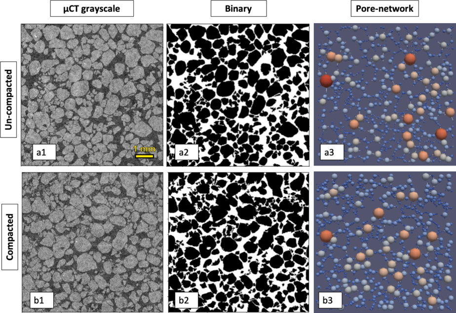
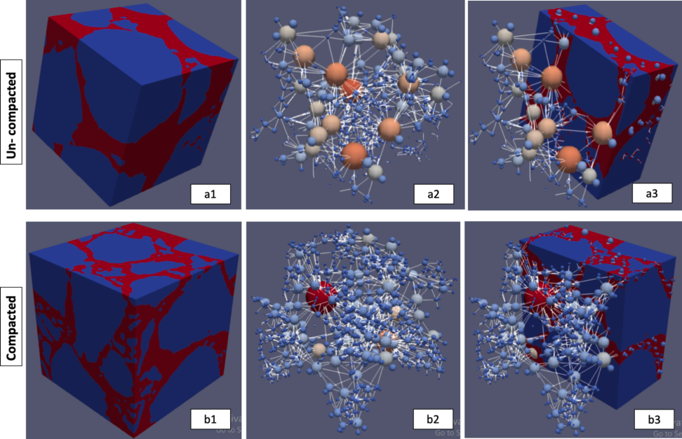
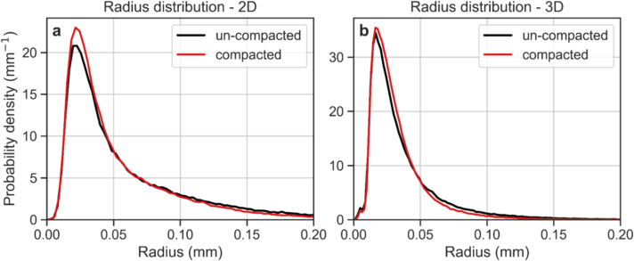
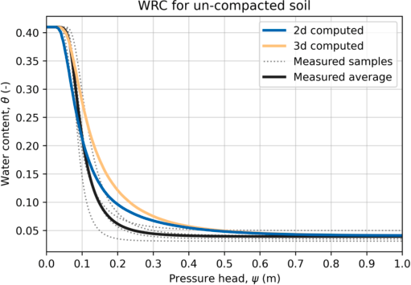
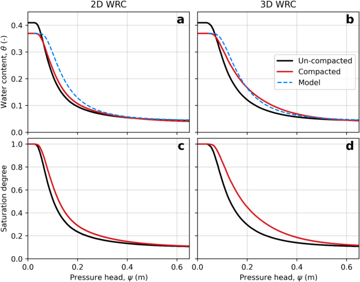
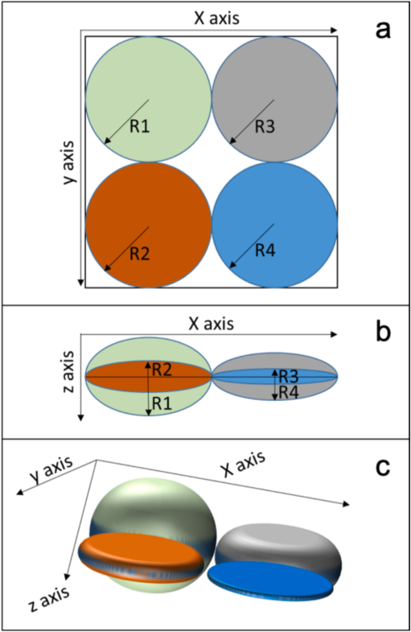

::: {.paper-authors}
Nurit Goldberg-Yehuda^a,b^, Uri Nachshon^b^, Shmuel Assouline^b^, Yair Mau^a,\*^
:::

::: {.paper-affil}
^a^ Institute of Environmental Sciences, The Robert H. Smith Faculty of Agriculture, Food and Environment, The Hebrew University of Jerusalem, Rehovot, Israel &nbsp;&middot;&nbsp; ^b^ Institute of Soil, Water and Environmental Sciences, Agricultural Research Organization – Volcani Institute, Rishon Lezion, Israel
:::

---

::: {.paper-meta}
Catena 242, 108068 &middot; 2024 &middot; doi: [10.1016/j.catena.2024.108068](https://doi.org/10.1016/j.catena.2024.108068)

Received 24 December 2023; revised 18 March 2024; accepted 26 April 2024

Correspondence: Yair Mau (yair.mau@mail.huji.ac.il)
:::

> **How to cite:** Goldberg-Yehuda, N., Nachshon, U., Assouline, S. and Mau, Y. (2024). The effect of mechanical compaction on the soil water retention curve: Insights from a rapid image analysis of micro-CT scanning. Catena, 242, 108068. https://doi.org/10.1016/j.catena.2024.108068

---

**Keywords:** Soil compaction, Water retention, Image analysis, Micro-CT, Void-size distribution

#### Abstract

Soil hydrological and agricultural properties are highly affected by the soil water retention characteristics, which are closely related to the void size distribution and structure of the soil. Agricultural lands are often faced with the challenge of soil compaction, which alters the size, shape, connectivity, and morphology of soil voids. To determine the water retention curve and other hydrological and agricultural functions of un-compacted and compacted sandy soils, we used micro-CT techniques and image analysis procedures in both two and three dimensions. We found that these techniques were reliable, as they were validated against physical measurements and empirical physically-based models, and provided a relatively simple and fast way to characterize the key features of soil hydrological and agricultural properties. The findings highlight the impact of compaction on the soil void size distribution, resulting in increased water holding capacity, greater water availability for root uptake, and reduced hydraulic conductivity. We also discussed the differences between the two and three-dimensional analyses, highlighting the better ability to characterize soil hydrological and agricultural functions and soil water retention curve using the three-dimensional image analysis approach.

## 1. Introduction

### 1.1. Compaction

Compaction is a major cause of soil degradation in agricultural environments, and seems to be inevitable in modern agriculture ([Hamza and Anderson, 2005](#ref-hamza2005); [Nawaz et al., 2013](#ref-nawaz2013); [Mossadeghi-Bjorklund et al., 2016](#ref-mossadeghi2016); [Keller et al., 2022](#ref-keller2022)). Compaction occurs at a variety of scales and may result from anthropogenic and natural processes such as vehicular traffic over the fields, cycles of wetting and drying after tillage, grazing animals, rainfall drops, and roots growth ([Or et al., 2000](#ref-or2000); [Assouline, 2004](#ref-assouline2004), [2006a](#ref-assouline2006a); [Hamza and Anderson, 2005](#ref-hamza2005); [Nawaz et al., 2013](#ref-nawaz2013)). Soil compaction is characterized by the increase of soil bulk density and the related decrease of porosity ([Mossadeghi-Bjorklund et al., 2016](#ref-mossadeghi2016)). It disturbs the soil void system and alters the void-size distribution, void geometry and morphology, and void connectivity ([Horn et al., 1995](#ref-horn1995); [Mossadeghi-Bjorklund et al., 2016](#ref-mossadeghi2016); [Goldberg-Yehuda et al., 2022](#ref-goldberg2022)). These changes in soil structure have a significant impact on soil hydraulic properties, soil water retention characteristics, and soil hydraulic conductivity, resulting in the formation of preferential flow paths and reduced soil aeration ([Horn et al., 1995](#ref-horn1995); [Assouline et al., 1997](#ref-assouline1997); [Hendrickx and Flury, 2001](#ref-hendrickx2001); [Smith et al., 2001](#ref-smith2001); [Assouline, 2006a](#ref-assouline2006a),[b](#ref-assouline2006b); [Ngo-Cong et al., 2021](#ref-ngocong2021)).

### 1.2. Water Retention Curve

The soil water retention curve (WRC) is a fundamental soil hydraulic characteristic that describes the relationship between the soil matric potential (or capillary head), $\psi$, and the volumetric water content, $\theta$. It is indispensable for the solution of the equations that describe water flow processes in soils ([Assouline and Or, 2013](#ref-assoulineor2013)). The WRC is strongly related to the soil structure and the resulting void size distribution ([Assouline, 2005](#ref-assouline2005); [Pires et al., 2008](#ref-pires2008); [Zhou et al., 2017](#ref-zhou2017)).

In principle, large voids are the first to drain, due to their low matric suction, and the finer voids hold water at higher levels of water suction ([Or et al., 2002](#ref-or2002); [Easton and Bock, 2016](#ref-easton2016)). Therefore, the shape of the WRC is related to the probability function of the void size of the soil, and its derivative with regards to $\psi$, can express the corresponding void size distributions ([Tuller et al., 1999](#ref-tuller1999); [Assouline, 2005](#ref-assouline2005); [Assouline, 2021](#ref-assouline2021); [Jabro and Stevens, 2022](#ref-jabro2022)).

Several traditional methods are available for measuring the WRC, such as the hanging water column ([Dane and Hopmans, 2002](#ref-dane2002); [Schelle et al., 2013](#ref-schelle2013)), the suction table ([Klute, 1986](#ref-klute1986); [Dane and Hopmans, 2002](#ref-dane2002)), the pressure cell ([Klute, 1986](#ref-klute1986); [Dane and Hopmans, 2002](#ref-dane2002)), the pressure plate extractor ([Klute, 1986](#ref-klute1986); [Dane and Hopmans, 2002](#ref-dane2002); [Schindler et al., 2012](#ref-schindler2012)), and the HYdraulic PROPerty analyzer ([Schindler et al., 2015](#ref-schindler2015)). Among these methods, the hanging water column and the pressure plate extractor are the most commonly used for measuring the WRC. In the hanging water column method, a negative pressure is applied to the soil sample, causing the water to flow out until hydraulic equilibrium is achieved ([Dane and Hopmans, 2002](#ref-dane2002); [Schelle et al., 2013](#ref-schelle2013)). In the pressure plate extractor method, positive pressure is applied to the soil sample, and the water drainage is measured ([Dane and Hopmans, 2002](#ref-dane2002); [Schelle et al., 2013](#ref-schelle2013)). However, both methods are laborious and time-consuming ([Assouline and Or, 2013](#ref-assoulineor2013)).

The WRC plays a crucial role in hydrological and agricultural functions as it provides direct and indirect information about soil hydraulic properties, including plant-available water in soil, hydraulic conductivity function, predicting unsaturated water flow, saturation degree at field capacity, infiltration capacity curve, and more ([Schelle et al., 2013](#ref-schelle2013); [Assouline, 2021](#ref-assouline2021)). Numerous WRC models have been developed to model soil water dynamics and solute transport because of its importance ([Brooks and Corey, 1964](#ref-brooks1964); [Campbell, 1974](#ref-campbell1974); [van Genuchten, 1980](#ref-vangenuchten1980); [Arya and Paris, 1981](#ref-arya1981); [Assouline et al., 1998](#ref-assouline1998); [Zhou et al., 2017](#ref-zhou2017)). The most widely used empirical models for WRC are the Brooks and Corey (1964) and the van Genuchten (1980) models. Additionally, different models use the WRC to describe unsaturated hydraulic conductivity of the soil ([Mualem, 1986](#ref-mualem1986); [Assouline, 2001](#ref-assouline2001)), as well as other hydrological functions of the soil related to drainage, evaporation, and water availability for plants ([Assouline, 2021](#ref-assouline2021)). Assouline (2006a) proposed an empirical approach that models the effect of changes in soil bulk density on the WRC, enabling relatively accurate predictions of the impact of compaction on the soil WRC. Therefore, this model will be used here and its predictions will be compared to the WRC data generated by Micro–computed tomography ($\mu$CT) techniques and image analysis procedures, as detailed below.

### 1.3. Micro-CT and Image Analysis

$\mu$CT is an effective method to characterize soil void networks ([Katuwal et al., 2015](#ref-katuwal2015); [Hamamoto et al., 2016](#ref-hamamoto2016); [Singh et al., 2021](#ref-singh2021)). This technique generates two dimensional (2D) cross-sections of the scanned samples with a spatial resolution of a few microns ([Skarzynski and Tejchman, 2016](#ref-skarzynski2016)). By assembling thousands of these cross-sections, three dimensional (3D) images of the sample can be generated ([Cnudde and Boone, 2013](#ref-cnudde2013); [Skarzynski and Tejchman, 2016](#ref-skarzynski2016)). $\mu$CT has become an essential research tool in various disciplines including physics ([Sheppard et al., 2014](#ref-sheppard2014)), biology and toxicology ([Wise et al., 2013](#ref-wise2013)), geosciences ([Cnudde et al., 2006](#ref-cnudde2006)), and medical fields ([Swain and Xue, 2009](#ref-swain2009)). Despite its advantages, the $\mu$CT technique also has some noteworthy disadvantages. One of these is that it requires a significant amount of computing power to manipulate and analyze the 3D images. Additionally, removing noise and handling artifacts can be challenging and subjective, requiring expertise and experience. Finally, for soil science purposes, $\mu$CT may not be suitable for very fine-textured soils due to resolution limitations ([Zhou et al., 2017](#ref-zhou2017)).

In recent years, $\mu$CT and image analysis methods have been employed to quantify 3D soil structures from void scale to core scale ([Helliwell et al., 2013](#ref-helliwell2013); [Zhou et al., 2017](#ref-zhou2017)), and to study soil structure, void network continuity and geometry ([Taina et al., 2008](#ref-taina2008); [Helliwell et al., 2013](#ref-helliwell2013)). Quantitative understanding of these properties may allow for the generation of a WRC in a relatively simple, fast and nondestructive manner. Previous works have shown that WRC of coarse texture porous media can be estimated from three dimensional representation of the matrix as a complex network of pores and throats, generated from $\mu$CT ([Bhattad et al., 2011](#ref-bhattad2011); [Mahabadi et al., 2016](#ref-mahabadi2016)). However, as mentioned above, these procedures require high computing power in order to generate the three dimensional structures and to model the pore-throat network of the examined domain. Our study presents a new approach to generate soil WRC using high-resolution $\mu$CT and image analysis procedures. This paper discusses the advantages and disadvantages of both 2D and 3D image analysis methods, while considering the possibility of analyzing pore size distribution only in 2D without the need of computing the complex three dimensional network of pores and throats. Recently Ngo-Cong et al. (2021) have shown experimentally, for fine textured soils, that changes in pore size distribution due to compaction is sufficient to estimate changes to soil WRC. Here we characterize the effect of soil compaction on WRC, for coarse textured soil, using the image analysis method and validate it by comparing it to the physically-based empirical model of Assouline (2006a).

## 2. Materials and Methods

This study is composed of three parts. Firstly, the impact of compaction on sandy soil void size distribution is studied using X-ray $\mu$CT and 2D and 3D image analyses. Secondly, soil WRC is generated for both compacted and un-compacted soils using the information about void size distribution acquired through the image analysis procedures, and the results will be compared to Assouline's model predictions ([Assouline, 2006a](#ref-assouline2006a)) for validation. Finally, the computed WRC is used to estimate the impact of compaction on various soil hydraulic and hydrological properties.

### 2.1. $\mu$CT Imaging of Undisturbed and Compacted Sand Samples

A non-destructive imaging technique using high-resolution $\mu$CT (SKYSCAN 1172, Bruker, Kontich, Belgium) was employed to image sand samples before and after compaction. The X-ray source voltage was 80 kV, and the electrical current was 0.1 mA. Scans were conducted with aluminum and copper filters, and sample rotation of 0.2°. The software NRecon (Bruker, Kontich, Belgium) reconstructed images with a voxel resolution of 4.42 $\mu$m. Image analyses were performed using Python and ParaView, as described below.

Quarry coarse sand (quartz) with a mean grain diameter of approximately 500 $\mu$m (sand characteristics can be found in [Nachshon, 2016](#ref-nachshon2016)) was packed into Polyvinyl Chloride (PVC) tubes, which were open at the top and sealed at the bottom. The tubes were 20 mm long and had a diameter of 16 mm. The sand columns were scanned before and after mechanical compaction, which was achieved using a hand-operated press that fitted exactly into the inner diameter of the column. The sand samples were compressed by slowly pushing the shaft downward to generate a one-dimensional confined compression. The samples were compressed down to a decrease of 2 mm in the total length of the sand sample, resulting in an increase of approximately 10% in the bulk density of the samples. The soil bulk mass was 4.78 g.

This sand was chosen because its grain and void texture is coarse, thus, with the 4.42 $\mu$m resolution of the $\mu$CT, the x-ray absorbance yields good image contrast between the dense medium (quartz, shown in dark shades) and voids (light shades). However, the resolution of the device would not allow us to distinguish between smaller particles and image noise in finer textured soils.

The high-resolution $\mu$CT scans were used to analyze the soil structure of the sand samples at two different depths: the top 7 mm and at a depth of 9–18 mm. Goldberg-Yehuda et al. (2022) found that the effect of compaction decreases with distance from the source of pressure, and in the specific sand and under the experimental conditions, the impact of compaction is not observed at depths greater than 9 mm. Henceforth, the top and lower levels of the scanned samples will be referred to as 'compacted' and 'un-compacted', respectively. The results of both levels were then utilized to characterize the impact of compaction on the void size distribution and void network of the sand. The obtained void data was further used to generate the WRC of both the compacted and uncompacted samples.

Each $\mu$CT scan generates hundreds of images of 2D transects of the sample with a 4.42 $\mu$m distance between adjacent slices. For image analysis, both 2D and 3D procedures were performed. For the 2D analysis, 100 random transects were selected from the thousands of images, and for the 3D analysis, 1800 2D slices were assembled together to form the 3D structure. Both 2D and 3D images were analyzed using Python, as detailed below.

### 2.2. Arrangement of Soil Void System

It is important to note that this approach considers a full draining of the voids, which ignores the fact that the water content of any drained porous media cannot go below the residual water content of the matrix. Therefore, in the calculation process of water draining, we assumed that only 90% of the void was drained. For each $\psi$, only 90% of the drained water volume was taken into account, and the remaining 10% was considered as residual water. This value was chosen as this is roughly the known residual water content of the examined coarse sand ([Nachshon, 2016](#ref-nachshon2016)).

To obtain the void size distribution from the scanned samples, Python was used for image analysis, as described below:

For the 2D analysis, 100 vertical transects were randomly selected from both the compacted and un-compacted samples. The edges of the transects were removed to avoid boundary effects, resulting in images of size 1800×1800 pixels (7.96 mm each side). For the 3D analysis, 1800 2D transects were cropped from the center of the scanned sample to a size of 1800 × 1800 pixels and assembled together to generate the 3D structure (7.96 mm on each side).

To reduce noise (reconstruction artifacts) in the 2D slices, the gray scale images were converted into binary images of black and white for the sand grains and voids, respectively. For the 3D analysis, both binary conversion and noise reduction were performed after constructing the 3D image. Noise reduction for both sets included 'Dilation' and 'Erosion' morphology and a Gaussian filter, all part of the Python's Scipy library ([Virtanen et al., 2020](#ref-virtanen2020)). For the 3D analysis, 'Remove small objects' morphology was performed using the Python's scikit-image library ([Van Der Walt et al., 2014](#ref-vanderwalt2014)).

To generate 2D and 3D void network representations, we used the Python's PoreSpy ([Gostick et al., 2019](#ref-gostick2019)) and OpenPNM ([Gostick et al., 2016](#ref-gostick2016)) packages. The process undertaken by the PoreSpy package, as outlined in Gostick et al. (2016) and [Gostick (2017)](#ref-gostick2017), involves the construction of void networks of throats and pores from the 2D or 3D images. The process comprises of several key steps: (1) the calculation of Euclidean distances in the empty regions and peak identification; (2) the segmentation of the distance map into different watersheds (pores); and (3) the conversion of the segmented watersheds into geometrical features, such as pore volume and throat size.

### 2.3. Computing Soil WRC from $\mu$CT Data

The 2D and 3D image analysis procedures detailed above provided void network data and detailed information about size distribution of voids in the scanned samples. In the analyzed images, each void's area or volume (for 2D and 3D, respectively) was represented by an effective circle or a sphere, from which the void radius was extracted. This radius represents the void's ability to hold water under matric suction, as described by the Young–Laplace equation:

$$
\psi = \frac{2\gamma\cos\phi}{\rho g r}, \tag{1}
$$

Here, $\psi$ is the matric suction (m), $\gamma$ is the liquid surface tension (for water, it is 0.0727 kg/s²), $\phi$ is the contact angle between the liquid and solid phases (considered to be zero for water and quartz, with $\cos\phi \approx 1$), $\rho$ is the water density (1000 kg/m³), $g$ is the acceleration due to gravity (9.8 m/s²), and $r$ is the void radius (m). For suctions greater than $\psi$, the void is considered drained of its water.

To calculate the volumetric water content ($\theta$) of the entire sample, we divided the void volume by the total volume of the sample. For 2D images, the term "volume" should be understood as area. We then used void size distribution data to compute the volume of drained water from the void network at various matric potentials to generate the WRC from the $\mu$CT scans. Equation (1) was used to calculate $\psi$ for each void in the system. The total drained water was calculated for each $\psi$ by summing up all voids drained at this specific suction. Finally, $\theta(\psi)$ was calculated as the remaining water (not drained) divided by the total volume.

### 2.4. WRC – Physical Measurements

The WRC was physically measured using the hanging column method ([Schelle et al., 2013](#ref-schelle2013)), in which a 100 g sample of the undisturbed sand was placed on a porous cup that was hydraulically connected to a hanging water column. Initially, the sand was saturated, and the hanging water column was gradually lowered in 2 cm intervals to create conditions of an increasing suction. The amount of drained water from the sample was measured for each suction, and the corresponding water content versus matric potential was calculated. The hanging column was lowered only after reaching hydrostatic conditions for a few hours, with no further water drainage at the examined suction.

The physical measurements revealed that the porosity values computed from the $\mu$CT images were slightly underestimated. Therefore, the computed porosities were multiplied by a correction factor, $f$, which is further explained in the results section.

### 2.5. Modeling the Effect of Bulk Density

The validation of the undisturbed samples' WRC, generated using the image analysis procedures, was performed by comparing the computed WRC with physically measured ones. In addition, the compacted WRC generated from $\mu$CT scans was validated using Assouline's (2006a) model. This model was selected because it incorporates the impact of changes in soil bulk density due to compaction on the soil WRC. It accounts for four parameters: saturated water content ($\theta_s$), residual water content ($\theta_r$), $\alpha$, and $\mu$. $\alpha$ and $\mu$ are fitting parameters in the WRC equation that relates the effective degree of saturation, $S_e = (\theta-\theta_r)/(\theta_s-\theta_r)$, to $\psi$:

$$
S_e(\psi) = 1 - \exp\left[-\alpha\left(|\psi|^{-1} - |\psi_L|^{-1}\right)^\mu\right], \qquad 0 \leqslant |\psi| \leqslant |\psi_L| \tag{2}
$$

Here, $\psi_L$ is the capillary head corresponding to a very low water content, $\theta_L$, representing the limit of the WRC domain of interest. In this study, $|\psi_L|$ was 1 m and $\theta_L = \theta_r$.

The model states that for compacted soil conditions where soil bulk density has increased, the saturated water content of the compacted soil changes according to:

$$
\theta_{sc} = \theta_s\left(\frac{\rho_s-\rho_c}{\rho_s-\rho}\right), \tag{3}
$$

where $\theta_{sc}$ is the saturated water content of the compacted soil, $\theta_s$ is the initial saturated water content of the soil before compaction, $\rho_s$ is the soil particle density (2.65 g/cm³), $\rho_c$ is the compacted bulk density, and $\rho$ is the initial bulk density.

The volumetric residual water content of the compacted soil is given by:

$$
\theta_{rc} = \left(\frac{\rho_c}{\rho}\right)\theta_r, \tag{4}
$$

where $\theta_{rc}$ is the volumetric residual water content of compacted soil, and $\theta_r$ is the residual water content before compaction.

The impact of changes in soil bulk density on the $\alpha$ and $\mu$ parameters is described by:

$$
\alpha_c = \left(\frac{\rho_c}{\rho}\right)^{3.72}\alpha, \qquad \mu_c = \left(\frac{\rho_c}{\rho}\right)^{2.3}\mu, \tag{5,6}
$$

where $\alpha_c$ and $\mu_c$ are the fitting parameters of the compacted soil, while $\alpha$ and $\mu$ are for the initial undisturbed conditions.

### 2.6. Linking the WRC to Hydrological and Agricultural Functions

A recent study by [Assouline (2021)](#ref-assouline2021) has demonstrated how the WRC can be used to characterize various agricultural and hydrological variables of soil, such as the effective saturation degree at field capacity ($S_{eFC}$), relative hydraulic conductivity at field capacity ($K_{rFC}$), soil available water capacity (AWC), and duration of stage one evaporation ($t_{s1}$).

These relationships were used here to demonstrate the impact of compaction on hydrological and agricultural functions of the soil. All the relationships use the coefficient of variation, $\varepsilon$ (–), to characterize the WRC:

$$
\varepsilon = \frac{\sqrt{\Gamma\left(1+\frac{2}{\mu}\right) - \Gamma\left(1+\frac{1}{\mu}\right)^2}}{\Gamma\left(1+\frac{1}{\mu}\right)\left(1+|\psi_L|^{-1}\right)}, \tag{7}
$$

where $\Gamma$ is the complete gamma function, and all other parameters are as detailed in Equation (2).

Changes in the effective saturation degree at field capacity due to compaction can be described by the following linear expression:

$$
S_{eFC} = 0.22\,\varepsilon + 0.16. \tag{8}
$$

The following equations describe the impact of compaction on various soil agricultural and hydrological variables, specifically the relative hydraulic conductivity at field capacity ($K_{rFC}$), available water capacity (AWC), and duration of stage one of evaporation ($t_{s1}$), as a function of $\varepsilon$:

$$
\begin{aligned}
K_{rFC} &= -0.0053\,\varepsilon + 0.0098 \tag{9}\\
\text{AWC} &= 0.075\,\varepsilon + 0.035 \tag{10}\\
t_{s1} &= -115.48\,\varepsilon^2 + 152.61\,\varepsilon - 24.525. \tag{11}
\end{aligned}
$$

## 3. Results and Discussion

The results are presented in four sections. The first section describes the impact of compaction on void size distribution. The second section focuses on estimating sand WRC using image analysis of 2D and 3D $\mu$CT scans. The third section examines the effect of compaction on the WRC and validates the results obtained by the image analysis method with respect to the bulk density model of Assouline (2006a). The fourth and final section discusses the compaction effect on soil hydrological and agricultural functions.

### 3.1. $\mu$CT Scans and Observed Impact of Compaction on Void Size Distribution

The study employed 2D and 3D image analysis procedures to examine the effects of compaction on void size distribution and void network characteristics of un-compacted and compacted sand samples. Fig. 1 illustrates the image analysis procedure for the 2D images for both conditions. The $\mu$CT scan produces a 2D grayscale image, where gray levels indicate the density of the scanned element. Dark colors denote low density (air), while brighter colors high density (solid) (Fig. 1, panels a1 and b1). A cleaning procedure is applied to remove noise and artifacts and generate a binary image, where voids and sand particles are segmented (Fig. 1, panels a2 and b2). A void network is then computed based on the binary images, showing the locations and sizes of the voids (Fig. 1, panels a3 and b3).

The images in Fig. 1 show that compaction of the sandy medium results in a reduction of total porosity and void sizes. This reduction is most noticeable in the void-network analysis. The un-compacted sample (Fig. 1a3) displays a greater proportion of reddish/warmer spheres, which represent larger voids, in comparison to the compacted state (Fig. 1b3).

**Fig. 1 | 2D image analysis for un-compacted (a), and compacted (b) sand samples.** Panels a1,b1: $\mu$CT 2D grayscale cross-section scans (1800 × 1800 pixel). Panels a2, b2: Binary images after noise cleaning. Panels a3,b3: computed void networks. In (3) the variation of the colors in the void network indicates the different sizes of void radius, where warm (cold) colors denote larger (smaller) voids.

A similar analysis was also performed on 3D images (Fig. 2) providing even greater clarity on how compaction decreases void sizes, as seen in the 3D network visualization. In this visualization, it is apparent that the compacted sample's void network (Fig. 2b2) has a more complex and branched structure, containing many small voids and far fewer large voids compared to the un-compacted state (Fig. 2a2).

**Fig. 2 | 3D image analysis for un-compacted (a), and compacted (b) sand samples.** Panels a1,b1: 3D images (blue denotes solid and red void). Panels a2,b2: void network. Panels a3,b3: images together with void network, for un-compacted (top row) and compacted (bottom row) samples. The variation of the colors in the void network indicates the different sizes of void radius, where warm (cold) colors denote larger (smaller) voids.

Continuing from the above observations, the data obtained from the 2D and 3D void-network analyses using the PoreSpy package were used to generate a quantitative representation of the void size distribution for both un-compacted and compacted samples. Fig. 3 shows the void size distribution for both un-compacted and compacted samples, indicating that the compacted samples' radius distribution is skewed towards the smaller voids in both 2D and 3D analyses. The maximal probability density of 23 and 35 mm⁻¹ for void radii of ~0.022 mm and ~0.019 mm for the compacted sample is compared to a peak of 21 and 35 mm⁻¹ of void radii of ~0.023 mm and ~0.018 mm for the un-compacted sample (2D and 3D, respectively). Additionally, the un-compacted domain has a higher density for radii larger than 0.078 and 0.05 mm (2D and 3D, respectively).

The porosity of the scanned medium can be determined by calculating the ratio of the void volume to the volume of the entire (binary) image. Table 1 displays the computed porosity of the un-compacted and compacted samples based on the 2D and 3D images, together with porosity values obtained from physical measurements of bulk density.

**Table 1 | Porosity values from physical measurements and (2D and 3D) image analyses for the compacted and uncompacted samples.**

| | Physical measurements | 2D Image analysis | 3D Image analysis |
|---|---|---|---|
| Compacted porosity [-] | 0.37 | 0.33 | 0.34 |
| Uncompacted porosity [-] | 0.41 | 0.36 | 0.35 |
| Change of porosity due to compaction [%] | 9.75 | 7.57 | 4.42 |

For the compacted porosity, a discrepancy of 12% and 9% is found between the physical measurements and image analysis (2D and 3D, respectively, see first row in the table). Also, the 2D and 3D analyses underestimate the change in porosity due to compaction (last row in the table). Nonetheless, a significant reduction in porosity, approximately between 5 and 10%, was measured for the compacted samples compared to the uncompacted, for both physical measurements and 2D/3D image analysis procedures. These observations are important as they indicate that the $\mu$CT scans and image analysis procedures capture the physical changes and reduced porosity of the compacted sandy soil samples. However, the absolute values obtained from the $\mu$CT scans are not entirely accurate due to the technical limitations such as imperfect cleaning and segmentation processes of the 2D and 3D images. To correct these disparities and to provide a comparative basis of the WRC that will be presented later, it is proposed to rescale the void size radii obtained from the $\mu$CT scans by multiplying these readings by a correction factor, $f^{1/n}$, where

$$
f = \frac{\theta_p}{\theta_{CT}}, \tag{12}
$$

$\theta_p$ and $\theta_{CT}$ are physically measured porosity and $\mu$CT scans obtained porosity, and $n$ is the dimension of the analyzed images (2 and 3). The intuition behind the exponent $1/n$ is that the porosity scales with the pore radii to the power $n$. Table 2 presents the correction factor $f$, which will be used for the 2D and 3D images under the un-compacted and compacted conditions.

**Table 2 | $f$ values for un-compacted and compacted samples, for both 2D and 3D image analysis.**

| | 3D Image analysis | 2D Image analysis |
|---|---|---|
| Uncompacted $f$ [-] | 1.16 | 1.15 |
| Compacted $f$ [-] | 1.10 | 1.13 |

**Fig. 3 | Void size distribution for un-compacted and compacted sand samples obtained from the 2D and 3D $\mu$CT analyses.**

The reduction in porosity and void sizes observed in Figs. 1–3 and Table 1 is consistent with findings from previous studies on the impact of compaction on soil physical properties ([Liu et al., 2021](#ref-liu2021); [Goldberg-Yehuda et al., 2022](#ref-goldberg2022)). However, assessing the quantitative impact of compaction on hydraulic properties, especially on the WRC, is more complex and there is limited literature on this topic ([Naveed et al., 2016](#ref-naveed2016)). The following sections will discuss a relatively simple procedure that uses void size distribution data obtained from $\mu$CT 2D and 3D images to characterize water retention properties of the sandy media before and after compaction.

### 3.2. $\mu$CT Image Analysis to Assess WRC

As described in the Materials and Methods section, the WRC was estimated by considering the void size distribution of the scanned samples and computing the amount of water released by the sample at different successive matric suctions using the Young-Laplace Equation. The void radii obtained from image analyses, both 2D and 3D, were multiplied by $f^{1/n}$ as detailed in Table 2. The computed WRC of the uncompacted sand was compared to the measured WRC in four replicates using the hanging column method. Due to inherent variability of packing, the different replicates had slightly different levels of bulk density and porosity. Therefore, all measured WRCs were standardized to a porosity of 0.41 cm³/cm³ corresponding to a bulk density of 1.56 g/cm³, as detailed in Table 1, using Assouline's (2006a) model that links changes in bulk density to WRC.

Fig. 4 presents the measured and computed water retention curves of the un-compacted sand, for 2D image analysis (blue) and 3D image analysis (orange). The computed WRCs were found to be in agreement with the measured WRCs (four samples denoted by dotted lines, their average by the solid black line), and some differences were observed between the measured air entry value (~0.05 cm) and the computed air entry value obtained from the 2D images (~0.03 cm). The air entry value computed from the 3D image analysis (~0.05 cm) was in better agreement with the measured value. The good agreement between the WRCs obtained by the 2D/3D analyses and the measured curves demonstrates the strength of the proposed approach to compute WRC from 2D and 3D $\mu$CT scans, and suggests that this method could be used to estimate the WRC of granular media.

**Fig. 4 | WRC of the physically measured samples (dotted lines), their averaged WRC (solid black line), and computed WRC from void size distribution, obtained from the 2D and 3D $\mu$CT analyses (blue and orange lines, respectively).**

### 3.3. Impact of Compaction on WRC and Comparison to the Bulk Density Model

The proposed approach to compute WRC from 2D/3D image analysis of $\mu$CT scanned samples is user-friendly and enables the characterization of soil WRC for both disturbed (e.g., compacted) and undisturbed soil samples.

As mentioned earlier, [Assouline (2006a)](#ref-assouline2006a) developed a model that predicts the resulting WRC of a compacted soil based on the WRC at a reference bulk density and the actual bulk density after compaction. This model was used here to validate the $\mu$CT image analysis approach for computing soil WRC after compaction. To this end, the soil WRCs of sand samples were computed using the 2D/3D image analysis procedures prior to and following compaction, and compared to the WRC resulting from the model for the corresponding conditions (Table 1). Fig. 5 depicts the WRCs obtained from both the image processing approach and the model. First, it can be seen that the image analysis approach accurately reproduced the expected effect of compaction on the WRC (as shown by the solid lines in panels a and b). Second, both the 2D and 3D curves show similar behavior to the WRC predicted by the model (dashed line). The root mean square error was 0.02 for the 2D image analysis and 0.007 for the 3D analysis.

However, some differences were observed in the air entry value, which is influenced by the largest voids. The predicted air entry value after compaction was overestimated (by 47% in the 2D and 24% in the 3D) compared to the computed values obtained by the image analysis method. This could be due to inaccuracies in image cleaning and segmentation, particularly for the large voids.

**Fig. 5 | WRC from 2D (a) and 3D (b) image analysis for the un-compacted and compacted samples, and the predicted curves by the model (dashed lines).** Panels c and d show the normalized WRC to emphasize the differences induced by compaction.

Fig. 5c,d shows the normalized WRCs obtained from the image analysis procedures for both the un-compacted and compacted samples. The curves were normalized with respect to $\theta_s$ to highlight the differences induced by compaction. The main differences are: (1) the air entry value; and (2) the curve shape, which is affected by the void size distribution of the sample.

Compaction results in an increase in the air entry value (Fig. 5c,d), which is due to the reduction in void sizes in the compacted soils (Figs. 2 and 3). This leads to an increase in the soil water retention.

With respect to the slope of the curves, it can be seen that the compacted sample curves have a more moderate slope compared to the uncompacted curves, for both 2D and 3D (Fig. 5c,d). The differences in curve slope reflect the variance in void size distribution, where a steep slope indicates a relatively uniform void size distribution, and a moderate slope indicates a wider range of void sizes. The changes in void size distribution of the compacted sand are a result of void compaction (Fig. 3), as well as breaking of some of the sand particles, which creates more voids at various sizes ([Goldberg-Yehuda et al., 2022](#ref-goldberg2022)). These results are consistent with previous studies that used different experimental approaches ([Li and Zhang, 2009](#ref-li2009); [Lipiec et al., 2012](#ref-lipiec2012)).

### 3.4. Linking the WRC Characteristic to Hydrological and Agricultural Functions

The WRC is a valuable tool for understanding several valuable hydrological and agricultural functions of soil ([Assouline, 2021](#ref-assouline2021)). With the aid of $\mu$CT 2D or 3D image analyses, it is easy to estimate the effect of compaction on the soil WRC and express how these functions are impacted. Table 3 summarizes the effect of compaction on the following soil hydrological and agricultural functions (Equations 7–11): (1) relative hydraulic conductivity at field capacity ($K_{rFC}$); (2) saturation degree at field capacity ($S_{eFC}$); (3) available water content in the soil (AWC); and (4) duration of stage-one evaporation ($t_{s1}$).

From the 2D and 3D analyses, it is apparent that the $\varepsilon$ value (Equation (7)) is higher for the compacted conditions compared to the uncompacted ones, resulting in increased $S_{eFC}$, AWC and $t_{s1}$. As previously mentioned, compaction mainly affects the void size distribution of the soil, decreasing larger voids and increasing the proportion of smaller voids. As a result, water content at higher levels of matric suction is elevated, leading to the observed changes in the hydrological and agricultural functions detailed above. At field capacity, where drainage has practically ceased ([Assouline and Or, 2014](#ref-assoulineor2014)), $K_{rFC}$ is reduced and $S_{eFC}$ increases due to compaction. This is due to the increased proportion of the small voids, which limit drainage and increase water retention. For the same reason, AWC is higher for compacted conditions, as more water is held in the compacted soils, making more water available for uptake.

**Table 3 | Hydraulic parameter before and after compaction based on mathematical expression of the soil WRC.**

| | 3D Uncompacted | 3D Compacted | 2D Uncompacted | 2D Compacted |
|---|---|---|---|---|
| $\varepsilon$ | 0.221 | 0.255 | 0.237 | 0.251 |
| $K_{rFC}$ (−) | 0.0086 | 0.0084 ↓ | 0.0085 | 0.0084 ↓ |
| $S_{eFC}$ (−) | 0.209 | 0.216 ↑ | 0.212 | 0.215 ↑ |
| AWC (cm³/cm³) | 0.052 | 0.054 ↑ | 0.053 | 0.054 ↑ |
| $t_{s1}$ (d) | 3.65 | 6.90 ↑ | 5.12 | 6.544 ↑ |

In terms of the duration of stage-1 evaporation, the increased water retention in smaller voids of the compacted soil results in better hydraulic connection between the wet matrix and its interface with the atmosphere, where evaporation occurs during stage-one of evaporation. This leads to more efficient water delivery to the evaporation front in compacted soils and longer $t_{s1}$ compared to un-compacted conditions. This was demonstrated by direct measurements in a previous study by [Goldberg-Yehuda et al. (2022)](#ref-goldberg2022).

These results are consistent with trends previously reported in the literature, which strengthens the conclusion that the presented $\mu$CT scanning and image analysis approach provides an efficient, quick, and easy-to-use tool for estimating soil WRCs in both undisturbed and compacted conditions.

### 3.5. Limitations of the Image Analysis Procedures

It is important to mention some of the limitations of the image analysis procedures. First, for 3D, much greater processing time and computing power are needed in comparison to 2D. However, using PoreSpy and OpenPNM for 2D is less accurate than for 3D images as these packages were originally built for 3D. Additionally, the texture, voids and particle sizes of the scanned media must fit the $\mu$CT resolution, in order to ensure high-quality imaging of the sample.

Furthermore, it is important to note that the 2D transects are limited in their ability to capture information on void sizes in the axis perpendicular to the image. As a result, voids that are wide at the plane of the transect (x, y) but thin over the perpendicular axis (z) are considered large voids, even though their thin opening over the z-axis is the critical property that affects the hydraulic properties (Fig. 6). This bias is not present in the 3D analysis, as information in all axes is considered.

**Fig. 6 | Conceptual explanation of large void density underestimation by the 2D analysis.** Colored objects designate four different voids. Panel a: Top view over the x, y plane (2D view) all voids have identical radius (R1 = R2 = R3 = R4). Panel b is a side view over the x, z plane and it is seen that in reality R1 > R4 > R2 > R3. This information is lost when considering only the original 2D view. In panel c, a 3D illustration of the four different voids is provided.

The 2D analysis is satisfactory to understand the general trends in the hydraulic parameters (as seen in Table 3). However, in order to get a more accurate picture of the WRC, the 3D analysis should be preferred. As seen in Fig. 5, the model's predictive power is higher when applied to the 3D analysis (panel b) in comparison to the 2D (panel a). Not surprisingly, there is a tradeoff between the computational demands of the analysis and the accuracy of the results.

## 4. Summary and Conclusions

In this study, $\mu$CT techniques were used to generate WRC based on void size distribution of both un-compacted and compacted soil samples. 2D and 3D image analysis procedures were applied to analyze the data, and the impact of soil compaction on hydrological and agricultural soil variables was investigated. The measured WRC and the computed uncompacted WRC were found to be in good agreement. Furthermore, the procedure used to compute the compacted WRC was successfully verified, as there was good agreement between it and the model's predictions, in particular regarding the 3D analysis.

Compaction was found to cause a reduction in the total porosity and a decrease in void sizes. The most notable changes in the compacted WRC (compared to un-compacted conditions) include: higher levels of air entry pressure; higher water content levels; and a wider distribution of void sizes. As a result of these changes, important agricultural functions are affected, such as an increase in water retention and availability for plant uptake, a reduction in hydraulic conductivity at field capacity, and an extension of the duration of stage-one of evaporation.

This study demonstrates an efficient and non-destructive method for estimating soil WRC, successfully validated for coarse texture sand. Both the 2D and 3D image analysis procedures were found suitable for estimating WRC in undisturbed and compacted sand samples, with the 3D analysis providing more accurate results. Future research should explore the applicability of these procedures for soils with finer texture grains, using higher resolution $\mu$CT scanners. Moreover, machine learning and deep learning methods can (and should) enhance our image analysis capabilities, especially in the segmentation process.

## Open Research

Data is available through Goldberg-Yehuda et al. (2022).

## Declaration of Generative AI and AI-Assisted Technologies in the Writing Process

After completing the draft of the article, the authors employed ChatGPT solely to refine the wording and enhance the readability during the text editing phase. It is important to clarify that all the content presented in this paper is the original work of the authors, without any direct contribution from AI tools. Following the use of this tool, the authors meticulously reviewed and revised the content as necessary, and they assume full responsibility for the publication's content.

## Funding

This research did not receive any specific grant from funding agencies in the public, commercial, or not-for-profit sectors.

## Declaration of Competing Interest

The authors declare that they have no known competing financial interests or personal relationships that could have appeared to influence the work reported in this paper.

## Data Availability

Data will be made available on request.

## References

[Arya and Paris, 1981]{#ref-arya1981} Arya, L.M., Paris, J.F., 1981. A physicoempirical model to predict the soil moisture characteristic from particle-size distribution and bulk density data. Soil Sci. Soc. Am. J. 45 (6), 1023–1030.

[Assouline, 2001]{#ref-assouline2001} Assouline, S., 2001. A model for soil relative hydraulic conductivity based on the water retention characteristic curve. Water Resour. Res. 37 (2), 265–271.

[Assouline, 2004]{#ref-assouline2004} Assouline, S., 2004. Rainfall-induced soil surface sealing: a critical review of observations, conceptual models, and solutions. Vadose Zo. J. 3 (2), 570–591.

[Assouline, 2005]{#ref-assouline2005} Assouline, S., 2005. On the relationships between the pore size distribution index and characteristics of the soil hydraulic functions. Water Resour. Res. 41 (7), 1–8.

[Assouline, 2006a]{#ref-assouline2006a} Assouline, S., 2006a. Modeling the relationship between soil bulk density and the water retention curve. Vadose Zo. J. 5 (2), 554–563.

[Assouline, 2006b]{#ref-assouline2006b} Assouline, S., 2006b. Modeling the relationship between soil bulk density and the hydraulic conductivity function. Vadose Zo. J. 5 (2), 697–705.

[Assouline, 2021]{#ref-assouline2021} Assouline, S., 2021. What can we learn from the water retention characteristic of a soil regarding its hydrological and agricultural functions? Review and analysis of actual knowledge. Water Resour. Res. 57 (12), 1–16.

[Assouline and Or, 2013]{#ref-assoulineor2013} Assouline, S., Or, D., 2013. Conceptual and parametric representation of soil hydraulic properties: a review. Vadose Zo. J. 12 (4).

[Assouline and Or, 2014]{#ref-assoulineor2014} Assouline, S., Or, D., 2014. The concept of field capacity revisited: defining intrinsic static and dynamic criteria for soil internal drainage dynamics. Water Resour. Res. 50, 4787–4802.

[Assouline et al., 1997]{#ref-assouline1997} Assouline, S., Tessier, D., Tavares-Filho, J., 1997. Effect of compaction on soil physical and hydraulic properties: experimental results and modeling. Soil Sci. Soc. Am. J. 61 (2), 390.

[Assouline et al., 1998]{#ref-assouline1998} Assouline, S., Tessier, D., Bruand, A., 1998. A conceptual model of the soil water retention curve. Water Resour. Res. 34 (2), 223–231.

[Bhattad et al., 2011]{#ref-bhattad2011} Bhattad, P., Willson, C.S., Thompson, K.E., 2011. Effect of network structure on characterization and flow modeling using X-ray Micro-tomography images of granular and fibrous porous media. Transport Porous Media 90 (2), 363–391.

[Brooks and Corey, 1964]{#ref-brooks1964} Brooks, R.H., Corey, A.T., 1964. Hydraulic properties of porous media and their relation to drainage design. Trans. ASAE 7 (1), 0026–0028.

[Campbell, 1974]{#ref-campbell1974} Campbell, G.S., 1974. A simple method for determining unsaturated conductivity from moisture retention data. Soil Sci. 117 (6), 311–314.

[Cnudde and Boone, 2013]{#ref-cnudde2013} Cnudde, V., Boone, M.N., 2013. High-resolution X-ray computed tomography in geosciences: a review of the current technology and applications. Earth-Sci. Rev. 123, 1–17.

[Cnudde et al., 2006]{#ref-cnudde2006} Cnudde, V., Masschaele, B., Dierick, M., Vlassenbroeck, J., Van Hoorebeke, L., Jacobs, P., 2006. Recent progress in X-ray CT as a geosciences tool. Appl. Geochem. 21 (5), 826–832.

[Dane and Hopmans, 2002]{#ref-dane2002} Dane, J., Hopmans, J.W., 2002. Water retention and storage: laboratory methods. Methods of Soil Analysis. Part 4 - Physical Methods. John Wiley & Sons, Ltd. pp. 675–720.

[Easton and Bock, 2016]{#ref-easton2016} Easton, Z., Bock, E., 2016. Soil and Soil Water Relationships. Virginia Cooperative Extension.

[Goldberg-Yehuda et al., 2022]{#ref-goldberg2022} Goldberg-Yehuda, N., Assouline, S., Mau, Y., Nachshon, U., 2022. Compaction effects on evaporation and salt precipitation in drying porous media. Hydrol. Earth Syst. Sci. 26 (9), 2499–2517.

[Gostick, 2017]{#ref-gostick2017} Gostick, J.T., 2017. Versatile and efficient pore network extraction method using marker-based watershed segmentation. Phys. Rev. E 96 (2), 1–15.

[Gostick et al., 2016]{#ref-gostick2016} Gostick, J., Aghighi, M., Hinebaugh, J., Tranter, T., Hoeh, M.A., Day, H., Spellacy, B., Sharqawy, M.H., Bazylak, A., Burns, A., Lehnert, W., Putz, A., 2016. OpenPNM: a pore network modeling package. Comput. Sci. Eng. 18 (4), 60–74.

[Gostick et al., 2019]{#ref-gostick2019} Gostick, J., Khan, Z., Tranter, T., Kok, M., Agnaou, M., Sadeghi, M., Jervis, R., 2019. PoreSpy: a python toolkit for quantitative analysis of porous media images. J. Open Source Softw. 4 (37), 1296.

[Hamamoto et al., 2016]{#ref-hamamoto2016} Hamamoto, S., Moldrup, P., Kawamoto, K., Sakaki, T., Nishimura, T., Komatsu, T., 2016. Pore network structure linked by X-ray CT to particle characteristics and transport parameters. Soils Found. 56 (4), 676–690.

[Hamza and Anderson, 2005]{#ref-hamza2005} Hamza, M.A., Anderson, W.K., 2005. Soil compaction in cropping systems: a review of the nature, causes and possible solutions. Soil Tillage Res. 82 (2), 121–145.

[Helliwell et al., 2013]{#ref-helliwell2013} Helliwell, J.R., Sturrock, C.J., Grayling, K.M., Tracy, S.R., Flavel, R.J., Young, I.M., Whalley, W.R., Mooney, S.J., 2013. Applications of X-ray computed tomography for examining biophysical interactions and structural development in soil systems: a review. Eur. J. Soil Sci. 64 (3), 279–297.

[Hendrickx and Flury, 2001]{#ref-hendrickx2001} Hendrickx, J.M., Flury, M., 2001. Uniform and preferential flow mechanisms in the vadose zone. Conceptual Models of Flow and Transport in the Fractured Vadose Zone. National Academy Press, Washington, D.C. pp. 149–187.

[Horn et al., 1995]{#ref-horn1995} Horn, R., Domzal, H., Slowinska-Jurkiewicz, A., Van Ouwerkerk, C., 1995. Soil compaction processes and their effects on the structure of arable soils and the environment. Soil Tillage Res. 35 (1–2), 23–36.

[Jabro and Stevens, 2022]{#ref-jabro2022} Jabro, J.D., Stevens, W.B., 2022. Soil-water characteristic curves and their estimated hydraulic parameters in no-tilled and conventionally tilled soils. Soil Tillage Res. 219, 105342.

[Katuwal et al., 2015]{#ref-katuwal2015} Katuwal, S., Arthur, E., Tuller, M., Moldrup, P., de Jonge, L.W., 2015. Quantification of soil pore network complexity with X-ray computed tomography and gas transport measurements. Soil Sci. Soc. Am. J. 79 (6), 1577–1589.

[Keller et al., 2022]{#ref-keller2022} Keller, T., Lamandé, M., Naderi-Boldaji, M., de Lima, R.P., 2022. Soil compaction due to agricultural field traffic: an overview of current knowledge and techniques for compaction quantification and mapping. In: Advances in Understanding Soil Degradation. Springer, Cham.

[Klute, 1986]{#ref-klute1986} Klute, A. 1986. Water retention: Laboratory methods. Methods of Soil Analysis. Part 1: Physical and mineralogical methods, Agronomy Monograph vol. 9, ASA–SSSA. pp. 635–662.

[Li and Zhang, 2009]{#ref-li2009} Li, X., Zhang, L.M., 2009. Characterization of dual-structure pore-size distribution of soil. Can. Geotech. J. 46 (2), 129–141.

[Lipiec et al., 2012]{#ref-lipiec2012} Lipiec, J., Hajnos, M., Swieboda, R., 2012. Estimating effects of compaction on pore size distribution of soil aggregates by mercury porosimeter. Geoderma 179–180, 20–27.

[Liu et al., 2021]{#ref-liu2021} Liu, B., Fan, H., Han, W., Zhu, L., Zhao, X., Zhang, Y., Ma, R., 2021. Linking soil water retention capacity to pore structure characteristics based on X-ray computed tomography: Chinese Mollisol under freeze-thaw effect. Geoderma 401, 115170.

[Mahabadi et al., 2016]{#ref-mahabadi2016} Mahabadi, N., Dai, S., Seol, Y., Sup Yun, T., Jang, J., 2016. The water retention curve and relative permeability for gas production from hydrate-bearing sediments: pore-network model simulation. Geochem. Geophys. Geosyst. 17 (8), 3099–3110.

[Mossadeghi-Bjorklund et al., 2016]{#ref-mossadeghi2016} Mossadeghi-Björklund, M., Arvidsson, J., Keller, T., Koestel, J., Lamandé, M., Larsbo, M., Jarvis, N., 2016. Effects of subsoil compaction on hydraulic properties and preferential flow in a Swedish clay soil. Soil Tillage Res. 156, 91–98.

[Mualem, 1986]{#ref-mualem1986} Mualem, Y., 1986. Hydraulic conductivity of unsaturated soils: prediction and formulas. Methods of Soil Analysis. Part 1, Physical and Mineralogical Methods 9, 799–823.

[Nachshon, 2016]{#ref-nachshon2016} Nachshon, U., 2016. Seepage weathering impacts on erosivity of arid stream banks: a new conceptual model. Geomorphology 261, 212–221.

[Naveed et al., 2016]{#ref-naveed2016} Naveed, M., Schjønning, P., Keller, T., de Jonge, L.W., Moldrup, P., Lamandé, M., 2016. Quantifying vertical stress transmission and compaction-induced soil structure using sensor mat and X-ray computed tomography. Soil Tillage Res. 158, 110–122.

[Nawaz et al., 2013]{#ref-nawaz2013} Nawaz, M.F., Bourrié, G., Trolard, F., 2013. Soil compaction impact and modelling. A review. Agron. Sustain. Dev. 33 (2), 291–309.

[Ngo-Cong et al., 2021]{#ref-ngocong2021} Ngo-Cong, D., Antille, D.L., van Genuchten, M.T., Nguyen, H.Q., Tekeste, M.Z., Baillie, C.P., Godwin, R.J., 2021. A modeling framework to quantify the effects of compaction on soil water retention and infiltration. Soil Sci. Soc. Am. J. 85 (6), 1931–1945.

[Or et al., 2000]{#ref-or2000} Or, D., Leij, F.J., Snyder, V., Ghezzehei, T.A., 2000. Stochastic model for posttillage soil pore space evolution. Water Resour. Res. 36 (7), 1641–1652.

[Or et al., 2002]{#ref-or2002} Or, D., Wraith, J., Warrick, A. 2002. Soil water content and water potential relationships. Soil Physics Companion. pp. 49–84.

[Pires et al., 2008]{#ref-pires2008} Pires, L.F., Cassaro, F.A.M., Reichardt, K., Bacchi, O.O.S., 2008. Soil porous system changes quantified by analyzing soil water retention curve modifications. Soil Tillage Res. 100 (1–2), 72–77.

[Schelle et al., 2013]{#ref-schelle2013} Schelle, H., Heise, L., Janicke, K., Durner, W., 2013. Water retention characteristics of soils over the whole moisture range: a comparison of laboratory methods. Eur. J. Soil Sci. 64 (6), 814–821.

[Schindler et al., 2012]{#ref-schindler2012} Schindler, U., Mueller, L., da Veiga, M., Zhang, Y., Schlindwein, S., Hu, C., 2012. Comparison of water-retention functions obtained from the extended evaporation method and the standard methods sand/kaolin boxes and pressure plate extractor. J. Plant Nutr. Soil Sci. 175 (4), 527–534.

[Schindler et al., 2015]{#ref-schindler2015} Schindler, U., Von Unold, G., Durner, W., Mueller, L., 2015. Recent Progress in Measuring Soil Hydraulic Properties.

[Sheppard et al., 2014]{#ref-sheppard2014} Sheppard, A., Latham, S., Middleton, J., Kingston, A., Myers, G., Varslot, T., Fogden, A., Sawkins, T., Cruikshank, R., Saadatfar, M., Francios, N., Arns, C., Senden, T., 2014. Techniques in helical scanning, dynamic imaging and image segmentation for improved quantitative analysis with X-ray micro-CT. Nucl. Instr. Methods Phys. Res. Sect. B 324, 49–56.

[Singh et al., 2021]{#ref-singh2021} Singh, N., Kumar, S., Udawatta, R.P., Anderson, S.H., de Jonge, L.W., Katuwal, S., 2021. X-ray micro-computed tomography characterized soil pore network as influenced by long-term application of manure and fertilizer. Geoderma 385.

[Skarzynski and Tejchman, 2016]{#ref-skarzynski2016} Skarzynski, L., Tejchman, J., 2016. Experimental investigations of fracture process in concrete by means of X-ray micro-computed tomography. Strain 52 (1), 26–45.

[Smith et al., 2001]{#ref-smith2001} Smith, C.W., Johnston, M.A., Lorentz, S.A., 2001. The effect of soil compaction on the water retention characteristics of soils in forest plantations. South Afr. J. Plant Soil 18 (3), 87–97.

[Swain and Xue, 2009]{#ref-swain2009} Swain, M.V., Xue, J., 2009. State of the art of Micro-CT applications in dental research. Int. J. Oral Sci. 1 (4), 177–188.

[Taina et al., 2008]{#ref-taina2008} Taina, I.A., Heck, R.J., Elliot, T.R., 2008. Application of X-ray computed tomography to soil science: a literature review. Can. J. Soil Sci. 88 (1), 1–20.

[Tuller et al., 1999]{#ref-tuller1999} Tuller, M., Or, D., Dudley, L.M., 1999. Adsorption and capillary condensation in porous media: liquid retention and interfacial configurations in angular pores. Water Resour. Res. 35 (7), 1949–1964.

[Van Der Walt et al., 2014]{#ref-vanderwalt2014} Van Der Walt, S., Schönberger, J.L., Nunez-Iglesias, J., Boulogne, F., Warner, J.D., Yager, N., Gouillart, E., Yu, T., 2014. Scikit-image: image processing in python. PeerJ 2014 (1).

[van Genuchten, 1980]{#ref-vangenuchten1980} van Genuchten, M.T., 1980. A closed-form equation for predicting the hydraulic conductivity of unsaturated soils. Soil Sci. Soc. Am. J. 44 (5), 892–898.

[Virtanen et al., 2020]{#ref-virtanen2020} Virtanen, P., Gommers, R., Oliphant, T.E., Haberland, M., Reddy, T., Cournapeau, D., Burovski, E., et al., 2020. SciPy 1.0: fundamental algorithms for scientific computing in Python. Nat. Methods 17 (3), 261–272.

[Wise et al., 2013]{#ref-wise2013} Wise, D.L., Winkelmann, C.T., Dogdas, B., Bagchi, A., 2013. Micro-computed tomography imaging and analysis in developmental biology and toxicology. Birth Defects Res. Part C 99 (2), 71–82.

[Zhou et al., 2017]{#ref-zhou2017} Zhou, H., Mooney, S.J., Peng, X., 2017. Bimodal soil pore structure investigated by a combined soil water retention curve and X-ray computed tomography approach. Soil Sci. Soc. Am. J. 81 (6), 1270–1278.
