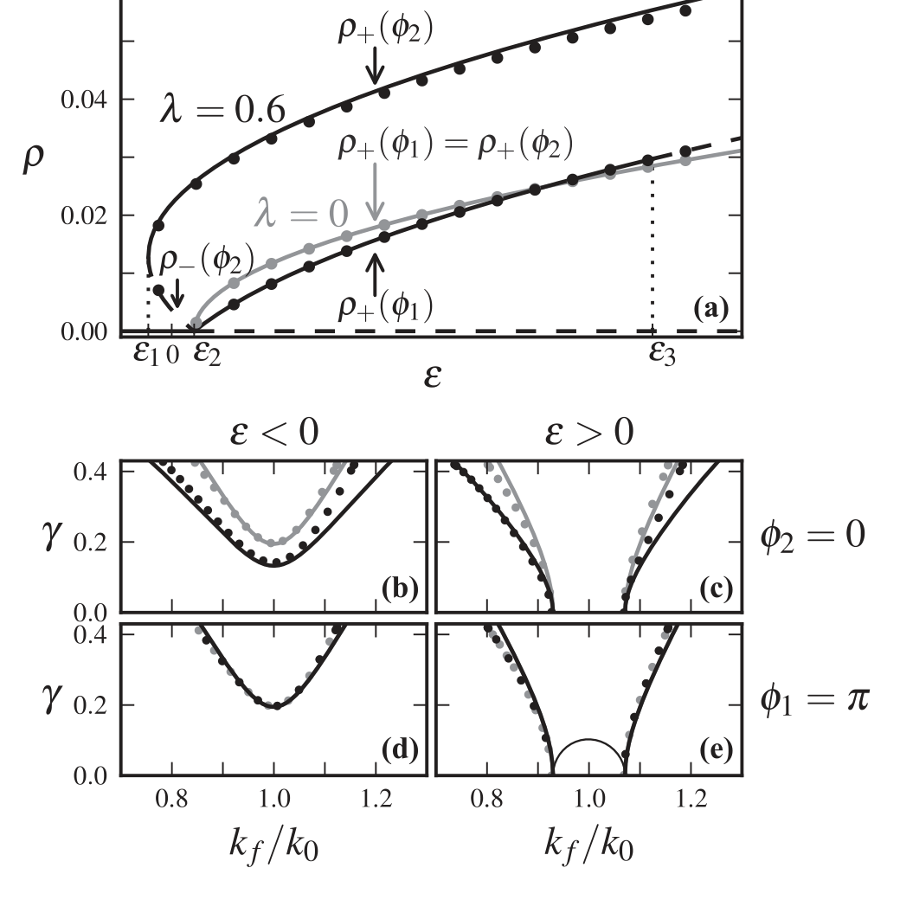
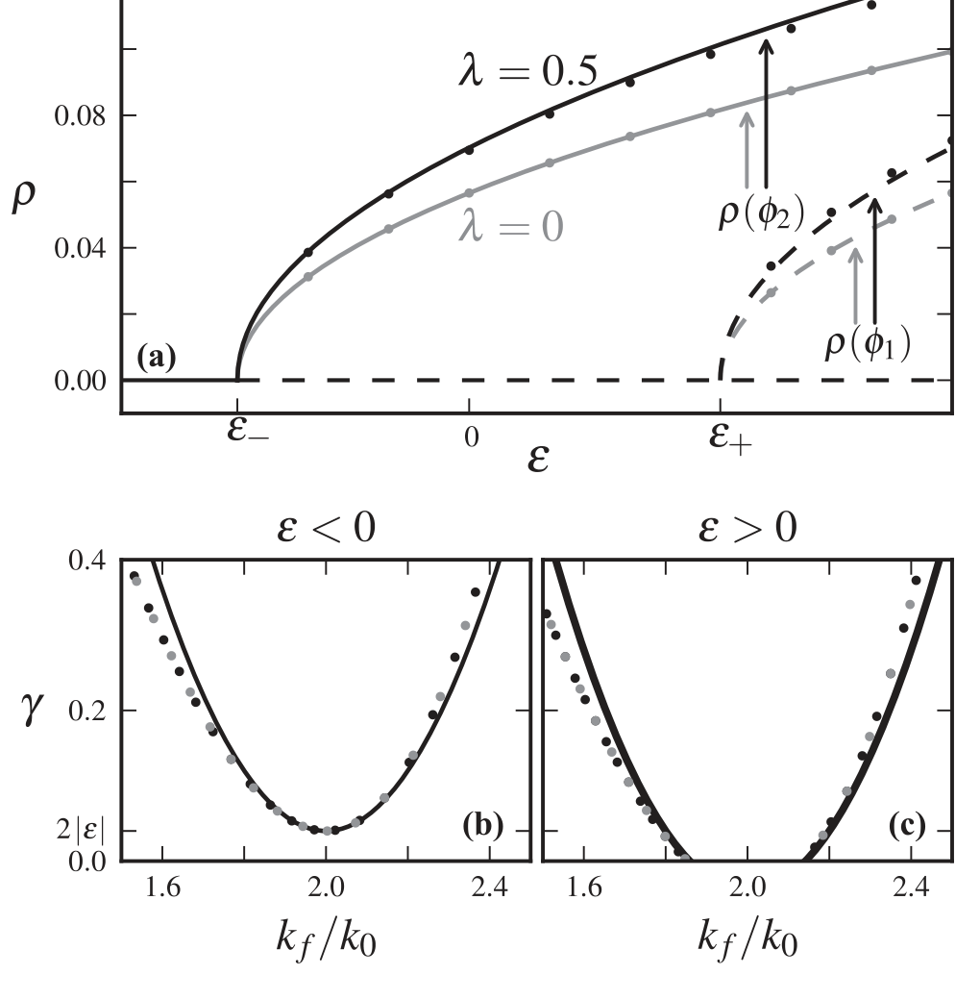
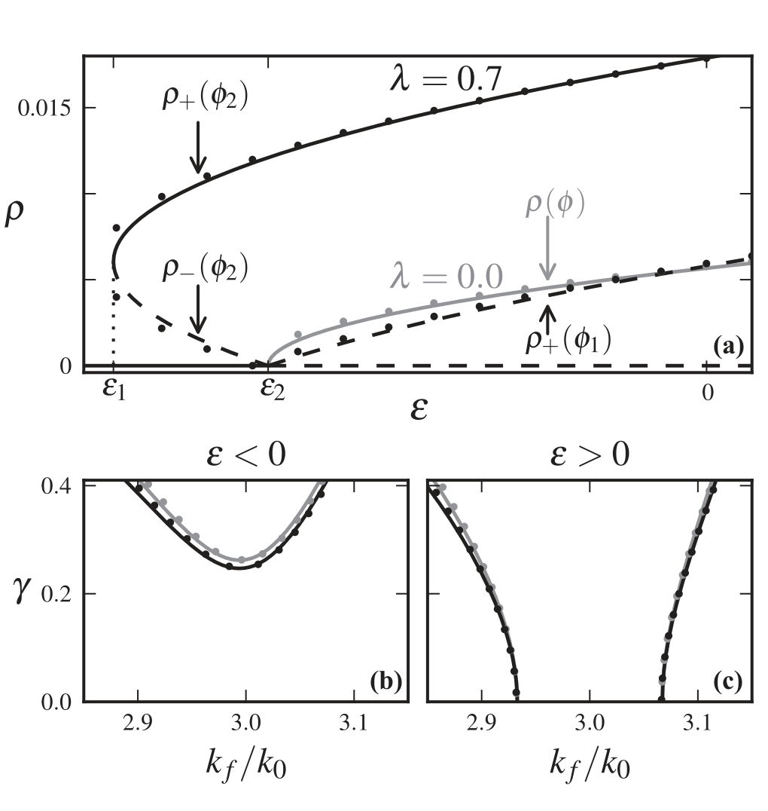
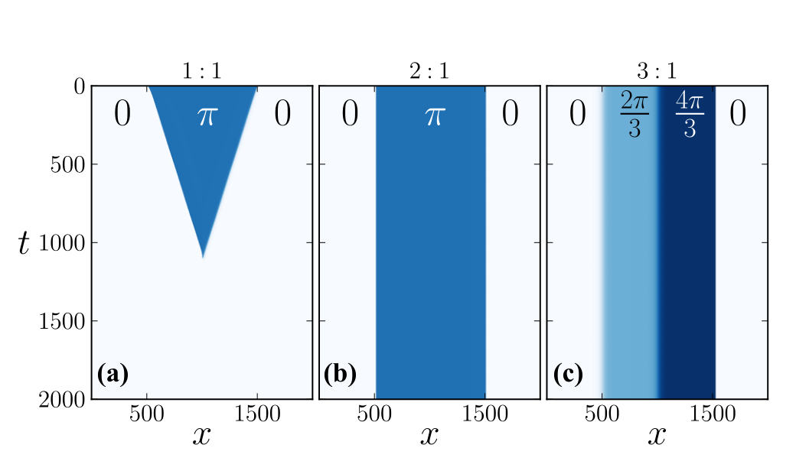

::: {.paper-authors}
Lev Haim^1,2,\*^, Yair Mau^1,3,\*,&dagger;^, Ehud Meron^1,4^
:::

::: {.paper-affil}
^1^ Physics Department, Ben-Gurion University of the Negev, Beer-Sheva 84105, Israel &nbsp;&middot;&nbsp; ^2^ Department of Oncology, Soroka University Medical Center, Beer Sheva, 84101, Israel &nbsp;&middot;&nbsp; ^3^ Department of Civil and Environmental Engineering, Duke University, Durham, North Carolina 27708, USA &nbsp;&middot;&nbsp; ^4^ Department of Solar Energy and Environmental Physics, BIDR, Ben-Gurion University of the Negev, Sede Boqer Campus, 84990, Israel

^\*^ These authors contributed equally to this work. &nbsp;&middot;&nbsp; ^&dagger;^ Corresponding author
:::

---

::: {.paper-meta}
Physical Review E 90, 022904 &middot; 2014 &middot; doi: [10.1103/PhysRevE.90.022904](https://doi.org/10.1103/PhysRevE.90.022904)

Received 20 May 2014; published 8 August 2014
:::

> **How to cite:** Haim, L., Mau, Y. and Meron, E. (2014). Spatial Forcing of Pattern-Forming Systems That Lack Inversion Symmetry. Physical Review E, 90, 022904. https://doi.org/10.1103/PhysRevE.90.022904

---

#### Abstract

The entrainment of periodic patterns to spatially periodic parametric forcing is studied. Using a weak nonlinear analysis of a simple pattern formation model we study the resonant responses of one-dimensional systems that lack inversion symmetry. Focusing on the first three $n{:}1$ resonances, in which the system adjusts its wavenumber to one $n$th of the forcing wavenumber, we delineate commonalities and differences among the resonances. Surprisingly, we find that all resonances show multiplicity of stable phase states, including the $1{:}1$ resonance. The phase states in the $2{:}1$ and $3{:}1$ resonances, however, differ from those in the $1{:}1$ resonance in remaining symmetric even when the inversion symmetry is broken. This is because of the existence of a discrete translation symmetry in the forced system. As a consequence, the $2{:}1$ and $3{:}1$ resonances show stationary phase fronts and patterns, whereas phase fronts within the $1{:}1$ resonance are propagating and phase patterns are transients. In addition, we find substantial differences between the $2{:}1$ resonance and the other two resonances. While the pattern forming instability in the $2{:}1$ resonance is supercritical, in the $1{:}1$ and $3{:}1$ resonances it is subcritical, and while the inversion asymmetry extends the ranges of resonant solutions in the $1{:}1$ and $3{:}1$ resonances, it has no effect on the $2{:}1$ resonance range. We conclude by discussing a few open questions.

## I. Introduction

Spatial periodic forcing can be used to control and manipulate pattern forming systems ([1](#ref-1)&ndash;[4](#ref-4)). In model equations the forcing appears either parametrically, by multiplying a dynamical variable, or additively. The latter case has been studied in the contexts of optical patterns in photorefractive feedback systems ([5](#ref-5)), Rayleigh-Bénard convection ([6](#ref-6)), and Turing patterns in chemical reactions ([3](#ref-3)). Parametric forcing is relevant to the restoration of banded vegetation on hill slopes by water harvesting ([7](#ref-7)&ndash;[9](#ref-9)).

General aspects of pattern-forming systems can often be captured by analyzing simple pattern formation models. A widely used model of this kind is the Swift-Hohenberg (SH) equation, originally introduced in the context of fluid convection ([10](#ref-10)). The SH equation can be viewed as the simplest model that captures a nonuniform stationary instability, i.e., an instability that renders a uniform state unstable and gives rise to a stationary periodic pattern. In a series of recent works we used the SH equation to study spatial parametric forcing as a means of stabilizing patterns, extending their existence range, controlling their wavenumbers and amplitudes, and creating new patterns ([11](#ref-11)&ndash;[14](#ref-14)).

In all these studies we used the original form of the SH equation, which has an inversion symmetry ($u \to -u$). However, pattern forming systems often lack such a symmetry. In thermal convection, the so-called "up-down" symmetry is broken when fluids with temperature-dependent properties are used (non-Oberbeck-Boussinesq convection) ([15](#ref-15)). Models of chemical reactions, such as the Lengyel-Epstein model for the CDIMA reaction ([3](#ref-3)), generally lack inversion symmetry in all settings, and the same holds for models of dryland vegetation ([16](#ref-16)).

In this paper we use a modified SH equation that includes a quadratic term to study the effect of linear parametric forcing on pattern formation in 1D systems that lack inversion symmetry. Using a weak nonlinear analysis we study the first three resonances $n{:}1$, $n=1,2,3$, in which the system responds to the forcing with wavenumbers that are one $n$th of the forcing wavenumber. Interestingly, the effect of the quadratic term on different resonances manifests itself differently; in some respects the $1{:}1$ resonance shows different behaviors from those of the other two, while in other respects the $2{:}1$ resonance stands out.

The paper is organized as follows. We begin in Sec. II by presenting the modified SH equation that we study. In Sec. III we use a multiple scales analysis to derive an amplitude equation for one-dimensional $n{:}1$ wavenumber-locked solutions of the modified SH equation. In Sec. IV we study constant solutions of the amplitude equation for the different resonances, investigating their existence and stability ranges, both analytically and numerically. The implications of this study for phase patterns are addressed in Sec. V, while a summary of all results and a discussion of open questions conclude the paper in Sec. VI.

## II. The Model Equation

The modified SH equation to be studied here is

$$
\frac{\partial u}{\partial t} = \varepsilon u + \lambda u^2 - \left(\nabla^2 + k_0^2\right)^2 u - u^3 + \gamma u \cos(k_f x), \tag{1}
$$

where, in the unforced system, $\varepsilon$ represents the distance from the pattern forming instability of the zero state and $k_0 \sim O(1)$ is the wavenumber of the first mode to grow at the instability point and also the wavenumber of the resulting stationary pattern. The inversion symmetry, $u \to -u$, is broken by the quadratic term, where $\lambda$ is assumed to be of order unity. The parametric forcing is controlled by the wavenumber $k_f$ and strength $\gamma$. Since Eq. (1) is invariant under the transformation $\gamma \to -\gamma$ and $x \to x + \pi/k_f$, we will choose to consider only positive values of the forcing $\gamma$. We will also restrict ourselves to positive values of $\lambda$; the results for negative $\lambda$ can then be obtained by changing the sign of $u$.

The forced SH Eq. (1) is gradient, i.e., it has a Lyapunov (or energy) functional $L$, in terms of which it reads

$$
\frac{\partial u}{\partial t} = -\frac{\delta L}{\delta u}, \tag{2}
$$

where $\delta$ denotes the variational derivative, and

$$
L = \int d\mathbf{r}\left\{\frac{1}{2}\left(\nabla^2 u + k_0^2 u\right)^2 - \left[\varepsilon + \gamma\cos(k_fx)\right]\frac{u^2}{2} - \lambda\frac{u^3}{3} + \frac{u^4}{4}\right\}. \tag{3}
$$

## III. Derivation of the Amplitude Equation

We consider Eq. (1) near the instability of the zero solution ($|\varepsilon| \ll 1$) and assume weak forcing ($\gamma \ll 1$). The periodic solutions that appear beyond the instability point have small amplitudes that vary weakly in time and space. Using $\varepsilon$ as a small parameter, we expand solutions of Eq. (1) as

$$
u = \sum_{i=1}^{\infty} |\varepsilon|^{i/2}\, u_i(x_0,x_1,t_1,x_2,t_2,\ldots), \tag{4}
$$

where $x_j = |\varepsilon|^{j/2}x$ and $t_j = |\varepsilon|^{j/2}t$ are the "slow" space and time variables for $j \neq 0$ and "fast" for $j=0$. With these choices of space and time variables the derivatives in Eq. (1) transform according to

$$
\partial_x = \sum_{i=0}^{\infty} |\varepsilon|^{i/2}\,\partial_{x_i}, \qquad \partial_t = \sum_{i=1}^{\infty} |\varepsilon|^{i/2}\,\partial_{t_i}. \tag{5}
$$

We further expand the forcing strength as a power series in $\varepsilon$:

$$
\gamma = \sum_{j=1}^{\infty} |\varepsilon|^{j/2}\,\Gamma_j, \qquad \Gamma_j \sim O(1). \tag{6}
$$

This form will allow us to use different scalings of $\gamma$ with $\varepsilon$ for different resonances, if needed. Finally, we assume that the forcing wavenumber, $k_f$, is close to a multiple of $k_0$, that is, $k_f \approx nk_0$, where $n$ is an integer, and quantify this proximity to exact resonance by introducing a small detuning parameter $\nu$:

$$
\nu = k_0 - k_f/n = |\varepsilon|^{1/2}\nu_1, \qquad \nu_1 \sim O(1). \tag{7}
$$

Substituting Eqs. (4)–(6) into Eq. (1) we obtain the following linear equations at successive orders of $|\varepsilon|^{1/2}$:

$$
\begin{aligned}
|\varepsilon|^{1/2}: \quad & \mathcal{L}^2 u_1 = 0, \tag{8a}\\
|\varepsilon|^{2/2}: \quad & \mathcal{L}^2 u_2 = \lambda u_1^2 + \Gamma_1 u_1 \cos(x_0 k_f) - \partial_{t_1}u_1 - 4\mathcal{L}\mathcal{M}_{0,1}u_1, \tag{8b}\\
|\varepsilon|^{3/2}: \quad & \mathcal{L}^2 u_3 = u_1 + 2\lambda u_1 u_2 - u_1^3 - 4\mathcal{M}_{0,1}^2 u_1 - \partial_{t_2}u_1 - \partial_{t_1}u_2 \\
&\quad + (\Gamma_1 u_2 + \Gamma_2 u_1)\cos(x_0 k_f) - 2\mathcal{L}(2\mathcal{M}_{0,2}u_1 + \mathcal{M}_{1,1}u_1 + 2\mathcal{M}_{0,1}u_2), \tag{8c}
\end{aligned}
$$

where $\mathcal{L} = \mathcal{M}_{0,0} + k_0^2$ and $\mathcal{M}_{i,j} = \partial_{x_i}\partial_{x_j}$. The solution of Eq. (8a), which provides the leading order approximation, reads

$$
u_1 = A(x_1,t_1,\ldots)e^{ik_0x_0} + \text{c.c.}, \tag{9}
$$

where the complex-valued amplitude $A$ depends on the slow variables and c.c. stands for complex conjugate.

The next order contribution, $u_2$, satisfies Eq. (8b). The right-hand side of this equation contains secular terms that need to be eliminated in order for $u_2$ to represent a higher harmonics of $\exp(ik_0x)$. Applying this solvability condition we find

$$
\partial_{t_1}A = \delta_{n,2}\frac{\Gamma_1}{2}A^\star e^{-2i\nu_1x_1}, \tag{10}
$$

where $\delta_{i,j}$ is the Kronecker $\delta$ and $\star$ denotes complex conjugation. For all resonances with $n\neq2$ the right-hand side of Eq. (10) vanishes and, consequently, the solvability condition does not contribute to the amplitude equations of these resonances. In the case of the $2{:}1$ resonance the right-hand side of Eq. (10) does not vanish. It, however, consists of a linear term that, on the time scale $t_1$, can lead to exponentially growing solutions with no other terms to balance the exponential growth. Nonlinear terms capable of balancing exponential growth will appear at the next order of the analysis but such terms represent smaller contributions. To resolve this inconsistency we set $\Gamma_1=0$ for $n=2$, which is equivalent to choosing a different scaling of $\gamma$ with $\varepsilon$ for the $2{:}1$ resonance [see Eq. (6)]. We accomplish this constraint on $\Gamma_1$ by multiplying it by the factor $(1-\delta_{n,2})$. Thus, Eq. (10) effectively reduces to $\partial_{t_1}A=0$ for all resonances.

Using Eq. (9), the solution of Eq. (8b) can be written as

$$
u_2 = \frac{\Gamma_1 d_+}{2}A\,e^{i(k_0+k_f)x_0} + \frac{\Gamma_1 d_-}{2}(1-\delta_{n,2})A\,e^{i(k_0-k_f)x_0} + \frac{\lambda}{9k_0^4}A^2 e^{2ik_0x_0} + \frac{2\lambda}{k_0^4}|A|^2 + \text{c.c.}, \tag{11}
$$

where $d_\pm = [k_f(2k_0 \pm k_f)]^{-2}$.

The highest order contribution to be considered here, $u_3$, satisfies Eq. (8c). Applying the solvability condition in this case, using Eqs. (9) and (11) for $u_1$ and $u_2$, we find

$$
\begin{aligned}
\partial_{t_2}A &= \left[\Gamma_2 + \frac{\Gamma_1^2}{4}(d_- + d_+ - d_-\delta_{n,2})\right]A - \eta|A|^2A + 4k_0^2\partial_{x_1}^2A \\
&\quad + \left[\Gamma_1\lambda\zeta_1\,e^{-3i\nu_1x_1}A^{\star2}\right]\delta_{n,3} + \left[\frac{\Gamma_2}{2}e^{-2i\nu_1x_1}A^\star\right]\delta_{n,2} \\
&\quad + \left[\Gamma_1\lambda\left(\zeta_1e^{i\nu_1x_1}A^2 + \zeta_2e^{-i\nu_1x_1}|A|^2\right) + \frac{\Gamma_1^2d_-}{4}e^{-2i\nu_1x_1}A^\star\right]\delta_{n,1},
\end{aligned} \tag{12}
$$

where

$$
\zeta_1 \equiv d_- + \frac{1}{18k_0^4}, \qquad \zeta_2 \equiv d_- + d_+ + \frac{1}{k_0^4}, \qquad \eta \equiv 3 - \frac{38\lambda^2}{9k_0^4}. \tag{13}
$$

Note that $\zeta_1$ and $\zeta_2$ are positive. We also have to demand that $\eta$ is positive, otherwise the expansion has to be extended to fifth order in $|\varepsilon|^{1/2}$. This constrains the coefficient of the quadratic term to $\lambda < k_0^2\sqrt{27/38}$.

The amplitude equation can be now obtained by combining Eqs. (10) and (12) using the chain rule $\partial_tA = \varepsilon^{1/2}\partial_{t_1}A + \varepsilon^{2/2}\partial_{t_2}A$. Rescaling back to the fast variables and to the original forcing strength $\gamma$ and detuning $\nu$,

$$
\Gamma_1 = \frac{\gamma}{|\varepsilon|^{1/2}}(1-\delta_{n,2}), \qquad \Gamma_2 = \frac{\gamma}{|\varepsilon|}, \qquad \nu_1 = \frac{\nu}{|\varepsilon|^{1/2}},
$$

we obtain

$$
\begin{aligned}
\partial_tB &= \left[\varepsilon + \frac{\gamma^2}{4}(d_-+d_+)(1-\delta_{n,2})\right]B - \eta|B|^2B + 4k_0^2(\partial_x - i\nu)^2B \\
&\quad + \left[\gamma\lambda\zeta_1B^{\star2}\right]\delta_{n,3} + \left[\frac{\gamma}{2}B^\star\right]\delta_{n,2} + \left[\gamma\lambda(\zeta_1B^2+\zeta_2|B|^2) + \frac{\gamma^2d_-}{4}B^\star\right]\delta_{n,1},
\end{aligned} \tag{14}
$$

where

$$
B(x_1,t_1,\ldots) = |\varepsilon|^{1/2}A\,e^{i\nu_1x_1}. \tag{15}
$$

In terms of the amplitude $B$ the leading order form of the solution Eq. (4) is

$$
u(x_0,x_1,t_1,\ldots) \approx B\,e^{i\frac{k_f}{n}x_0} + \text{c.c.} \tag{16}
$$

This form is especially convenient, for constant solutions of Eq. (14) describe wavenumber-locked solutions of Eq. (1), the wavenumbers of which are related to the forcing wavenumber by the ratio $k_f/n$. An equivalent form for the space-independent amplitude Eq. (14) is obtained by expressing $B$ and $B^*$ in terms of $\rho=|B|$ and $\phi=\arg B$:

$$
\begin{aligned}
\rho_t &= \rho\left[\varepsilon - 4k_0^2\nu^2 + \frac{\gamma^2}{4}(d_-+d_+)(1-\delta_{n,2})\right] - \eta\rho^3 + \left[\gamma\lambda\zeta_1\rho^2\cos3\phi\right]\delta_{n,3} + \left[\frac{\gamma}{2}\rho\cos2\phi\right]\delta_{n,2} \\
&\quad + \left[\gamma\lambda(\zeta_1+\zeta_2)\rho^2\cos\phi + \frac{\gamma^2d_-}{4}\rho\cos2\phi\right]\delta_{n,1}, \\
\phi_t &= -\left[\gamma\lambda\zeta_1\rho\sin3\phi\right]\delta_{n,3} - \left[\frac{\gamma}{2}\sin2\phi\right]\delta_{n,2} - \left[\gamma(\zeta_2-\zeta_1)\lambda\rho\sin\phi + \frac{\gamma^2d_-}{4}\sin2\phi\right]\delta_{n,1}.
\end{aligned} \tag{17}
$$

Note that for $n\leqslant3$, up to the third-order analysis considered here, the phase equation in Eq. (17) has discrete phase solutions,

$$
\phi_1 = (2m+1)\frac{\pi}{n}, \qquad \phi_2 = 2m\frac{\pi}{n}, \qquad m=0,1,\ldots,n-1, \tag{18}
$$

where we distinguished between a group $\phi_1$ of odd-phase solutions and a group $\phi_2$ of even-phase solutions. The multiplicity of phase solutions within each group is related to the discrete translational symmetry, $x \to x + 2m\pi/k_f$, of Eq. (1), which implies the invariance of the amplitude Eq. (14) under the transformation $B \to B\exp(2\pi im/n)$. In the following we will refer to this symmetry as "translation symmetry."

In deriving the amplitude Eq. (14) we considered only particular solutions of Eqs. (8) for $u_i$, instead of general solutions, which would contain undetermined amplitudes or "free fields" for the different modes. In principle, these fields can be determined by demanding commutativity between time derivatives of the amplitude ([17](#ref-17)), e.g., $\partial_{t_1}\partial_{t_2}A = \partial_{t_2}\partial_{t_1}A$. Implementing these conditions, however, turned out to be too hard. Nevertheless, the amplitude Eq. (14) does provide good quantitative approximations, at least for sufficiently small $\gamma$ and $\lambda$, as we will shortly see. We note that Eq. (14) reduces to known equations when the inversion symmetry is reintroduced ($\lambda=0$) ([13](#ref-13),[14](#ref-14)).

## IV. Resonant Periodic Solutions

The existence range and stability properties of periodic wavenumber-locked solutions of Eq. (1) can be obtained by studying constant solutions of the amplitude Eq. (14) or its equivalent form Eq. (17). In the following subsections we describe such studies for different $n{:}1$ resonances. The stability analysis is restricted to uniform perturbations for which the space-derivative terms in Eq. (14) drop out. The dynamics of such perturbations are determined by the eigenvalues of the Jacobian matrix:

$$
J(B,n) = \begin{pmatrix} C & D \\ D^\star & C^\star \end{pmatrix}, \tag{19}
$$

where

$$
\begin{aligned}
C &= \left[\varepsilon - 4\nu^2k_0^2 + \frac{\gamma^2}{4}(d_-+d_+)(1-\delta_{n,2})\right] + \gamma\lambda(2B\zeta_1+B^\star\zeta_2)\delta_{n,1} - 2|B|^2\eta, \\
D &= -B^2\eta + \left(\frac{d_-\gamma^2}{4} + B_0\lambda\zeta_2\gamma\right)\delta_{n,1} + \frac{\gamma}{2}\delta_{n,2} + 2\gamma\lambda\zeta_1B^\star\delta_{n,3},
\end{aligned} \tag{20}
$$

and $B=\rho\exp(i\phi)$ represents the constant solution considered. The eigenvalues of $J$ are determined using the formula

$$
\sigma = \frac{\text{Tr}(J)}{2} \pm \sqrt{\left[\frac{\text{Tr}(J)}{2}\right]^2 - \text{Det}(J)}. \tag{21}
$$

To test the analytical results for the existence ranges of the various solutions we conduct numerical continuation studies of Eq. (1) ([18](#ref-18)).

### A. 1:1 Resonant Solutions

For $n=1$, Eqs. (17) reduce to

$$
\begin{aligned}
\rho_t &= \rho\left[\varepsilon - 4k_0^2\nu^2 + \frac{\gamma^2}{4}(d_-+d_+)\right] - \eta\rho^3 + \gamma\lambda(\zeta_1+\zeta_2)\rho^2\cos\phi + \frac{\gamma^2d_-}{4}\rho\cos2\phi, \\
\phi_t &= -\gamma(\zeta_2-\zeta_1)\lambda\rho\sin\phi - \frac{\gamma^2d_-}{4}\sin2\phi,
\end{aligned} \tag{22}
$$

and admit the following solutions:

$$
\rho_\pm(\phi) = \frac{\gamma\lambda(\zeta_1+\zeta_2)}{2\eta}\cos\phi \pm \sqrt{\frac{\varepsilon-\varepsilon_1}{\eta}}, \qquad \phi=\{\phi_1,\phi_2\}, \tag{23}
$$

where $\phi_1=\pi$ is the odd-phase solution and $\phi_2=0$ is the even-phase solution [see Eq. (18)] and

$$
\varepsilon_1 = \varepsilon_2 - \frac{\gamma^2\lambda^2(\zeta_1+\zeta_2)^2}{4\eta}, \qquad \varepsilon_2 = 4k_0^2\nu^2 - \frac{\gamma^2}{4}(2d_-+d_+). \tag{24}
$$

According to Eq. (23), $\rho_-(\phi_1)$ is always negative and therefore cannot be a solution. Moreover, $\rho_-(\phi_2)$ exists for $\varepsilon_1 \leqslant \varepsilon \leqslant \varepsilon_2$, but inserting this solution into the eigenvalue expression Eq. (21) reveals that it is always unstable.

Figure 1(a) shows bifurcations diagrams for $1{:}1$ wavenumber-locked solutions for a system with an inversion symmetry ($\lambda=0$) and for a system that lacks that symmetry ($\lambda\neq0$). The solid lines (stable solutions) and the dashed lines (unstable solutions) were calculated using Eqs. (23) and (21). The dots show existence range results obtained numerically from Eq. (1) using a continuation method. In the symmetric case (gray line), the $\phi_1$ and $\phi_2$ solutions coincide and appear in a supercritical bifurcation at $\varepsilon=\varepsilon_2$. Furthermore, the solutions are stable to uniform perturbations. In the asymmetric case (black lines) the degeneracy of the solution is lifted, and while the bifurcation of the $\phi_1$ solution is supercritical, the bifurcation of the $\phi_2$ solution is subcritical. In both bifurcations the zero solution is destabilized at $\varepsilon=\varepsilon_2$, but the $\phi_2$ solution extends to lower $\varepsilon$ values and disappears in a fold bifurcation at $\varepsilon=\varepsilon_1<\varepsilon_2$, where a large-amplitude solution and a small-amplitude solution merge. The solution branch $\rho_+(\phi_2)$ is stable for all $\varepsilon$ values, while the solution branch $\rho_+(\phi_1)$ loses stability at $\varepsilon=\varepsilon_3$, where

$$
\varepsilon_3 = \varepsilon_2 + \frac{\gamma^2d_-\left[\eta d_- + 2\lambda^2\left(\zeta_2^2-\zeta_1^2\right)\right]}{4\lambda^2(\zeta_1-\zeta_2)^2}. \tag{25}
$$

The $1{:}1$ resonance domains in the forcing-parameters plane ($\gamma,k_f/k_0$) are shown in Fig. 1, where panels (b) and (c) correspond to the $\phi_2$ solution and panels (d) and (e) to the $\phi_1$ solution. For negative $\varepsilon$ the lack of inversion symmetry extends the resonance range of the $\phi_2$ solution [panel (b)] but leaves the resonance range of the $\phi_1$ solution unaffected [panel (d)]. For positive $\varepsilon$ the lack of inversion symmetry has opposite effects on the resonance ranges of stable $\phi_1$ and $\phi_2$ solutions; while the range is extended for the $\phi_2$ solution [panel (c)] it is reduced for the $\phi_1$ solution [panel (e)]. This range reduction occurs for relatively low values of $\gamma$, as demarcated by the thin line in panel (e), below which solution $\phi_1$ exists but is unstable.

**FIG. 1 | The 1:1 resonance.** Panel (a) shows a bifurcation diagram of $1{:}1$ wavenumber-locked solutions. Solid (dashed) curves indicate the stable (unstable) analytical solutions Eq. (23), and the dots denote numerical solutions of Eq. (1). Black curves represent a system that lacks an inversion symmetry with ($\lambda=0.6$), while gray curves represent a symmetric system ($\lambda=0$). Parameters for panel (a): $\gamma=0.02$, $k_f/k_0=1.01$. Panels (b) through (e) show existence and stability domains of resonant solutions—the inner domains bounded by the black and gray curves, where black refers to an asymmetric system and gray to a symmetric system. Panels (b) and (c) show the domains of the $\phi_2$ solution below ($\varepsilon=-0.02$) (b) and above ($\varepsilon=0.02$) (c) the instability threshold $\varepsilon=0$ of the zero state in the unforced system. Panels (d) and (e) show the same information for the $\phi_1$ solution. The thin black line in panel (e) denotes marginal stability of the $\phi_1$ solution. Below this line the solution exists but is unstable.

### B. 2:1 Resonant Solutions

For $n=2$, Eqs. (17) reduce to

$$
\rho_t = \rho(\varepsilon-4k_0^2\nu^2) - \eta\rho^3 + \frac{\gamma}{2}\rho\cos2\phi, \qquad \phi_t = -\frac{\gamma}{2}\sin2\phi, \tag{26}
$$

and admit the following solution sets:

$$
\rho(\phi) = \sqrt{\frac{\varepsilon-4k_0^2\nu^2+\frac{\gamma}{2}\cos2\phi}{\eta}}, \qquad \phi=\{\phi_1,\phi_2\}, \tag{27}
$$

where according to Eq. (18) $\phi_1=\{\tfrac{\pi}{2},\tfrac{3\pi}{2}\}$ and $\phi_2=\{0,\pi\}$. Denoting

$$
\varepsilon_\pm \equiv 4k_0^2\nu^2 \pm \frac{\gamma}{2}, \tag{28}
$$

we find from Eqs. (27) that the $\phi_1$ solutions exist for $\varepsilon \geqslant \varepsilon_+$, whereas the $\phi_2$ solutions exist for $\varepsilon \geqslant \varepsilon_-$. Using the solutions $B=\rho(\phi)\exp(i\phi)$ with $\phi=\phi_2$ in Eq. (21) we find that these even-phase solutions are stable in their entire existence range while the odd-phase solutions with $\phi=\phi_1$ are unstable in their entire existence range. The bifurcation diagrams for these solutions for $\lambda=0$ and for $\lambda>0$ are shown in Fig. 2(a). Note that the phase equation in Eq. (26) is independent of $\lambda$. As a consequence the solutions Eq. (27) for the two even-phase solutions, $\phi_2=\{0,\pi\}$, are identical, $\rho(0)=\rho(\pi)$. This holds both in the symmetric case ($\lambda=0$) and in the asymmetric case ($\lambda>0$). That is, each of the stable solution branches in the bifurcation diagram (in black and in gray) represents two overlapping solution branches, one for the even-phase solution $\phi=0$ and one for the even-phase solution $\phi=\pi$. This is unlike the $1{:}1$ resonance, which is also characterized by bistability of $\phi=0$ and $\phi=\pi$ phase states, except that the former state is an even-phase solution, whereas the latter is an odd-phase solution [in the sense of Eq. (18)], and for $\lambda>0$ they are not identical, as the two solution branches in Fig. 1 denoted by $\rho_+(\phi_2)$ and $\rho_+(\phi_1)$ indicate. The similarity of solutions for $\lambda=0$ and $\lambda>0$ derive from the fact that $\lambda$ only appears in Eqs. (26) in the parameter $\eta$, and the breaking of the up-down symmetry simply amounts to the renormalization of the coefficient of $\rho^3$.

It is interesting to note that for the $2{:}1$ resonance, the amplitude equation obtained for a system that undergoes a finite wavenumber instability subjected to spatial parametric forcing is similar in structure to that of a system that undergoes a Hopf bifurcation subjected to temporal parametric forcing ([19](#ref-19)&ndash;[22](#ref-22)). There is a fundamental difference, though; because of the parity symmetry $x \to -x$ of Eq. (1) all coefficients in Eq. (14) must be real and the equation is variational, i.e., has an energy functional, which rules out asymptotic dynamics. By contrast, the coefficients in the amplitude equation for forced oscillatory systems are complex valued in general, the equation is not necessarily variational and asymptotic dynamical behaviors are possible (see also Sec. V).

**FIG. 2 | The 2:1 resonance.** Panel (a) shows a bifurcation diagram of $2{:}1$ wavenumber-locked solutions. Solid (dashed) curves indicate the stable (unstable) analytical solutions Eq. (27), and the dots denote numerical solutions of Eq. (1). Black curves represent a system that lacks an inversion symmetry with ($\lambda=0.5$), while gray curves represent a symmetric system ($\lambda=0$). Each of the upper solution branches denoted by $\rho(\phi_2)$ represent two translationally symmetric even-phase solutions, $\phi_2=\{0,\pi\}$. These solutions are stable in their entire existence range, unlike the lower solution branches, denoted by $\rho(\phi_1)$, which represent two translationally symmetric odd-phase solutions, $\phi_1=\{\tfrac{\pi}{2},\tfrac{3\pi}{2}\}$ and are unstable. Parameters for panel (a): $\gamma=0.02$, $k_f/k_0=2.02$. Panels (b) and (c) show existence and stability domains of resonant even-phase solutions below ($\varepsilon=-0.02$) (b) and above ($\varepsilon=0.02$) (c) the instability threshold $\varepsilon=0$. Note the overlap of the black and gray curves, both of the solid curves and of the curves delineated by the dots, which reflects the independence of the resonance domains on $\lambda$.

Figures 2(b) and 2(c) show the resonance range of stable even-phase solutions in the parameter space $\gamma$ versus $k_f/k_0$, for $\varepsilon<0$ and $\varepsilon>0$, respectively (the unstable odd-phase solutions $\phi_1=\{\tfrac{\pi}{2},\tfrac{3\pi}{2}\}$ are not shown). As can be seen from the expression for $\rho$ in Eq. (27) the existence range of the resonant solutions is independent of $\lambda$, and the same holds for the stability range of these solutions which coincide with the existence range. As a result, the resonance ranges in symmetric and asymmetric systems coincide (black and gray lines or dots overlap). Again this is unlike the $1{:}1$ resonance where the asymmetry ($\lambda>0$) changes the resonance range.

### C. 3:1 Resonant Solutions

For $n=3$, Eqs. (17) reduce to

$$
\rho_t = \rho(\varepsilon-\varepsilon_2) - \eta\rho^3 + \gamma\lambda\zeta_1\rho^2\cos3\phi, \qquad \phi_t = -\gamma\lambda\zeta_1\rho\sin3\phi, \tag{29}
$$

and admit the following solutions:

$$
\rho_\pm(\phi) = \frac{\gamma\zeta_1\lambda\cos(3\phi)}{2\eta} \pm \sqrt{\frac{\varepsilon-\varepsilon_1}{\eta}}, \qquad \phi=\{\phi_1,\phi_2\}, \tag{30}
$$

where the thresholds $\varepsilon_1$ and $\varepsilon_2$ [not to be confused with Eq. (24)] are given by

$$
\varepsilon_1 = \varepsilon_2 - \frac{\gamma^2\zeta_1^2\lambda^2}{4\eta}, \qquad \varepsilon_2 = 4k_0^2\nu^2 - \frac{\gamma^2}{4}(d_-+d_+), \tag{31}
$$

and according to Eq. (18) $\phi_1=\{\tfrac{\pi}{3},\pi,\tfrac{5\pi}{3}\}$, $\phi_2=\{0,\tfrac{2\pi}{3},\tfrac{4\pi}{3}\}$.

According to Eqs. (21) and (30), the solutions $\rho_+(\phi_1)$ of an asymmetric system ($\lambda\neq0$) exist for $\varepsilon>\varepsilon_2$ but are always unstable, whereas the solutions $\rho_-(\phi_1)$ do not exist. The solutions $\rho_+(\phi_2)$ exist and are stable for $\varepsilon>\varepsilon_1$, whereas the solutions $\rho_-(\phi_2)$ exist in the range $\varepsilon_1<\varepsilon<\varepsilon_2$ but are unstable. This behavior is similar to the $1{:}1$ resonance in that the $\rho_+(\phi_2)$ solutions appear in a subcritical bifurcation and the $\rho_+(\phi_1)$ solutions appear in a supercritical bifurcation. Unlike the $1{:}1$ resonance the $\rho_+(\phi_1)$ solutions in the $3{:}1$ resonance are always unstable, thus no bistability range of even-phase solutions $\rho_+(\phi_2)$ and of odd-phase solutions $\rho_+(\phi_1)$ exists, as in the $1{:}1$ resonance. The $3{:}1$ resonance still gives rise to multiplicity of stable phase states—the three translationally symmetric even phases $\phi_2=\{0,\tfrac{2\pi}{3},\tfrac{4\pi}{3}\}$. In the symmetric case ($\lambda=0$) the solutions appear in a supercritical bifurcation at $\varepsilon=\varepsilon_2$ but the phase $\phi$ is undetermined, as the phase equation in Eq. (29) implies.

**FIG. 3 | The 3:1 resonance.** Panel (a) shows a bifurcation diagram of $3{:}1$ wavenumber-locked solutions. Solid (dashed) curves indicate the stable (unstable) analytical solutions Eq. (30), and the dots denote numerical solutions of Eq. (1). Black curves represent a system that lacks an inversion symmetry with ($\lambda=0.7$), while gray curves represent a symmetric system ($\lambda=0$). The stable solution branch $\rho_+(\phi_2)$ describes three translationally symmetric even-phase solutions $\phi_2=\{0,\tfrac{2\pi}{3},\tfrac{4\pi}{3}\}$. The thresholds $\varepsilon_1$, $\varepsilon_2$ are given in Eq. (31). Parameters for panel (a): $\gamma=0.1$, $k_f/k_0=3.02$. Panels (b) and (c) show existence and stability domains of resonant even-phase solutions below ($\varepsilon=-0.002$) (b) and above ($\varepsilon=0.002$) (c) the instability threshold $\varepsilon=0$ for asymmetric (black) and symmetric (gray) systems.

Figures 3(b) and 3(c) show the resonance domains of stable even-phase solutions in the parameter space $\gamma$ versus $k_f/k_0$, for $\varepsilon<0$ and $\varepsilon>0$, respectively. Like in the $1{:}1$ resonance (but unlike the $2{:}1$ resonance) the asymmetry extends the boundaries of the resonance domains of even-phase solutions, but to a lesser extent.

## V. Phase Patterns

All three resonances considered here involve multiplicity of stable phase states. In the $1{:}1$ resonance we found bistability of an even-phase solution, $\phi=0$, and an odd-phase solution, $\phi=\pi$. Breaking the inversion symmetry of the system breaks the symmetry between these two phase states, as Fig. 1(a) shows. In the two higher resonances the odd-phase solutions are unstable but the system shows multiplicity of stable even-phase solutions, $\phi=0$ and $\phi=\pi$ in the $2{:}1$ resonance, and $\phi=0$, $\phi=2\pi/3$, and $\phi=4\pi/3$ in the $3{:}1$ resonance. Moreover, these solutions remain translationally symmetric even for asymmetric systems ($\lambda\neq0$).

Multiplicity of phase states allow for phase-fronts that shift the phase from one state to another within narrow domains in the physical space. Such fronts and their stability properties have been thoroughly studied in the context of temporally forced oscillatory systems ([23](#ref-23)&ndash;[25](#ref-25)). These fronts constitute the building blocks for localized solutions ([26](#ref-26)&ndash;[28](#ref-28)) and for a variety of spatially extended patterns, including traveling waves, standing waves, and chaotic patterns ([29](#ref-29),[30](#ref-30)), many of which have been observed in experiments ([31](#ref-31)&ndash;[35](#ref-35)). The existence of an energy functional in the present context [Eq. (3)] rules out asymptotic dynamical behaviors as observed in forced oscillatory systems. Yet, phase fronts do exist and form transient or stationary patterns as we now discuss.

The bistability of uniform phase states within the $1{:}1$ resonance allows for phase fronts that shift the phase by $\pi$. In asymmetric systems ($\lambda\neq0$) the two states are not translationally symmetric and the phase fronts propagate so as to minimize the energy functional Eq. (3). This leads to transient patterns as the space-time plot in Fig. 4(a) implies. We verified that the same behavior holds for the original forced SH Eq. (1) (i.e., no front pinning has been found). The bistability of uniform phase states within the $2{:}1$ resonance allows for stationary phase patterns. This is because of the translation symmetry that relates the two phase states and their equal energies, which make the phase fronts stationary as the space-time plot in Fig. 4(b) shows. This behavior holds also for the tristability of translationally symmetric phase states within the $3{:}1$ resonance as Fig. 4(c) shows. We note that in terms of the solution Eq. (16) a phase pattern involving an array of phase fronts translates to a periodic pattern that is disrupted by an array of defects.

**FIG. 4 | Phase-front dynamics in the absence of an inversion symmetry.** Shown are space-time plots, obtained by numerical integration of Eq. (14), of phase fronts that separate different phase states, as labeled, within the $1{:}1$ (a), $2{:}1$ (b), and $3{:}1$ (c) resonances. Darker shades correspond to higher phase values. The translation asymmetry between the two phase states in the $1{:}1$ resonance induces front motion and the convergence to the zero-phase state. The translation symmetry that relates the phase states in the $2{:}1$ and $3{:}1$ resonances results in stationary fronts and phase patterns. Parameters: $\varepsilon=0.01$, $\lambda=0.5$, $\gamma=0.3$, and $k_f/k_0=0.02+n$.

## VI. Conclusion

We have studied a parametrically forced SH equation with broken inversion symmetry as a simple model of pattern forming systems that are subjected to periodic spatial forcing. The study involved weak nonlinear analysis, complemented by numerical studies, of the three basic resonances $n{:}1$, $n=1,2,3$. Two aspects are shared by all resonances. The first is the higher-amplitude patterns obtained in asymmetric systems ($\lambda\neq0$) compared to the symmetric ones ($\lambda=0$). The second aspect is the stabilizing effect of the forcing, i.e., the appearance of stable patterns below the threshold $\varepsilon=0$ of unforced systems. There are, however, substantial differences between these resonances.

The $1{:}1$ resonance is the only resonance that has stable odd-phase solutions. The existence of such an odd-phase solution ($\phi_1=\pi$) along with a stable even-phase solution ($\phi_2=0$) leads to bistability of phases states, a quite surprising result. In the presence of an inversion symmetry ($\lambda=0$) these two phase states are translationally symmetric, as Fig. 1(a) shows, but breaking the inversion symmetry ($\lambda\neq0$) removes the symmetry between the two phase states. Since their energy-functional values are no longer equal, phase fronts that are biasymptotic to the two phase states propagate. As a result, initial spatial distributions of the two phase states culminate in a single phase state, the state that minimizes the energy functional. The higher $2{:}1$ and $3{:}1$ resonances both have unstable odd-phase solutions, but show multiplicity of stable even-phase solutions, $\phi_2=\{0,\pi\}$ for the $2{:}1$ resonance, and $\phi_2=\{0,\tfrac{2\pi}{3},\tfrac{4\pi}{3}\}$ for the $3{:}1$ resonance. While the even-phase ($\phi_2$) and the odd-phase ($\phi_1$) solutions are not symmetric for $\lambda\neq0$ (because of the broken inversion symmetry) the even-phase solutions among themselves, i.e., within $\phi_2$, are still translationally symmetric. As a consequence, phase fronts, and patterns consisting of widely separated phase fronts as building blocks, are stationary (Fig. 4).

There is another substantial difference, this time between the $2{:}1$ resonance and the other two resonances. The pattern-forming instability of the zero state is supercritical in the $2{:}1$ resonance and subcritical in the $1{:}1$ and $3{:}1$ resonances, implying bistability ranges of the patterned states and the zero state in the latter two resonances. Furthermore, while the inversion asymmetry extends the ranges of resonant even-phase solutions in the $1{:}1$ and $3{:}1$ resonances, it has no effect on the $2{:}1$ resonance range.

We restricted the analysis to $n\leqslant3$ because higher resonances require higher-order contributions to Eq. (14). Whether the $3{:}1$ resonance is a good representative of higher resonances in its basic properties—a subcritical pattern forming instability and multiplicity of $n$ translationally symmetric, stable even-phase solutions—remains an open question. In this study we considered parametric forcing of a linear term. We expect other forms of forcing, additive or parametric forcing of nonlinear terms, to result in different behaviors, which have yet to be explored.

The results predicted here can be tested in controlled laboratory experiments. A possible candidate system is the CDIMA reaction in a quasi-1D cell that is spatially forced by modulating the cell temperature (to ensure parametric forcing)—in a parameter range of Turing patterns ([3](#ref-3)). An example of a prediction that can be tested is the propagation of a phase front that shifts the pattern phase by $\pi$ in the $1{:}1$ resonance, and the nonpropagation of a similar front in the $2{:}1$ resonance [see Figs. 4(a) and 4(b)].

We also restricted the analysis to one spatial dimension. Breaking the inversion symmetry in two-dimensional systems can have dramatic effects on the type of patterns that emerge from the unstable zero state. In the absence of forcing hexagonal patterns often emerge ([36](#ref-36)). How are these patterns related to rectangular patterns found in symmetric forced systems ([11](#ref-11)) when the inversion symmetry is removed, is yet another open pattern formation question. This question is also significant for practical applications of spatial forcing, particularly in restoration ecology where periodic ground modulations are used to restore degraded vegetation ([9](#ref-9)). Finally, this work may provide useful insights into the study of localized structures in the Swift-Hohenberg equation ([37](#ref-37)), especially with regard to resonances other than the $1{:}1$.

## Acknowledgments

The support of the United States-Israel Binational Science Foundation (Grant No. 2008241), and of the Israel Science Foundation (Grant No. 305/13) is gratefully acknowledged.

## References

[1]{#ref-1} M. Lowe, J. P. Gollub, and T. C. Lubensky, Phys. Rev. Lett. **51**, 786 (1983).

[2]{#ref-2} G. Seiden, S. Weiss, J. H. McCoy, W. Pesch, and E. Bodenschatz, Phys. Rev. Lett. **101**, 214503 (2008).

[3]{#ref-3} M. Dolnik, T. Bánsági, S. Ansari, I. Valent, and I. R. Epstein, Phys. Chem. Chem. Phys. **13**, 12578 (2011).

[4]{#ref-4} S. Rüdiger, E. M. Nicola, J. Casademunt, and L. Kramer, Phys. Rep. **447**, 73 (2007).

[5]{#ref-5} P.-Y. Wang and M. Saffman, Opt. Lett. **24**, 1118 (1999).

[6]{#ref-6} G. Freund and W. Zimmermann, J. Fluid Mech. **673**, 318 (2011).

[7]{#ref-7} C. Valentin, J.-M. d'Herbès, and J. Poesen, Catena **37**, 1 (1999).

[8]{#ref-8} H. Yizhaq, E. Gilad, and E. Meron, Physica A **356**, 139 (2005).

[9]{#ref-9} E. Meron, Ecol. Model. **234**, 70 (2012).

[10]{#ref-10} J. Swift and P. C. Hohenberg, Phys. Rev. A **15**, 319 (1977).

[11]{#ref-11} R. Manor, A. Hagberg, and E. Meron, Europhys. Lett. **83**, 10005 (2008).

[12]{#ref-12} R. Manor, A. Hagberg, and E. Meron, New J. Phys. **11**, 063016 (2009).

[13]{#ref-13} Y. Mau, A. Hagberg, and E. Meron, Phys. Rev. Lett. **109**, 034102 (2012).

[14]{#ref-14} Y. Mau, L. Haim, A. Hagberg, and E. Meron, Phys. Rev. E **88**, 032917 (2013).

[15]{#ref-15} E. Bodenschatz, J. R. de Bruyn, G. Ahlers, and D. S. Cannell, Phys. Rev. Lett. **67**, 3078 (1991).

[16]{#ref-16} Y. R. Zelnik, S. Kinast, H. Yizhaq, G. Bel, and E. Meron, Phil. Trans. R. Soc. A **371**, 20120358 (2013).

[17]{#ref-17} P. B. Kahn and Y. Zarmi, *Nonlinear Dynamics: Exploration through Normal Forms*, Vol. 1 (Wiley, New York, 1998).

[18]{#ref-18} E. J. Doedel, Congr. Numer. **30**, 265 (1981).

[19]{#ref-19} P. Coullet, Phys. Rev. Lett. **56**, 724 (1986).

[20]{#ref-20} J.-M. Gambaudo, J. Diff. Equ. **57**, 172 (1985).

[21]{#ref-21} C. Elphick, G. Iooss, and E. Tirapegui, Phys. Lett. A **120**, 459 (1987).

[22]{#ref-22} I. S. Aranson and L. Kramer, Rev. Mod. Phys. **74**, 99 (2002).

[23]{#ref-23} P. Coullet, J. Lega, B. Houchmanzadeh, and J. Lajzerowicz, Phys. Rev. Lett. **65**, 1352 (1990).

[24]{#ref-24} P. Coullet and K. Emilsson, Physica D: Nonlin. Phenom. **61**, 119 (1992).

[25]{#ref-25} C. Elphick, A. Hagberg, and E. Meron, Phys. Rev. Lett. **80**, 5007 (1998).

[26]{#ref-26} C. Elphick, A. Hagberg, B. A. Malomed, and E. Meron, Phys. Lett. A **230**, 33 (1997).

[27]{#ref-27} I. V. Barashenkov and S. R. Woodford, Phys. Rev. E **71**, 026613 (2005).

[28]{#ref-28} J. Burke, A. Yochelis, and E. Knobloch, SIAM J. Appl. Dynam. Syst. **7**, 651 (2008).

[29]{#ref-29} E. Meron, Discrete Dynam. Nature Soc. **4**, 217 (2000).

[30]{#ref-30} A. Mikhailov and K. Showalter, Phys. Rep. **425**, 79 (2006).

[31]{#ref-31} A. L. Lin, M. Bertram, K. Martinez, H. L. Swinney, A. Ardelea, and G. F. Carey, Phys. Rev. Lett. **84**, 4240 (2000).

[32]{#ref-32} A. L. Lin, A. Hagberg, A. Ardelea, M. Bertram, H. L. Swinney, and E. Meron, Phys. Rev. E **62**, 3790 (2000).

[33]{#ref-33} A. L. Lin, A. Hagberg, E. Meron, and H. L. Swinney, Phys. Rev. E **69**, 066217 (2004).

[34]{#ref-34} B. Marts, A. Hagberg, E. Meron, and A. L. Lin, Phys. Rev. Lett. **93**, 108305 (2004).

[35]{#ref-35} A. Yochelis, A. Hagberg, E. Meron, A. Lin, and H. Swinney, SIAM J. Appl. Dynam. Syst. **1**, 236 (2002).

[36]{#ref-36} M. Cross and P. Hohenberg, Rev. Mod. Phys. **65**, 851 (1993).

[37]{#ref-37} H.-C. Kao, C. Beaume, and E. Knobloch, Phys. Rev. E **89**, 012903 (2014).
