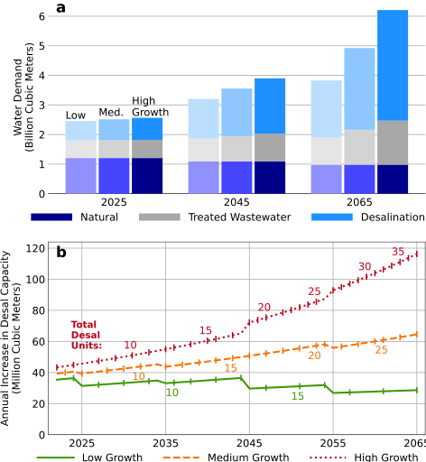
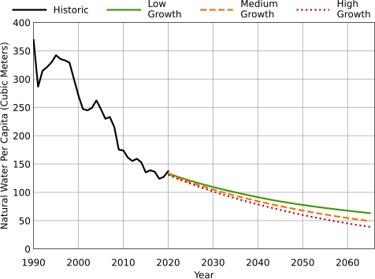
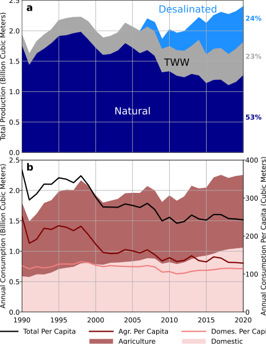
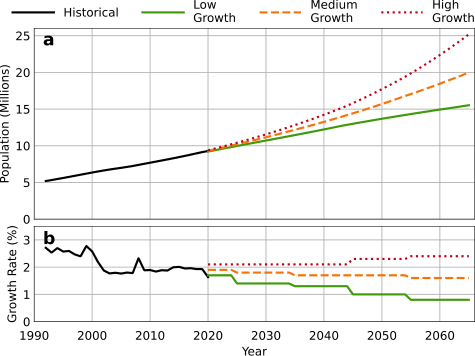

::: {.paper-authors}
Isaac Kramer^1^, Yaara Tsairi^2^, Michael Buchdahl Roth^3^, Alon Tal^4^, Yair Mau^1^
:::

::: {.paper-affil}
^1^ Institute of Environmental Sciences, The Robert H. Smith Faculty of Agriculture, Food and Environment, The Hebrew University of Jerusalem, Rehovot, Israel &nbsp;&middot;&nbsp; ^2^ Faculty of Architecture and Town Planning, Technion – Israel Institute of Technology, Haifa, Israel &nbsp;&middot;&nbsp; ^3^ Harvard Kennedy School, Belfer Center for Science and International Affairs, Harvard University, Cambridge, MA, USA &nbsp;&middot;&nbsp; ^4^ Department of Public Policy, Tel Aviv University, Tel Aviv, Israel
:::

---

::: {.paper-meta}
Article &middot; npj Clean Water, 5:67 &middot; 2022 &middot; doi: [10.1038/s41545-022-00215-9](https://doi.org/10.1038/s41545-022-00215-9)

Received 25 July 2022; Accepted 15 December 2022

Correspondence: Isaac Kramer (isaac.kramer@mail.huji.ac.il)
:::

> **How to cite:** Kramer, I., Tsairi, Y., Buchdahl Roth, M., Tal, A. and Mau, Y. (2022). Effects of population growth on Israel's demand for desalinated water. npj Clean Water, 5, 67. https://doi.org/10.1038/s41545-022-00215-9

---

#### Abstract

In 2005, Israel began using desalination to augment limited natural water supplies. While desalination has helped Israel overcome chronic water shortages, high-population growth may test this approach. We examine how three population growth scenarios (low, medium, high) could affect water demand and supply by 2065. Our projections show that Israel will need to desalinate as much as 3.7 billion m³ annually, compared to 0.5 billion m³ in 2020. Meeting this demand could require the construction of 30 new desalination units. The effects of population growth on Israel's water supply are likely to dwarf those of climate change. Increased desalination would, however, increase electricity demand, requiring over 11 TWh electricity annually. Population growth is also likely to challenge Israel's wastewater management policies, producing more effluent than farmers will have the capacity to consume. The Israeli experience will provide important lessons for regions facing similar pressures.

## Introduction

Ensuring sufficient water supply has always been among Israel's foremost challenges. During the first several decades of its history, Israel managed chronic water scarcity through a combination of technological innovations, conservation efforts, and policy measures. Israel implemented a large-scale domestic wastewater recycling program, encouraged efficiency measures such as drip irrigation, and carried out successful public awareness campaigns to promote water conservation ([1](#ref-1)). Despite these efforts, water levels in the Sea of Galilee, Israel's largest source of natural water, repeatedly reached dangerously low levels. Facing regular deficits in supply, in 1999 the Israeli government decided to pursue desalination as a strategy to address water scarcity. Since then, Israel has built five major reverse osmosis facilities at Ashkelon (2005), Palmachim (2007), Hadera (2009), Sorek (2013) and Ashdod (2015). A sixth desalination plant is scheduled to open by 2025 in Israel's north ([2](#ref-2)), and a second plant is being planned at Sorek ([3](#ref-3)). As of 2020, desalination supplies approximately 50% of Israel's domestic water needs ([4](#ref-4)).

While increasing reliance on desalination has largely eliminated the public perception that Israel faces an impending water crisis, rising population levels are likely to place unprecedented stress on Israel's water infrastructure. Israel's population growth rate over the past 30 years has averaged just over 2.1% ([5](#ref-5)), a singularly high rate amongst industrialized countries ([6](#ref-6)). Israel's Central Bureau of Statistics anticipates an increase in population from approximately 9.5 million in 2022 to between 15–25 million by 2065, depending on actual growth rates.

In this paper, we compare the effects of three different population growth rates on Israel's water system from 2020 to 2065 ([7](#ref-7)). In the high-growth scenario, Israel's population continues to expand by more than 2% annually, in the medium scenario the growth rate gradually falls to 1.6%, and under the low-growth scenario it steadily drops to 0.8% annually by 2065 (Methods). As the basis for our analysis, we rely on historical water production and consumption data, which show that per capita consumption rates have remained largely stable over the last two decades, making projected demand a function of population ("Methods").

Our work demonstrates that population growth is likely to necessitate an unprecedented increase in the production of desalinated water, while the availability of freshwater from natural sources is likely to decline both in per capita and absolute terms. We show that the total effects of population growth on Israel's water system can be expected to far outweigh those of climate change. Increased reliance on desalination will require a correspondingly large investment in infrastructure to ensure that Israel's production capacity keeps pace with water demand. The extent to which Israel is able to ensure adequate water supplies will provide lessons to other countries and regions facing acute water scarcity and high-population growth.

## Results

### Total water consumption

Our forecasts show that Israel's total water needs are expected to rise in direct proportion to population growth (Fig. 1a). In 2020, Israel consumed approximately 2.4 billion m³. Our projections show that by 2065 total demand will rise to 3.8, 4.9, and 6.2 billion m³ under the low-, medium-, and high-growth scenarios, respectively. To put this in historical perspective: during the 60 years between 1960 and 2020, Israel's water consumption rose from 1.3 to 2.4 billion m³, an 85% increase over 60 years. By 2065, water demand would increase by 160% under the high-growth scenario. Increasing water supplies by this amount in just 35 years would constitute a quadrupling in the rate by which national water demand grew from 1960 to 2020.

### Required desalination capacity

By 2065, desalination will account for the majority of Israel's water production, under all population change scenarios (Fig. 1a). Under the low-growth scenario, Israel will need to increase desalination production from 0.5 in 2020 to 1.9 billion m³ per year by 2065 (280% increase). Under the medium-growth scenario, required desalination will rise to 2.75 billion m³ per year (450% increase) and under the high-growth scenario to 3.75 billion m³ per year (650% increase).

Supplying this quantity of desalinated water will require massive infrastructure expansion and energy expenditure. As of 2020, the average annual production at each of Israel's five desalination facilities was approximately 100 million m³. For the sake of comparison between present and future infrastructure, we define 100 million m³ as a desalination unit. We use the term unit, instead of plant, to emphasize the possibility that future desalination facilities could be more efficient, both in terms of energy needed to desalinate water and physical footprint. Meeting future demand would require 37 desalination units under the high-growth scenario, 27 under the medium-growth scenario, and 19 under the low-growth scenario. Crucially, the rate at which Israel will have to add desalination capacity scales with the expected geometric population growth. That is, under the high-growth scenario Israel would have to build 7 new desalination units from 2020 to 2035, while it will be required to add 11 new units between 2055 and 2065 alone. These comparisons are not intended to infer a specific number of plants that Israel would need to build, but to illustrate the scale of infrastructure investment that will be required to keep pace with rising demand.

**Fig. 1 | Expected growth in Israel's water demand will require substantial increase in desalination capacity.** **(a)** Israel's water demand is expected to scale linearly with population growth. Given constraints on natural water production, most additional demand will be met through desalination. **(b)** Rate at which Israel will have to increase desalination capacity is strongly affected by population growth rate. Vertical lines represent points at which desalination requirements increase by 100 million m³, the average capacity of one of Israel's current desalination facilities. By 2065, Israel would need an additional 1500 to 3500 MCM of water, or between 19–37 total desalination units.

### Treated wastewater production

In the future, treated effluent from Israel's domestic wastewater is likely to eclipse the demand from the agriculture sector. Under all but the low-growth scenario, treated wastewater—already the primary source of water for agriculture in Israel in 2022—is projected to comprise the second largest source of water. Even in the low-growth scenario, treated wastewater production is forecast to rise from just 0.5 in 2020 to 0.9 billion m³ in 2065. Under the medium-growth scenario, we project that treated wastewater production will increase to 1.2 billion m³ per year, and under high-growth that it will reach 1.5 billion m³ per year. Processing such large quantities of wastewater would of course require a corresponding investment in the infrastructure used to collect and treat domestic effluent.

It is already clear, however, that Israel's agricultural sector, which has seen improving water efficiency in recent decades, may not be able to utilize a threefold increase in the treated effluent. Restrictions on which crops can be irrigated using treated wastewater, and regulations preventing the use of treated wastewater within a certain proximity of Israel's aquifers, for instance, are likely to limit the agricultural system's ability to absorb increased quantities of treated wastewater. Israel's burgeoning population also requires the construction of approximately 60,000 new housing units and associated infrastructure per year, leading to the annual loss of roughly 30 km² of open spaces ([8](#ref-8)). These invariably include fertile lands, previously zoned as agricultural, further complicating the task of absorbing significantly higher quantities of effluent ([9](#ref-9)). Additional environmental and health concerns raised by the continued use of treated wastewater are discussed in the section "Sustainability of treated wastewater for agriculture".

### Supplies of natural water

Our projections show that natural water from precipitation will become the smallest source of consumed water in all but the lowest population growth scenario (Fig. 1). Natural water production per capita, which was above 300 m³ per person per year prior to 2000, is forecast to fall to less than 40 m³ per person per year by 2065 under the high-population growth scenario. Under the medium-population growth scenario our projections show that natural water per capita will be 50 m³ per year and under the low-growth scenario 63 m³ per year (Fig. 2).

These numbers emphasize the extent to which Israel will be dependent on non-natural water supplies to meet its growing demand. Historical data show that annual consumption per capita in Israel has averaged around 100 m³ for domestic purposes and 250 m³ in total (Methods). Israel would have to significantly lower its per capita water consumption if it were to attempt to supply a larger fraction of demand using natural sources. It is worth noting that it is cheaper and less energy intensive to produce water from natural sources, as opposed to desalination. Farmers generally prefer freshwater over desalinated and treated wastewater, due to the effects that the chemical composition of the latter two often have on plant growth and soil health (section "Sustainability of treated wastewater for agriculture").

**Fig. 2 | Natural water per capita is expected to continue its long-term decline under all population growth scenarios.** As a result, natural water will be able to supply only a small fraction of Israel's total demand.

## Discussion

### Expansion of desalination

While reliance on desalination may allow Israel to meet basic domestic and agricultural needs, doing so will have considerable environmental consequences. Foremost, increased production of desalinated water will lead to a correspondingly steep rise in energy demand. The world's most efficient desalination facilities currently require 3–3.5 kWh to desalinate 1 m³ of seawater ([10](#ref-10)&ndash;[12](#ref-12)). Assuming the lower end of this bound, under the high-growth scenario, Israel will need an additional 11 TWh per year, or about 15% of the country's current electrical generation. For comparison's sake, this amount of electricity would require the equivalent of a 1600 MW natural gas power plant operating with an 80% capacity factor. Of course, technological improvements can be expected to make the desalination process less energy intensive, but the rate of reduction is expected to be limited ([13](#ref-13)). We emphasize that these numbers include only the electricity required for the reverse osmosis process. They do not include the cost or energy associated with pumping water from the Mediterranean, distribution within Israel, and eventual wastewater treatment, all of which are energy intensive in their own right ([14](#ref-14)). While renewable energy generation holds great promise, it could take decades before Israel has a low-carbon electricity system. Indeed, Israeli pledges at the Glasgow COP 26 envision only 30% of electricity coming from renewable sources by 2030 ([15](#ref-15)). Should Israel pursue a solar PV-based decarbonization strategy, it will require substantial amounts of open space, in a country that already suffers from land shortages ([12](#ref-12)). If solar PV is to become a main source of electricity generation in Israel, then demand will far exceed what is viable to produce on rooftops. At present, Israel generates over 90% of its electricity from fossil fuels, mostly natural gas and in the near-term, desalination will lead to increased greenhouse gas emissions ([14](#ref-14)).

The construction of new desalination facilities has the potential to negatively affect Israel's coastal landscape and aquatic coastal ecosystem. At present, Israel's major desalination plants are all located along the country's Mediterranean shoreline, with the future Haifa and Sorek II plants also planned for the coast. Significant future construction has the potential to limit public access to coastal recreation areas. While the construction of future desalination facilities at inland locations may alleviate the environmental impact on Israel's coast, the feasibility of such construction is still being evaluated. An inland approach could increase the energy requirements for desalination, since it would require pumping seawater further inland. Moreover, scientists and environmentalists have voiced concerns that increased reliance on the pumping of seawater and discharge of brine following desalination over the long term has the potential to damage Israel's coastal ecosystems, including plant and animal life ([16](#ref-16)&ndash;[18](#ref-18)). For almost two decades Israel's Oceanic and Limnological Research Institute has carefully monitored the effects of desalination facilities in these areas and has yet to detect signs of consequential ecological damage ([19](#ref-19),[20](#ref-20)). Notwithstanding, this is an issue that requires continuous observation and analysis.

A transition to desalinated water as the primary source of drinking water also raises a number of potential health concerns. Notably, desalinated water is lacking in certain minerals, such as magnesium, considered essential for human health ([21](#ref-21),[22](#ref-22)). The long-term consequences of consuming water that does not contain these elements are unknown ([21](#ref-21),[22](#ref-22)).

### Sustainability of treated wastewater for agriculture

Despite the boon that treated wastewater has been to Israeli farmers—ensuring a steady supply of low-cost water—leading voices within the scientific community have raised potential environmental and health concerns that question the sustainability of Israel's practices ([23](#ref-23)&ndash;[26](#ref-26)).

Treated wastewater, including Israel's relatively high-quality effluents, remains high in salt content, which can lead to reduced plant yield and increase the risk of long-term soil degradation ([26](#ref-26)&ndash;[28](#ref-28)). In particular, recent research has demonstrated that irrigation water with a high relative fraction of sodium can cause irreversible breakdowns in soil structure, such that the affected land can no longer support agricultural production. Long-term use of saline water also has the potential to pollute Israel's aquifers ([27](#ref-27)).

Treated wastewater is additionally known to contain various chemical compounds—ranging from pharmaceuticals to heavy metals—that may present risks to human health. When used for agriculture, pharmaceuticals and heavy metal compounds can be taken up by food crops and consumed by people ([29](#ref-29)&ndash;[32](#ref-32)). Crucially, the health consequences of long-term exposure to these compounds are uncertain and further research in this area is needed ([33](#ref-33)).

Should Israel determine that reliance on treated wastewater for agriculture is too great a liability, this would create a twofold stress for the country's water infrastructure. First, additional water supplies would be required to sustain the country's farmers, with the only viable alternative likely being the production of additional desalinated water. Given current energy prices, however, the cost of using desalinated water appears to be prohibitively expensive for most crops ([25](#ref-25),[34](#ref-34)). Israel would then face a choice between continuing to support local agricultural production, despite the high costs, or moving to import required food supplies, which could be expensive and present potential national security risks. Second, Israel would have to find an environmentally acceptable method of discharging the large quantities of wastewater previously allocated to agriculture. If reusing treated effluent for agriculture is no longer viable, Israel will need to adjust its water treatment infrastructure.

One plausible scenario for coping with increased quantities of domestic wastewater is the possibility of treating this water to a higher level so that it can be re-used as drinking water, as has been done in potable reuse programs for years in American states like California, Virginia, and Colorado ([35](#ref-35)). Expanded potable reuse could also lead to a decrease in Israel's demand for desalinated water, lowering energy costs and greenhouse gas emissions while ameliorating pressure on Israel's coastal landscape and ecosystems. Treating wastewater to a higher level could also enable continued use by farmers, albeit at a higher cost.

### Effect of climate change minimal compared to population rise

Our analysis shows that the expected effects of climate change on Israel's water supply are likely to be minimal compared to those of population growth. An assumed 20% decline in production from natural water resources by 2065 ("Methods"), represents a decrease of 245 million m³ per year in comparison to 2020 levels. Even if we consider a larger decline in natural sources due to climate change, the lost capacity pales in comparison to the increased demand from population growth, which is an order of magnitude larger. That is, our projections show that Israel's water supply will remain precarious even if the worst consequences of global climate change do not materialize. Of course, even if climate change's effects on Israel's drinking water may be small compared to that caused by population growth, any change in precipitation patterns also has the potential to raise the risk of forest fires, cause increased flooding, and affect the region's wildlife.

### Security concerns and regional cooperation

In past military conflicts, Israel's coastal desalination facilities have been a target for both rocket and cyber-attacks. Thus far, Israel's Iron Dome and other defense systems have withstood these challenges. Nonetheless, should a desalination plant be forced offline for a prolonged period of time, it could potentially disrupt water supply.

It is also important to note Israel's obligations to provide fixed quantities of water to the Palestinian Authority and Jordan, pursuant to the Oslo II Accords and the 1994 peace treaty with Jordan. While it is beyond the scope of this analysis, Israel's neighbors are themselves under intense pressure to meet the water demands of growing populations. Unlike Israel, Palestine and Jordan are already suffering from major deficits in supply, with access severely limited. Moreover, Israel's neighbors are less well positioned to increase desalination capacity. Water scarcity in Jordan, Palestine, and other countries in the region has the potential to cause significant unrest, representing a major security concern for Israel and its neighbors. The possibility of Israel supplying desalinated water to its neighbors has often been suggested as a possible component of regional peace building ([36](#ref-36)). In fact, in 2021 Israel agreed to double its annual water supply to Jordan to 100 MCM ([37](#ref-37)). Any additional steps to the export of water to Jordan or Palestine would, however, add an additional component of stress to an Israeli water system that will already be facing unprecedented demand driven by population growth.

The sustainability of any future plan to address Israeli water scarcity could be bolstered by steps to increase cooperation between Israel and its neighbors. At present, for example, significant quantities of untreated wastewater flow from the West Bank into Israel ([38](#ref-38)&ndash;[40](#ref-40)). Likewise, sewage discharge from Gaza into the Mediterranean has in the past caused fouling of membranes at Israel's Ashkelon desalination plant, even forcing the plant to go offline ([41](#ref-41)). Capture and treatment of wastewater within Palestine would have the dual benefit of increasing potential irrigation supplies for Palestinian farmers while reducing pollution of transboundary water resources ([42](#ref-42)). Increased water access, of course, also has the potential to decrease water-driven security risks in the region.

### Ecological concerns

The projections presented here only consider how an increase in water demand could impact future demand from desalination. We do not examine how rising population levels might limit access to water resources for recreational purposes. Nonetheless, we can expect that a larger population will put increased strain on access to Israel's streams, rivers, and lakes ([43](#ref-43)). Likewise, reduced natural flows are liable to stress the flora and fauna in the country's national parks and nature reserves ([43](#ref-43)). A recent report by Israel's State Comptroller revealed that the country's compliance with the UN Convention on Biodiversity is woefully inadequate, with the country failing to meet 74% of the convention's measurable objectives ([44](#ref-44)). Providing nature with reliable and reasonable water flows will be critical to preserving the country's unique ecosystems, but increasingly difficult given the anticipated growth in anthropogenic demands.

### Global bellwether

The extent to which Israel is able to meet the water demands of a growing population in the face of increasingly insufficient natural supplies could provide valuable insight for regions and governments facing similar pressures. The population growth rate in the American Southwest, for instance, has far outpaced that of the U.S. as a whole, with water resources in the region already extremely stressed. In contrast to Israel, the American Southwest lacks the advantages of a centralized water authority. Additionally, many of the population centers in the American Southwest are far removed from potential sources of desalinated water, making the challenge of water delivery even greater and the value of efficiency and wastewater treatment and reuse higher. Likewise, middle-income countries facing acute water scarcity (e.g., Brazil, South Africa) may look to Israel's experience as they seek to increase water supplies for growing populations.

Hydrological stability is typically considered a prerequisite for sustainability. In water-scarce regions, projected climate-change-driven precipitation decreases matter. But the anticipated shortages caused by population growth appear to matter far more. Desalination offers a possible way-out of such conundrums. But for the foreseeable future, the absence of low-carbon electricity to power this energy-intensive process means that relying on desalination technology will contribute to increased greenhouse gas emissions. Should Israel struggle in its effort to meet growing water demand, or be unable to do so without significantly increasing carbon emissions, it will provide a stark warning of the challenges ahead.

### Water in the context of other constraints on Israeli population growth

While many technologically-optimistic managers perceive desalination as a panacea for providing water supply under conditions of steady population growth, in other areas of life, solutions are more elusive. This is particularly true in designing infrastructure that utilizes land resources, such as housing, agriculture, and the production of raw materials for construction.

To meet projected demand for residential housing between 2020–2030, Israel will need to add an additional 560,000 housing units to present stock. Due to the nature of exponential growth functions, however, demand will grow to over 1.05 million housing units between 2050–2060. Supplying the corresponding housing and infrastructure is expected to put further pressure on Israel's open spaces, which are already disappearing at a rate of 30 km² a year ([8](#ref-8)). The depletion of open spaces, including agricultural lands, could also pose a threat to Israel's food security in the future. Already, official figures cite current Israeli food imports at around 64% of total calories consumed by the population ([45](#ref-45)) with some experts calculating even greater dependence on food imports ([46](#ref-46)). Besides expanding the carbon footprint of Israel's food supply, such significant reliance on imported crops increases the country's vulnerability and exposure to global shocks in the food markets during times of international turbulence or military conflict.

## Methods

### Modeling expected water production and demand

**Technological improvements.** The trends discussed here are robust even if dramatic technological improvements allow Israel to greatly reduce per capita water consumption. For instance, if we assume a 30% decline in per capita consumption, a truly dramatic change considering historical values and Israel's already impressive water conservation practices, Israel would still need to produce 2.3 billion m³ of desalinated water in 2065 for the high-growth scenario. This constitutes a 350% increase in capacity compared to 2020 levels and would require significant infrastructure investment.

We simulate future Israeli water demand using a combination of population projections from 2020 to 2065 and assumptions about future water consumption based on historical data from 1992–2020 ([4](#ref-4),[7](#ref-7)). In Fig. 3 we show that Israel's total and domestic water consumption have remained stable over the past several decades, enabling us to model future demand uniquely as a function of expected population levels. The population growth forecasts that we use were developed by Israel's Central Bureau of Statistics ([7](#ref-7)). The different growth scenarios, together with Israel's historic population changes are presented in Fig. 4.

**Fig. 3 | Israel water consumption and production, 1992–2020.** **(a)** Israel water production by source. **(b)** Absolute and per capita water consumption in Israel by sector. Note: In 2015, Israel's Central Bureau of Statistics started reporting domestic and industrial consumption together. For simplicity, data for the period prior to 2015 is presented using the new practice in the above figure.

Between 2010 and 2020 Israel's total (i.e., all sectors) water consumption was steady, averaging 246 m³ per capita annually, with per capita domestic consumption averaging 100 m³ annually. We assume that total and domestic demand will remain at these levels through 2065, which is consistent with Israel's Master Plan for the National Water Sector ([47](#ref-47)). Expected water demand is thus taken to be the product of future population and average per capita consumption values.

Israel's extraction of natural water from the Sea of Galilee, aquifers, and other surface water has steadily declined over the past 15 years, corresponding to a sustained increase in the production of desalinated water ([4](#ref-4)). In the coming decades, Israel's reliance on natural water is expected to decline further ([47](#ref-47)). In many cases, extraction from natural sources is either nearing or has already exceeded its maximum sustainable yield; the level at which additional consumption would cause irreversible hydrological damage. Overextraction from Israel's coastal aquifer, for instance, has the potential to cause intrusion of seawater to the aquifer and salination of wells ([48](#ref-48)&ndash;[50](#ref-50)).

Likewise, climate change, including the projected shortening of the winter rainy season and higher average temperatures throughout the year makes increased availability from natural sources highly unlikely ([51](#ref-51)&ndash;[55](#ref-55)). Moreover, in order to reverse the negative trends in biodiversity indicators, Israel has defined a strategic goal of returning more water to nature ([47](#ref-47)). Given these constraints on natural production and the aforementioned climatic impacts, Israel's Master Plan anticipates a steady decrease in consumption from natural sources ([47](#ref-47)). In our simulations, we assume a decline by 20% from the long-term mean (1.23 billion m³ annually) by 2065, consistent with the Israel Water Authority's estimates ([47](#ref-47)).

Between 2010–2020, Israel was able to steadily capture and treat an average of 60% of its domestically consumed water, with recycled wastewater comprising the largest source of water for irrigation in agriculture ([4](#ref-4),[47](#ref-47)). Our forecasts assume that Israel will continue to treat and use 60% of its domestic wastewater for agriculture, notwithstanding significant environmental challenges, discussed in the section "Sustainability of treated wastewater for agriculture".

**Fig. 4 | Historical and projected population growth in Israel to 2065.** **(a)** Projected changes to total population numbers. **(b)** Annual growth rates used to construct population forecasts. High growth assumes a population growth rate of 2.1% per year through 2045, 2.3% per year from 2046 to 2055, and 2.4% per year from 2056 to 2065. The medium-growth scenario assumes a population growth rate of 1.9% per year to 2025, 1.8% per year from 2026 to 2035, 1.7% per year from 2036 to 2055, and 1.6% per year from 2056 to 2065. The low-growth scenario considers a growth rate of 1.7% per year to 2025, 1.4% per year from 2026 to 2035, 1.3% per year from 2036 to 2045, 1.0% per year from 2046 to 2055, and 0.8% per year from 2056 to 2065.

## Data Availability

All the data used in our simulations are publicly available from Israel's Central Bureau of Statistics. The authors have shared this data at [github.com/isaackramer/water-population-Israel](https://github.com/isaackramer/waterpopulation-Israel) ([56](#ref-56)).

## Code Availability

All of the simulation code is available at [github.com/isaackramer/water-population-Israel](https://github.com/isaackramer/waterpopulation-Israel) ([56](#ref-56)).

## Acknowledgements

The authors thank Elion Adar, Dror Avisar, Shmuel Assouline, Dennis Gamzin, Lea Kronaveter, and Miki Zaide for helpful discussions.

## Author Contributions

I.K.: Conceptualization, Data curation, Formal analysis, Investigation, Methodology, Visualization, Software, Writing—original draft, Writing—review & editing. Y.T.: Conceptualization, Methodology, Writing—review & editing. Michael Buchdahl Roth: Methodology, Writing—review & editing. A.T.: Conceptualization, Writing—review & editing, Supervision. Y.M.: Conceptualization, Visualization, Formal analysis, Writing—review & editing, Supervision.

## References

[1]{#ref-1} Megdal, S. B., Varady, R. G., & Eden, S. (eds.). *Shared Borders, Shared Waters: Israeli-Palestinian and Colorado River Basin Water Challenges* 1st edn (CRC Press, 2012).

[2]{#ref-2} Roah, A. The Rimon Group is the winner of the Mekorot tender for the connection of the desalination plant in the Western Galilee. *Calcalist* (2022).

[3]{#ref-3} Barkat, A. IDE wins sorek 2 desalination tender amid US pressure. *Globes* (2020).

[4]{#ref-4} Israel Central Bureau of Statistics. Energy and Water—Statistical Abstracts of Israel (1996–2018) (2018).

[5]{#ref-5} Israel Central Bureau of Statistics. Population—Statistical Abstract of Israel 2021—No.72 (2021).

[6]{#ref-6} OECD. Historical Population Growth Rates in OECD (2022).

[7]{#ref-7} Israel Central Bureau of Statistics. Projections of Israel Population until 2065 (2017).

[8]{#ref-8} Ben-Moshe, N. & Ronen, I. State of Nature Report—Israel 2022—Trends and Threats. Hamaarag – Israel's National Ecosystem Assessment Program, Steinhardt Museum of Natural History, Tel Aviv University (2022).

[9]{#ref-9} Tal, A. in *At Nature's Edge, The Global Present and Long-Term History* (eds. Cederlöf, G. & Rangarajan, M.) 142–161 (Oxford University Press, 2018).

[10]{#ref-10} Meindertsma, W., Van Sark, W. G. J. H. M. & Lipchin, C. Renewable energy fueled desalination in Israel. *Desalination Water Treat.* 13, 450–463 (2010).

[11]{#ref-11} Ghalilah Desalination Plant Honored with Distinction Award for Desalination Plant of the Year at 2016 Global Water Awards. *Water Online* (2016).

[12]{#ref-12} Roth, M. B. & Tal, A. The ecological tradeoffs of desalination in land-constrained countries seeking to mitigate climate change. *Desalination* 529, 115607 (2022).

[13]{#ref-13} Caldera, U. & Breyer, C. Learning curve for seawater reverse osmosis desalination plants: capital cost trend of the past, present, and future. *Water Resour. Res.* 53, 10523–10538 (2017).

[14]{#ref-14} Tal, A. Addressing desalination's carbon footprint: the Israeli experience. *Water* 10, 197 (2018).

[15]{#ref-15} Tal, A. Israel's response to the global climate crisis. *Isr. J. Foreign Aff.* 15, 409–414 (2021).

[16]{#ref-16} Drami, D., Yacobi, Y. Z., Stambler, N. & Kress, N. Seawater quality and microbial communities at a desalination plant marine outfall. A field study at the Israeli Mediterranean coast. *Water Res.* 45, 5449–5462 (2011).

[17]{#ref-17} Kenigsberg, C., Abramovich, S. & Hyams-Kaphzan, O. The effect of long-term brine discharge from desalination plants on benthic foraminifera. *PLoS ONE* 15, e0227589 (2020).

[18]{#ref-18} Einav, R. & Lokiec, F. Environmental aspects of a desalination plant in Ashkelon. *Desalination* 156, 79–85 (2003).

[19]{#ref-19} Petersen, K. L., Frank, H., Paytan, A. & Bar-Zeev, E. Impacts of seawater desalination on coastal environments. *Sustainable Desalination Handbook: Plant Selection, Design and Implementation* (ed. Gude, V. G.) 437–463 (Butterworth-Heinemann, 2018).

[20]{#ref-20} Grossowicz, M., Varulker, S., Koren, N. & Gal, G. Desalination plants do not impact the diversity or abundance of zooplankton of the Israeli coast. *Desalination* 511, 115097 (2021).

[21]{#ref-21} Rosen, V. V., Garber, O. G. & Chen, Y. Magnesium deficiency in tap water in Israel: the desalination era. *Desalination* 426, 88–96 (2018).

[22]{#ref-22} Lesimple, A., Ahmed, F. E. & Hilal, N. Remineralization of desalinated water: methods and environmental impact. *Desalination* 496, 114692 (2020).

[23]{#ref-23} Ben-Gal, A., Tal, A. & Tel-Zur, N. The sustainability of arid agriculture: trends and challenges. *Ann. Arid Zone* 45, 1–31 (2006).

[24]{#ref-24} Raveh, E. & Ben-Gal, A. Irrigation with water containing salts: evidence from a macro-data national case study in Israel. *Agric. Water Manag.* 170, 176–179 (2016).

[25]{#ref-25} Tal, A. Rethinking the sustainability of Israel's irrigation practices in the Drylands. *Water Res.* 90, 387–394 (2016).

[26]{#ref-26} Kramer, I., Bayer, Y. & Mau, Y. The Sustainability of Treated Wastewater Irrigation: The Impact of Hysteresis on Saturated Soil Hydraulic Conductivity. *Water Resour. Res.* 58, 1–14 (2022).

[27]{#ref-27} Hillel, D. Salinity Management for Sustainable Irrigation: Integrating Science, Environment, and Economics. The World Bank (2000).

[28]{#ref-28} Adeyemo, T., Kramer, I., Levy, G. J. & Mau, Y. Salinity and sodicity can cause hysteresis in soil hydraulic conductivity. *Geoderma* 413, 115765 (2022).

[29]{#ref-29} Fu, Q. et al. Pharmaceutical and personal care products: from wastewater treatment into agro-food systems. *Environ. Sci. Technol.* 53, 14083–14090 (2019).

[30]{#ref-30} Malchi, T., Maor, Y., Tadmor, G., Shenker, M. & Chefetz, B. Irrigation of root vegetables with treated wastewater: evaluating uptake of pharmaceuticals and the associated human health risks. *Environ. Sci. Technol.* 48, 9325–9333 (2014).

[31]{#ref-31} Ben Mordechay, E., Tarchitzky, J., Chen, Y., Shenker, M. & Chefetz, B. Composted biosolids and treated wastewater as sources of pharmaceuticals and personal care products for plant uptake: A case study with carbamazepine. *Environ. Pollut.* 232, 164–172 (2018).

[32]{#ref-32} Schapira, M. et al. Involuntary human exposure to carbamazepine: a cross-sectional study of correlates across the lifespan and dietary spectrum. *Environ. Int.* 143, 105951 (2020).

[33]{#ref-33} Futran Fuhrman, V., Tal, A. & Arnon, S. Why endocrine disrupting chemicals (EDCs) challenge traditional risk assessment and how to respond. *J. Hazard. Mater.* 286, 589–611 (2015).

[34]{#ref-34} Yermiyahu, U., Tal, A., Ben-Gal, A., Tarchitzky, J. & Lahav, O. Rethinking desalinated water quality and agriculture. *Science* 318, 920–921 (2007).

[35]{#ref-35} United States Environmental Protection Agency. 2017 Potable Reuse Compendium (2017).

[36]{#ref-36} Bromberg, G., Majdalani, N. & Taleb, Y. A. A Green Blue Deal for the Middle East. EcoPeace Middle East (2020).

[37]{#ref-37} AFP. Israel signs deal doubling water supply to parched Jordan. *The Times of Israel* (2021).

[38]{#ref-38} Salem, H. S., Yihdego, Y. & Hamaaziz Muhammed, H. The status of freshwater and reused treated wastewater for agricultural irrigation in the Occupied Palestinian Territories. *J. Water Health* 19, 120–158 (2021).

[39]{#ref-39} Dotan, P. et al. Endocrine disrupting compounds in streams in Israel and the Palestinian West Bank: Implications for transboundary basin management. *J. Environ. Manag.* 204, 355–364 (2017).

[40]{#ref-40} Tal, A. in *Shared Borders, Shared Waters: Israeli-Palestinian and Colorado River Basin Water Challenges* (eds. Megdal, S. B., Varady, R. G. & Susanna, E.) (CRC Press, 2013).

[41]{#ref-41} Efron, S., Noach, K. & Shusterman, N. The Gaza Strip and the Climate Crisis. Tel Aviv University Institute for National Security Studies (2022).

[42]{#ref-42} Jerusalem Post Staff. Israel, Palestinian Authority partner to transport water to Palestinian farmers. *The Jerusalem Post* (2022).

[43]{#ref-43} Tal, A. *The Land is Full: Addressing Overpopulation in Israel* (Yale University Press, 2016).

[44]{#ref-44} Israel State Comptroller. Preventing Damage from Invasive Species and Preserving Biodiversity (Hebrew). Israel State Comptroller (2022).

[45]{#ref-45} Shaked, O. & Akingbe, O. O. Israeli Food Supply Chain. United States Department of Agriculture Foreign Agricultural Service (2022).

[46]{#ref-46} Fridman, D., Koellner, T. & Kissinger, M. Exploring global interregional food system's sustainability using the functional regions typology. *Glob. Environ. Change* 68, 102276 (2021).

[47]{#ref-47} Gamzin, D., Zaide, M. & Shamir, U. Master Plan for the National Water System: A Probability Analysis of the Discrepancy between Demand for Freshwater and Natural Supply, on a National Level, up to 2050. Israel Water Authority (2011).

[48]{#ref-48} Paldor, A., Shalev, E., Katz, O. & Aharonov, E. Dynamics of saltwater intrusion and submarine groundwater discharge in confined coastal aquifers: a case study in northern Israel. *Hydrogeol. J.* 27, 1611–1625 (2019).

[49]{#ref-49} Kafri, U. & Arad, A. Current subsurface intrusion of Mediterranean seawater—a possible source of groundwater salinity in the Rift Valley system, Israel. *J. Hydrol.* 44, 267–287 (1979).

[50]{#ref-50} Melloul, A. J. & Goldenberg, L. C. Monitoring of seawater intrusion in coastal aquifers: basics and local concerns. *J. Environ. Manag.* 51, 73–86 (1997).

[51]{#ref-51} Hochman, A., Harpaz, T., Saaroni, H. & Alpert, P. The seasons' length in 21st century CMIP5 projections over the eastern Mediterranean. *Int. J. Climatol.* 38, 2627–2637 (2018).

[52]{#ref-52} Hochman, A. et al. Weather regimes and analogues downscaling of seasonal precipitation for the 21st century: a case study over Israel. *Int. J. Climatol.* 40, 2062–2077 (2020).

[53]{#ref-53} Hochman, A., Harpaz, T., Saaroni, H. & Alpert, P. Synoptic classification in 21st century CMIP5 predictions over the eastern Mediterranean with focus on cyclones. *Int. J. Climatol.* 38, 1476–1483 (2018).

[54]{#ref-54} Black, E. The impact of climate change on daily precipitation statistics in Jordan and Israel. *Atmos. Sci. Lett.* 10, 192–200 (2009).

[55]{#ref-55} Chenoweth, J. et al. Impact of climate change on the water resources of the eastern Mediterranean and Middle East region: Modeled 21st century changes and implications. *Water Resour. Res.* 47 (2011).

[56]{#ref-56} Kramer, I. isaackramer/water-population-Israel (v1.0.0). Zenodo. https://doi.org/10.5281/zenodo.6802334 (2022).
