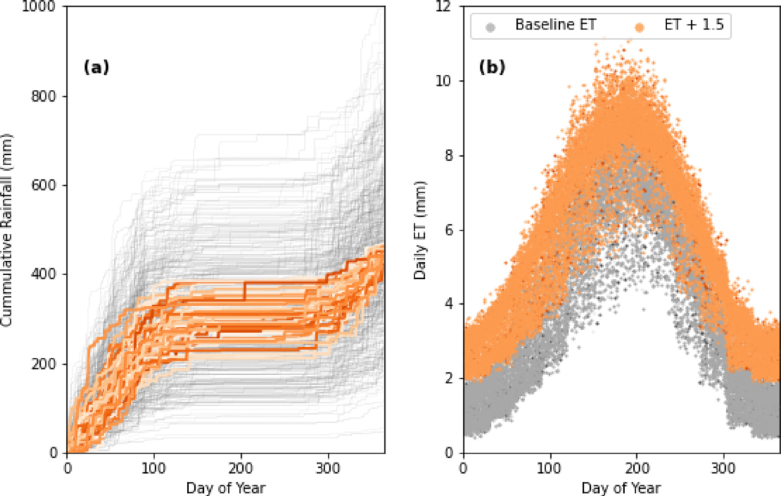
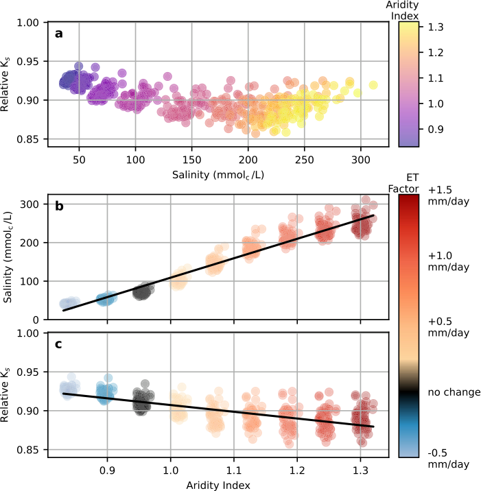
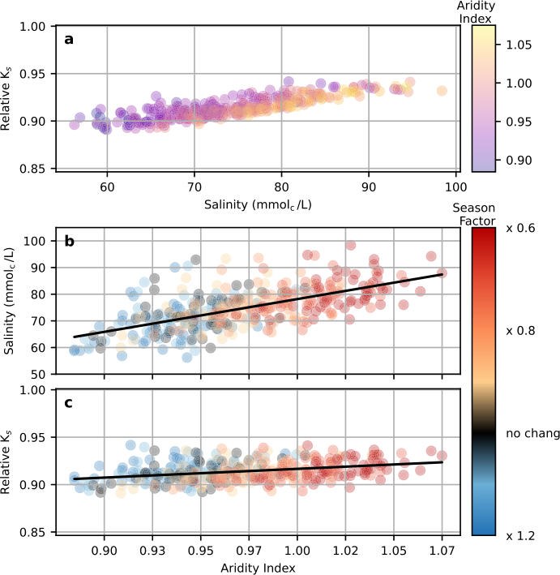
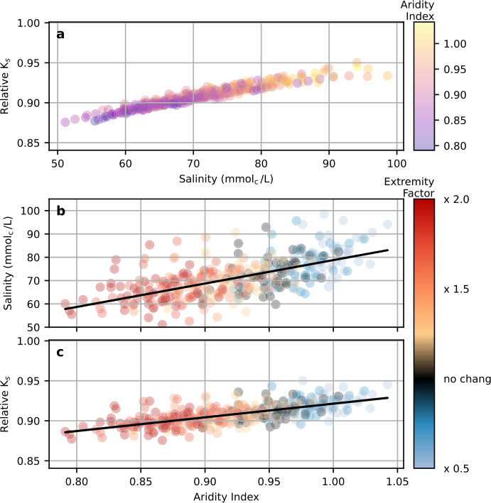
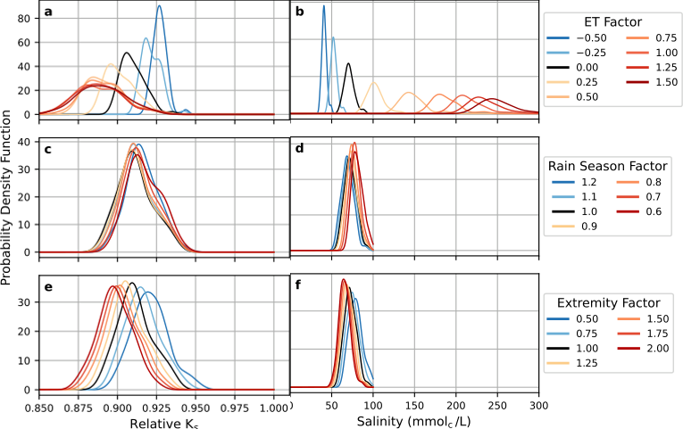

::: {.paper-authors}
Isaac Kramer^a^, Nadav Peleg^b,c^, Yair Mau^a,\*^
:::

::: {.paper-affil}
^a^ Institute of Environmental Sciences, The Robert H. Smith Faculty of Agriculture, Food and Environment, The Hebrew University of Jerusalem, Rehovot, Israel &nbsp;&middot;&nbsp; ^b^ Institute of Earth Surface Dynamics, University of Lausanne, Lausanne, Switzerland &nbsp;&middot;&nbsp; ^c^ Expertise Center for Climate Extremes, University of Lausanne, Lausanne, Switzerland
:::

---

::: {.paper-meta}
Agricultural Water Management 307, 109223 &middot; 2025 &middot; doi: [10.1016/j.agwat.2024.109223](https://doi.org/10.1016/j.agwat.2024.109223)

Received 29 June 2024; revised 21 November 2024; accepted 3 December 2024

Correspondence: Yair Mau (yair.mau@mail.huji.ac.il)
:::

> **How to cite:** Kramer, I., Peleg, N. and Mau, Y. (2025). Climate change shifts risk of soil salinity and land degradation in water-scarce regions. Agricultural Water Management, 307, 109223. https://doi.org/10.1016/j.agwat.2024.109223

---

**Keywords:** Irrigation, Salt-affected, Climate change, Sodicity, Hazard, Agriculture

#### Abstract

Climate change introduces significant uncertainty when assessing the risk of soil salinity in water-scarce regions. We combine a soil–water-salinity–sodicity model (SOTE) and a weather generator model (AWE-GEN) to develop a framework for studying salinity and sodicity dynamics under changing climate definitions. Using California's San Joaquin Valley as a case study, we perform first-order sensitivity analyses for the effect of changing evapotranspiration (ET) rates, length of the rain season, and magnitude of extreme rainfall events. Higher aridity, through increased ET, shorter rainy seasons, or decreased magnitude of extreme rainfall events, drives higher salinity — with rising ET leading to the highest salinity levels. Increased ET leads to lower levels of soil hydraulic conductivity, while the opposite effect is observed when the rainfall season length is shortened and extreme rainfall events become less intense. Higher ET leads to greater unpredictability in the soil response, with the overall risk of high salinity and soil degradation increasing with ET. While the exact nature of future climate changes remains unknown, the results show a serious increase in salinity hazard for climate changes within the expected range of possibilities. The presented results are relevant for many other salt-affected regions, especially those characterized by intermittent wet–dry seasons. While the San Joaquin Valley is in a comparatively strong position to adapt to heightened salinity, other regions may struggle to maintain high food production levels under hotter and drier conditions.

## 1. Introduction

Soil salinity and sodicity present major challenges to agricultural production ([Howitt et al., 2009](#ref-howitt2009); [Wallender and Tanji, 2011](#ref-wallender2011); [Qadir et al., 2014](#ref-qadir2014); [FAO and ITPS, 2015](#ref-faoitps2015); [Daliakopoulos et al., 2016](#ref-daliakopoulos2016); [Prăvălie et al., 2021](#ref-pravalie2021); [Kramer and Mau, 2023](#ref-kramermau2023)). High soil salinity inhibits plant water uptake, leading to declining yields and plant death ([McGeorge, 1954](#ref-mcgeorge1954); [Bernstein, 1975](#ref-bernstein1975); [Maas and Grattan, 1999](#ref-maas1999); [Munns, 2002](#ref-munns2002)). High sodicity levels can trigger the breakdown of soil aggregates, limiting the flow of water and air to the root zone, thereby threatening plant growth ([McGeorge, 1954](#ref-mcgeorge1954); [Mandal et al., 2008](#ref-mandal2008); [Levy, 2011](#ref-levy2011); [Bardhan et al., 2016](#ref-bardhan2016)). Critically, experimental and field evidence has indicated that breakdowns in soil aggregates are extremely difficult to reverse, in many cases causing permanent soil degradation ([Bhardwaj et al., 2008](#ref-bhardwaj2008); [Assouline and Narkis, 2011](#ref-assoulinenarkis2011); [Schacht and Marschner, 2015](#ref-schacht2015); [Adeyemo et al., 2022](#ref-adeyemo2022)).

The threats of salinity and sodicity are especially pronounced in water-scarce regions ([FAO, 2023](#ref-fao2023)). Due to limited freshwater supplies, food production in these areas often depends on irrigation with high salinity water, including treated wastewater and saline groundwater ([Oster, 1994](#ref-oster1994); [Bixio et al., 2006](#ref-bixio2006); [Levy, 2011](#ref-levy2011); [Assouline et al., 2015](#ref-assouline2015)). With domestic water needs typically prioritized over the agricultural sector's, reliance on high salinity irrigation water is expected to increase over the coming decades ([Oster, 1994](#ref-oster1994); [Bixio et al., 2006](#ref-bixio2006); [Levy, 2011](#ref-levy2011); [Assouline et al., 2015](#ref-assouline2015); [Kramer et al., 2022b](#ref-kramer2022b)).

Climate change introduces an additional element of uncertainty when forecasting the risk of salinity-induced damage to agriculture. Rising temperatures and changes to annual rainfall have the potential to further aggravate water scarcity, pushing growers to even greater dependence on high salinity irrigation supplies — at a time when plants are already facing more intense heat stress and atmospheric demand ([Nachshon, 2018](#ref-nachshon2018)). In areas with distinct dry and wet seasons, rainfall is often critical in the natural leaching of salts that accumulate from irrigation ([Lado et al., 2012](#ref-lado2012)). Changes in rainfall patterns (e.g., shorter rainfall season, reduction in rainfall amounts, or increase in intermittency between storms) could disrupt these processes, leading to a potential rise in average soil salinity levels, and putting the soil at risk of long-term, irreversible degradation ([Eswar et al., 2021](#ref-eswar2021)).

We seek to understand how the dynamics of salinity and sodicity in water-scarce regions are most likely to be affected by changing rainfall and temperature patterns. While the impact of salinity and sodicity on plants and soils has been closely studied ([Minhas et al., 2020](#ref-minhas2020); [Kramer and Mau, 2023](#ref-kramermau2023)), the effects of climate change on salinity and sodicity have received limited attention. Most research on the intersection of agriculture and salinity has focused on preventing salinity-driven damage to groundwater and other natural water resources ([Knapp, 1992a](#ref-knapp1992a),[b](#ref-knapp1992b),[c](#ref-knapp1992c); [Dinar et al., 1993](#ref-dinar1993); [Hansen et al., 2018](#ref-hansen2018); [Quinn, 2020](#ref-quinn2020)). [Hassani et al. (2020](#ref-hassani2020), [2021)](#ref-hassani2021) use data-driven models to try and predict how primary soil salinity (i.e., salinity caused by natural processes) will change over the 21st century. Their models, however, do not apply to secondary salinity (salinity driven by human activities), such as the irrigation-driven salinity and sodicity that is common in agricultural-producing regions. [Kramer and Mau (2020)](#ref-kramermau2020) demonstrated that shorter rainy seasons and an increase in the magnitude of extreme precipitation events have the potential to exacerbate the risk of salinity- and sodicity-driven degradations in saturated $K_s$ in agricultural settings. While the framework used by [Kramer and Mau (2020)](#ref-kramermau2020) explores only one specific change in rainfall patterns, without considering feedback loops between salinity levels and the ability of water to move through the soil, the findings underscore the fact that climate change may introduce new conditions that challenge traditional salinity management strategies. [Corwin (2021)](#ref-corwin2021) evaluates existing research on the impact that climate change has had up to now. This important review notes that remote sensing is a powerful tool for monitoring salinity development and emphasizes the risk that climate change is already presenting in important agricultural regions. It is not, however, a tool for forecasting the effect of specific climate changes on salinity and sodicity dynamics. In the face of such changes, growers who do not adapt may be confronted with declining yields and an increased risk of irreversible soil degradation. Given this possibility, we must develop a core understanding of how anticipated changes in climate may affect salinity and sodicity trends so that policymakers and extension specialists can adequately prepare growers to face new challenges.

In this article, we examine how incremental changes in evapotranspiration, rainfall season length, and the magnitude of extreme rainfall events are likely to impact the hazard of salinity-induced crop damage and sodicity-induced soil degradation in irrigated lands. As a case study for the effects of climate change on salinity and sodicity, we focus on California's San Joaquin Valley (SJV). We chose the SJV because of its central role in US food production, but many other important agricultural regions across the US and worldwide share similar climate profiles and are susceptible to similar pressures as a result of water scarcity ([Corwin, 2021](#ref-corwin2021)).

## 2. Material and methods

### 2.1. Modeling salinity, sodicity, and hydraulic conductivity dynamics

Changes in soil salinity and sodicity, and how they affect saturated hydraulic conductivity, are modeled using the Salt of the Earth 2.0 (SOTE) model ([Kramer et al., 2022a](#ref-kramer2022a)). SOTE is a numerical model that focuses on how irrigation (chemical composition and application rates) and climate conditions (precipitation and evapotranspiration fluxes) affect the dynamics of relative soil water content, the electrolyte concentration of the soil water (i.e., salinity, $C_s$, (mmol~c~ L^−1^)), and the fraction of sodium ions in the soil's exchange complex (i.e., $Ex$, dimensionless). Water balance is determined by precipitation, irrigation, and evapotranspiration rates, together with soil physical and chemical properties. Fluctuation in the salinity and sodium content of the input water, together with climate conditions, continuously drive changes in the chemical composition of the soil water itself, which in turn exchange with the soil. Rain and ET inputs can be generated stochastically or from pre-determined datasets. As the dynamics of the model's three state variables evolve, SOTE includes feedback with saturated hydraulic conductivity, $K_s$ ([Kramer et al., 2022a](#ref-kramer2022a)). This is done by a module that tracks how the whole history of salinization and sodification impact $K_s$ ([Kramer et al., 2021](#ref-kramer2021)). In contrast to other models that track salinity and sodicity dynamics ([Šimůnek and Suarez, 1994](#ref-simunek1994); [Šimůnek et al., 2013](#ref-simunek2013); [Kroes et al., 2017](#ref-kroes2017); [Ma et al., 2012](#ref-ma2012); [Russo, 1984](#ref-russo1984), [1988](#ref-russo1988); [Russo et al., 2004](#ref-russo2004); [Russo, 2013](#ref-russo2013); [van der Zee et al., 2010](#ref-vanderzee2010); [Shah et al., 2011](#ref-shah2011); [van der Zee et al., 2014](#ref-vanderzee2014); [Kramer and Mau, 2023](#ref-kramermau2023)), SOTE includes the potential for irreversible effects when modeling increases and decreases in soil $K_s$. This is important because experimental and field evidence has demonstrated that changes in $K_s$ are marked by hysteresis ([Bhardwaj et al., 2008](#ref-bhardwaj2008); [Assouline and Narkis, 2011](#ref-assoulinenarkis2011); [Schacht and Marschner, 2015](#ref-schacht2015); [Adeyemo et al., 2022](#ref-adeyemo2022)). The exclusion of hysteresis in $K_s$ has been demonstrated to significantly lower the forecasted probability of long-term soil degradation, making its inclusion critical for understanding the actual risks to soil health ([Kramer and Mau, 2020](#ref-kramermau2020); [Kramer et al., 2022a](#ref-kramer2022a)). Therefore, declines in saturated hydraulic conductivity are often used as a metric for soil degradation. SOTE can be used to investigate the effect of climate change on salinity and sodicity dynamics by modifying rainfall and actual evapotranspiration of the crop under non-standard conditions (ETc act, mm d^−1^) ([Fernández, 2023](#ref-fernandez2023)). In this setup, ETc act is a proxy for the effects of temperature. All references to ET in the remainder of this article refer to ETc act.

The salinity, sodicity, and water dynamics in the SOTE model were successfully validated against results from a multiyear lysimeter experiment involving different irrigation water qualities and precipitation ([Kramer and Mau, 2020](#ref-kramermau2020)). The hydraulic conductivity module used in SOTE has been validated through laboratory experiments ([Adeyemo et al., 2022](#ref-adeyemo2022); [Kramer et al., 2021](#ref-kramer2021)). The SOTE model has also been used to examine plant responses to salinity and sodicity ([Yin et al., 2021](#ref-yin2021), [2023](#ref-yin2023)).

The SOTE-required parameters for soil physical and chemical properties, and the chemical properties of the irrigation water used in the simulations, are consistent with the approach used in [Kramer and Mau (2020)](#ref-kramermau2020) and [Kramer et al. (2022a)](#ref-kramer2022a). The soil physical and chemical properties are listed in Table 1. The chemical properties of the irrigation water were: $C_i = 10$ mmol~c~ L^−1^ and $E_i = 0.3$. This gives the applied water a 1.6 Sodium Adsorption Ratio (mmol~c~ L^−1^)^1/2^. [Kramer et al. (2022b)](#ref-kramer2022b) showed that the drainage parameters ($c$ and $K_s$) are most likely to affect the overall model results. The simulations here use drainage properties associated with a sandy loam soil ([Rodriguez-Iturbe and Porporato, 2004](#ref-rodriguezporporato2004)).

**Table 1 | Definition of soil parameters.**

| Symbol | Units | Description | Value |
|---|---|---|---|
| $c$ | – | Leaching coefficient | 12.5 |
| $K_s$ | mm d^−1^ | Saturated hydraulic conductivity | 500 |
| CEC | mmol~c~/kg | Cation exchange capacity | 300 |
| $K_g$ | (mmol~c~/m²)^−1/2^ | Gapon selectivity coefficient | 0.03 |
| $n$ | – | Soil porosity | 0.42 |
| $\rho$ | kg m^−3^ | Bulk density | 1.5 |
| $s_h$ | – | Hygroscopic point | 0.2 |
| $s_w$ | – | Wilting point | 0.35 |
| $s_{bal}$ | – | Point at which $ET < ET_{max}$ | 0.5 |
| $s_{fc}$ | – | Field capacity | 0.65 |
| $ET_w$ | – | ET when $s = s_w$ | 0.1 |

### 2.2. Generating stochastic weather

The present and future rainfall and evapotranspiration time series were generated using the 1-dimension version of the AWE-GEN (Advanced Weather Generator) model ([Fatichi et al., 2011](#ref-fatichi2011); [Ivanov et al., 2007](#ref-ivanov2007)). This hourly weather generator is capable of reproducing the key climatic variables required for agro-hydrological applications, such as precipitation, cloud cover, temperature, radiation, and humidity, while preserving their temporal correlations. The low- and high-order statistics of the generated time series are realistically emulated by employing physically-based and stochastic approaches. For example, the precipitation module is based on a Poisson-cluster process, while the near-surface air temperature module includes a stochastic component to generate the hourly time series according to the diurnal cycle and seasonality, physically constrained with the hourly cloud cover and radiation budget. It appears to have a low bias compared with climate statistics simulated for the present and future climates ([Fatichi et al., 2013](#ref-fatichi2013)) and maintains uncertainty at a low level while representing natural (stochastic) variations in climate ([Fatichi et al., 2016](#ref-fatichi2016)). Readers are referred to [Fatichi et al. (2011)](#ref-fatichi2011) for more information regarding AWE-GEN; [Fatichi et al. (2013)](#ref-fatichi2013) provides an overview of model parameterization for future climate conditions. AWE-GEN is a robust model that has been used to generate long and non-stationary time series of climatic variables for multiple applications (e.g., [Fatichi et al., 2021](#ref-fatichi2021); [Cache et al., 2023](#ref-cache2023); [Ramirez et al., 2023](#ref-ramirez2023)).

Since long-term climatic records (e.g., from flux tower) for the region are not available, the model was calibrated to generate ET and rainfall hourly time series using 40 years of ERA5 climate data (1980 to 2020) for Fresno County in the SJV. Climate data from ERA5 were found to be representative of the regional climate in the study area and have been used in previous studies, such as [de Foy and Schauer (2019)](#ref-defoy2019), [Knipper et al. (2024)](#ref-knipper2024). The model was validated against measured values over the same period (Supplemental Materials 1). To account for the natural climate variability (inter- and intra-annual variations), we generated 500 unique years of baseline rainfall and ET data (Fig. 1).

**Fig. 1 | The 500 years of stochastic simulations of rainfall (a; gray lines) and ET (b; gray points) generated using the AWE-GEN model.** Orange lines highlight the 50 years in which total annual rainfall was between the 45th and 55th percentiles of the ensemble. Orange points are elevated ET by 1.5 mm d^−1^.

### 2.3. The San Joaquin Valley

As a case study for the effects of climate change on salinity and sodicity, we focus on California's San Joaquin Valley (SJV). In addition to being one of the most important agricultural areas in the United States, the SJV is an apt case study because severely limited freshwater allocations make farmers dependent on often-saline groundwater supplies for irrigation. Salinity-driven environmental damage has been a concern and focus of research in the SJV for more than a century ([Nelson et al., 1918](#ref-nelson1918); [Eaton, 1935](#ref-eaton1935); [Tanji et al., 1972](#ref-tanji1972); [Amundson and Smith, 1988](#ref-amundsonsmith1988); [Fujii et al., 1988](#ref-fujii1988); [Tidball et al., 1989](#ref-tidball1989); [Lin et al., 2000](#ref-lin2000); [Hanson and May, 2003](#ref-hanson2003); [Mitchell et al., 2017](#ref-mitchell2017); [Hansen et al., 2018](#ref-hansen2018); [Corwin, 2021](#ref-corwin2021)). The focus of these studies has ranged from remediation of salt-affected lands ([Amundson and Lund, 1985](#ref-amundsonlund1985)), surveying the extent of existing salinity damage ([Scudiero et al., 2014](#ref-scudiero2014); [Thellier et al., 1990](#ref-thellier1990)), the hydrological roots of saline groundwater ([Schoups et al., 2005](#ref-schoups2005)), and mapping root zone salinity using remote sensing in response to climate changes ([Corwin, 2021](#ref-corwin2021)). We are unaware of any studies, however, that have considered the role of future climate conditions on salinity and sodicity dynamics.

The present SJV climate is characterized as warm-summer Mediterranean (Csb) by the Köppen–Geiger classification ([Peel et al., 2007](#ref-peel2007)), with a rainy winter season from November to April that yields an average annual precipitation of 275 mm. Summers in the SJV are warm and dry with virtually no rainfall and a mean daily temperature of 24.6°C. This contrast between a wet winter season and a dry summer season is typical of many salt-affected regions.

While climate models project with a high level of certainty that temperatures in the SJV will rise over the remainder of the 21st century, they are unclear about the precise magnitude ([Pierce et al., 2013](#ref-pierce2013)). Projected changes in precipitation patterns are marked by much higher levels of uncertainty, partly because inter-annual variability in rainfall amounts in the region is already high ([Pierce et al., 2013](#ref-pierce2013)). Among the most common probable climate projections are (i) a decrease in the overall length of the winter rainfall season and (ii) intensification of extreme rainfall events. The latter is primarily driven by temperature increases ([Peleg et al., 2020](#ref-peleg2020); [Marra et al., 2024](#ref-marra2024)), and therefore is highly probable ([Fowler et al., 2021](#ref-fowler2021)) even if precipitation levels remain unchanged.

### 2.4. Simulations framework

The objective of our study is to understand how long-term trends in salinity and sodicity dynamics will be affected by potential changes in climate. To facilitate this goal, we use the one-at-a-time technique where the effect of one parameter (evapotranspiration, rainfall season length, rainfall intensity) is analyzed while keeping the others fixed. In this local sensitivity analysis approach ([Razavi and Gupta, 2015](#ref-razavi2015)), variations in output are then a measure of how susceptible the system is to changes in that particular input variable. Such a framework enables the straightforward identification of potential trends, e.g., the effect of increasing ET on overall salinity or saturated hydraulic conductivity levels, while avoiding the intense computational demands of a global sensitivity analysis. It also allows us to probe for the existence of "cutoff thresholds" — points beyond which irreversible soil degradation might occur.

To account for natural variations in climate, the simulations are divided into scenarios, each composed of a unique set of input conditions. Each scenario is made up of a stochastic ensemble of 50 climatic realizations, each realization 15 years long, sampled from the pool of 500 unique data years (a similar conceptual framework as suggested by [Fatichi et al. (2016)](#ref-fatichi2016)). For each stochastic realization in the ensemble, the results consider only the average conditions over the final three years of the 15-year simulation period. This approach minimizes the impact of any one extreme year or set of climate conditions, while also highlighting the role of natural climate variations on the set of final results. Focusing on average conditions at the end of the simulation period is important because changes in salinity and sodicity levels sometimes take several years to manifest and stabilize.

In the results that follow, we focus on the following groups of scenarios, describing changes in evapotranspiration, rainfall season length, and extreme rainfall events intensity. All three groups share the same baseline scenario (Section 2.2), against which each treatment is compared. Irrigation amounts are determined using the baseline ET rate, with the irrigation rate at each time-step equal to 1.1 daily ET during the fraction of the year when no rain is possible. During the other fraction of the year, no irrigation water is applied.

**Evapotranspiration.** We describe nine scenarios, corresponding to additive changes between −0.5 and +1.5 mm d^−1^ with respect to the baseline ET, with increments of 0.25 mm d^−1^. To minimize variation due to annual rainfall, these simulations use only the 50 colored trajectories in Fig. 1a. The annual precipitation for each of these trajectories was within 10 percent of the median annual total.

**Rainfall season length.** The baseline length of 190 days was multiplied by a factor between 0.6 to 1.2, with 0.1 increments, totaling seven scenarios. Total rainfall is increased/decreased by the same factor, with no changes in event magnitude.

**Extreme rainfall events.** The highest 20% of rainfall events for each year were multiplied by a factor ranging from 0.5 to 2.0, with 0.25 increments. The smallest 20% of rainfall events were multiplied by the inverse of the factor. Within each group of scenarios, the simulations start using the same random seed, such that the hourly ET and rain inputs are identical across the groups, with the only differences due to the applied rainfall/ET factors. Increased extremity results in higher seasonal rainfall totals, while decreased extremity lowers annual rainfall amounts.

In discussing the results, we introduce a modified aridity index. Because ET and precipitation can both vary across the simulation sets, the aridity index is useful as a single metric for changes in water stress. Here, the aridity index is defined as the ratio of total evapotranspiration to the sum of all precipitation and irrigation inputs, i.e., higher values correspond to more arid conditions. The other input parameters used to run the simulations, including soil physical and chemical properties and the chemical composition of the irrigation water, are presented in Supplementary Materials 2.

## 3. Results

### 3.1. Effects of changing ET on soil system

The simulations reveal a multi-faceted relationship between changing ET and the health of the soil system (Fig. 2). While salinity increases linearly with ET, the effects of ET on soil degradation are more varied, such that rising ET leads to higher unpredictability in relative $K_s$. Likewise, the relationship between relative $K_s$ and salinity evolves as ET changes, eluding simple classification.

Fig. 2a shows the non-linear relationship between salinity and relative saturated hydraulic conductivity. As salinity increases from 50 to 200 mmol~c~ L^−1^, relative $K_s$ values initially decline by 10%. When salinity levels exceed 200 mmol~c~ L^−1^, however, this trend reverses: relative $K_s$ begins to increase and eventually equal the $K_s$ values observed when salinity was lowest. We can also see that the relationship between salinity and relative $K_s$ changes as aridity increases. Because variations in total rainfall in this set of simulations were limited, aridity index values are primarily a function of the input ET. We observe that the least desired results – high salinity and decreases in relative $K_s$ (at around 200 mmol~c~ L^−1^) – occur as aridity increases. As aridity increases, we also note that there is higher variability in the scatter of salinity and relative $K_s$; the lowest aridity values (purple) are grouped closely together, while the high aridity (yellow) points are more spread out.

The sensitivity of salinity and sodicity to aridity is further explored in Fig. 2b–c. There is a significant linear relationship between increasing aridity and salinity in Fig. 2b ($R^2$: 0.95, $p < 0.05$), with distinct clouds of points corresponding to the incremental jumps in input ET used in the simulations. Fig. 2c presents a significant negative, but less intense, trend in relative $K_s$ as aridity increases ($R^2$: 0.52, $p < 0.05$), and emphasizes how relative $K_s$ is prone to greater unpredictability as aridity increases.

**Fig. 2 | The effects of rising ET on the soil system.** (a) The non-linear relationship between salinity and relative $K_s$. (b) The positive effect of rising ET on salinity ($R^2$: 0.95, $p < 0.05$). (c) The negative relationship between ET and relative $K_s$ ($R^2$: 0.52, $p < 0.05$). Black lines are linear regression.

### 3.2. Effects of changing rainfall season length on soil system

The simulation results show that longer rainfall seasons (lower aridity) lead to a noticeable decline in overall salinity and slight drops in relative $K_s$ (Fig. 3), and vice versa. In the simulations with the longest rainfall season, salinity values are as low as 60 mmol~c~ L^−1^, while in the shortest they surpass 80 mmol~c~ L^−1^. The minimum value of relative $K_s$ is approximately 0.9 for the longest rainfall season, while it rises to approximately 0.95 for the shortest. These relationships are weak, however, in comparison to those observed when analyzing the effects of ET (note the scale differences between Figs. 2 and 3). Changes in rainfall season length lead to smaller ranges in aridity index, effectively leading to a less extreme set of climate conditions. Yet even within this limited range of aridity, the relationship between aridity and salinity and relative $K_s$, respectively, is less intense. Fig. 3b–c show that there is a wide scatter around the regression line for both salinity and relative $K_s$, indicating a wide range of potential salinity and relative $K_s$ values for each aridity index value. This is further reflected in the relatively low $R^2$ values for the relationship between salinity and aridity, and between relative $K_s$ and aridity (0.39 and 0.12, respectively).

**Fig. 3 | The effect of changes in rainfall season length on the soil system.** (a) The relationship between salinity and relative $K_s$. (b) The effect of rainfall season length on salinity ($R^2$: 0.39). (c) The relationship between aridity and relative $K_s$ ($R^2$: 0.12). Black lines are linear regression.

### 3.3. Effects of extreme rainfall on soil system

We found that an increase in the magnitude of the extreme rainfall events leads to lower salinity and lower values of relative $K_s$ (Fig. 4). In the simulations with the most extreme rainfall, salinity decreased to around 60 mmol~c~ L^−1^, while in the simulations with the least extreme events it increased to above 80 mmol~c~ L^−1^. Likewise, relative $K_s$ ranged between 0.9 and 0.95 in the simulations with the most and least extreme events, respectively. The heavy concentration of purple points in the bottom left of Fig. 4a corresponds to the simulations with the lowest aridity values, which in this case are the simulations with the highest magnitude of extreme rainfall events. Likewise, Figs. 4b–c indicate positive linear relationships between aridity and salinity and aridity and relative $K_s$ ($R^2$ values of 0.39 and 0.46, respectively).

**Fig. 4 | The effect of changes in extreme rainfall on soil system.** (a) The relationship between salinity and relative $K_s$. (b) and (c) present the effect of extreme rainfall on salinity ($R^2$: 0.39) and relative $K_s$ ($R^2$: 0.46), respectively. Black lines are linear regression.

## 4. Discussion

### 4.1. Shifting dynamics as a result of changes in ET

This shifting response of relative $K_s$ dynamics observed in Section 3.1 is not entirely surprising given previous work on the effects of salinity and sodicity on $K_s$. Several experimental and modeling studies have demonstrated that seasonal fluctuations in salinity – typically as a result of high salinity irrigation water applied during dry months being leached by winter rainfall – have the potential to increase the risk of soil degradation ([Shainberg and Shalhevet, 1984](#ref-shainberg1984); [van der Zee et al., 2014](#ref-vanderzee2014); [Mau and Porporato, 2015](#ref-maupoporato2015); [Kramer and Mau, 2020](#ref-kramermau2020)). This occurs because the fraction of sodium in the soil exchange complex changes at a slower rate than overall salinity, and degradation is most likely to occur when salinity is moderately low and the sodicity fraction relatively high ([Shainberg and Shalhevet, 1984](#ref-shainberg1984); [van der Zee et al., 2014](#ref-vanderzee2014); [Mau and Porporato, 2015](#ref-maupoporato2015); [Kramer and Mau, 2020](#ref-kramermau2020)). These same studies, however, have demonstrated that extremely high levels of salinity are likely to insulate the soil system against degradation hazards, no matter how high the sodicity fraction. In these cases, extreme salinity levels mask the relatively weak ionic bonding strength of the sodium cations.

The similar distribution of the points within each of the clouds in the ET simulations is a feature of the modeling setup. The same random seed was used before each simulation set to restrict variation in the final results to the effect of initial ET (Section 2.3). While differences in annual rainfall in this set of simulations were intentionally restricted, most of the variation in results at the selected ET increments can be explained by rainfall (Supplemental Materials 3).

### 4.2. Rainfall vs. ET simulations

The results from the rainfall season length (Section 3.2) and extreme rainfall (Section 3.3) exhibit several differences in comparison to the ET simulations (Section 3.1). In the ET simulations the relationship between salinity and relative $K_s$ switches from a negative correlation to positive as salinity increases. The rainfall simulations, by contrast, feature a consistently negative relationship between the two variables.

These differences point to important distinctions in how the selected climate variables affect the soil system. The ET simulations experience a wider range of salinity levels than observed in the rainfall simulations (the reader's attention is drawn to the different axis limits in Figs. 2–4). Specifically, the results show that for the scenarios examined, increasing ET drives higher salinity levels than in any of the rainfall simulations. It is also worth making clear that the extreme salinity levels recorded in the ET simulations are beyond the tolerance levels of even the most salt-resistant crops.

The model results suggest that farmers under such conditions would have no choice but to (a) spend more water by increasing the leaching fraction to stimulate the leaching of salts from the root zone, (b) search for irrigation water with a less saline chemical composition or, (c) abandon agricultural production altogether. Given that such regions are already facing water scarcity, solutions (a) and (b) will be difficult to apply, while option (c) would endanger food security and economic output.

At the same aridity index values, the rainfall simulations exhibit lower salinity levels compared to the ET simulation. For example, when the aridity index value is 1, the ET simulations show an average salinity of approximately 100 mmol~c~ L^−1^ (Fig. 2b), while the average salinity levels are less than 80 mmol~c~ L^−1^ in the two rainfall simulations when the aridity index is 1 (Figs. 3b and 4b). One possible explanation for this difference is that the increased rainfall drives additional leaching of salts from the root zone. While leaching can certainly contribute to lower salinity values, Section 4.4 discusses some potential limitations concerning the model's ability to fully forecast the effects of extreme rainfall.

### 4.3. Impact on soil health hazards

One of the clearest contrasts between the three sets of simulations is how the changing climatic variables affect the overall hazard of dangerous salinity and relative $K_s$ levels. This point is emphasized in Fig. 5, which presents probability density functions (PDFs) for each of the sets of scenarios. The PDFs for the ET simulations show the highest levels of variation, with rising ET strongly contributing to increased salinity hazards and soil degradation, affecting soil health and agriculture production. In Fig. 5a, the PDFs shift from right to left as ET increases, indicating lower averages for relative $K_s$, while in Fig. 5b the PDFs shift from left to right as ET increases, corresponding to elevated salinity levels. In both cases, not only do the PDFs shift to the less desirable range of values, but the PDFs themselves become flatter, indicating a wider range of potential values — i.e., that the final results are characterized by higher levels of uncertainty.

These dynamics are present to a less significant degree in the other sets of simulations. As rainfall season length becomes shorter, the PDFs move rightward (Fig. 5c–d), consistent with the higher salinity values observed in Section 3.2. The PDFs also become narrower, indicating not only that the model forecasts increased salinity as ET rises, but also a high level of certainty in this outcome. The effect of rainfall season length on relative $K_s$ has minimal effect on the PDFs, again consistent with the lower correlation observed between aridity and relative $K_s$ in Fig. 3c. The PDFs for the rainfall extremity simulations exhibit a gradual shift to the left for the relative $K_s$ output (Fig. 5e–f), while increased rainfall extremity actually causes the salinity PDFs to shift to the left.

**Fig. 5 | The probability distribution functions (PDFs) for relative $K_s$ results for (a) ET, (c) rainfall season length, and (e) rainfall extremity simulations.** (b), (d), and (f) present the PDFs for salinity values for the same sets of simulations.

### 4.4. Modeling limitations

The simulations presented here help understand how salinity and sodicity dynamics might be affected by changes in climate, but inherent modeling limitations should be considered when assessing the results. The simulations were intentionally narrow in scope, focusing on sensitivity to a single climate feature at a time. While this approach is important for building initial understandings, it is more likely that future climate conditions will involve parallel changes to rainfall duration and intensity, ET, and possibly other variables. Future research should explore how interactions between climate variables will affect the system as a whole. While such an investigation is within the capabilities of the combined SOTE-AWE-GEN framework, it is beyond the scope of this study.

Likewise, the present analysis focuses on changes to the soil root zone with little attention to the interaction between different layers of the soil profile or the potential effect of rainfall itself on a soil's physical conditions. While SOTE is not by definition restricted to the analysis of specific soil depths, it is a bucket model and therefore less amenable to studying interactions between the upper and lower layers of the soil profile. We focused on the upper layers of the soil profile since changes in salinity and infiltration rates in the zone present an immediate risk to crop production. Attention to lower layers of the profile, however, could be especially important in cases where groundwater infiltration is of concern. Furthermore, the simulations in Section 3.3 focused on extreme rainfall events without analyzing the potential effects of impact force itself on the soil. It is well understood that extreme rainfall can lead to dispersion of the particles on the soil surface, including the breakdown of soil aggregates, such that infiltration rates and overall hydraulic conductivity are both impacted ([Assouline, 2004](#ref-assouline2004)). To increase our understanding of how extreme rainfall might affect salinity and sodicity dynamics, the incorporation of these phenomena should be considered an important next step.

Our modeling framework does not yet account for crop-specific reductions in ET due to salinity. This could be done in a future study by integrating phenomenological effects of salt concentration on transpiration ([Van Genuchten and Hoffman, 1984](#ref-vangenuchtenhoffman1984)). A further improvement of the model may be the inclusion of temperature-dependent effects on soil properties ([Hopmans and Dane, 1985](#ref-hopmans1985)), especially on $K_s$. There are evidences that a 5°C increase in soil–water temperature can effect a 10% increase in $K_s$ ([Gao and Shao, 2015](#ref-gao2015)).

The analyses here used the San Joaquin Valley as a case study, but the results are a bellwether for other agriculturally important parts of the US and beyond. Farmers throughout the rest of California, the American Southwest, and large portions of the Midwest are similarly confronted by the challenges of declining freshwater access and expected temperature increases, while simultaneously facing pressure to improve crop yields as food demand grows. Furthermore, the general climate patterns in Fresno County – hot and dry summer growing seasons; seasonal rainfall during the winter months – are common in other regions affected by salinity and sodicity hazards, including large portions of the Middle East and North Africa, the Indian sub-continent, and Australia ([Kramer and Mau, 2023](#ref-kramermau2023); [FAO, 2023](#ref-fao2023)).

What most separates the San Joaquin Valley from these other regions is the California agricultural sector's relatively strong ability to cope with climate-driven challenges. Traditionally, the most effective ways of mitigating salinity hazards are irrigation with higher quality (low-salinity) input water, intentional over-irrigation designed to leach salts from the root zone, and transition to more salt-tolerant crops and varieties. Many growers in the San Joaquin Valley focus on high-revenue specialty crops, providing them with the capital necessary to invest in high-efficiency irrigation systems, advanced monitoring capabilities, and automation equipment — all of which can contribute to water conservation. Likewise, these growers are more capable of transitioning to salt-resistant varieties. Several local, state, and national funding programs provide further financial aid and direct incentives to farmers interested in technological upgrades. Abundant government funding can help support investment in alternatives such as desalination and treated wastewater, which can provide supplemental sources of irrigation water when freshwater is limited. On the other hand, coping with the challenges of salinity and sodicity will be much more challenging in less wealthy regions, where investment in new technologies is less affordable for most food producers, and where governments are less capable of funding water infrastructure projects.

## 5. Conclusion

We analyzed the first-order sensitivity of salinity and sodicity dynamics to changes in ET, rainfall season length, and extreme rainfall. While increased aridity leads to higher salinity levels in all three sets of simulations, the response of relative $K_s$ showed mixed behavior — with increased aridity leading to lower relative $K_s$ in the ET simulations, and slightly higher relative $K_s$ in the rainfall simulations. Changes in temperature (ET) led to the largest variation in output levels, with higher ET contributing to wider distribution in final salinity and relative $K_s$.

Climate models have consistently pointed to a likely rise in temperature and ET in the Fresno area, underscoring the importance of understanding how these changes may affect soil health. The exact nature of any future climate will of course depend on government policy, technological developments, and potential feedback between climate variables. However, a substantial rise in temperature and ET, on the order of that explored in this research, is well within the range of possible changes, presenting a potentially serious threat to agricultural production.

## CRediT authorship contribution statement

**Isaac Kramer:** Writing – review & editing, Writing – original draft, Visualization, Validation, Software, Resources, Methodology, Investigation, Formal analysis, Data curation, Conceptualization. **Nadav Peleg:** Writing – review & editing, Writing – original draft, Software, Methodology, Investigation. **Yair Mau:** Writing – review & editing, Writing – original draft, Visualization, Supervision, Methodology.

## Declaration of competing interest

The authors declare that they have no known competing financial interests or personal relationships that could have appeared to influence the work reported in this paper.

## Acknowledgment

NP was supported by the Swiss National Science Foundation (SNSF), Grant 194649. YM acknowledges the support of the Research Center for Agriculture, Environment and Natural Resources, of the Hebrew University of Jerusalem.

## Appendix A. Supplementary data

Supplementary material related to this article can be found online at [https://doi.org/10.1016/j.agwat.2024.109223](https://doi.org/10.1016/j.agwat.2024.109223).

::: {.callout-note}
The Supplementary Materials (model validation, parameter tables, and additional sensitivity results referenced throughout this page) were not available to include inline — only the main article PDF was on file. See the link above for the publisher's version.
:::

## Data availability

Data will be made available on request.

## References

[Adeyemo et al., 2022]{#ref-adeyemo2022} Adeyemo, T., Kramer, I., Levy, G.J., Mau, Y., 2022. Salinity and sodicity can cause hysteresis in soil hydraulic conductivity. Geoderma 413, 115765. http://dx.doi.org/10.1016/j.geoderma.2022.115765.

[Amundson and Lund, 1985]{#ref-amundsonlund1985} Amundson, R.G., Lund, L.J., 1985. Changes in the chemical and physical properties of a reclaimed saline-sodic soil in the San Joaquin Valley of California. Soil Sci. 140 (3), 213–222.

[Amundson and Smith, 1988]{#ref-amundsonsmith1988} Amundson, R.G., Smith, V., 1988. Effects of irrigation on the chemical properties of a soil in the western San Joaquin Valley, California. Arid Soil Res. Rehabil. 2 (1), 1–17. http://dx.doi.org/10.1080/15324988809381154.

[Assouline, 2004]{#ref-assouline2004} Assouline, S., 2004. Rainfall-induced soil surface sealing: A critical review of observations, conceptual models, and solutions. Vadose Zone J. 3 (2), 570–591. http://dx.doi.org/10.2136/vzj2004.0570.

[Assouline and Narkis, 2011]{#ref-assoulinenarkis2011} Assouline, S., Narkis, K., 2011. Effects of long-term irrigation with treated wastewater on the hydraulic properties of a clayey soil. Water Resour. Res. 47, 1–12. http://dx.doi.org/10.1029/2011WR010498.

[Assouline et al., 2015]{#ref-assouline2015} Assouline, S., Russo, D., Silber, A., Or, D., 2015. Balancing water scarcity and quality for sustainable irrigated agriculture. Water Resour. Res. 51, 3419–3436. http://dx.doi.org/10.1002/2015WR017071.

[Bardhan et al., 2016]{#ref-bardhan2016} Bardhan, G., Russo, D., Goldstein, D., Levy, G.J., 2016. Changes in the hydraulic properties of a clay soil under long-term irrigation with treated wastewater. Geoderma 264, 1–9. http://dx.doi.org/10.1016/j.geoderma.2015.10.004.

[Bernstein, 1975]{#ref-bernstein1975} Bernstein, L., 1975. Effects of salinity and sodicity on plant growth. Annu. Rev. Phytopathol. 13, 295–312. http://dx.doi.org/10.1146/annurev.py.13.090175.001455.

[Bhardwaj et al., 2008]{#ref-bhardwaj2008} Bhardwaj, A.K., Mandal, U.K., Bar-Tal, A., Gilboa, A., Levy, G.J., 2008. Replacing saline-sodic irrigation water with treated wastewater: Effects on saturated hydraulic conductivity, slaking, and swelling. Irrigation Sci. 26, 139–146. http://dx.doi.org/10.1007/s00271-007-0080-1.

[Bixio et al., 2006]{#ref-bixio2006} Bixio, D., Thoeye, C., Koning, J.D., Joksimovic, D., Savic, D., Wintgens, T., Melin, T., 2006. Wastewater reuse in europe. Desalination 187, 89–101. http://dx.doi.org/10.1016/j.desal.2005.04.070.

[Cache et al., 2023]{#ref-cache2023} Cache, T., Ramirez, J.A., Molnar, P., Ruiz-Villanueva, V., Peleg, N., 2023. Increased erosion in a pre-alpine region contrasts with a future decrease in precipitation and snowmelt. Geomorphology 436, 108782. http://dx.doi.org/10.1016/j.geomorph.2023.108782.

[Corwin, 2021]{#ref-corwin2021} Corwin, D.L., 2021. Climate change impacts on soil salinity in agricultural areas. Eur. J. Soil Sci. 72 (2), 842–862. http://dx.doi.org/10.1111/ejss.13010.

[Daliakopoulos et al., 2016]{#ref-daliakopoulos2016} Daliakopoulos, I., Tsanis, I., Koutroulis, A., Kourgialas, N., Varouchakis, A., Karatzas, G., Ritsema, C., 2016. The threat of soil salinity: A European scale review. Sci. Total Environ. 573, 727–739. http://dx.doi.org/10.1016/j.scitotenv.2016.08.177.

[de Foy and Schauer, 2019]{#ref-defoy2019} de Foy, B., Schauer, J.J., 2019. Changes in speciated PM2.5 concentrations in Fresno, California, due to NOx reductions and variations in diurnal emission profiles by day of week. Elem. Sci. Anth. 7, 45.

[Dinar et al., 1993]{#ref-dinar1993} Dinar, A., Aillery, M.P., Moore, M.R., 1993. A dynamic model of soil salinity and drainage generation in irrigated agriculture: A framework for policy analysis. Water Resour. Res. 29 (6), 1527–1537. http://dx.doi.org/10.1029/93WR00181.

[Eaton, 1935]{#ref-eaton1935} Eaton, F.M., 1935. Boron in soils and irrigation waters and its effects on plants, with particular reference to the San Joaquin Valley of California. Tech. Bull. 448, 131.

[Eswar et al., 2021]{#ref-eswar2021} Eswar, D., Karuppusamy, R., Chellamuthu, S., 2021. Drivers of soil salinity and their correlation with climate change. Curr. Opin. Environ. Sustain. 50, 310–318.

[FAO, 2023]{#ref-fao2023} FAO, 2023. Global salt-affected soils map (v2.0). https://www.fao.org/soils-portal/data-hub/soil-maps-and-databases/global-map-of-salt-affected-soils/en/.

[FAO and ITPS, 2015]{#ref-faoitps2015} FAO, ITPS, 2015. Status of the World's Soil Resources. Food and Agriculture Organization of the United Nations and Intergovernmental Technical Panel on Soils, Rome, Italy.

[Fatichi et al., 2011]{#ref-fatichi2011} Fatichi, S., Ivanov, V.Y., Caporali, E., 2011. Simulation of future climate scenarios with a weather generator. Adv. Water Resour. 34 (4), 448–467. http://dx.doi.org/10.1016/j.advwatres.2010.12.013.

[Fatichi et al., 2013]{#ref-fatichi2013} Fatichi, S., Ivanov, V., Caporali, E., 2013. Assessment of a stochastic downscaling methodology in generating an ensemble of hourly future climate time series. Clim. Dyn. 40, 1841–1861. http://dx.doi.org/10.1007/s00382-012-1627-2.

[Fatichi et al., 2016]{#ref-fatichi2016} Fatichi, S., Ivanov, V.Y., Paschalis, A., Peleg, N., Molnar, P., Rimkus, S., Kim, J., Burlando, P., Caporali, E., 2016. Uncertainty partition challenges the predictability of vital details of climate change. Earth's Future 4 (5), 240–251. http://dx.doi.org/10.1002/2015EF000336.

[Fatichi et al., 2021]{#ref-fatichi2021} Fatichi, S., Peleg, N., Mastrotheodoros, T., Pappas, C., Manoli, G., 2021. An ecohydrological journey of 4500 years reveals a stable but threatened precipitation–groundwater recharge relation around jerusalem. Sci. Adv. 7 (37), eabe6303. http://dx.doi.org/10.1126/sciadv.abe6303.

[Fernández, 2023]{#ref-fernandez2023} Fernández, E., 2023. Editorial note on terms for crop evapotranspiration, water use efficiency and water productivity. Agricult. Water. Manag. 289, 108548. http://dx.doi.org/10.1016/j.agwat.2023.108548.

[Fowler et al., 2021]{#ref-fowler2021} Fowler, H.J., Lenderink, G., Prein, A.F., Westra, S., Allan, R.P., Ban, N., Barbero, R., Berg, P., Blenkinsop, S., Do, H.X., et al., 2021. Anthropogenic intensification of short-duration rainfall extremes. Nature Rev. Earth Environ. 2 (2), 107–122. http://dx.doi.org/10.1038/s43017-020-00128-6.

[Fujii et al., 1988]{#ref-fujii1988} Fujii, R., Deverel, S., Hatfield, D., 1988. Distribution of selenium in soils of agricultural fields, western San Joaquin Valley, California. Soil Sci. Am. J. 52 (5), 1274–1283. http://dx.doi.org/10.2136/sssaj1988.03615995005200050011x.

[Gao and Shao, 2015]{#ref-gao2015} Gao, H., Shao, M., 2015. Effects of temperature changes on soil hydraulic properties. Soil Tillage Res. 153, 145–154.

[Hansen et al., 2018]{#ref-hansen2018} Hansen, J.A., Jurgens, B.C., Fram, M.S., 2018. Quantifying anthropogenic contributions to century-scale groundwater salinity changes, San Joaquin Valley, California, USA. Sci. Total Environ. 642, 125–136. http://dx.doi.org/10.1016/j.scitotenv.2018.05.333.

[Hanson and May, 2003]{#ref-hanson2003} Hanson, B., May, D., 2003. Drip irrigation increases tomato yields in salt-affected soil of San Joaquin Valley. California Agric. 57 (4).

[Hassani et al., 2020]{#ref-hassani2020} Hassani, A., Azapagic, A., Shokri, N., 2020. Predicting long-term dynamics of soil salinity and sodicity on a global scale. Proc. Natl. Acad. Sci. 117, 33017–33027. http://dx.doi.org/10.1073/pnas.2013771117.

[Hassani et al., 2021]{#ref-hassani2021} Hassani, A., Azapagic, A., Shokri, N., 2021. Global predictions of primary soil salinization under changing climate in the 21st century. Nature Commun. 12, 1–17. http://dx.doi.org/10.1038/s41467-021-26907-3.

[Hopmans and Dane, 1985]{#ref-hopmans1985} Hopmans, J., Dane, J., 1985. Effect of temperature-dependent hydraulic properties on soil water movement. Soil Sci. Am. J. 49 (1), 51–58.

[Howitt et al., 2009]{#ref-howitt2009} Howitt, R.E., Kaplan, J., Larson, D., MacEwan, D., Medellín-Azuara, J., Horner, G., Lee, N.S., 2009. The Economic Impacts of Central Valley Salinity. Final Report to the State Water Resources Control Board Contract, University of California Davis.

[Ivanov et al., 2007]{#ref-ivanov2007} Ivanov, V.Y., Bras, R.L., Curtis, D.C., 2007. A weather generator for hydrological, ecological, and agricultural applications. Water Resour. Res. 43 (10). http://dx.doi.org/10.1029/2006WR005364.

[Knapp, 1992a]{#ref-knapp1992a} Knapp, K.C., 1992a. Irrigation management and investment under saline, limited drainage conditions: 1. Model formulation. Water Resour. Res. 28 (12), 3085–3090. http://dx.doi.org/10.1029/92WR01747.

[Knapp, 1992b]{#ref-knapp1992b} Knapp, K.C., 1992b. Irrigation management and investment under saline, limited drainage conditions: 2. Characterization of optimal decision rules. Water Resour. Res. 28 (12), 3091–3097. http://dx.doi.org/10.1029/92WR01746.

[Knapp, 1992c]{#ref-knapp1992c} Knapp, K.C., 1992c. Irrigation management and investment under saline, limited drainage conditions: 3. Policy analysis and extensions. Water Resour. Res. 28 (12), 3099–3109. http://dx.doi.org/10.1029/92WR01745.

[Knipper et al., 2024]{#ref-knipper2024} Knipper, K., Anderson, M., Bambach, N., Melton, F., Ellis, Z., Yang, Y., Volk, J., McElrone, A.J., Kustas, W., Roby, M., et al., 2024. A comparative analysis of OpenET for evaluating evapotranspiration in California almond orchards. Agricult. Forest. Meterol. 355, 110146.

[Kramer et al., 2021]{#ref-kramer2021} Kramer, I., Bayer, Y., Adeyemo, T., Mau, Y., 2021. Hysteresis in soil hydraulic conductivity as driven by salinity and sodicity – a modeling framework. Hydrol. Earth Syst. Sci. 25 (4), 1993–2008. http://dx.doi.org/10.5194/hess-25-1993-2021.

[Kramer et al., 2022a]{#ref-kramer2022a} Kramer, I., Bayer, Y., Mau, Y., 2022a. The Sustainability of Treated Wastewater Irrigation: The Impact of Hysteresis on Saturated Soil Hydraulic Conductivity. Water Resour. Res. 58 (3), 1–14. http://dx.doi.org/10.1029/2021wr031307.

[Kramer and Mau, 2020]{#ref-kramermau2020} Kramer, I., Mau, Y., 2020. Soil Degradation Risks Assessed by the SOTE Model for Salinity and Sodicity. Water Resour. Res. 56. http://dx.doi.org/10.1029/2020WR027456.

[Kramer and Mau, 2023]{#ref-kramermau2023} Kramer, I., Mau, Y., 2023. Review: Modeling the effects of salinity and sodicity in agricultural systems. Water Resour. Res. 59 (6), e2023WR034750. http://dx.doi.org/10.1029/2023WR034750.

[Kramer et al., 2022b]{#ref-kramer2022b} Kramer, I., Tsairi, Y., Roth, M.B., Tal, A., Mau, Y., 2022b. Effects of population growth on Israel's demand for desalinated water. npj Clean Water 5 (1), 67. http://dx.doi.org/10.1038/s41545-022-00215-9.

[Kroes et al., 2017]{#ref-kroes2017} Kroes, J., van Dam, J., Bartholomeus, R., Groenendijk, P., Heinen, M., Hendriks, R., Mulder, H., Supit, I., van Walsum, P., 2017. SWAP version 4. Wageningen Environmental Research, Wageningen, The Netherlands.

[Lado et al., 2012]{#ref-lado2012} Lado, M., Bar-Tal, A., Azenkot, A., Assouline, S., Ravina, I., Erner, Y., Fine, P., Dasberg, S., Ben-Hur, M., 2012. Changes in chemical properties of semiarid soils under long-term secondary treated wastewater irrigation. Soil Sci. Am. J. 76 (4), 1358–1369. http://dx.doi.org/10.2136/sssaj2011.0230.

[Levy, 2011]{#ref-levy2011} Levy, G.J., 2011. Impact of long-term irrigation with treated wastewater on soil-structure stability—the Israeli experience. Israel J. Plant Sci. 59, 95–104. http://dx.doi.org/10.1560/IJPS.59.2-4.95.

[Lin et al., 2000]{#ref-lin2000} Lin, Z.-Q., Schemenauer, R.S., Cervinka, V., Zayed, A., Lee, A., Terry, N., 2000. Selenium volatilization from a soil—Plant system for the remediation of contaminated water and soil in the San Joaquin Valley. J. Environ. Qual. 29 (4), 1048–1056. http://dx.doi.org/10.2134/jeq2000.00472425002900040003x.

[Ma et al., 2012]{#ref-ma2012} Ma, L., Ahuja, L., Nolan, B.T., Malone, R., Trout, T., Qi, Z., 2012. Root zone water quality model (RZWQM2): Model use, calibration and validation. Trans. ASABE 55 (4), 1425–1446.

[Maas and Grattan, 1999]{#ref-maas1999} Maas, E.V., Grattan, S.R., 1999. Crop yields as affected by salinity. In: Agricultural Drainage. John Wiley & Sons, Ltd, pp. 55–108. http://dx.doi.org/10.2134/agronmonogr38.c3.

[Mandal et al., 2008]{#ref-mandal2008} Mandal, U.K., Bhardwaj, A.K., Warrington, D.N., Goldstein, D., Bar-Tal, A., Levy, G.J., 2008. Changes in soil hydraulic conductivity, runoff, and soil loss due to irrigation with different types of saline-sodic water. Geoderma 144, 509–516. http://dx.doi.org/10.1016/j.geoderma.2008.01.005.

[Marra et al., 2024]{#ref-marra2024} Marra, F., Koukoula, M., Canale, A., Peleg, N., 2024. Predicting extreme sub-hourly precipitation intensification based on temperature shifts. Hydrol. Earth Syst. Sci. 28 (2), 375–389. http://dx.doi.org/10.5194/hess-28-375-2024.

[Mau and Porporato, 2015]{#ref-maupoporato2015} Mau, Y., Porporato, A., 2015. A dynamical system approach to soil salinity and sodicity. Adv. Water Resour. 83, 68–76. http://dx.doi.org/10.1016/j.advwatres.2015.05.010.

[McGeorge, 1954]{#ref-mcgeorge1954} McGeorge, W.T., 1954. Diagnosis and improvement of saline and alkaline soils. Soil Sci. Am. J. 18, 348. http://dx.doi.org/10.2136/sssaj1954.03615995001800030032x.

[Minhas et al., 2020]{#ref-minhas2020} Minhas, P.S., Ramos, T.B., Ben-Gal, A., Pereira, L.S., 2020. Coping with salinity in irrigated agriculture: Crop evapotranspiration and water management issues. Agricult. Water. Manag. 227. http://dx.doi.org/10.1016/j.agwat.2019.105832.

[Mitchell et al., 2017]{#ref-mitchell2017} Mitchell, J.P., Shrestha, A., Mathesius, K., Scow, K.M., Southard, R.J., Haney, R.L., Schmidt, R., Munk, D.S., Horwath, W.R., 2017. Cover cropping and no-tillage improve soil health in an arid irrigated cropping system in California's San Joaquin Valley, USA. Soil Tillage Res. 165, 325–335. http://dx.doi.org/10.1016/j.still.2016.09.001.

[Munns, 2002]{#ref-munns2002} Munns, R., 2002. Comparative physiology of salt and water stress. Plant, Cell Environ. 25 (2), 239–250. http://dx.doi.org/10.1046/j.0016-8025.2001.00808.x.

[Nachshon, 2018]{#ref-nachshon2018} Nachshon, U., 2018. Cropland soil salinization and associated hydrology: Trends, processes and examples. Water 10 (8), 1030.

[Nelson et al., 1918]{#ref-nelson1918} Nelson, J.W., Guernsey, J.E., Holmes, L.C., Eckmann, E.C., 1918. Reconnaissance Soil Survey of the Lower San Joaquin Valley, California. U.S. Department of Agriculture, Soil Conservation Service, Washington, D.C.

[Oster, 1994]{#ref-oster1994} Oster, J.D., 1994. Irrigation with poor quality water. Agricult. Water. Manag. 25, 271–297. http://dx.doi.org/10.1016/0378-3774(94)90064-7.

[Peel et al., 2007]{#ref-peel2007} Peel, M.C., Finlayson, B.L., McMahon, T.A., 2007. Updated world map of the Köppen-Geiger climate classification. Hydrol. Earth Syst. Sci. 11 (5), 1633–1644. http://dx.doi.org/10.5194/hess-11-1633-2007.

[Peleg et al., 2020]{#ref-peleg2020} Peleg, N., Skinner, C., Fatichi, S., Molnar, P., 2020. Temperature effects on the spatial structure of heavy rainfall modify catchment hydro-morphological response. Earth Surf. Dyn. 8 (1), 17–36. http://dx.doi.org/10.5194/esurf-8-17-2020.

[Pierce et al., 2013]{#ref-pierce2013} Pierce, D.W., Das, T., Cayan, D.R., Maurer, E.P., Miller, N.L., Bao, Y., Kanamitsu, M., Yoshimura, K., Snyder, M.A., Sloan, L.C., Franco, G., Tyree, M., 2013. Probabilistic estimates of future changes in California temperature and precipitation using statistical and dynamical downscaling. Clim. Dyn. 40, 839–856. http://dx.doi.org/10.1007/s00382-012-1337-9.

[Prăvălie et al., 2021]{#ref-pravalie2021} Prăvălie, R., Patriche, C., Borrelli, P., Panagos, P., Roşca, B., Dumitraşcu, M., Nita, I.A., Săvulescu, I., Birsan, M.V., Bandoc, G., 2021. Arable lands under the pressure of multiple land degradation processes. A global perspective. Environ. Res. 194. http://dx.doi.org/10.1016/j.envres.2020.110697.

[Qadir et al., 2014]{#ref-qadir2014} Qadir, M., Quillérou, E., Nangia, V., Murtaza, G., Singh, M., Thomas, R.J., Drechsel, P., Noble, A.D., 2014. Economics of salt-induced land degradation and restoration. Nat. Resour. Forum 38, 282–295. http://dx.doi.org/10.1111/1477-8947.12054.

[Quinn, 2020]{#ref-quinn2020} Quinn, N.W.T., 2020. Policy Innovation and Governance for Irrigation Sustainability in the Arid, Saline San Joaquin River Basin. Sustainability 12 (11), 4733. http://dx.doi.org/10.3390/su12114733.

[Ramirez et al., 2023]{#ref-ramirez2023} Ramirez, J.A., Peleg, N., Baird, A.J., Young, D.M., Morris, P.J., Larocque, M., Garneau, M., 2023. Modelling peatland development in high-boreal Quebec, Canada, with DigiBog_Boreal. Ecol. Model. 478, 110298. http://dx.doi.org/10.1016/j.ecolmodel.2023.110298.

[Razavi and Gupta, 2015]{#ref-razavi2015} Razavi, S., Gupta, H.V., 2015. What do we mean by sensitivity analysis? The need for comprehensive characterization of "global" sensitivity in earth and environmental systems models. Water Resour. Res. 51 (5), 3070–3092.

[Rodriguez-Iturbe and Porporato, 2004]{#ref-rodriguezporporato2004} Rodriguez-Iturbe, I., Porporato, A. (Eds.), 2004. Ecohydrology of Water-Controlled Ecosystems: Soil Moisture and Plant Dynamics. Cambridge University Press. http://dx.doi.org/10.1017/CBO9780511535727.

[Russo, 1984]{#ref-russo1984} Russo, D., 1984. A geostatistical approach to solute transport in heterogeneous fields and its applications to salinity management. Water Resour. Res. 20 (9), 1260–1270. http://dx.doi.org/10.1029/WR020i009p01260.

[Russo, 1988]{#ref-russo1988} Russo, D., 1988. Numerical analysis of the nonsteady transport of interacting solutes through unsaturated soil: 1. Homogeneous systems. Water Resour. Res. 24, 271–284. http://dx.doi.org/10.1029/WR024i002p00271.

[Russo, 2013]{#ref-russo2013} Russo, D., 2013. Consequences of salinity-induced-time-dependent soil hydraulic properties on flow and transport in salt-affected soils. Procedia Environ. Sci. 19, 623–632. http://dx.doi.org/10.1016/j.proenv.2013.06.071.

[Russo et al., 2004]{#ref-russo2004} Russo, D., Zaidel, J., Laufer, A., 2004. Numerical analysis of transport of interacting solutes in a three-dimensional unsaturated heterogeneous soil. Vadose Zone J. 3 (4), 1286–1299. http://dx.doi.org/10.2136/vzj2004.1286.

[Schacht and Marschner, 2015]{#ref-schacht2015} Schacht, K., Marschner, B., 2015. Treated wastewater irrigation effects on soil hydraulic conductivity and aggregate stability of loamy soils in Israel. J. Hydrol. Hydromech. 63, 47–54. http://dx.doi.org/10.1515/johh-2015-0010.

[Schoups et al., 2005]{#ref-schoups2005} Schoups, G., Hopmans, J.W., Young, C.A., Panday, S., 2005. Sustainability of irrigated agriculture in the San Joaquin Valley, California. Proc. Natl. Acad. Sci. 102 (43), 15352–15356. http://dx.doi.org/10.1073/pnas.0507723102.

[Scudiero et al., 2014]{#ref-scudiero2014} Scudiero, E., Skaggs, T.H., Corwin, D.L., 2014. Regional scale soil salinity evaluation using landsat 7, western San Joaquin Valley, California, USA. Geoderma Reg. 2–3, 82–90. http://dx.doi.org/10.1016/j.geodrs.2014.10.004.

[Shah et al., 2011]{#ref-shah2011} Shah, S.H., Vervoort, R.W., Suweis, S., Guswa, A.J., Rinaldo, A., Zee, S.E.V.D., 2011. Stochastic modeling of salt accumulation in the root zone due to capillary flux from brackish groundwater. Water Resour. Res. 47, 1–17. http://dx.doi.org/10.1029/2010WR009790.

[Shainberg and Shalhevet, 1984]{#ref-shainberg1984} Shainberg, I., Shalhevet, J. (Eds.), 1984. Soil Salinity Under Irrigation: Processes and Management. Springer-Verlag, Berlin, Germany. http://dx.doi.org/10.1007/978-3-642-69836-1.

[Šimůnek et al., 2013]{#ref-simunek2013} Šimůnek, J., Sakai, M., Genuchten, M.V., Saito, H., Sejna, M., 2013. The HYDRUS-1D Software Package for Simulating the One-Dimensional Movement of Water, Heat, and Multiple Solutes in Variably-Saturated Media. Department of Environmental Sciences, University of California Riverside, Riverside, California.

[Šimůnek and Suarez, 1994]{#ref-simunek1994} Šimůnek, J., Suarez, D.L., 1994. Two-dimensional transport model for variably saturated porous media with major ion chemistry. Water Resour. Res. 30, 1115–1133. http://dx.doi.org/10.1029/93WR03347.

[Tanji et al., 1972]{#ref-tanji1972} Tanji, K.K., Doneen, L.D., Ferry, G.V., Ayers, R.S., 1972. Computer simulation analysis on reclamation of salt-affected soils in San Joaquin Valley, California. Soil Sci. Am. J. 36 (1), 127–133. http://dx.doi.org/10.2136/sssaj1972.03615995003600010030x.

[Thellier et al., 1990]{#ref-thellier1990} Thellier, C., Holtzclaw, K.M., Rhoades, J.D., Sposito, G., 1990. Chemical effects of saline irrigation water on a San Joaquin Valley soil: II. Field soil samples. J. Environ. Qual. 19, 56–60. http://dx.doi.org/10.2134/jeq1990.00472425001900010006x.

[Tidball et al., 1989]{#ref-tidball1989} Tidball, R.R., Severson, R.C., Gent, C.A., Riddle, G.O., 1989. Element associations in soils of the San Joaquin Valley of California. In: Selenium in Agriculture and the Environment. John Wiley & Sons, Ltd, pp. 179–193. http://dx.doi.org/10.2136/sssaspecpub23.c9.

[Van Genuchten and Hoffman, 1984]{#ref-vangenuchtenhoffman1984} Van Genuchten, M., Hoffman, G., 1984. Analysis of crop production. In: Shainberg, I., Shalhevet, J. (Eds.), Soil Salinity under Irrigation. Springer, New York, NY, USA, pp. 258–271.

[Wallender and Tanji, 2011]{#ref-wallender2011} Wallender, W.W., Tanji, K.K. (Eds.), 2011. Agricultural Salinity Assessment and Management, second ed. American Society of Civil Engineers, Reston, VA. http://dx.doi.org/10.1061/9780784411698.

[Yin et al., 2021]{#ref-yin2021} Yin, X., Feng, Q., Li, Y., Liu, W., Zhu, M., Xu, G., Zheng, X., Sindikubwabo, C., 2021. Induced soil degradation risks and plant responses by salinity and sodicity in intensive irrigated agro-ecosystems of seasonally-frozen arid regions. J. Hydrol. 603, 127036. http://dx.doi.org/10.1016/j.jhydrol.2021.127036.

[Yin et al., 2023]{#ref-yin2023} Yin, X., Feng, Q., Liu, W., Zhu, M., Zhang, J., Li, Y., Yang, L., Zhang, C., Cui, M., Zheng, X., Li, Y., 2023. Assessment and mechanism analysis of plant salt tolerance regulates soil moisture dynamics and controls root zone salinity and sodicity in seasonally irrigated agroecosystems. J. Hydrol. 617, 129138. http://dx.doi.org/10.1016/j.jhydrol.2023.129138.

[van der Zee et al., 2010]{#ref-vanderzee2010} van der Zee, S., Shah, S.H., van Uffelen, C.G., Raats, P.A., dal Ferro, N., 2010. Soil sodicity as a result of periodical drought. Agricult. Water. Manag. 97, 41–49. http://dx.doi.org/10.1016/j.agwat.2009.08.009.

[van der Zee et al., 2014]{#ref-vanderzee2014} van der Zee, S., Shah, S., Vervoort, R., 2014. Root zone salinity and sodicity under seasonal rainfall due to feedback of decreasing hydraulic conductivity. Water Resour. Res. 50, 9432–9446. http://dx.doi.org/10.1002/2013WR015208.
