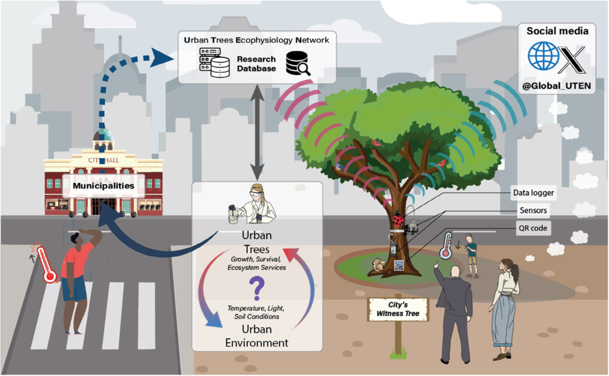
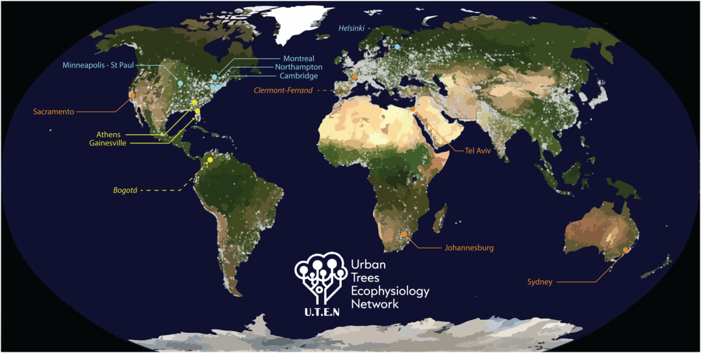

::: {.paper-authors}
Marylou Mantova^1^, Daniel M. Johnson^2^, Jonathan Antebi^3^, Sara Beery^4^, Meghan Blumstein^5^, Ron Cohen^3^, Felipe Defavari^6^, Xue Feng^7,8^, Erez Feuer^9^, Jess Gersony^10^, William M. Hammond^1^, Grace John^11^, Renée M. Marchin^12^, Yair Mau^9^, Bill Miller^13^, Clara Nibbelink^2^, Alessandro Ossola^14,15^, Alain Paquette^16^, Tim Rademacher^17,18,19^, Kaisa Rissanen^16^, Einat Shemesh-Mayer^20^, Robert Skelton^21,22^, Jean V. Wilkening^7,8^, Yakir Preisler^20,23^
:::

::: {.paper-affil}
^1^ Agronomy Department, University of Florida, Gainesville, FL, USA &nbsp;&middot;&nbsp; ^2^ Warnell School of Forestry and Natural Resources, University of Georgia, Athens, GA, USA &nbsp;&middot;&nbsp; ^3^ TreeTube Ltd, Ramat-Gan, Israel &nbsp;&middot;&nbsp; ^4^ MIT EECS Faculty of AI and Decision Making, Cambridge, MA, USA &nbsp;&middot;&nbsp; ^5^ Department of Civil and Environmental Engineering, MIT, Cambridge, MA, USA &nbsp;&middot;&nbsp; ^6^ ICT International Pty Ltd, Armidale, NSW, Australia &nbsp;&middot;&nbsp; ^7^ Department of Civil, Environmental, and Geo-Engineering, University of Minnesota, Twin Cities, Minneapolis, MN, USA &nbsp;&middot;&nbsp; ^8^ St Anthony Falls Laboratory, University of Minnesota, Twin Cities, Minneapolis, MN, USA &nbsp;&middot;&nbsp; ^9^ Institute of Environmental Sciences, The Robert H. Smith Faculty of Agriculture, Food and Environment, The Hebrew University of Jerusalem, Rehovot, Israel &nbsp;&middot;&nbsp; ^10^ Department of Biological Sciences, Smith College, Northampton, MA, USA &nbsp;&middot;&nbsp; ^11^ Department of Biology, University of Florida, Gainesville, FL, USA &nbsp;&middot;&nbsp; ^12^ Hawkesbury Institute for the Environment, Western Sydney University, Penrith, NSW, Australia &nbsp;&middot;&nbsp; ^13^ LI-COR Biosciences Inc., Lincoln, NE, USA &nbsp;&middot;&nbsp; ^14^ Department of Plant Sciences, University of California Davis, Davis, CA, USA &nbsp;&middot;&nbsp; ^15^ School of Agriculture, Food and Ecosystem Sciences, University of Melbourne, Parkville, VIC, Australia &nbsp;&middot;&nbsp; ^16^ Centre for Forest Research, Université du Québec à Montréal, Montreal, QC, Canada &nbsp;&middot;&nbsp; ^17^ Institut des Sciences de la Forêt Tempérée, Université du Québec en Outaouais, Ripon, QC, Canada &nbsp;&middot;&nbsp; ^18^ Centre ACER, Saint-Hyacinthe, QC, Canada &nbsp;&middot;&nbsp; ^19^ Harvard Forest, Harvard University, Petersham, MA, USA &nbsp;&middot;&nbsp; ^20^ Agriculture Research Organization (ARO), Volcani Center, Rishon LeZion, Israel &nbsp;&middot;&nbsp; ^21^ SAEON Fynbos Node, Centre for Biodiversity Conservation, Kirstenbosch Gardens, Cape Town, South Africa &nbsp;&middot;&nbsp; ^22^ Animal, Plant and Environmental Sciences, University of the Witwatersrand, Johannesburg, South Africa &nbsp;&middot;&nbsp; ^23^ School of Engineering and Applied Science, Harvard University, Cambridge, MA, USA
:::

---

::: {.paper-meta}
Forum (Meetings) &middot; New Phytologist &middot; 2024 &middot; doi: [10.1111/nph.19621](https://doi.org/10.1111/nph.19621)

Correspondence: Marylou Mantova (mantova.marylou@gmail.com), Yakir Preisler (yakir@volcani.agri.gov.il)
:::

> **How to cite:** Mantova, M., Johnson, D.M., Antebi, J., Beery, S., Blumstein, M., Cohen, R., Defavari, F., Feng, X., Feuer, E., Gersony, J., Hammond, W.M., John, G., Marchin, R.M., Mau, Y., Miller, B., Nibbelink, C., Ossola, A., Paquette, A., Rademacher, T., Rissanen, K., Shemesh-Mayer, E., Skelton, R., Wilkening, J.V. and Preisler, Y. (2024). Monitoring urban trees across the world. Report from the Urban Trees Ecophysiology Network (UTEN) inaugural workshop. New Phytologist. https://doi.org/10.1111/nph.19621

---

**Key words:** climate change, drought, heatwaves, urban forests, urban heat island, witness tree.

The Urban Trees Ecophysiology Network inaugural workshop, Georgia Center at the University of Georgia, Athens, United States, March 2023.

From 26 March to 29 March 2023, at the Georgia Center in Athens, GA, USA, a workshop on urban trees gathered 40 specialists from a wide array of disciplines, including tree physiology, forest ecology, arboriculture, urban tree ecology, urban forestry, soil science, ecohydrology, vegetation modelling, computer vision, and industrial design. With 28 attendees from four continents, and seven countries physically present, and a further 12 participants joining virtually, the workshop brought together an international team aiming to better understand the physiological functioning of urban trees. The Urban Trees Ecophysiology Network (UTEN) inaugural workshop sought to address the questions of how the urban environment impacts tree functioning and health, and how trees alter the microclimate of cities.

Assessing tree health, performance, and survival in urban forests is a complex task that requires a deeper understanding of the physiological functioning of trees in relation to the biophysical, climatic, and social factors shaping urban environments. Confronting these complexities, the workshop brought together scientists and experts covering different aspects of biotic and abiotic stressors affecting tree health, performance, and mortality, as well as urban practitioners and managers, to encourage interdisciplinary thinking, align protocols, design/share new tools, and discuss the dissemination of findings to the public. Thus, the workshop aimed to uncover predictable patterns leading to rapid assessment of tree health and the influence of trees on the microclimate of the cities in contrasting urban environments across the globe amid climate change.

## Why study the physiology of tree stress and survival in urban environments?

The vulnerability of cities and their populations to further climate change may increase due to rapid urbanization, with 70% of Earth's population expected to live in cities by 2050 ([Salbitano et al., 2016](#ref-salbitano2016)). Urban trees play a crucial role in creating liveable and sustainable communities in densely populated areas ([Turner-Skoff & Cavender, 2019](#ref-turnerskoff2019)). They have been associated with lower air pollution ([Nowak et al., 2006](#ref-nowak2006)), improved mental health ([Faber Taylor & Kuo, 2009](#ref-fabertaylor2009)), and lower temperatures ([Baró et al., 2019](#ref-baro2019); [Wang et al., 2019](#ref-wang2019)). Particularly, their presence reduces the phenomenon of urban heat islands by providing shaded areas and actively cooling the air via transpiration (Fig. 1; [Armson et al., 2012](#ref-armson2012); [Rahman et al., 2019](#ref-rahman2019)), helping relieve financial strain on citizens and municipalities by reducing reliance on expensive air-cooling systems ([Tsoka et al., 2021](#ref-tsoka2021)). They can also help to decrease costs associated with water pollution, runoff, and water treatment. Even though urban trees can sometimes be considered threats to infrastructure ([Ossola et al., 2023](#ref-ossola2023)), their benefits generally outweigh their risks, for example by reducing road maintenance expenses and extending road lifespan through reduced UV radiation exposure ([McPherson & Muchnick, 2005](#ref-mcpherson2005)). On another scale, urban trees play a key role in ecosystems by providing food and habitat for birds, invertebrates, mammals, and epiphytes, thus helping with biodiversity conservation in cities (Fig. 1). They also serve the environment by mitigating climate change, actively capturing and sequestering carbon. In 2021, urban trees contributed, along with agricultural soils in the USA, to offsetting 13.1% of total gross emissions ([EPA, 2023](#ref-epa2023)).

However, trees, and therefore their benefits, are not equitably distributed ([Nyelele & Kroll, 2020](#ref-nyelele2020)) and multiple studies found that urban canopy cover decreases along multiple social dimensions such as the poverty rate, minority population proportion, and low educational attainment (outlined in [Riley & Gardiner, 2020](#ref-riley2020)). This has cascading implications for the positive services trees provide, with low-income areas presenting 15% less tree cover and being 1.5°C hotter than those areas with higher income ([McDonald et al., 2021](#ref-mcdonald2021)). This bias was even more extreme in the Northeastern USA, with low-income areas experiencing up to 30% less tree cover and up to 4.0°C warming relative to high-income areas. Recognizing these disparities, the network is seeking to move forward and design our projects with an eye toward equity.

## A global urban trees network: concrete actions

During the meeting, a series of breakout sessions were organized to discuss methodological gaps and research needs across disciplines and sites. Breakout sessions particularly highlighted: (1) The challenges of data management and the importance of synchronizing data and methodologies to build a meaningful scientific story across sites, countries, and institutions with a variety of regional challenges and opportunities.

(2) The challenges of building and maintaining a research design in an urban context.

(3) The challenges of communicating with various urban stakeholders (e.g. industry, governments, scientists, homeowners, and landowners) and with the public.

**Fig. 1 | Schematic representation of a witness tree in a city, and the expected outputs of the sensors installed on it.** The witness tree, chosen with the help of the municipalities and host to a variety of wildlife, is equipped with different sensors connected to a data logger. The data logger transfers the data to the Urban Trees Ecophysiology Network (UTEN) research database via the Global System for Mobile (GSM) communication so that scientists can assess questions regarding the influence of trees on the urban environment and the impact of the urban environment on trees. Benefits from urban trees, such as cooler temperatures or shade underneath the tree, are also represented. Finally, the interaction with the public is represented through the child scanning the QR code installed on the tree and the social media box. All data is managed and stored via the Amazon Web Services (AWS) cloud.

During breakout sessions, regional working groups were created to (1) identify the species of interest; (2) characterize dominant stressor(s) in specific climate region; and (3) connect rapidly with local land managers to find out whether tree inventories existed and what data were already available for use. Workshop participants were divided into three climatically themed groups (Fig. 2): Hot and Wet, including scientists from Gainesville (Florida, USA) and Athens (Georgia, USA); Cool and Wet, including scientists from Montreal (Canada), Cambridge and Northampton (Massachusetts, USA), and Minneapolis–Saint Paul (Minnesota, USA); and Hot and Dry including scientists from Sydney (Australia), Tel-Aviv (Israel), Sacramento (California, USA), and Johannesburg (South Africa). Each group raised the global and regional most urgent questions and highlighted the specific needs of each region. Data collected from all cities will help tackle common questions concerning tree health and stress in the face of changing climate across biomes, as well as leveraging institutional knowledge to investigate research questions and hypotheses particular to the locality of each network node.

Breakout groups echoed concepts from keynote talks highlighting the potential for public engagement. By leveraging public curiosity surrounding equipment installation and tissue collection in high-traffic public areas, research in urban environments can inspire both science communication and education. Keynotes by Jason Gordon (University of Georgia, USA) and Kaisa Rissanen (Université de Québec à Montréal, Canada) highlighted the challenge of preserving scientific equipment from any human or animal-induced degradations in urban settings. To simultaneously maximize educational opportunities and discourage vandalism, workshop participants proposed installing informative panels in front of monitored trees, including a QR code for near-real-time web-based tree health information (Fig. 1). Subsequent discussions explored methods of protecting apparatus from tampering, including suggesting the use of decoy devices (Fig. 1).

Keynote talks by Yakir Preisler (Harvard University, USA and ARO, Israel), Erez Feuer (Hebrew University, Israel), Bill Miller (Licor Ltd, USA), showcased novel tools helpful for long-term monitoring of urban trees. Workshop participants decided that each city node would build and deploy a 'Trumpet' datalogger designed by Erez Feuer utilizing the Global System for Mobile (GSM) communication network for real-time data collection across multiple remote sites (Fig. 1). Upon database launch, the 'Trumpet' would be deployed on urban trees distributed to c. 30 trees per participating city, to measure air temperature, humidity, and trunk diameter variations using band dendrometers (EMS Brno Ltd, Brno, Czechia). Emphasizing the need for real-time monitoring across cities, representatives from each UTEN node agreed to monitor ecophysiological processes (e.g. sap flow, stem diameter, and water potential) and meteorological measurements (air temperature, humidity, solar radiation, and wind) using this design over the coming year(s). Participants of the workshop agreed on a platform for consistent measurement and quality control of data collection and communication from urban trees to UTEN. Thus, these data will be aggregated in a shared UTEN research database (Fig. 1), which UTEN intends to create and implement in close collaboration with municipalities for exchanging critical information on urban forest health (see arrows in Fig. 1).

**Fig. 2 | The Urban Trees Ecophysiology Network (UTEN) established and future nodes distribution in 2023.** Blue points correspond to the stations located in a cool and dry environment, while orange points indicate hot and dry environments, and yellow points represent the hot and wet environments. Already established nodes are symbolized with solid arrows, signifying their current presence. Future nodes, set to become active in the summer of 2024, are denoted by dashed arrows. In each established node, connections with municipalities were initiated; specific trees were selected for monitoring using our global species list, sourced from the GUTI databases ([Ossola et al., 2020](#ref-ossola2020)), and a summer campaign of physiological measurements was conducted. Each node will continuously monitor trees' water use and status, growth rate, local temperature, and relative humidity. Furthermore, each node has the flexibility to integrate multiple sensors and seasonal measurements tailored to its unique considerations and needs.

Following Dr. Tim Rademacher's Université du Québec en Outaouais keynote talk that presented the concept of a 'witness tree', that is a tree on which different apparatus communicate their results to the general public through social media, workshop participants agreed to install one witness tree per city to enhance public and municipal engagement. Future actions will consist of selecting and establishing one witness tree per city and establishing a social media presence (X, Instagram, etc.) for it (Fig. 1).

## Future of the urban trees network

Establishing a global urban tree monitoring network is challenging in practice and will require several years of commitment to the project. However, workshop participants were eager to trial measurements and deploy sensors. The group's primary focus lies in establishing a foundational ecophysiological database, ready to benefit both the scientific community (addressing climate change responses, mechanisms, and biophysical interactions) and municipal decision-makers (in matters of species selection, cooling efficiency, treatments, etc.). While the group will encounter scientific and logistical obstacles, UTEN has the interdisciplinary expertise necessary to overcome a wide array of challenges. Future steps, including ongoing virtual meetings (which have been running monthly since December 2022), include establishing an annual in-person meeting to discuss the data collected and the future of the network, such as recruiting representatives from new nodes to aid the progressive expansion of the network into currently underrepresented biogeographic and climatic regions. The integration of nodes in Europe (Clermont-Ferrand, France, and Helsinki, Finland), and South America (Bogotá, Colombia) is currently underway; however, participation of more sites in areas of the world that lack UTEN nodes (particularly in the southern hemisphere) is encouraged. Those interested in establishing a node of UTEN in their city should join the group on X at @Global_UTEN, and visit the UTEN website and complete the 'join us' form.

## Acknowledgements

Funding for the workshop was provided by the Georgia Forestry Commission, the Warnell School of Forestry and Natural Resources, and the Office of the Vice President for Research at the University of Georgia.

## Author contributions

YP planned and designed the UTEN workshop. MM wrote the first draft of the manuscript. WMH, DMJ, YP, RM, MB, GPJ, JG and AO contributed substantially to improving the first draft. All the other authors contributed equally to improving the final version of the manuscript.

## Data availability

Data sharing is not applicable as no new data were generated.

## References

[Armson et al., 2012]{#ref-armson2012} Armson D, Stringer P, Ennos AR. 2012. The effect of tree shade and grass on surface and globe temperatures in an urban area. *Urban Forestry & Urban Greening* 11: 245–255.

[Baró et al., 2019]{#ref-baro2019} Baró F, Calderón-Argelich A, Langemeyer J, Connolly JJT. 2019. Under one canopy? Assessing the distributional environmental justice implications of street tree benefits in Barcelona. *Environmental Science and Policy* 102: 54–64.

[EPA, 2023]{#ref-epa2023} EPA. 2023. Inventory of U.S. greenhouse gas emissions and sinks: 1990–2021 – main report. Washington, DC, USA: United States Environmental Protection Agency.

[Faber Taylor & Kuo, 2009]{#ref-fabertaylor2009} Faber Taylor A, Kuo FE. 2009. Children with attention deficits concentrate better after walk in the park. *Journal of Attention Disorders* 12: 402–409.

[McDonald et al., 2021]{#ref-mcdonald2021} McDonald RI, Biswas T, Sachar C, Housman I, Boucher TM, Balk D, Nowak D, Spotswood E, Stanley CK, Leyk S. 2021. The tree cover and temperature disparity in US urbanized areas: quantifying the association with income across 5,723 communities. *PLoS ONE* 16: e0249715.

[McPherson & Muchnick, 2005]{#ref-mcpherson2005} McPherson EG, Muchnick J. 2005. Effects of street tree shade on asphalt concrete pavement performance. *Arboriculture & Urban Forestry* 31: 303–310.

[Nowak et al., 2006]{#ref-nowak2006} Nowak DJ, Crane DE, Stevens JC. 2006. Air pollution removal by urban trees and shrubs in the United States. *Urban Forestry & Urban Greening* 4: 115–123.

[Nyelele & Kroll, 2020]{#ref-nyelele2020} Nyelele C, Kroll CN. 2020. The equity of urban forest ecosystem services and benefits in the Bronx, NY. *Urban Forestry & Urban Greening* 53: 126723.

[Ossola et al., 2020]{#ref-ossola2020} Ossola A, Hoeppner MJ, Burley HM, Gallagher RV, Beaumont LJ, Leishman MR. 2020. The global urban tree inventory: a database of the diverse tree flora that inhabits the world's cities. *Global Ecology and Biogeography* 29: 1907–1914.

[Ossola et al., 2023]{#ref-ossola2023} Ossola A, Yu M, Le Roux J, Bustamante H, Uthayakumaran L, Leishman M. 2023. Research note: Integrating big data to predict tree root blockages across sewer networks. *Landscape and Urban Planning* 240: 104892.

[Rahman et al., 2019]{#ref-rahman2019} Rahman MA, Moser A, Rötzer T, Pauleit S. 2019. Comparing the transpirational and shading effects of two contrasting urban tree species. *Urban Ecosystems* 22: 683–697.

[Riley & Gardiner, 2020]{#ref-riley2020} Riley CB, Gardiner MM. 2020. Examining the distributional equity of urban tree canopy cover and ecosystem services across United States cities. *PLoS ONE* 15: e0230398.

[Salbitano et al., 2016]{#ref-salbitano2016} Salbitano F, Borelli S, Conigliaro M, Yujuan C. 2016. Guidelines on urban and peri-urban forestry. *FAO Forestry Paper* (FAO) Eng No. 178.

[Tsoka et al., 2021]{#ref-tsoka2021} Tsoka S, Leduc T, Rodler A. 2021. Assessing the effects of urban street trees on building cooling energy needs: the role of foliage density and planting pattern. *Sustainable Cities and Society* 65: 102633.

[Turner-Skoff & Cavender, 2019]{#ref-turnerskoff2019} Turner-Skoff JB, Cavender N. 2019. The benefits of trees for livable and sustainable communities. *Plants, People, Planet* 1: 323–335.

[Wang et al., 2019]{#ref-wang2019} Wang C, Wang ZH, Wang C, Myint SW. 2019. Environmental cooling provided by urban trees under extreme heat and cold waves in U.S. cities. *Remote Sensing of Environment* 227: 28–43.
