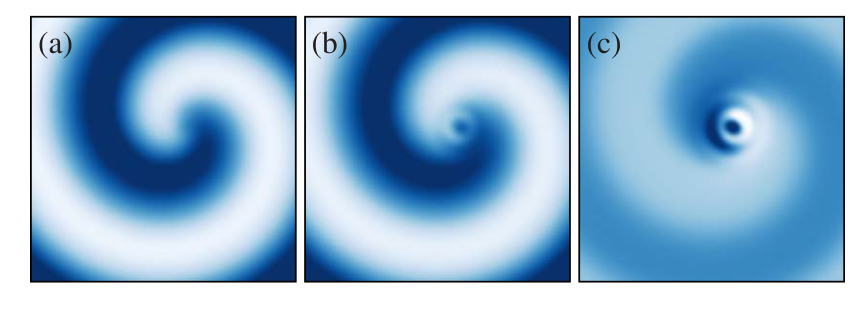
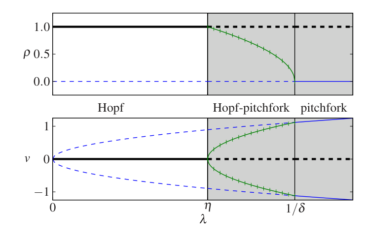
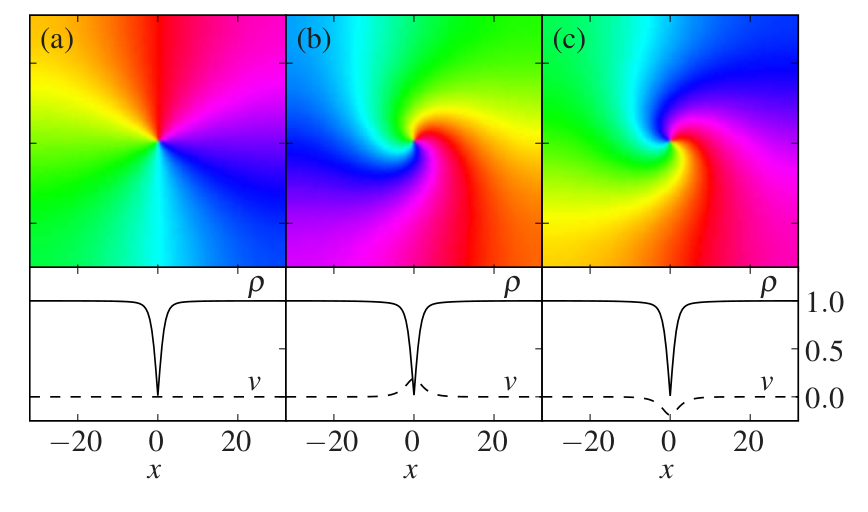
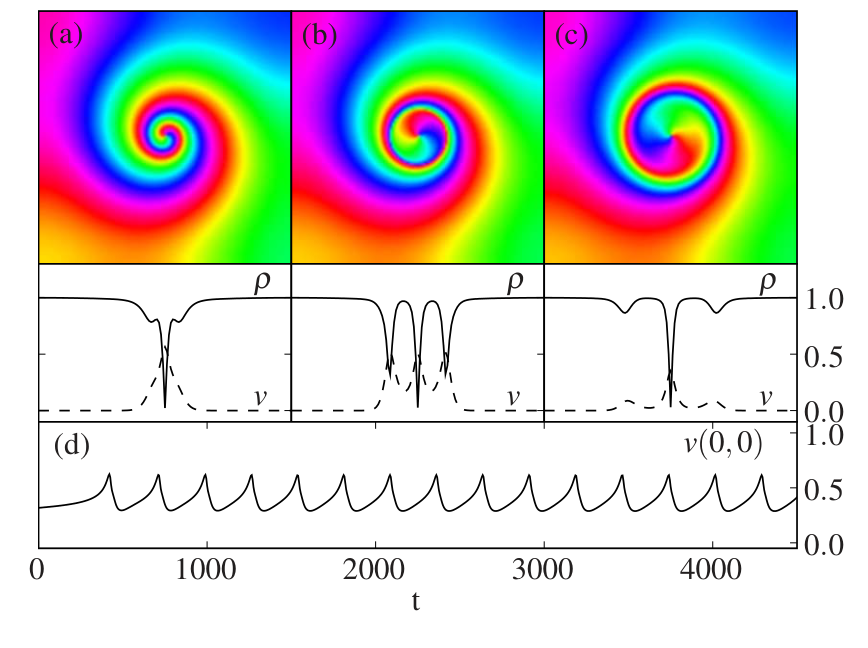
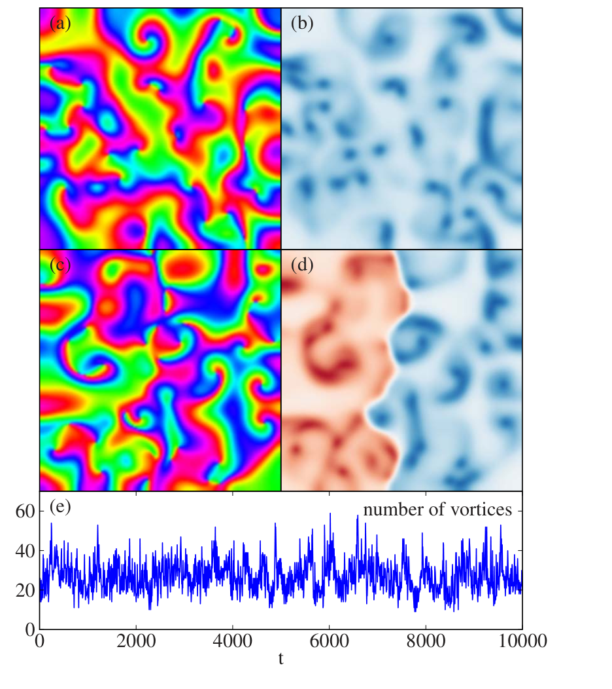

::: {.paper-authors}
Yair Mau^1^, Aric Hagberg^2^, Ehud Meron^1,3^
:::

::: {.paper-affil}
^1^ Physics Department, Ben-Gurion University, Beer-Sheva 84105, Israel &nbsp;&middot;&nbsp; ^2^ Theoretical Division, Los Alamos National Laboratory, Los Alamos, New Mexico 87545, USA &nbsp;&middot;&nbsp; ^3^ Department of Solar Energy and Environmental Physics, BIDR, Ben-Gurion University, Sede Boqer, 84990, Israel
:::

---

::: {.paper-meta}
Rapid Communication &middot; Physical Review E 80, 065203(R) &middot; 2009 &middot; doi: [10.1103/PhysRevE.80.065203](https://doi.org/10.1103/PhysRevE.80.065203)

Received 19 April 2009; revised manuscript received 8 November 2009; published 8 December 2009
:::

> **How to cite:** Mau, Y., Hagberg, A. and Meron, E. (2009). Dual-Mode Spiral Vortices. Physical Review E, 80, 065203(R). https://doi.org/10.1103/PhysRevE.80.065203

---

#### Abstract

We show that spiral vortices in oscillatory systems can lose stability to secondary modes to form dual-mode spiral vortices. The secondary modes grow at the vortex core where the oscillation amplitude vanishes but are nonlinearly damped by the oscillatory mode away from the core. Gradients of the oscillation phase, induced by the hosted secondary mode, can lead to additional hosting events that culminate in periodic core oscillations or in a novel form of spatiotemporal chaos. The results of this study apply to physical, chemical, and biological systems that go through cusp-Hopf, fold-Hopf, and Hopf-Turing bifurcations.

When a spatially extended dissipative system is driven far enough from equilibrium it generally loses stability to a new nonequilibrium state. The primary mode that grows at the instability point can be time dependent or spatially structured and leads to spatially periodic patterns, uniform oscillations, or traveling waves. Driving the system farther away from equilibrium may result in an instability of the nonequilibrium state that produces an even more structured nonequilibrium state in space and time. These processes have been thoroughly studied in various physical, chemical, and biological contexts ([1](#ref-1)).

In addition to further instabilities of the nonequilibrium state, the original equilibrium state might become unstable to the growth of a secondary mode. Such modes are often not visible because they are nonlinearly damped by the primary mode. However, if the primary mode develops a localized structure where the amplitude becomes very small or vanishes, it may no longer be effective in damping the secondary mode there. The single-mode localized structure may then become unstable to form a dual-mode structure ([2](#ref-2), [3](#ref-3)).

A well-studied single-mode localized structure is the spiral vortex. Spiral vortices may go through various instabilities and may appear spontaneously in processes that often designate the onset of spatiotemporal chaos (STC) ([4](#ref-4), [5](#ref-5)). They have been found in diverse systems, including chemical reactions and lasers, where the primary mode is an oscillatory Hopf mode ([1](#ref-1)), and in thermal convection, where the primary mode is a roll mode ([6](#ref-6)). The zero amplitude of the primary mode at the spiral-vortex core potentially allows the localized growth of a secondary mode there while it is still damped away from the core. An example of such an instability has been observed and analyzed in the context of thermal convection: the destabilization of a spiral roll pattern to the growth of an hexagonal mode at its core ([7](#ref-7)).

In this Rapid Communication we study dual-mode spiral vortices where the primary mode is a Hopf mode. We first demonstrate the appearance of a spatially structured Turing mode at the core of a Hopf spiral in a class of reaction-diffusion systems represented by the FitzHugh-Nagumo (FHN) model. We then consider an apparently simpler situation in which the secondary mode is uniform when decoupled from the Hopf mode but study it in a wider context using the pertinent normal form or amplitude equations. We show that the generic process by which the primary Hopf mode hosts a secondary mode is not limited to the core region of the original spiral; spontaneous hosting processes away from the core region, induced by phase gradients created in earlier hosting events, can lead to localized periodic oscillations and to global STC of a novel form.

The FHN model consists of two real-valued fields, $u(x,y,t)$ and $v(x,y,t)$, which may be thought of as representing the concentrations of activator and inhibitor types of chemical reagents. The two fields satisfy the equations

$$
u_t = u - u^3 - v + \nabla^2 u, \tag{1a}
$$

$$
v_t = \varepsilon(u - a_1 v - a_0) + \zeta\nabla^2 v. \tag{1b}
$$

The parameter $\varepsilon$ is the ratio of the characteristic time scales of $u$ and $v$ and $\zeta$ is the ratio of the diffusion rates of $u$ and $v$. When $a_0 = 0$ the model is symmetric under the transformation $(u,v) \to (-u,-v)$ and has an equilibrium solution $(u,v)=(0,0)$. This solution goes through a Hopf bifurcation to uniform oscillations as $\varepsilon$ is decreased below a critical value $\varepsilon_H = 1/a_1$. For a given $\zeta$ value it also goes through a Turing bifurcation to stationary periodic patterns as $\varepsilon$ is decreased below $\varepsilon_T = \zeta/(2 - a_1 + 2\sqrt{1-a_1})$. A codimension-two Hopf-Turing bifurcation is obtained by choosing $\varepsilon=\varepsilon_H$ and increasing $\zeta$ to a critical value $\zeta_c$ where the two bifurcations coincide, $\varepsilon_H = \varepsilon_T(\zeta_c)$. For a nearly symmetric model, $|a_0| \ll 1$, the above forms for $\varepsilon_H$ and $\varepsilon_T$ still provide good approximations of the Hopf and Turing instability thresholds.

Fixing $\varepsilon$ at a value smaller than $\varepsilon_H$ (i.e., beyond the Hopf bifurcation) and initiating a spiral-vortex solution, we now increase $\zeta$ above the Turing bifurcation, $\zeta_T = \varepsilon(2 - a_1 + 2\sqrt{1-a_1})$. As Fig. 1 shows the single-mode Hopf spiral can persist even beyond the onset of the Turing instability [Fig. 1(a)]. However, as the distance from the Turing instability, $\zeta - \zeta_T$, is increased beyond a second threshold, the single-mode spiral-vortex solution loses stability to a dual-mode vortex solution that contains a Turing spot at the vortex core [Figs. 1(b) and 1(c)]. Away from the core region the Turing mode is damped by the Hopf mode. Dual-mode spiral waves of this kind have been observed in the chlorite-iodide-malonic acid (CIMA) reaction ([8](#ref-8)).

**FIG. 1 | Single- and dual-mode spiral vortices in the FHN system (1) beyond the Hopf and Turing bifurcations.** (a) Close to the Turing bifurcation the Turing mode is damped everywhere, $\zeta=4.5$. (b) Farther from the Turing bifurcation the Turing mode is hosted at the spiral core, $\zeta=5.75$. (c) The difference between (a) and (b) showing the Turing mode at the core. The frames show the $u$ field variable of Eqs. (1) with ranges of $[-0.5,0.5]$ in (a) and (b) and $[-0.1,0.1]$ in (c). Lighter colors are lower values and darker colors are higher values. The initial condition is a spiral wave. Parameters: $\varepsilon=1.5$, $a_1=0.5$, $a_0=0.05$, and $x=y=[0,256]$, with no-flux boundary conditions.

Canonical reaction-diffusion models, such as the FHN model, are often too restricted for exploring the wealth of possible behaviors near instability points. Amplitude equations provide a powerful alternative approach which is universal in the sense that they capture the dynamics of all systems which are near a given instability point. For this reason, results obtained with amplitude equations are generally applicable to a wide range of systems. We use this approach to study dual-mode spiral vortices involving secondary modes that are stationary and uniform when decoupled from the primary Hopf mode.

We conceive an equilibrium state that loses stability in a Hopf bifurcation to uniform oscillations as a control parameter $R$ is increased past a threshold value $R_1$. Further increase of $R$ passes a second threshold $R_2 > R_1$ at which a stationary uniform mode begins to grow from the already unstable equilibrium state. We additionally assume that another system control parameter $S$ has a critical value $S_c$ where the two instabilities merge in a codimension-two point. That is, at $S=S_c$, $R_1(S_c)=R_2(S_c)$, and both the Hopf mode and the stationary uniform mode grow simultaneously.

In the vicinity of this codimension-two point we can approximate a typical dynamical variable of the system as $u = c_1 A e^{i\omega t} + c_2 v + \text{c.c.} + \cdots$, where $c_1$ and $c_2$ are constants, $\omega$ is the oscillation frequency, c.c. stands for the complex conjugate, and the dots denote higher order terms. The amplitudes $A$ and $v$ satisfy the following equations after rescaling time, space, and the amplitudes $A$ and $v$, including appropriate phase rotation in $A$ and using the same notations for the transformed quantities ([9](#ref-9)):

$$
A_t = A - (1+i\beta)|A|^2 A + (1+i\alpha)\nabla^2 A - \gamma A v - \delta A v^2, \tag{2a}
$$

$$
v_t = f(v) + d\nabla^2 v + \sigma|A|^2 - \eta|A|^2 v, \tag{2b}
$$

$$
f(v) = \kappa + \lambda v + \mu v^2 - v^3. \tag{2c}
$$

Equations (2) capture the fold-Hopf and cusp-Hopf bifurcations ([10](#ref-10), [11](#ref-11)). Most of the results reported here, however, are for $f(v)$ with $\kappa=0$ and $\mu=0$ corresponding to a supercritical pitchfork bifurcation in the stationary uniform mode $v$ at $\lambda=0$. We briefly discuss other cases toward the end of this paper. In Eqs. (2) all coefficients are real valued except for $\gamma$ and $\delta$.

Setting $\kappa=\mu=0$ in Eqs. (2) we first identify a parameter regime where the stationary uniform mode $v$ is nonlinearly damped by the Hopf mode $A$. Equations (2) have four types of stationary uniform solutions: *equilibrium* $(A=0,v=0)$, *single-mode pitchfork* $(A=0,v=v_0)$, *single-mode Hopf* $(A=A_0,v=0)$, and *dual mode* $(A=A_m,v=v_m)$. For $\gamma_r \equiv \text{Re}(\gamma)=0$ the solutions are given by $v_0 = \pm\sqrt{\lambda}$, $A_0 = \sqrt{\varepsilon}\exp(-i\beta t + i\phi)$, $A_m = \sqrt{(\delta_r\varepsilon-1)/(\delta_r\eta-1)}\exp(i\omega_{\pm}t+i\phi)$, $\omega_{\pm}=-\beta|A_m|^2-\gamma_i v_m+\delta_i v_m^2$, and $v_m = \pm\sqrt{(\eta-\varepsilon)/(\delta_r\eta-1)}$, where $\phi$ is an arbitrary constant phase and the subscripts $r$ and $i$ on $\gamma$ and $\delta$ denote the real and imaginary parts, respectively. The existence and stability ranges of these solutions for the case $\delta_r\eta < 1$ are shown in Fig. 2. In this case the dual-mode uniform solutions are stable. When $\delta_r\eta > 1$ the dual-mode solutions are unstable and there is a bistability range of the single-mode Hopf solution and the single-mode pitchfork solution.

We focus in this study on the monostability range of the single-mode Hopf solution, denoted as the unshaded range in the bifurcation diagram of Fig. 2. Note that the system is beyond the pitchfork bifurcation ($\lambda>0$) and the reason for the stability of the single-mode Hopf solution is the nonlinear damping of the pitchfork mode by the Hopf mode due to the term $-\eta|A|^2 v$ in Eq. (2b).

Initiating a vortex at a sufficiently small distance $\lambda$ from the pitchfork bifurcation, we find, by numerical solution of Eqs. (2), a stable single-mode spiral vortex. The pitchfork mode remains everywhere damped, including at the vortex core where the Hopf amplitude vanishes [Fig. 3(a)]. However, as $\lambda$ exceeds a threshold value the pitchfork mode is no longer damped at the vortex core; a pair of dual-mode spiral vortices [Figs. 3(b) and 3(c)] appears in a supercritical pitchfork-like vortex bifurcation. The two vortex solutions differ in the sign of the time-independent $v$ field at the vortex core. We refer to these solutions as *static* dual-mode spiral vortices. Because of our choice of the amplitude $A$ and the zero value for $\beta$, the single-mode vortex solution does not rotate and is characterized by linear equiphase lines emanating from the core in radial directions [Fig. 3(a)]. This choice emphasizes the effects of the $v$ field that builds up at the vortex core — *it twists the phase and creates a phase gradient in the radial direction* [Figs. 3(b) and 3(c)].

**FIG. 2 | Bifurcation diagram for $\rho=|A|$ and $v$ showing the nonzero uniform solutions of Eqs. (2): single-mode Hopf (thick black line), single-mode pitchfork (thin blue line), and dual-mode pitchfork-Hopf (vertical-ticked green line).** Solid (dashed) lines represent stable (unstable) solutions. The unshaded range denotes the stability range of the single-mode Hopf solution. Parameters: $\eta=0.8$, $\kappa=0$, $\mu=0$, $\delta=0.8$, $\gamma=-i$, and $\beta=0$.

The phase-twist effect has important implications for the stability of dual-mode vortex solutions which can be seen by rewriting the amplitude equations in terms of the modulus of the Hopf amplitude, $\rho=|A|$, and its phase gradient or local wave vector $\mathbf{K}=\nabla\varphi$, where $\varphi=\arg A$,

$$
\rho_t = \rho(1 - \rho^2 - \delta_r v^2 - K^2) + \nabla^2\rho, \tag{3a}
$$

$$
\mathbf{K}_t = -\gamma_i \nabla v + G(\rho,\mathbf{K};\nabla), \tag{3b}
$$

$$
v_t = v(\varepsilon - v^2 - \eta\rho^2) + d\nabla^2 v, \tag{3c}
$$

where $K=|\mathbf{K}|$ and $G$ is independent of $v$, and we excluded terms that have been set to zero in Fig. 3. According to Eq. (3b) the axisymmetric localized form of $v$ at the vortex core creates a phase gradient $\mathbf{K}$ pointing in the radial direction. This phase gradient reduces the Hopf amplitude, $\rho$, in a ring around the vortex core and, if steep enough, can drive spontaneous hosting of $v$ along that circle as Fig. 4(b) shows. This leads to the destabilization of the static dual-mode vortices shown in Fig. 3. The spontaneous hosting of $v$ creates new phase gradients which, if strong enough, can induce new hosting events.

**FIG. 3 | Vortex solutions of the Hopf-Pitchfork system.** (a) A single-mode vortex with $v=0$ at the core, $\lambda=0.62$. (b) and (c) Dual-mode vortices with (b) $v>0$ and (c) $v<0$ at the core, $\lambda=0.635$. The top frames show the phase $\varphi=\arg A$ in the $x$-$y$ plane (colored or shaded from $[0,2\pi]$ in a circle around the origin) and the bottom frames show the amplitude $\rho=|A|$ and $v$ at cross section at $y=0$. The initial condition is $A=\exp(i\varphi)$, $\varphi=\arctan(y/x)$, and $v=\pm0.1\exp[-(x^2+y^2)/5]$. Parameters: $\eta=0.8$, $\kappa=0$, $\mu=0$, $\delta=0.8$, $\gamma=-i$, $\alpha=0$, $\beta=0$, $d=1$, and $x=y=[-32,32]$, with no-flux boundary conditions.

Depending on the steepness of the phase gradients regular or chaotic dynamics are found. Moderate phase gradients, obtained close to the instability point of the static dual-mode vortices, may reduce $\rho$ to values that enable hosting of $v$ but are bounded away from zero. This can result in periodic oscillations as Fig. 4 shows. Farther away from the instability point zeros of $\rho$ can form, resulting in vortex-pair nucleation and the onset of STC, as Fig. 5 shows. Note that there are two symmetric states of STC, corresponding to positive and negative $v$ values at the vortex cores. This *bistability of STC states* allows for spatial coexistence of the two states as Figs. 5(c) and 5(d) show. We emphasize that this form of STC has been obtained with $\alpha=\beta=0$ in Eq. (2a). Without the coupling to the $v$ mode, this choice amounts to the variational Ginzburg-Landau equation that does not support STC ([4](#ref-4)). Hosting events of the uniform mode therefore play a crucial role in inducing this new form of STC, which extends to nonzero $\alpha$ and $\beta$ values as well.

**FIG. 4 | Vortex oscillations induced by spontaneous hosting around the core.** Shown are the phase $\varphi$ (top) and cross sections of $\rho=|A|$ and $v$ (center) at three different times. (a) Phase gradients induced by the hosted $v$ field reduce the oscillation amplitude near the core. (b) The oscillation amplitude decreases and leads to spontaneous hosting. (c) The low amplitude regions diminish as the phase gradients travel outward setting the stage for a new cycle of hosting. (d) The resulting core oscillations produce a time-periodic change of $v$ at the core center. The initial conditions and parameters are the same as in Fig. 3 with $\lambda=0.638$.

**FIG. 5 | STC induced by spontaneous hosting far from the pitchfork bifurcation, shown in snapshots of the phase (a) and (c) $\varphi$ and (b) and (d) $v$.** (e) Strong hosting events induce zeros of the oscillation amplitude and spontaneous vortex-pair nucleation with a fluctuating number of vortices. (c) and (d) Bistability of STC states with $v$ positive (blue, right half) and negative (red, left half) allows for spatial mixture of the two chaotic states and for fronts separating them (c) and (d). The parameters are the same as Fig. 3 with $\lambda=0.75$ and $x=y=[-64,64]$.

So far we discussed the case in which the stationary uniform mode $v$ appears in a pitchfork bifurcation ($\kappa=\mu=0$). Similar behavior is found for $\kappa=0$, $\mu<0$ and an initial condition consisting of $0<v\ll1$ at the vortex core and $v\to0$ away from the core (this case amounts to a transcritical bifurcation). As $\lambda$ is increased a single-mode vortex first loses stability to a static dual-mode vortex, then to an oscillatory vortex, and, at sufficiently large $\lambda$ values, to a global state of STC. The situation is different for $\kappa=0$ and $\mu>0$ starting with the same initial condition for $v$: for now the instability of the single-mode spiral vortex is subcritical. In particular, the value of $v$ that develops at the core can be large enough to directly induce STC with no intermediate states of static and oscillatory dual-mode spiral vortices. Below the instability point there is a range of $\lambda$ where stable single-mode spiral vortices coexist with STC. This range corresponds, in fact, to tristability as the state of single-mode Hopf oscillations $(A,v)=(A_0,0)$ with no vortices is linearly stable too ([12](#ref-12)). The general behaviors discussed above also apply to the case $\kappa\neq0$.

An experimental candidate system for testing our predictions is the thiourea-iodate-sulfite reaction, recently studied by Horváth *et al.* ([13](#ref-13)). In that reaction, dynamical regimes of oscillatory behavior and bistability of uniform states have been identified, suggesting the possible existence of a cusp-Hopf bifurcation. Oscillatory systems with additional stationary uniform modes have been studied in the context of birhythmicity ([14](#ref-14)), focusing on the stable dual-mode regime which is contiguous to the Hopf monostability regime considered here (see Fig. 2). This suggests that systems with birhythmicity ([15](#ref-15)) may also show dual-mode spiral vortices and spontaneous hosting events leading to spatiotemporal chaos. The secondary mode is, by definition, slower than the primary Hopf mode. Oscillatory systems with an additional slow mode have been studied in the context of chemical reactions ([16](#ref-16)). In these studies the slow mode has been assumed to be slowly decaying, but a neighborhood in parameter space can be envisaged where the slow mode is linearly growing as assumed here. Finally, the hosted mode need not be uniform, as demonstrated in Fig. 1 with the FHN model near a Hopf-Turing codimension-two point and in experiments on the CIMA reaction ([8](#ref-8)). A Turing mode can be hosted in the core of a Hopf spiral and may possibly couple to the oscillation phase in a manner that induces spontaneous hosting events and STC. Hopf-Turing systems have been found and studied in various contexts including chemical reactions ([17](#ref-17)), nonlinear optical systems ([18](#ref-18)), and predator-prey systems in ecology ([19](#ref-19)).

## References

[1]{#ref-1} M. C. Cross and P. C. Hohenberg, Rev. Mod. Phys. **65**, 851 (1993); M. Tlidi, M. Taki, and T. Kolokolnikov, Chaos (see also the special issue of) **17**, 037101 (2007).

[2]{#ref-2} A. Lampert and E. Meron, EPL **78**, 14002 (2007).

[3]{#ref-3} S. Ciliberto, P. Coullet, J. Lega, E. Pampaloni, and C. Perez-Garcia, Phys. Rev. Lett. **65**, 2370 (1990).

[4]{#ref-4} I. S. Aranson and L. Kramer, Rev. Mod. Phys. **74**, 99 (2002).

[5]{#ref-5} B. Marts, A. Hagberg, E. Meron, and A. L. Lin, Phys. Rev. Lett. **93**, 108305 (2004).

[6]{#ref-6} E. Bodenschatz, J. R. de Bruyn, G. Ahlers, and D. S. Cannell, Phys. Rev. Lett. **67**, 3078 (1991).

[7]{#ref-7} I. Aranson, M. Assenheimer, V. Steinberg, and L. S. Tsimring, Phys. Rev. E **55**, R4877 (1997).

[8]{#ref-8} P. De Kepper, J. J. Perraud, B. Rudovics, and E. Dulos, Int. J. Bifurcation Chaos Appl. Sci. Eng. **4**, 1215 (1994).

[9]{#ref-9} M. Ipsen, L. Kramer, and P. G. Sørensen, Phys. Rep. **337**, 193 (2000).

[10]{#ref-10} Y. A. Kuznetsov, *Elements of Applied Bifurcation Theory*, 3rd ed. (Springer, New York, 2004).

[11]{#ref-11} Equations (2) are valid sufficiently close to the codimension-two point of the Hopf and stationary uniform modes. When one of the amplitudes modulates a spatially periodic state nonadiabatic effects may be important ([20](#ref-20)). This is, however, not the case with Eqs. (2).

[12]{#ref-12} Multistabilities of chaotic and regular states in spatially extended systems have been studied by several groups (see Ref. [21](#ref-21) and references therein).

[13]{#ref-13} J. Horváth, I. Szalai, and P. De Kepper, Science **324**, 772 (2009).

[14]{#ref-14} M. Stich, M. Ipsen, and A. S. Mikhailov, Phys. Rev. Lett. **86**, 4406 (2001).

[15]{#ref-15} O. Decroly and A. Goldbeter, Proc. Natl. Acad. Sci. U.S.A. **79**, 6917 (1982); M. Alamgir and I. R. Epstein, J. Am. Chem. Soc. **105**, 2500 (1983); P. Lamba and J. L. Hudson, Chem. Eng. Commun. **32**, 369 (1985).

[16]{#ref-16} M. Ipsen and P. G. Sørensen, Phys. Rev. Lett. **84**, 2389 (2000).

[17]{#ref-17} J. J. Perraud, A. De Wit, E. Dulos, P. De Kepper, G. Dewel, and P. Borckmans, Phys. Rev. Lett. **71**, 1272 (1993); A. Rovinsky and M. Menzinger, Phys. Rev. A **46**, 6315 (1992); I. Lengyel and I. R. Epstein, Science **251**, 650 (1991).

[18]{#ref-18} M. Tlidi, P. Mandel, and M. Haelterman, Phys. Rev. E **56**, 6524 (1997); M. Tlidi and P. Mandel, Phys. Rev. A **59**, R2575 (1999).

[19]{#ref-19} M. Baurmann, T. Gross, and U. Feudel, J. Theor. Biol. **245**, 220 (2007).

[20]{#ref-20} G. Kozyreff and S. J. Chapman, Phys. Rev. Lett. **97**, 044502 (2006).

[21]{#ref-21} H. Sakaguchi and D. Tanaka, Phys. Rev. E **76**, 025201(R) (2007).
