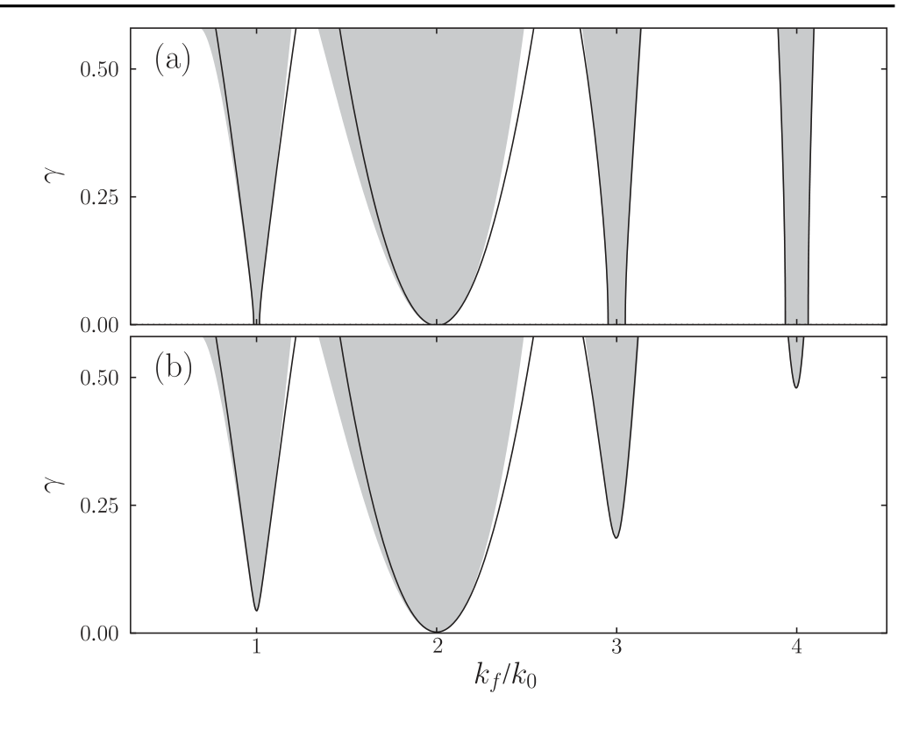
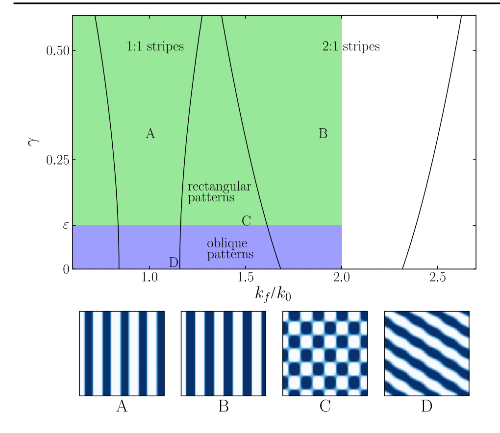
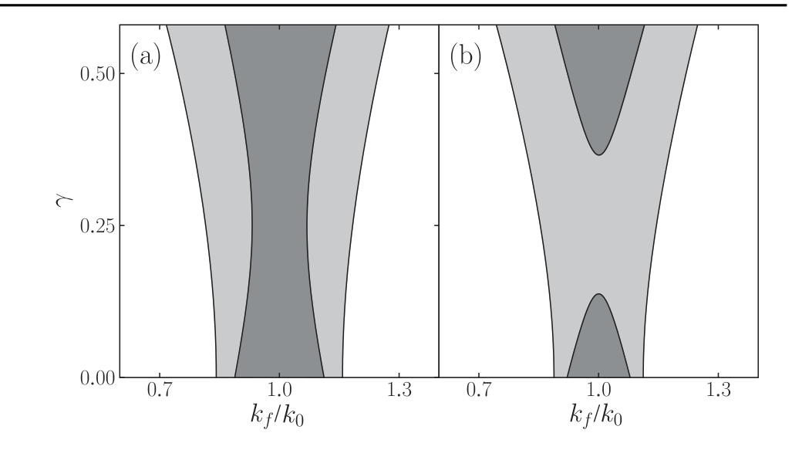
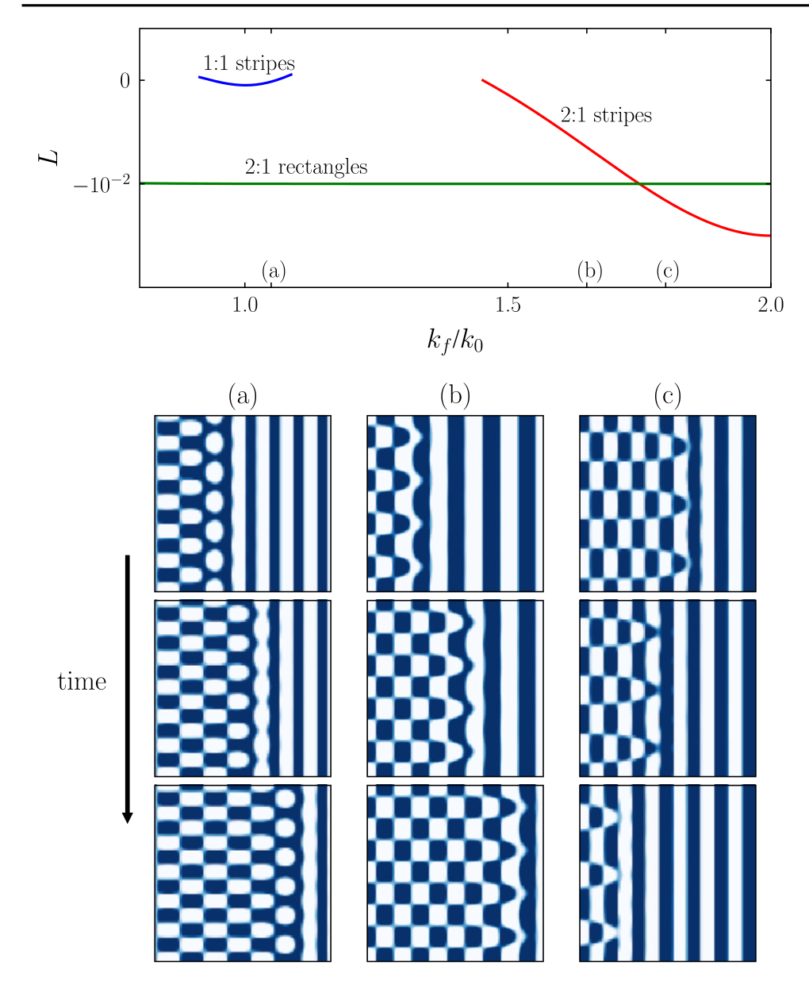

::: {.paper-authors}
Yair Mau^1^, Aric Hagberg^2^, Ehud Meron^1,3^
:::

::: {.paper-affil}
^1^ Physics Department, Ben-Gurion University of the Negev, Beer-Sheva 84105, Israel &nbsp;&middot;&nbsp; ^2^ Center for Nonlinear Studies and Theoretical Division, Los Alamos National Laboratory, Los Alamos, New Mexico 87545, USA &nbsp;&middot;&nbsp; ^3^ Department of Solar Energy and Environmental Physics, BIDR, Ben-Gurion University of the Negev, Sede Boqer Campus, 84990, Israel
:::

---

::: {.paper-meta}
Physical Review Letters 109, 034102 &middot; 2012 &middot; doi: [10.1103/PhysRevLett.109.034102](https://doi.org/10.1103/PhysRevLett.109.034102)

Received 17 May 2012; published 17 July 2012
:::

> **How to cite:** Mau, Y., Hagberg, A. and Meron, E. (2012). Spatial Periodic Forcing Can Displace Patterns It Is Intended to Control. Physical Review Letters, 109, 034102. https://doi.org/10.1103/PhysRevLett.109.034102

---

#### Abstract

Spatial periodic forcing of pattern-forming systems is an important, but lightly studied, method of controlling patterns. It can be used to control the amplitude and wave number of one-dimensional periodic patterns, to stabilize unstable patterns, and to induce them below instability onset. We show that, although in one spatial dimension the forcing acts to reinforce the patterns, in two dimensions it acts to destabilize or displace them by inducing two-dimensional rectangular and oblique patterns.

Pattern formation phenomena are found in a wide variety of physical, chemical, and biological contexts. Examples include embryonic pattern formation ([1](#ref-1)), cardiac arrhythmias ([2](#ref-2)), bacterial colonies ([3](#ref-3)), nanoparticle assemblies ([4](#ref-4)), two-phase mixtures ([5](#ref-5)), thermal convection ([6](#ref-6)), nonlinear optics ([7](#ref-7)), chemical ([8](#ref-8)) and electrochemical reactions ([9](#ref-9)), and environmental pattern formation ([10](#ref-10)). In some contexts, pattern formation is essential for the functioning of the system. This is the case with embryonic pattern formation or with vegetation patterning—a mechanism by which vegetation copes with water stress. In other contexts, pattern formation is an undesired outcome. This is the case with spiral waves in the heart muscle ([11](#ref-11)), dewetting of liquid films ([12](#ref-12)), or spatial patterning in the transverse directions of a laser beam ([13](#ref-13)). In order to eliminate, modify, or induce patterns, means of controlling and manipulating them are needed. These means may consist of basic parameter tuning or may involve external intervention such as feedback control ([14](#ref-14)) or periodic forcing in time ([15](#ref-15)) and space ([16](#ref-16)).

Control of periodic patterns by spatial periodic forcing is achieved by locking the pattern's wave number, $k$, to a rational fraction of the forcing wave number, $k_f$. The locking typically occurs over a limited wave-number range that increases with the forcing amplitude—the "resonance tongue." Within this range, the wave number of the locked or resonant pattern is controllable by tuning the forcing wave number.

Recent studies have shown that parametric one-dimensional (1d) spatial forcing of systems supporting stationary stripe patterns can also induce resonant two-dimensional (2d) patterns of rectangular and oblique forms ([16](#ref-16), [17](#ref-17)). Such patterns exist over a wide range of forcing wave numbers that includes resonance tongues of stripe patterns, in particular, the basic 1:1 ($k=k_f$) resonance, which would generally be the first choice for control. In this Letter, we address the question of how the 2d rectangular and oblique patterns interfere with the control of stripe patterns.

Focusing on universal aspects of spatially forced pattern-forming systems, we study the Swift-Hohenberg (SH) equation as a minimal model that captures the relevant mathematical construct of a stationary nonuniform instability of a stationary uniform state ([18](#ref-18)). Adding parametric forcing, the equation reads

$$
u_t = \varepsilon u - (\nabla^2 + k_0^2)^2 u - u^3 + \gamma u \cos(k_f x), \tag{1}
$$

where $\varepsilon$ is the distance from the pattern-forming instability of the uniform stationary state, $u=0$, of the unforced system; $k_0 \sim O(1)$ is the wave number of the mode that begins to grow at the instability point; $k_f$ is the forcing wave number; and $\gamma>0$ is the forcing amplitude ([19](#ref-19)).

Resonant stripe patterns of Eq. (1) exist in tongue-shaped domains in the forcing parameter plane $k_f/k_0 - \gamma$. We begin by identifying these domains for patterns near the instability point $|\varepsilon| \ll 1$. We consider Eq. (1) in 1d and approximate the resonant stripe solutions as

$$
u \approx A\exp(ikx) + \text{c.c.}, \qquad k = \frac{k_f}{n}, \tag{2}
$$

where the amplitude $A$ is small, $|A| \sim O(\sqrt{|\varepsilon|})$, and slowly varying in space and time, $|A_x| \sim O(|\varepsilon|)$, $|A_t| \sim O(|\varepsilon|^{3/2})$, and c.c. stands for the complex conjugate. The parameter $n=1,2,\ldots$ is an integer representing the type of resonance $k_f{:}k = n{:}1$. Within and in the vicinities of the resonant tongues, the detunings $\nu_n = k_0 - k_f/n$ from the exact resonances $n{:}1$ are small. Assuming $\nu_n \sim O(\sqrt{|\varepsilon|})$, $\gamma \sim O(\sqrt{|\varepsilon|})$ and using multiple-scale analysis to order $|\varepsilon|^{3/2}$, we find the amplitude equation

$$
A_t = \varepsilon A - 3|A|^2 A - (2ik_0\partial_x + 2k_0\nu_n)^2 A + \left(\frac{\gamma}{2}\right)^2\left[(d_+ + d_-)A + \delta_{n,1}d_-A^*\right], \tag{3}
$$

where

$$
d_\pm = \frac{1}{k_f^2(k_f \mp 2k_0)^2} \tag{4}
$$

and $\delta_{n,1}$ is the Kronecker delta. Note that $d_\pm$ diverges for $k_f = \mp 2k_0$, that is, for the exact 2:1 resonance. This resonance, which requires a different scaling of the forcing, $\gamma \sim O(|\varepsilon|)$, was studied earlier ([17](#ref-17)).

Constant solutions of Eq. (3) represent $n{:}1$ wave-number-locked, or resonant, stationary stripe patterns. For $n \neq 2$, they have the form

$$
A = \rho_n\exp(i\phi), \qquad \rho_n = \frac{1}{\sqrt{3}}\sqrt{\varepsilon - (2k_0\nu_n)^2 + \gamma^2 d^2/4}, \tag{5}
$$

with $d = d_+ + (1+\delta_{n,1})d_-$. The phase $\phi$ is constant and equal to zero for $n=1$ but undetermined for higher resonances for the order $|\varepsilon|^{3/2}$ of our calculation. The resonant stripe solutions exist for $\gamma > \gamma_n$, where

$$
\gamma_n = 2\sqrt{\frac{(2k_0\nu_n)^2 - \varepsilon}{d}}. \tag{6}
$$

Wave-number-locked patterns corresponding to the 2:1 resonance have the form ([17](#ref-17))

$$
A = \rho_2\exp(i\phi), \qquad \rho_2 = \frac{1}{\sqrt{3}}\sqrt{\varepsilon - (2k_0\nu_2)^2 + \gamma^2/2}, \tag{7}
$$

with $\phi=0,\pi$. These solutions exist for $\gamma > \gamma_2$, where

$$
\gamma_2 = 2\left[(2k_0\nu_2)^2 - \varepsilon\right]^{1/2}. \tag{8}
$$

Figure 1 shows the tongue-shaped existence ranges of $n{:}1$ resonant stripe patterns with $n=1,\ldots,4$, for parameters above, $\varepsilon>0$, and below, $\varepsilon<0$, the pattern-forming instability. The solid lines in the figure are the results of the analysis from Eqs. (5) and (7), and the shaded regions are numerical results from solving for stationary solutions of the SH equation (1) using a continuation method ([20](#ref-20)).

**FIG. 1 | Existence domains of resonant stripe solutions of Eq. (1) (a) above the pattern-forming instability ($\varepsilon>0$) and (b) below it ($\varepsilon<0$).** The shaded regions indicate the range of resonant solutions computed from stationary solutions of Eq. (1), and the solid curves show the approximate boundary of resonant solutions based on the amplitude equation approach. The agreement for the lower resonances is very good for sufficiently small $\gamma$ values, and for the higher resonances it remains surprisingly good, even for large $\gamma$ values. Parameters: (a) $\varepsilon=0.001$, (b) $\varepsilon=-0.001$.

Of all resonances shown in Fig. 1, the 2:1 resonance region stands out in its robustness. It is wider and, for $\varepsilon<0$, i.e., below the pattern-forming instability, it appears at lower forcing amplitude $\gamma$. This is because the forcing is parametric, involving the linear term in the SH equation. Parametric forcing of higher-order terms will single out higher resonances.

A stronger expression of the special role the 2:1 resonance plays appears in two-space dimensions. In that case, a purely 1d forcing, $\mathbf{k_f}=k_f\hat{x}$, can induce stable 2d patterns ([17](#ref-17))—oblique patterns for $\gamma<\varepsilon$ and rectangular patterns for $\gamma>\varepsilon$. These are resonant patterns that respond to the spatial forcing by locking the wave vector components in the forcing direction in 2:1 resonance, $k_x = k_f/2$, and creating a wave vector component in the orthogonal direction, $k_y$, to compensate for the unfavorable forcing wave number, so that $k_x^2 + k_y^2 = k_0^2$.

The range of existence of these new 2d patterns is very wide in the forcing wave number $k_f$ but bounded from above by the 2:1 resonance of stripe patterns, i.e., $0<k_f<2k_0$, since at $k_f=2k_0$ the component $k_x$ attains its maximal possible value, $k_0$. Figure 2 shows the existence domains of resonant rectangular and oblique patterns superimposed onto the tongue diagram of resonant 1:1 and 2:1 stripe patterns.

We now address the overlap domains of rectangular and oblique patterns with the 1:1 resonance tongue of stripe patterns. In order to study the interaction of the patterns, we approximate solutions to Eq. (1) as a superposition of a stripe mode and two oblique modes

$$
u \approx Ae^{ik_fx} + ae^{i(k_xx+k_yy)} + be^{i(k_xx-k_yy)} + \text{c.c.}, \tag{9}
$$

where $k_x = k_f/2$ and $k_y = \sqrt{k_0^2-k_x^2}$. Using multiple-scale analysis, we find the amplitude equations ([21](#ref-21))

$$
\begin{aligned}
A_t &= \varepsilon A - 3(|A|^2 + 2|a|^2 + 2|b|^2)A - (2k_0\nu)^2 A + \left(\frac{\gamma}{2}\right)^2\left[A(d_++d_-) + A^*d_-\right], \\
a_t &= \varepsilon a - 3(|a|^2 + 2|b|^2 + 2|A|^2)a + \frac{\gamma}{2}b^* + \left(\frac{\gamma}{2}\right)^2 d_2 a, \\
b_t &= \varepsilon b - 3(|b|^2 + 2|a|^2 + 2|A|^2)b + \frac{\gamma}{2}a^* + \left(\frac{\gamma}{2}\right)^2 d_2 b,
\end{aligned} \tag{10}
$$

where $d_2 = 1/(2k_f^2)^2$.

**FIG. 2 | The existence domains of resonant rectangular and oblique patterns are very wide and overlap with the resonance tongues of 1:1 and 2:1 stripe patterns.** The domain size for all four patterns is $30 \times 30$. Parameters: $\varepsilon=0.1$.

Solutions of (10) of the form $(A,0,0)$ represent 1:1 stripe patterns, while solutions of the form $(0,a,b)$ represent 2d patterns. Stationary stripe solutions are given by $A=\rho_1$, where $\rho_1$ is given by Eq. (5) with $n=1$. Stationary rectangular solutions are given by $a=Re^{i\alpha}$, $b=Re^{i\alpha}$, where $\alpha$ is an arbitrary phase and

$$
R = \frac{1}{3}\sqrt{\tilde\varepsilon + \frac{\gamma}{2}}, \qquad \tilde\varepsilon = \varepsilon + d_2\left(\frac{\gamma}{2}\right)^2, \tag{11}
$$

while stationary oblique solutions are given by $a=\rho_O^\pm e^{i\alpha}$, $b=\rho_O^\mp e^{-i\alpha}$, where

$$
\rho_O^\pm = \sqrt{\frac{\tilde\varepsilon \pm \sqrt{\tilde\varepsilon^2-\gamma^2}}{6}}. \tag{12}
$$

To see how the 2d resonant patterns affect the stability of the 1:1 resonant stripes, we analyze the stability of the solution $(A,a,b)=(\rho_1,0,0)$. The eigenvalue analysis of the two oblique modes shows that the stability region of the stripe solution is smaller than the existence region and has two distinct shapes, depending on the value of $\varepsilon$. For larger values, $\varepsilon > \varepsilon_c = 9/143$, there is a continuous $\gamma$ range in which stripe solutions are stable, while, for $\varepsilon < \varepsilon_c$, the stability range is split into two ranges. Figure 3 shows the shapes of the stable solution ranges for two values of $\varepsilon$, one above and one below the critical value $\varepsilon_c$. The significance is that for $\varepsilon<\varepsilon_c$ there is an intermediate range of forcing amplitude $\gamma$ where the forcing destabilizes the stripe patterns even at exact resonance $k_f=k_0$ ([22](#ref-22)). This is in contrast to the behavior of 1d systems for which the forcing always acts to stabilize the stripe patterns.

**FIG. 3 | Existence and stability domains of 1:1 resonant stripe solutions of Eqs. (10).** The shaded areas indicate the existence domains, and the dark shaded areas are the stability regions. (a) Above the critical value, $\varepsilon>\varepsilon_c$, the stable region is contiguous. (b) Below the critical point, $\varepsilon<\varepsilon_c$, the solution is not stable in a range of forcing amplitude $\gamma$, even at exact resonance $k_f=k_0$. Parameters: (a) $\varepsilon=0.1$, (b) $\varepsilon=-0.05$.

The stability ranges of both the 1:1 and 2:1 stripe patterns are actually bistability ranges of the stripes and 2d patterns ([23](#ref-23)). This raises the question of which pattern is dominant; that is, which pattern invades the other in these ranges. To study this question, we calculated the energy (Lyapunov) functional of Eq. (1),

$$
L = \int d\mathbf{r}\left(-\frac{1}{2}\left[\varepsilon+\gamma\cos(k_fx)\right]u^2 + \frac{1}{4}u^4 + \frac{1}{2}(\nabla^2u+k_0^2u)^2\right),
$$

using the analytic forms of the approximate stripe, rectangular, and oblique solutions; the pattern that has lower energy is dominant.

Figure 4 shows the energies of rectangular patterns, resonant 1:1 stripe patterns, and resonant 2:1 stripe patterns, in their existence range along the $k_f/k_0$ axis. The energy of the 1:1 stripe pattern is higher than that of the rectangular pattern, implying that the latter is dominant. This is supported by numerical solutions of Eq. (1), according to which the rectangular patterns invade the 1:1 stripe, as the snapshots in Fig. 4(a) show. This result holds even at exact resonance ($k_f=k_0$). The situation is different within the resonance range of 2:1 stripes; the energies of the stripe and rectangular patterns cross one another and split the range into a low-$k_f$ part where the rectangular patterns are dominant and a high-$k_f$ part where the stripe pattern is dominant. Indeed, numerical solutions of Eq. (1) show that in the low-$k_f$ part the rectangular pattern invades the stripe pattern [Fig. 4(b)] and in the high-$k_f$ part the stripe pattern invades the rectangular pattern [Fig. 4(c)].

**FIG. 4 | (Top) The energy (Lyapunov functional values) of 1:1 resonant stripe patterns, 2:1 resonant stripe patterns, and rectangular patterns.** (Bottom) Snapshots of the dynamics of fronts that separate stripe and rectangular patterns. Lower energy patterns invade the regions of higher energy patterns: (a) rectangular pattern invading 1:1 stripes ($k_f/k_0=1.10$), (b) rectangular pattern invading 2:1 stripes ($k_f/k_0=1.65$), and (c) 2:1 stripes invading a rectangular pattern ($k_f/k_0=1.80$). The domain size of all snapshots is $45\times45$. Parameters: $\varepsilon=0.1$, $\gamma=0.4$.

Two intriguing results stand out in the analysis described above: (1) the most obvious control practice, i.e., 1:1 periodic forcing, can destabilize the stripe pattern it is intended to control and (2) even when the forcing leaves the stripes linearly stable, the stripes are displaced by the 2d patterns that the forcing induces. These are counterintuitive results because, naively, we would expect the forcing to reinforce the stripe patterns. The forcing indeed reinforces the stripe patterns by increasing their amplitudes [see Eq. (5)] and widening their wave-number range, but it also induces the growth of the oblique modes which either destabilize or displace the stripe patterns.

These outcomes may have important implications for practical applications of spatial forcing in various fields of science, including nonlinear optics ([24](#ref-24), [25](#ref-25)) and restoration ecology. An interesting example of the latter field is rehabilitation of banded vegetation on hill slopes by water harvesting ([26](#ref-26)). Water-harvesting methods often involve parallel contour ditches that accumulate runoff and along which the vegetation is planted ([27](#ref-27)). Our results suggest that the system may not respond as expected in a 1:1 resonance but rather form 2d patterns that involve long-lasting processes of mortality and regrowth. Because the analysis is based on universal amplitude equations near an instability point, we expect it to hold for a wide variety of spatially forced systems.

## Acknowledgements

The support of the United States–Israel Binational Science Foundation (Grant No. 2008241) is gratefully acknowledged. Part of this work was funded by the Department of Energy at Los Alamos National Laboratory under Contract No. DE-AC52-06NA25396 and by the DOE Office of Science Advanced Computing Research (ASCR) program in Applied Mathematical Sciences.

## References

[1]{#ref-1} T. Gregor, W. Bialek, R. R. d. R. van Steveninck, D. W. Tank, and E. F. Wieschaus, Proc. Natl. Acad. Sci. U.S.A. **102**, 18403 (2005); J. Howard, S. W. Grill, and J. S. Bois, Nat. Rev. Mol. Cell Biol. **12**, 392 (2011).

[2]{#ref-2} J. Jalife, M. Delmar, J. Anumonwo, O. Berenfeld, and J. Kalifa, *Rotors, Spirals, and Scroll Waves in the Heart* (Wiley, New York, 2009).

[3]{#ref-3} M. Matsushita and H. Fujikawa, Physica (Amsterdam) **168A**, 498 (1990); E. Ben-Jacob, O. Shochet, A. Tenenbaum, I. Cohen, A. Czirók, and T. Vicsek, Nature (London) **368**, 46 (1994).

[4]{#ref-4} *Self-Assembly, Pattern Formation and Growth Phenomena in Nano-Systems*, edited by A. A. Golovin and A. A. Nepomnyashchy (Springer, New York, 2006).

[5]{#ref-5} E. Sam, Y. Hayase, G. Auernhammer, and D. Vollmer, Phys. Chem. Chem. Phys. **13**, 13333 (2011).

[6]{#ref-6} M. Lappa, *Thermal Convection: Patterns, Evolution and Stability* (Wiley, New York, 2010).

[7]{#ref-7} F. Arecchi, S. Boccaletti, and P. Ramazza, Phys. Rep. **318**, 1 (1999).

[8]{#ref-8} R. Kapral and K. Showalter, *Chemical Waves and Patterns* (Springer, New York, 1995).

[9]{#ref-9} K. Krischer, in *Modern Aspects of Electrochemistry*, edited by B. E. Conway, J. O. Bockris, and R. E. White (Springer, New York, 2002), Vol. 32, p. 1.

[10]{#ref-10} G. Feingold, I. Koren, H. Wang, H. Xue, and W. Brewer, Nature (London) **466**, 849 (2010); V. Deblauwe, B. Barbier, P. Couteron, O. Lejeune, and J. Bogaert, Global Ecol. Biogeogr. **17**, 715 (2008); L. Goehring, L. Mahadevan, and S. W. Morris, Proc. Natl. Acad. Sci. U.S.A. **106**, 387 (2009).

[11]{#ref-11} S.-m. Hwang, T. Y. Kim, and K. J. Lee, Proc. Natl. Acad. Sci. U.S.A. **102**, 10363 (2005).

[12]{#ref-12} R. Seemann, S. Herminghaus, and K. Jacobs, J. Phys. Condens. Matter **13**, 4925 (2001).

[13]{#ref-13} C. Denz, M. Schwab, and C. Weilnau, *Transverse-Pattern Formation in Photorefractive Optics* (Springer, New York, 2003), Vol. 188.

[14]{#ref-14} L. G. Stanton and A. A. Golovin, Phys. Rev. E **76**, 036210 (2007).

[15]{#ref-15} A. Mikhailov and K. Showalter, Phys. Rep. **425**, 79 (2006).

[16]{#ref-16} M. Lowe, J. P. Gollub, and T. C. Lubensky, Phys. Rev. Lett. **51**, 786 (1983); G. Seiden, S. Weiss, J. H. McCoy, W. Pesch, and E. Bodenschatz, *ibid.* **101**, 214503 (2008); M. Dolnik, T. Bánsági, S. Ansari, I. Valent, and I. Epstein, Phys. Chem. Chem. Phys. **13**, 12578 (2011); S. Rüdiger, E. M. Nicola, J. Casademunt, and L. Kramer, Phys. Rep. **447**, 73 (2007).

[17]{#ref-17} R. Manor, A. Hagberg, and E. Meron, Europhys. Lett. **83**, 10005 (2008); New J. Phys. **11**, 063016 (2009); G. Freund, W. Pesch, and W. Zimmermann, J. Fluid Mech. **673**, 318 (2011).

[18]{#ref-18} M. C. Cross and P. C. Hohenberg, Rev. Mod. Phys. **65**, 851 (1993).

[19]{#ref-19} We can choose to consider only $\gamma>0$, since Eq. (1) is invariant under the transformations $\gamma \to -\gamma$ and $x \to x + \pi/k_f$.

[20]{#ref-20} E. J. Doedel, Congr. Numer. **30**, 265 (1981).

[21]{#ref-21} In deriving Eqs. (10), we used the scaling $\gamma \sim O(\sqrt{|\varepsilon|})$, $|A| \sim |a| \sim |b| \sim O(\sqrt{|\varepsilon|})$ and introduced two slow time scales, $T_1=\sqrt{|\varepsilon|}t$ and $T_2=|\varepsilon|t$. The right sides of the equations for $a$ and $b$ contain terms, $\gamma b^*/2$ and $\gamma a^*/2$, which formally are larger than all other terms and therefore cannot be balanced unless other terms grow to their size, in disagreement with the assumed scaling. However, for the range of $\varepsilon$ values considered here, these terms are in practice of the same order of magnitude as the other terms. Indeed, the results shown in Fig. 3 agree well with direct numerical studies of the forced SH equation. The derivation of the amplitude equations can be improved by considering the scaling $|A| \sim |a| \sim |b| \sim O(|\varepsilon|^{1/4})$, but this leads to many more terms in the equations which we wish to avoid here.

[22]{#ref-22} These results have been confirmed by direct numerical solutions of Eq. (1).

[23]{#ref-23} The stability of the 2d patterns is not affected by the stripe mode $A$ in these ranges.

[24]{#ref-24} P.-Y. Wang and M. Saffman, Opt. Lett. **24**, 1118 (1999).

[25]{#ref-25} R. Neubecker and O. Jakoby, Phys. Rev. E **67**, 066221 (2003).

[26]{#ref-26} C. Valentin, J. M. d'Herbès, and J. Poesen, Catena **37**, 1 (1999); H. Yizhaq, E. Gilad, and E. Meron, Physica (Amsterdam) **356A**, 139 (2005); E. Meron, Ecol. Model. **234**, 70 (2012).

[27]{#ref-27} The water redistribution induced by the ditches modulates the biomass growth rate and thus exerts parametric forcing.
