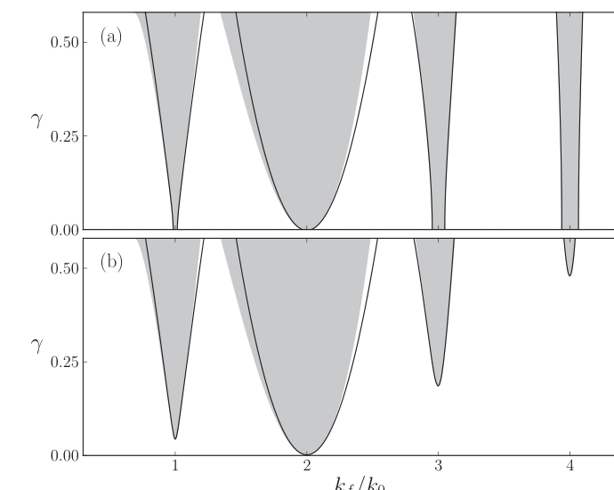
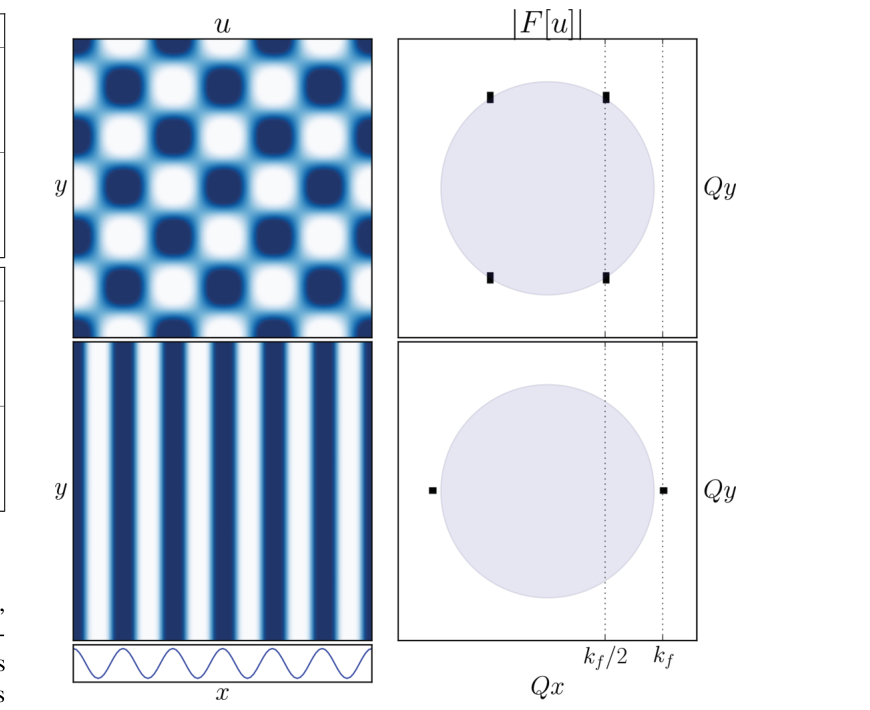
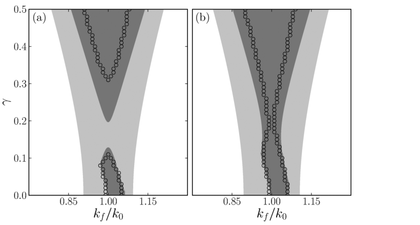

::: {.paper-authors}
Yair Mau^1,\*,&dagger;^, Lev Haim^1,\*^, Aric Hagberg^2^, Ehud Meron^1,3^
:::

::: {.paper-affil}
^1^ Physics Department, Ben-Gurion University of the Negev, Beer-Sheva, Israel &nbsp;&middot;&nbsp; ^2^ Center for Nonlinear Studies, Theoretical Division, Los Alamos National Laboratory, Los Alamos, New Mexico, USA &nbsp;&middot;&nbsp; ^3^ Department of Solar Energy and Environmental Physics, Blaustein Institutes for Desert Research, Ben-Gurion University of the Negev, Sede Boqer Campus, Israel

^\*^ These authors contributed equally to this work. &nbsp;&middot;&nbsp; ^&dagger;^ Corresponding author
:::

---

::: {.paper-meta}
Physical Review E 88, 032917 &middot; 2013 &middot; doi: [10.1103/PhysRevE.88.032917](https://doi.org/10.1103/PhysRevE.88.032917)

Received 1 August 2013; published 25 September 2013
:::

> **How to cite:** Mau, Y., Haim, L., Hagberg, A. and Meron, E. (2013). Competing Resonances in Spatially Forced Pattern-Forming Systems. Physical Review E, 88, 032917. https://doi.org/10.1103/PhysRevE.88.032917

---

#### Abstract

Spatial periodic forcing can entrain a pattern-forming system in the same way as temporal periodic forcing can entrain an oscillator. The forcing can lock the pattern's wave number to a fraction of the forcing wave number within tonguelike domains in the forcing parameter plane, it can increase the pattern's amplitude, and it can also create patterns below their onset. We derive these results using a multiple-scale analysis of a spatially forced Swift-Hohenberg equation in one spatial dimension. In two spatial dimensions the one-dimensional forcing can induce a symmetry-breaking instability that leads to two-dimensional (2D) patterns, rectangular or oblique. These patterns resonate with the forcing by locking their wave-vector component in the forcing direction to half the forcing wave number. The range of this type of 2:1 resonance overlaps with the 1:1 resonance tongue of stripe patterns. Using a multiple-scale analysis in the overlap region we show that the 2D patterns can destabilize the 1:1 resonant stripes even at exact resonance. This result sheds new light on the use of spatial periodic forcing for controlling patterns.

## I. Introduction

In some contexts pattern formation is essential for a system to function. This is the case with embryonic pattern formation ([1](#ref-1)) or with vegetation patterning—a mechanism by which vegetation copes with water stress ([2](#ref-2)). In other contexts pattern formation is an undesired outcome. This is the case with spiral waves in the heart muscle ([3](#ref-3)), dewetting of liquid films ([4](#ref-4)), or spatial patterning in the transverse directions of a laser beam ([5](#ref-5)). In order to create, modify, or eliminate patterns, means of controlling and manipulating them are needed. These means may consist of basic parameter tuning or may involve external intervention, such as feedback control ([6](#ref-6)) or periodic forcing in time ([7](#ref-7)) or space ([8](#ref-8)).

Temporal periodic forcing of an oscillatory system is a classical problem. An early realization is Kapitza's pendulum ([9](#ref-9))—a rigid pendulum with a pivot point that is forced to vibrate in the vertical direction. When the vibration, or forcing frequency, is sufficiently high the unstable upper vertical position of the pendulum can be controlled and stabilized. Another control aspect of this and other examples of forced oscillations, including spatially extended systems, is frequency locking. An oscillatory system subjected to time-periodic (spatially uniform) forcing is capable of changing its oscillation frequency, $\omega$, to lock at a fraction of the forcing frequency, $\omega_f$, provided this fraction is close enough to the natural frequency $\omega_0$ of the unforced system. The frequency-locking, or entrainment, capability increases with the forcing strength, at least for relatively weak forcing. As a consequence, in the parameter plane spanned by the forcing strength and frequency, the entrainment occurs in a tonguelike domain, often called an Arnold tongue. Mathematically, if $\omega_f$ is close to $(n/m)\omega_0$, where $n,m\in\mathbb{Z}$, there exists a domain in the forcing parameter plane—the $n{:}m$ resonance tongue, within which the actual oscillation frequency can be controlled by varying the forcing frequency according to $\omega = (m/n)\omega_f$.

Numerous examples of oscillatory systems entrained by periodic temporal forcing exist. Entrainment of mammalian circadian rhythms by the day-night periodicity is one class of examples ([10](#ref-10)). Additional physiological examples include the entrainment of the heart rate ([11](#ref-11)), of the respiratory phase ([12](#ref-12)), and of insulin and glucose oscillations ([13](#ref-13)). Many more examples can be found in areas as varied as chemistry ([14](#ref-14)&ndash;[17](#ref-17)) and optics ([18](#ref-18),[19](#ref-19)).

There are two additional signatures of periodically forced oscillatory systems that relate to frequency locking. The first is multiplicity of stable oscillation states sharing the same frequency but differing in oscillation phase. Associated with this multistability are front structures and rich pattern-formation phenomena ([16](#ref-16),[17](#ref-17),[20](#ref-20)&ndash;[23](#ref-23)), including traveling waves that restrict the domain of resonant nonuniform oscillations ([24](#ref-24)). The second signature is the possible generation of a symmetry-breaking instability by the periodic forcing. This instability can lead to 2:1 frequency-locked standing-wave patterns even outside the 2:1 resonance tongue of uniform oscillations. This is a reflection of the freedom of a spatially extended oscillatory system to resonate with a spatially uniform time-periodic forcing by forming spatial patterns that change the oscillation frequency through dispersion ([25](#ref-25)&ndash;[27](#ref-27)).

Spatial forcing of a pattern-forming system is analogous to temporal forcing of an oscillating system; the system can respond to the forcing by locking its wave number $k$ to the forcing wave number $k_f$. That is, for any $k_f$ close enough to $(n/m)k_0$, where $n,m\in\mathbb{Z}$ and $k_0$ is the system's natural wave number, the system can respond with a wave number $k=(m/n)k_f$. In the forcing parameter plane (forcing strength versus forcing frequency) wave-number-locked or resonant patterns occupy tonguelike domains—the spatial analogs of Arnold tongues. Within such tongues the wave numbers of resonant patterns are controllable by tuning the forcing wave number.

Spatially forced pattern-forming systems have been studied in various contexts including nematic liquid crystals ([8](#ref-8),[28](#ref-28)), light-sensitive chemical reactions ([8](#ref-8)), Rayleigh-Bénard convection ([8](#ref-8),[29](#ref-29)), liquid-crystal light valve optical systems ([30](#ref-30)), and bottom formation in slightly meandering channels ([31](#ref-31)).

The analogy to temporally forced oscillations extends also to the two additional signatures of periodic forcing, multistability of phase states and fronts ([32](#ref-32)), and a symmetry-breaking instability induced by a one-dimensional (1D) spatially periodic forcing. In this case, the instability breaks the remaining symmetry in the direction orthogonal to the spatial forcing and leads to resonant two-dimensional (2D) rectangular or oblique patterns ([29](#ref-29),[33](#ref-33),[34](#ref-34)). The patterns are wave-number locked to the forcing in a 2:1 resonance and extend far beyond the boundaries of the 2:1 resonant tongue of stripe patterns to a range that includes the 1:1 resonance ($k_f\approx k_0$). The wide resonance range of the 2D patterns is a consequence of the development of a wave-vector component in the direction orthogonal to the forcing that compensates for the unfavorable wave number $k_f/2$ in the forcing direction.

The basic 1:1 resonance of stripe patterns is generally the first choice for inducing, stabilizing, or controlling stripe patterns. This is the case, for example, in restoring degraded vegetation in water-limited landscapes by periodic arrays of microcatchments that concentrate runoff and form favorable conditions for vegetation growth in a fluctuating environment ([2](#ref-2)). However, the influence of 2D patterns on 1:1 stripe patterns has not yet been studied. In this paper we use a simple pattern-formation model to study the interaction between 1:1 resonant stripes and 2:1 resonant rectangular and oblique patterns and the extent to which the 2D patterns interfere with the control of the resonant stripe patterns. We show that, although in one spatial dimension the forcing acts to reinforce the patterns, in two dimensions it acts to destabilize them by inducing these 2D patterns. The analysis and results to be described here extend earlier results reported in Ref. ([35](#ref-35)).

## II. The Model Equation

We consider systems that go through a stationary finite-wave-number instability to stripe patterns and are subjected to time-independent, 1D spatial periodic forcing. A minimal model for such systems is the widely used Swift-Hohenberg (SH) equation for a single scalar field ([36](#ref-36)&ndash;[38](#ref-38)). The equation is gradient, i.e., it has a Lyapunov functional, and therefore does not have oscillatory solutions. The instability results in a stationary stripe pattern with a characteristic wave number that minimizes the Lyapunov functional.

To study the effect of periodic spatial forcing we add to the SH equation a parametric forcing term. The forced SH equation then reads

$$
u_t = \epsilon u - \left(\nabla^2+k_0^2\right)^2 u - u^3 + \gamma u\cos(k_fx), \tag{1}
$$

where $\epsilon$ is the distance from the pattern-forming instability of the uniform stationary state, $u=0$, of the unforced system and $k_0\sim O(1)$ is the wave number of the first mode to grow at the instability point and also the wave number of the resulting stationary pattern. The parametric forcing is generated with wave number $k_f$ and strength $\gamma$. Since Eq. (1) is invariant under the transformation $\gamma\to-\gamma$ and $x\to x+\pi/k_f$ we will choose to consider only positive values of the forcing $\gamma$. Note the inversion symmetry $u\to-u$ of Eq. (1), which excludes hexagonal patterns ([38](#ref-38)). Note also that the forced SH equation is gradient as well ([35](#ref-35)).

We first study Eq. (1) in one dimension in order to identify the resonance tongues of stripe patterns (Sec. III). The general analysis is valid for any resonance $n{:}1$, $n\in\mathbb{Z}$, assuming the vicinity to the instability of the zero solution to stripes, weak forcing, and small detuning. We then focus on the 1:1 resonance and study the interaction between the 1:1 stripe mode, $\exp(ik_0x)$, and two oblique modes, $\exp(ik_xx\pm ik_yy)$, that resonate with the forcing, $k_x=k_f/2$, and have the favorable wave number $k_0=(k_x^2+k_y^2)^{1/2}$ (Sec. IV). In both analyses we use the method of multiple scales using $\epsilon$ as the small parameter.

## III. Resonant Stripe Patterns

The zero solution of the unforced SH equation loses stability at $\varepsilon=0$. Beyond the instability point ($\varepsilon>0$) a family of periodic stripe solutions exists with wave numbers $k$ spanning the range

$$
k_0 - \frac{\sqrt{\varepsilon}}{2k_0} < k < k_0 + \frac{\sqrt{\varepsilon}}{2k_0}. \tag{2}
$$

Assume now that the forcing wave number, $k_f$, is close to a multiple of $k_0$, that is,

$$
k_f \approx nk_0, \qquad n\in\mathbb{Z}, \tag{3}
$$

and let $\nu$ be the deviation or detuning from exact resonance:

$$
\nu = k_0 - k_f/n. \tag{4}
$$

The solution family of the unforced system that spans the wave-number range in Eq. (2) can increase the freedom of the system to resonate with the forcing. This is because for any forcing wave number $k_f$, such that $k_f/n$ is within the range in Eq. (2), there exists a solution of the unforced system with that particular wave number. The forcing can further increase the resonance range by creating stripe solutions with wave numbers outside the range in Eq. (2). The manner in which it does it for various resonances $k_f/k=n$ is the problem we now address.

We use multiple-scale analysis ([36](#ref-36)), in which the state variable $u$ and the parameters $\gamma$ and $k_f$ are expanded as power series in $|\varepsilon|\ll1$. The specific choice of scaling used below can be justified by balancing different terms in Eq. (1). Consider the case of weak forcing ($\gamma\ll1$) near the instability of the zero solution ($|\varepsilon|\ll1$). The stripe solutions that appear beyond the instability point have small amplitudes that vary slowly in time and space. We thus expand solutions of Eq. (1) as

$$
u = \sum_{i=1}^{\infty}|\varepsilon|^{i/2}u_i(x_0,x_1,t_1), \tag{5}
$$

where $x_i=|\varepsilon|^{i/2}x$ ($i=0,1$) and $t_1=|\varepsilon|t$ are the slow space and time variables. We further assume the scaling $\nu\sim|\varepsilon|^{1/2}$ for the small detuning and expand the forcing strength as power series in $|\varepsilon|^{1/2}$:

$$
\gamma = \sum_{i=1}^{\infty}|\varepsilon|^{i/2}\gamma_i, \qquad \gamma_i\sim O(1). \tag{6}
$$

This allows handling all resonances using a single analysis. With these choices of the slow space and time variables the derivatives in Eq. (1) transform according to

$$
\partial_x = \partial_{x_0} + |\varepsilon|^{1/2}\partial_{x_1}, \qquad \partial_t = |\varepsilon|\partial_{t_1}. \tag{7}
$$

Substituting Eqs. (5)–(7) into Eq. (1) we find at order $|\varepsilon|^{1/2}$

$$
\mathcal{L}^2u_1 = 0, \tag{8}
$$

where $\mathcal{L} = (\partial_{x_0}^2+k_0^2)$. The solution of this equation can be written as

$$
u_1 = a(x_1,t_1)\,e^{ik_0x_0} + \text{c.c.}, \tag{9}
$$

where the amplitude $a$ depends on the slow variables $x_1$ and $t_1$ and c.c. stands for the complex conjugate.

At order $|\varepsilon|$ we find

$$
\mathcal{L}^2u_2 = \frac{\gamma_1}{2}\left(e^{ik_fx_0}+e^{-ik_fx_0}\right)u_1 = \frac{\gamma_1}{2}\left(a\,e^{i(k_f+k_0)x_0} + a^*e^{i(k_f-k_0)x_0}\right) + \text{c.c.} \tag{10}
$$

Solvability of Eq. (10) requires the elimination of secular terms from the right-hand side of the equation. The secular terms are those in which the fast spatial dependence is described by the harmonic factor $e^{\pm ik_0x_0}$. For all resonances $n\neq2$ the right-hand side does not contain secular terms and no solvability condition has to be imposed. For $n=2$, however, there are secular terms, $e^{\pm i(k_f-k_0)x_0}$, since $k_f\approx2k_0$ (see below). To eliminate the secular terms we must set $\gamma_1=0$ for the 2:1 resonance. We accomplish this condition by multiplying $\gamma_1$ by $1-\delta_{n,2}$, where $\delta_{i,j}$ is the Kronecker delta. The general solution of Eq. (10) is a superposition of a particular solution and a general solution of the homogeneous problem:

$$
u_2 = (1-\delta_{n,2})\frac{\gamma_1}{2}\left[d_+a\,e^{i(k_f+k_0)x_0} + d_-a^*e^{i(k_f-k_0)x_0}\right] + c(x_1,x_2,t_1,t_2,\ldots)\,e^{ik_0x_0} + \text{c.c.}, \tag{11}
$$

where

$$
d_\pm = \frac{1}{k_f^2(k_f\pm2k_0)^2}. \tag{12}
$$

Finally, at order $|\varepsilon|^{3/2}$ we find

$$
\mathcal{L}^2u_3 = u_1 - u_1^3 - \partial_{t_1}u_1 - \mathcal{M}^2u_1 - 2\mathcal{M}\mathcal{L}u_2 + \frac{1}{2}\left(e^{ik_fx_0}+e^{-ik_fx_0}\right)(\gamma_2u_1+\gamma_1u_2), \tag{13}
$$

where $\mathcal{M} = 2\partial_{x_0}\partial_{x_1}$. In order to identify the secular terms we insert the solutions Eqs. (9) and (11) for $u_1$ and $u_2$ into the right-hand side of Eq. (13) and note that since the detuning is of order $|\varepsilon|^{1/2}$ we can write $k_fx_0 = n(k_0x_0-\nu_1x_1)$, where $\nu_1=|\varepsilon|^{-1/2}\nu\sim O(1)$. Summing up all contributions to the secular terms and setting their coefficients to zero gives

$$
a_{t_1} = a - 3|a|^2a + (2k_0)^2\partial_{x_1}^2a + \delta_{n,2}\frac{\gamma_2}{2}a^* + (1-\delta_{n,2})\left(\frac{\gamma_1}{2}\right)^2\left[\eta_1a + \delta_{n,1}d_-\,e^{-2i\nu_1x_1}a^*\right], \tag{14}
$$

where $\eta_1 = d_+ + d_-$.

Introducing the amplitude variable $A = |\varepsilon|^{1/2}e^{i\nu_1x_1}a$, and going back to the fast time and space variables, we obtain the amplitude equation:

$$
A_t = \varepsilon A - 3|A|^2A - (2k_0)^2(i\partial_x+\nu)^2A + \delta_{n,2}\frac{|\varepsilon|\gamma_2}{2}A^* + (1-\delta_{n,2})\left(\frac{|\varepsilon|^{1/2}\gamma_1}{2}\right)^2\left[\eta_1A+\delta_{n,1}d_-A^*\right]. \tag{15}
$$

In terms of the amplitude $A$ the leading-order form of the solution is

$$
u \simeq A\,e^{i\frac{k_f}{n}x}. \tag{16}
$$

Constant solutions of the amplitude equation (15) represent $n{:}1$ wave-number-locked, or resonant, stationary stripe patterns. To find these solutions we consider the cases $n\neq2$ and $n=2$ separately. For $n\neq2$ Eq. (15) becomes

$$
A_t = \varepsilon A - 3|A|^2A - \left[2k_0(i\partial_x+\nu)\right]^2A + \left(\frac{\gamma}{2}\right)^2\left[\eta_1A+\delta_{n,1}d_-A^*\right], \tag{17}
$$

where $\gamma=|\varepsilon|^{1/2}\gamma_1$, and solutions are of the form

$$
A = \rho_n\,e^{i\phi}, \qquad \rho_n = \sqrt{\frac{\varepsilon - (2k_0\nu)^2 + (\eta_1+\delta_{n,1}d_-)\frac{\gamma^2}{4}}{3}}, \tag{18}
$$

with $\nu=k_0-k_f/n$. The phase $\phi$ is constant with $\phi=\{0,\pi\}$ for $n=1$ but undetermined for higher resonances for the order $|\varepsilon|^{3/2}$ of our calculation. The resonant stripe solutions exist for

$$
\gamma > 2\sqrt{\frac{(2k_0\nu)^2-\varepsilon}{\eta_1+\delta_{n,1}d_-}}. \tag{19}
$$

For $n=2$ Eq. (15) becomes

$$
A_t = \varepsilon A - 3|A|^2A - \left[2k_0(i\partial_x+\nu)\right]^2A + \frac{\gamma}{2}A^*, \tag{20}
$$

where $\gamma=|\varepsilon|\gamma_2$, and the solutions are of the form

$$
A = \rho_2\,e^{i\phi}, \qquad \rho_2 = \sqrt{\frac{\varepsilon-(2k_0\nu)^2+\gamma/2}{3}}, \tag{21}
$$

with $\phi=\{0,\pi\}$ ([34](#ref-34)). These solutions exist for

$$
\gamma > 2\left[(2k_0\nu)^2-\varepsilon\right]. \tag{22}
$$

Figure 1 shows the tongue-shaped existence ranges of $n{:}1$ resonant stripe patterns with $n=1,\ldots,4$, for parameters above, $\varepsilon>0$, and below, $\varepsilon<0$, the pattern-forming instability. The solid lines in the figure are the results of the analysis from Eqs. (18) and (21) and the shaded regions are numerical results from solving for stationary solutions of the forced SH equation Eq. (1) using a continuation method ([39](#ref-39)).

**FIG. 1 | Existence domains of resonant stripe solutions of Eq. (1), (a) above ($\varepsilon>0$) and (b) below ($\varepsilon<0$) the pattern-forming instability.** The shaded regions indicate the range of resonant solutions computed from stationary solutions of Eq. (1), and the solid curves show the region boundary approximations [Eqs. (19) and (22)] based on the amplitude equation approach. The agreement for the lower resonances is very good for sufficiently small $\gamma$ values, and for the higher resonances it remains surprisingly good even for large $\gamma$ values. Parameters: $k_0=1$ and (a) $\varepsilon=0.001$ and (b) $\varepsilon=-0.001$.

Note that for $\varepsilon>0$ the tongues have finite width even at $\gamma=0$ [Fig. 1(a)]. This width corresponds to the band of stripe solutions of the unforced system that appears beyond the pattern-forming instability. The effect of a weak forcing with a detuning $\nu$ can be interpreted as follows. If the detuning is small enough the forcing selects the stripe solution within the band that resonates with $k_f/n$. If the detuning lies outside the band the system can still yield to the forcing by changing the stripes wave number so as to resonate with $k_f/n$. This behavior is analogous to the frequency adjustment that a periodically forced oscillator makes when it locks to a fraction of the forcing frequency. Note also that for $\varepsilon<0$, i.e., below the pattern-forming instability, resonant stripe solutions are still possible provided the forcing is strong enough [Fig. 1(b)]. The minimum forcing strength can be evaluated from Eqs. (19) and (22); e.g., the smallest $\gamma$ value that enables locking for the 2:1 resonance is $-2\varepsilon$. The forcing has the additional effect of increasing the amplitude of the stripe pattern. This effect, however, becomes diminishingly small as the forcing wave number increases.

The 2:1 resonance tongue stands out in being wider and, for $\varepsilon<0$, in extending to lower forcing strength $\gamma$. The distinct character of the 2:1 resonance is already seen in the amplitude equation Eq. (20) for the 2:1 resonance, as compared with the amplitude equations Eqs. (17) for all other resonances. In the former the forcing strength appears to linear order, whereas in the latter it only appears at the second quadratic order, and therefore has a weaker effect. The different forms of the amplitude equations with respect to the forcing follow from the type of parametric forcing; forcing the cubic term in the forced SH equation Eq. (1), rather than the linear term, will result in a prominent 4:1 resonance.

## IV. Interference of 2D Patterns

In 2D domains, solutions of Eq. (1) can lock to the forcing wave vector $\mathbf{k}_f=k_f\hat{x}$, where $\hat{x}$ is a unit vector in the $x$ direction, in a much wider range of forcing wave numbers $k_f$. This is achieved by locking their wave-vector component in the forcing direction in a 2:1 resonance, $k_x=k_f/2$, and compensating for a big mismatch by building a wave-vector component in the $y$ direction, $k_y=(k_0^2-k_x^2)^{1/2}$, so that the total wave number is the favorable one, $k=k_0$ ([33](#ref-33),[34](#ref-34)). The resonance range then is only limited by the requirement that $k_y$ is real valued, that is, $0\leqslant k_f\leqslant2k_0$. The 2D patterns that form are described, to leading order, by a superposition of two oblique modes, $\exp(ik_xx\pm ik_yy)$. For sufficiently strong forcing ($\gamma>\varepsilon$) the two modes have equal amplitudes in absolute value, and the superposition forms rectangular patterns. For weaker forcing the amplitudes are not equal and the superposition forms oblique patterns.

**FIG. 2 | Two stable solutions of Eq. (1) at the same parameter values.** The panel on the upper left side shows a 2:1 locked rectangular solution, and the panel below it shows a 1:1 locked stripe solution. The short panel on the lower left side shows the forcing $\gamma\cos(k_fx)$. The panels on the right show the amplitude of the Fourier transform of the respective solutions in the two-dimensional wave-number space $Q_x,Q_y$. The circle in light blue has radius $k_0=1$, the most unstable wave number. Parameters: $\varepsilon=0.1$, $\gamma=0.2$, and $k_f=1.08$.

The resonance range of rectangular and oblique patterns overlaps with the much narrower 1:1 resonance tongue of stripe patterns. Within the overlap range we numerically find points of bistability of resonant 1:1 stripes and 2:1 2D patterns, as Fig. 2 demonstrates, but we also find points where the 2D patterns dominate. To study the dynamics within the overlap range we let the two types of patterns interact by approximating a solution of Eq. (1) as a superposition of a stripe mode with amplitude $A$ and two oblique modes with amplitudes $a$ and $b$:

$$
u \simeq A\,e^{ik_0x} + a\,e^{i(k_xx+k_yy)} + b\,e^{i(k_xx-k_yy)} + \text{c.c.}, \tag{23}
$$

where the amplitudes $A$, $a$, and $b$ are small in absolute value and vary weakly in time and space. In the Appendix we describe a derivation of coupled partial differential equations for these amplitudes using a multiple-scale analysis, and the results are in Eqs. (A20).

Constant solutions of the amplitude equations Eqs. (A20) of the form $(A,0,0)$ represent 1:1 resonant stripe patterns, while constant solutions of the form $(0,a,b)$ represent rectangular or oblique patterns locked in a 2:1 resonance in the $\hat{x}$ direction. The resonant stripe solutions are given by

$$
A_s = \rho_{s\pm}e^{i\phi_s}, \tag{24}
$$

where

$$
\rho_{s\pm} = 2\sqrt{8k_0^4\pm\left(k_0^2/\sqrt{3}\right)\sqrt{\varepsilon_s}}, \qquad \phi_s = m\frac{\pi}{2}. \tag{25}
$$

Here

$$
\varepsilon_s = -4\varepsilon + 16k_0^2\left(\nu^2+12k_0^2\right) - \gamma_1^2\left\{d_+ + \left[(-1)^m+1\right]d_-\right\},
$$

and $m$ is an integer.

Resonant rectangular solutions are given by

$$
a = \rho_re^{i\phi_a}, \qquad b = \rho_re^{i\phi_b}, \tag{26}
$$

where

$$
\rho_{r\pm} = \sqrt{\frac{9\pm\sqrt{81-4c\varepsilon_r}}{2c}}, \qquad \phi_a+\phi_b = m\pi. \tag{27}
$$

Here

$$
\varepsilon_r = \varepsilon + (-1)^m\frac{\gamma_2}{2}, \qquad c = \frac{27}{4}\left[k_f^{-4}+\left(k_f^2-4\right)^{-2}\right], \tag{28}
$$

and we assumed weak forcing strength ($\gamma_1=0$).

To study the impact of the 2D rectangular patterns on 1:1 resonant stripes we use Eqs. (A20) to study the linear stability of the latter. The stability analysis to phase perturbations can be performed independently of that of amplitude perturbations and gives the result that solutions with odd values of $m$ are unstable. We thus restrict our further consideration to even $m$ and consider the stability of $(A,a,b)=(\pm\rho_{s\pm},0,0)$ to nonuniform perturbations of the form $(\delta A_0,\delta a_0,\delta b_0)\exp(iq_xx+iq_yy)$. The Jacobian matrix for the solutions $(\pm\rho_{s\pm},0,0)$ has a block-diagonal form, with one block representing the stripe mode and the other block representing the oblique modes. Accordingly, one pair of eigenvalues, $\sigma_{s\pm}$, describes the dynamics of perturbations along the stripe mode, and another eigenvalue pair of multiplicity two, $\sigma_{r\pm}$, describes the dynamics of perturbations along the oblique modes. Of these only the eigenvalues $\sigma_{s+}$ and $\sigma_{r+}$ are potentially positive or have positive real parts.

For the stripe solutions $A=\pm\rho_{s+}$, both $\sigma_{s+}$ and $\sigma_{r+}$ are positive in the whole parameter range studied, and thus these solutions are always unstable and will not be considered any further. For the stripe solutions $A=\pm\rho_{s-}$, the analysis of the eigenvalue $\sigma_{r+}$ shows that there exists a domain in the existence overlap region of 1:1 stripes and rectangular patterns where the resonant stripes are stable, but the size of this domain is reduced by the growth of oblique modes. Furthermore, the reduced stability domain has two distinct shapes depending on the value of $\varepsilon$. For relatively large values, $\varepsilon>\varepsilon_c\simeq0.036$ (with $k_0=1$), there is a continuous $\gamma$ range in which stripe solutions are stable, while for $\varepsilon<\varepsilon_c$, the stability range is split into two regions, as Fig. 3 shows. The light-gray shades show the existence range of stripe solutions, $A=\pm\rho_{s-}$, while the dark-gray shades show their stability ranges (where both $\sigma_{s+}$ and $\sigma_{r+}$ are negative) for (a) $\varepsilon>\varepsilon_c$ and (b) $\varepsilon<\varepsilon_c$.

**FIG. 3 | Existence and stability domains of 1:1 resonant stripe solutions of Eqs. (A20).** The light gray shaded areas indicate the existence domains, and the dark gray shaded areas are the stability regions. (a) Above the critical value, $\varepsilon>\varepsilon_c$, where the stable region is contiguous. (b) Below the critical point, $\varepsilon<\varepsilon_c$, where the solution is not stable in a range of forcing strength $\gamma$ even at exact resonance $k_f=k_0$. The hollow circles demarcate the borders of the numerically computed stability region. Parameters: $k_0=1$ and (a) $\varepsilon=0.035$ and (b) $\varepsilon=0.045$.

The surprising result is that for $\varepsilon<\varepsilon_c$ there is an intermediate range of forcing strength $\gamma$ where the forcing destabilizes the stripe patterns even at exact resonance $k_f=k_0$. In 1D systems the forcing acts to stabilize the stripe patterns ([34](#ref-34)), but in 2D systems it induces the growth of rectangular and oblique patterns that can resonate with the forcing without paying any energy (Lyapunov functional) cost for off-resonance conditions, like in 1D systems ([35](#ref-35)). This "advantage" of the resonant 2D patterns over stripes translates into lower stability or even instability of the latter.

The asymmetry in the stability region for low $\gamma$ values is due to two different kinds of instabilities related to the eigenvalue $\sigma_{s+}$. In the lower part of Fig. 3 (for values of $\gamma$ between 0 and approximately 0.1), the left border of the stable stripes region (dark gray) indicates a zigzag instability, associated with the growth of perturbations of the form $e^{iq_yy}$. On the border on the right side, for very low values of $\gamma$ (between 0 and approximately 0.02), an Eckhaus instability, associated with the growth of perturbations of the form $e^{iq_xx}$, occurs. These results are qualitatively similar to the effects of the zigzag and Eckhaus instabilities found in the 2:1 resonance of stripe patterns ([34](#ref-34)).

Numerical solutions of Eq. (1) confirm the predictions of the mathematical analysis. The hollow circles in Fig. 3 show the borders of the stability region, and the agreement between simulation and analysis is very good for low values of $\gamma$. Because of the choice of weak forcing strength ($\gamma_1=0$), the analysis is expected to better describe the simulations for small values of $\gamma$, in line with the results shown in Fig. 3. The numerical integration performed was the explicit Euler method to advance time and a semispectral method to calculate the space derivatives, with a 1:1 stripe pattern as initial condition, with a small random noise added to it. The critical value we found was $\varepsilon_c\simeq0.043$, which is about 15% from our theoretically calculated value of $\varepsilon=0.036$.

## V. Conclusion

We have seen that spatial periodic forcing reinforces 1D stripe solutions by increasing the amplitude and widening the wave-number range. The stripe solutions are also stable below threshold ($\varepsilon<0$), provided that a minimal forcing strength is applied.

In 2D domains, oblique and rectangular patterns exist and are stable for a very wide range of forcing wave numbers ([34](#ref-34)). These 2D patterns dramatically change the stability range of stripe patterns, determining a critical value $\varepsilon_c$ below which the stripe solution is unstable in a range of forcing strength $\gamma$, even when $k_f=k_0$. This seems counterintuitive because naively we would expect the 1:1 forcing to reinforce the stripe pattern, as in the 1D case. In 2D, though, the system can yield more easily to the forcing by responding in the orthogonal direction through the growth of oblique modes that destabilize stripe patterns.

We have studied the SH equation as a simple model of pattern formation, which raises the question: to what extent are the results reported here applicable to real systems? One strong constraint in the SH equation is the inversion symmetry $u\to-u$, which rules out hexagonal patterns. Real systems often do not have this symmetry and do show hexagonal patterns. Adding a quadratic term, $\lambda u^2$, to the SH equation indeed induces an instability of the zero state to hexagonal patterns, which is a subcritical bifurcation ([38](#ref-38)). The effects of parametric forcing in this nonsymmetric case will be the subject of a future study.

We have also focused on parametric forcing rather than additive forcing. The latter case has been studied in the contexts of optical patterns in photorefractive feedback systems ([40](#ref-40)), Rayleigh-Bénard convection ([29](#ref-29)), and Turing patterns in chemical reactions ([8](#ref-8)). Parametric forcing is relevant to the restoration of banded vegetation on hill slopes by water harvesting ([2](#ref-2),[41](#ref-41),[42](#ref-42)). Water-harvesting methods consist of periodic arrays of microcatchments, e.g., parallel dikes, that intercept runoff and form favorable conditions for vegetation growth. The periodic modulation of the vegetation growth rate by the modulated soil-water distribution exerts parametric forcing.

## Acknowledgments

The support of the United States-Israel Binational Science Foundation (Grant No. 2008241) is gratefully acknowledged. Part of this work was funded by the Laboratory Directed Research and Development program at Los Alamos National Laboratory under the Department of Energy Contract No. DE-AC52-06NA25396.

## Appendix: Derivation of Amplitude Equations

We study the interaction between stripes and rectangular or oblique patterns by deriving equations for the amplitudes of a stripe mode and of two oblique modes using the leading-order approximation

$$
u \simeq A\,e^{ik_0x} + a\,e^{i(k_xx+k_yy)} + b\,e^{i(k_xx-k_yy)} + \text{c.c.}, \tag{A1}
$$

for the solutions of Eq. (1), where the amplitudes are assumed to vary slowly in space and time. Specifically, we define the slow variables

$$
x_i = \varepsilon^{i/4}x, \qquad y_i = \varepsilon^{i/4}y, \qquad t_i = \varepsilon^{i/4}t, \qquad i=1,2,\ldots, \tag{A2}
$$

and assume the following amplitude dependence:

$$
\begin{aligned}
A &= A(y_1,x_2,y_2,t_1,t_2,\ldots), \\
a &= a(x_2,y_2,t_1,t_2,\ldots), \qquad b = b(x_2,y_2,t_1,t_2,\ldots).
\end{aligned} \tag{A3}
$$

We included a dependence of $A$ on $y_1$ in order to capture a possible zigzag instability of stripe solutions. We further assume the following scaling forms for the forcing parameters:

$$
\gamma = |\varepsilon|^{1/2}\gamma_1, \qquad \nu = |\varepsilon|^{1/2}\nu_1, \tag{A4}
$$

where $\gamma_1$ and $\nu_1$ are of order unity.

In deriving the amplitude equation (17) for stripes we used the scaling $\gamma\sim|\varepsilon|^{1/2}$, whereas in the derivation of the amplitude equations for the two oblique modes the scaling $\gamma\sim|\varepsilon|$ has been used ([33](#ref-33),[34](#ref-34)). Because we are interested in deriving coupled equations for stripe and oblique modes we need to use the same scaling for $\gamma$. Choosing $\gamma\sim|\varepsilon|^{1/2}$ and slow time scales $t_i=\varepsilon^{i/2}t$, as in Ref. ([35](#ref-35)), leads to the undesired result that the forcing terms in the amplitude equations for the oblique modes are the largest with no other terms of the same order of magnitude to balance them. We therefore choose the slow time scales as in Eq. (A2) and expand the solution in powers of $|\varepsilon|^{1/4}$:

$$
u = \sum_{i=1}^{\infty}\varepsilon^{i/4}u_i. \tag{A5}
$$

Substituting Eqs. (A2), (A4), and (A5) into Eq. (1) we find at order $|\varepsilon|^{1/4}$

$$
\mathcal{L}^2u_1 = 0, \tag{A6}
$$

where $\mathcal{L} = \mathcal{M}_{00}+k_0^2$ and $\mathcal{M}_{ij} = \partial_{x_i}\partial_{x_j}+\partial_{y_i}\partial_{y_j}$. Equation (A6) has a solution of the form

$$
u_1 = Ae^{ik_0x_0} + ae^{i(k_xx_0+k_yy_0)} + be^{i(k_xx_0-k_yy_0)} + \text{c.c.}, \tag{A7}
$$

where $k_x^2+k_y^2=k_0^2$, which justifies the leading order approximation Eq. (A1).

At order $|\varepsilon|^{1/2}$ we find

$$
\mathcal{L}^2u_2 = -\partial_{t_1}u_1 + \mathcal{L}\mathcal{M}_{01}u_1. \tag{A8}
$$

Note that the term $\mathcal{L}\mathcal{M}_{01}u_1$ that appears on the right side of Eq. (A8) equals to zero because the operators $\mathcal{L}$ and $\mathcal{M}_{ij}$ commute and $\mathcal{L}u_1=0$. Therefore, from now on we will omit terms of the kind $\mathcal{L}\mathcal{M}_{ij}u_1$ from the analysis. Applying the solvability condition to secular terms on the right-hand side of Eq. (A8) we find that neither mode depends on $t_1$:

$$
\partial_{t_1}A = 0, \qquad \partial_{t_1}a = 0, \qquad \partial_{t_1}b = 0. \tag{A9}
$$

Hence, $u_2$ satisfies the same equation as $u_1$ and we can choose the trivial zero solution, $u_2=0$.

At order $|\varepsilon|^{3/4}$ we have

$$
\mathcal{L}^2u_3 = -\partial_{t_2}u_1 - 4\mathcal{M}_{01}^2u_1 - u_1^3 + u_1\gamma_1\cos(k_fx_0). \tag{A10}
$$

We recall that we focus on the overlap range of the 1:1 resonance tongue, where $k_f=k_0-\nu=k_0-|\varepsilon|^{1/2}\nu_1$, with 2:1 resonant rectangular or oblique patterns for which $k_f=2k_x$. Substituting Eq. (A7) into Eq. (A10), and demanding solvability, we find

$$
\partial_{t_2}A = F(A), \qquad \partial_{t_2}a = F(a) + \frac{\gamma_1}{2}b^*, \qquad \partial_{t_2}b = F(b) + \frac{\gamma_1}{2}a^*, \tag{A11}
$$

where $F(\zeta) = -3(2|A|^2+2|a|^2+2|b|^2-|\zeta|^2)\zeta$. If we were to stop the analysis here, the amplitude equation for the stripe pattern would not include any forcing term. Therefore, we continue the analysis to higher orders in $|\varepsilon|$ until a forcing term is achieved for the stripe equation. We will simplify the calculations from this point on by using the following symmetry argument. Since the forced SH equation is invariant under the reflection symmetry $y\to-y$, $u(x,-y)$ must also be a solution. The solution form Eq. (A1) then implies that $b$ should satisfy the same amplitude equation as $a$ once $a$ and $b$ are exchanged and $y$ is replaced by $-y$. Thus from now on we do not present the solvability conditions associated with $b$.

A particular solution to Eq. (A10) is given by

$$
\begin{aligned}
u_3 &= -\frac{1}{64k_0^4}\left(E_1^3+E_2^3+E_3^3\right) - 3d_2(E_2+E_3)E_2E_3 - 3p_+\left[E_1\left(E_2^2+E_3^2\right)+E_1^2(E_2+E_3)\right] - 6d_+E_1E_2E_3 \\
&\quad - 3p_-\left[E_1^*\left(E_2^2+E_3^2\right)+E_1^2(E_2^*+E_3^*)\right] - 6d_-E_1^*E_2E_3 - 3d_1\left[\left(E_3^*E_2^2+E_2^*E_3^2\right)+8(E_2E_3^*+E_2^*E_3)E_1\right] \\
&\quad + \frac{\gamma_1}{2}e^{ik_fx_0}\left[d_+E_1+d_2(E_2+E_3)+d_-E_1^*\right] + \text{c.c.}, \tag{A12}
\end{aligned}
$$

where $E_1 = A\,e^{ik_0x_0}$, $E_2 = a\,e^{i(k_xx_0+k_yy_0)}$, $E_3 = b\,e^{i(k_xx_0-k_yy_0)}$, $d_\pm$ is as given in Eq. (12), and the coefficients are

$$
d_1 = \frac{1}{64k_y^4}, \qquad d_2 = \frac{1}{4k_f^4}, \qquad p_\pm = \frac{k_f^2}{4k_0^2}d_\pm. \tag{A13}
$$

At order $|\varepsilon|^{4/4}$ we obtain

$$
\mathcal{L}^2u_4 = -\partial_{t_3}u_1 - 4\mathcal{M}_{01}\left[(\mathcal{M}_{11}+2\mathcal{M}_{02})u_1 + \mathcal{L}u_3\right]. \tag{A14}
$$

Requiring solvability we find that neither mode depends on $t_3$:

$$
\partial_{t_3}A = 0, \qquad \partial_{t_3}a = 0, \qquad \partial_{t_3}b = 0. \tag{A15}
$$

There is no need to solve Eq. (A14) explicitly, because in the next and last order we consider the term that contains $u_4$ and $(\mathcal{L}\mathcal{M}_{01}u_4)$ is not secular and will not contribute to the amplitude equations up to the order $|\varepsilon|^{5/4}$ considered here. The final order $|\varepsilon|^{5/4}$ gives

$$
\begin{aligned}
\mathcal{L}^2u_5 &= -\partial_{t_4}u_1 - \partial_{t_2}u_3 - 4\mathcal{L}\mathcal{M}_{01}u_4 - 2\left[2\mathcal{M}_{01}^2+\mathcal{L}(2\mathcal{M}_{02}+\mathcal{M}_{11})\right]u_3 \\
&\quad - \left[(2\mathcal{M}_{02}+\mathcal{M}_{11})^2+8\mathcal{M}_{01}\mathcal{M}_{12}\right]u_1 - 3u_1^2u_3 + u_1 + \gamma_1u_3\cos k_fx_0. \tag{A16}
\end{aligned}
$$

Applying the solvability condition, we find

$$
\begin{aligned}
\partial_{t_4}A &= A + G + \left(2k_0\partial_{x_2}-i\partial_{y_1}^2\right)^2A + 3\gamma_1\eta_1\left(\frac{\gamma_1}{12}-ab-a^*b^*\right)A \\
&\quad + e^{-2i\nu_1x_2}\left(\frac{d_-\gamma_1a^2}{4}-\frac{\gamma_1}{2}ab\eta_2+6a^2b^2\eta_4\right)A^*, \\
\partial_{t_4}a &= a + H(a,b) + 4\left(k_x\partial_{x_2}+k_y\partial_{y_2}\right)^2a + \frac{3\gamma_1d_2}{2}\left(\frac{\gamma_1}{6}-ab\right)a \tag{A17}\\
&\quad + \left[-3\gamma_1\left(|a|^2d_2+|b|^2\frac{d_2}{2}+|A|^2\eta_1\right) + e^{2i\nu_1x_2}\left(-\frac{\gamma_1}{2}\eta_3+3a^*b^*\eta_5\right)A^2\right]b^*,
\end{aligned}
$$

where

$$
\eta_1=d_++d_-, \quad \eta_2=12(d_2+d_-), \quad \eta_4=3d_2+\eta_3, \quad \eta_3=3d_2+3p_-+6d_-, \quad \eta_5=3d_2+15p_-+12d_-, \tag{A18}
$$

and

$$
G = 3\left[\frac{|A|^4}{64k_0^4}+3(p_++p_-)\left(2|A|^2|a|^2+2|A|^2|b|^2+|a|^4+|b|^4\right)+12(\eta_1+8d_1)|a|^2|b|^2\right]A, \tag{A19}
$$

$$
H(\zeta_1,\zeta_2) = 3\left[\frac{|\zeta_1|^4}{64k_0^4}+3|A|^2(|A|^2+2|\zeta_1|^2)(p_++p_-)+3|\zeta_2|^2(2|\zeta_1|^2+|\zeta_2|^2)(d_1+d_2)+12|A|^2|\zeta_2|^2(\eta_1+8d_1)\right]\zeta_1.
$$

The amplitude equations can now be obtained by combining Eqs. (A9), (A11), (A15), and (A17) (using the chain rule). Rescaling back to the "fast" space and time variables and rescaling the amplitudes $A\to\varepsilon^{-1/4}e^{-i\nu_1x_2}A$, $a\to\varepsilon^{-1/4}a$, $b\to\varepsilon^{-1/4}b$, the detuning $\nu_1=\varepsilon^{-1/2}\nu$, and the forcing strength as $\gamma_1=\varepsilon^{-1/2}\gamma$ gives the final form of the amplitude equations (we have also added the symmetric equation for $b$):

$$
\begin{aligned}
\partial_tA &= \varepsilon A - 3(|A|^2+2|a|^2+2|b|^2)A - \left[2k_0(i\partial_x+\nu)+\partial_y^2\right]^2A + \left(\frac{\gamma}{2}\right)^2(\eta_1A+d_-A^*) + \hat{G}, \\
\partial_ta &= \varepsilon a - 3(|a|^2+2|b|^2+2|A|^2)a + 4(k_x\partial_x+k_y\partial_y)^2a + \frac{\gamma}{2}b^* + \hat{H}(a,b), \tag{A20}\\
\partial_tb &= \varepsilon b - 3(|b|^2+2|a|^2+2|A|^2)b + 4(k_x\partial_x-k_y\partial_y)^2b + \frac{\gamma}{2}a^* + \hat{H}(b,a),
\end{aligned}
$$

with

$$
\begin{aligned}
\hat{G} &= -3\gamma\eta_1(ab+a^*b^*)A + \left[-\frac{\gamma}{2}ab\eta_2+6a^2b^2\eta_4\right]A^* + G, \\
\hat{H}(a,b) &= \frac{3\gamma d_2}{2}\left(\frac{\gamma}{6}-ab\right)a + \left(-\frac{\gamma}{2}\eta_3+3a^*b^*\eta_5\right)A^2b^* - 3\gamma\left[|a|^2d_2+|b|^2\frac{d_2}{2}+|A|^2\eta_1\right]b^* + H(a,b). \tag{A21}
\end{aligned}
$$

In the derivation of Eq. (A20) we have considered particular solutions of the equations for $u_i$ instead of general solutions with free fields for the different modes. In principle, these fields can be determined by demanding commutativity between time derivatives for each mode, e.g., $\partial_{t_4}(\partial_{t_2}A) = \partial_{t_2}(\partial_{t_4}A)$ ([43](#ref-43)). Implementing these conditions, however, turned out to be too hard. Nevertheless, the amplitude equations Eqs. (A20) capture the essential physics and provide good quantitative approximations, at least for sufficiently small $\gamma$, as Fig. 3 indicates.

We note that Eqs. (A20) reduce to known equations for either stripe patterns or 2D patterns when the appropriate limits are considered. For stripe solutions $(A,0,0)$ they coincide with Eq. (15) when $n=1$ and disregarding $\hat{G}$, which contains higher-order (fifth-order) contributions. For rectangular and oblique solutions they reduce to the equations reported in Ref. ([33](#ref-33)) when disregarding the fifth-order contributions in $\hat{H}$.

## References

[1]{#ref-1} T. Gregor, W. Bialek, R. R. d. R. van Steveninck, D. W. Tank, and E. F. Wieschaus, Proc. Natl. Acad. Sci. USA **102**, 18403 (2005); J. Howard, S. W. Grill, and J. S. Bois, Nat. Rev. Mol. Cell Biol. **12**, 392 (2011).

[2]{#ref-2} E. Meron, Ecological Modelling **234**, 70 (2012).

[3]{#ref-3} S.-m. Hwang, T. Y. Kim, and K. J. Lee, Proc. Natl. Acad. Sci. USA **102**, 10363 (2005).

[4]{#ref-4} R. Seemann, S. Herminghaus, and K. Jacobs, J. Phys.: Condens. Matter **13**, 4925 (2001).

[5]{#ref-5} C. Denz, M. Schwab, and C. Weilnau, *Transverse-Pattern Formation in Photorefractive Optics*, Tracts in Modern Physics Vol. 188 (Springer, New York, 2003).

[6]{#ref-6} L. G. Stanton and A. A. Golovin, Phys. Rev. E **76**, 036210 (2007).

[7]{#ref-7} A. S. Mikhailov and K. Showalter, Phys. Rep. **425**, 79 (2006).

[8]{#ref-8} M. Lowe, J. P. Gollub, and T. C. Lubensky, Phys. Rev. Lett. **51**, 786 (1983); G. Seiden, S. Weiss, J. H. McCoy, W. Pesch, and E. Bodenschatz, *ibid.* **101**, 214503 (2008); M. Dolnik, T. Bánsági, S. Ansari, I. Valent, and I. R. Epstein, Phys. Chem. Chem. Phys. **13**, 12578 (2011); S. Rüdiger, E. M. Nicola, J. Casademunt, and L. Kramer, Phys. Rep. **447**, 73 (2007).

[9]{#ref-9} P. Kapitza, Usp. Fiz. Nauk **44**, 7 (1951).

[10]{#ref-10} D. A. Golombek and R. E. Rosenstein, Physiol. Rev. **90**, 1063 (2010).

[11]{#ref-11} G. V. Bordyugov, N. B. Janson, N. B. Igosheva, A. G. Balanov, and V. S. Anishchenko, Inter. J. Bifurcation and Chaos **10**, 2339 (2000).

[12]{#ref-12} C. Graves, L. Glass, D. Laporta, R. Meloche, and A. Grassino, American Journal of Physiology-Regulatory, Integrative, and Comparative Physiology **250**, R902 (1986).

[13]{#ref-13} J. Sturis et al., Chaos (Woodbury, NY) **5**, 193 (1995).

[14]{#ref-14} I. Kevrekidis, R. Aris, and L. Schmidt, Chem. Eng. Sci. **41**, 1549 (1986).

[15]{#ref-15} M. Eiswirth and G. Ertl, Phys. Rev. Lett. **60**, 1526 (1988).

[16]{#ref-16} A. L. Lin, A. Hagberg, E. Meron, and H. L. Swinney, Phys. Rev. E **69**, 066217 (2004).

[17]{#ref-17} A. L. Lin, M. Bertram, K. Martinez, H. L. Swinney, A. Ardelea, and G. F. Carey, Phys. Rev. Lett. **84**, 4240 (2000).

[18]{#ref-18} P. M. Varangis, A. Gavrielides, T. Erneux, V. Kovanis, and L. F. Lester, Phys. Rev. Lett. **78**, 2353 (1997).

[19]{#ref-19} A. N. Pisarchik, Y. O. Barmenkov, and A. V. Kir'yanov, in *Advanced Solid-State Photonics* (Optical Society of America, Washington DC, 2004).

[20]{#ref-20} P. Coullet, J. Lega, B. Houchmanzadeh, and J. Lajzerowicz, Phys. Rev. Lett. **65**, 1352 (1990).

[21]{#ref-21} C. Elphick, A. Hagberg, E. Meron, and B. Malomed, Phys. Lett. A **230**, 33 (1997).

[22]{#ref-22} C. Elphick, A. Hagberg, and E. Meron, Phys. Rev. Lett. **80**, 5007 (1998).

[23]{#ref-23} C. Elphick, A. Hagberg, and E. Meron, Phys. Rev. E **59**, 5285 (1999).

[24]{#ref-24} B. Marts, A. Hagberg, E. Meron, and A. L. Lin, Chaos **16**, 037113 (2006).

[25]{#ref-25} A. Yochelis, A. Hagberg, E. Meron, A. L. Lin, and H. L. Swinney, SIAM Journal on Applied Dynamical Systems **1**, 236 (2002).

[26]{#ref-26} A. Yochelis, C. Elphick, A. Hagberg, and E. Meron, Physica D: Nonlinear Phenomena **199**, 201 (2004).

[27]{#ref-27} A. Yochelis, C. Elphick, A. Hagberg, and E. Meron, Europhys. Lett. **69**, 170 (2005).

[28]{#ref-28} P. Coullet, Phys. Rev. Lett. **56**, 724 (1986).

[29]{#ref-29} G. Freund and W. Zimmermann, J. Fluid Mech. **673**, 318 (2011).

[30]{#ref-30} R. Neubecker and A. Zimmermann, Phys. Rev. E **65**, 035205 (2002).

[31]{#ref-31} A. Doelman and R. Schielen, SIAM Journal on Applied Mathematics **58**, 1901 (1998).

[32]{#ref-32} L. Korzinov, M. I. Rabinovich, and L. S. Tsimring, Phys. Rev. A **46**, 7601 (1992).

[33]{#ref-33} R. Manor, A. Hagberg, and E. Meron, Europhys. Lett. **83**, 10005 (2008).

[34]{#ref-34} R. Manor, A. Hagberg, and E. Meron, New J. Phys. **11**, 063016 (2009).

[35]{#ref-35} Y. Mau, A. Hagberg, and E. Meron, Phys. Rev. Lett. **109**, 034102 (2012).

[36]{#ref-36} M. C. Cross and P. C. Hohenberg, Rev. Mod. Phys. **65**, 851 (1993).

[37]{#ref-37} T. Passot and A. Newell, Physica D: Nonlinear Phenomena **74**, 301 (1994).

[38]{#ref-38} M. Cross and H. Greenside, *Pattern Formation and Dynamics in Nonequilibrium Systems* (Cambridge University Press, Cambridge, 2009).

[39]{#ref-39} E. J. Doedel, Congr. Numer. **30**, 265 (1981).

[40]{#ref-40} P.-Y. Wang and M. Saffman, Opt. Lett. **24**, 1118 (1999).

[41]{#ref-41} C. Valentin, J.-M. d'Herbès, and J. Poesen, Catena **37**, 1 (1999).

[42]{#ref-42} H. Yizhaq, E. Gilad, and E. Meron, Physica A: Statistical Mechanics and its Applications **356**, 139 (2005).

[43]{#ref-43} P. B. Kahn and Y. Zarmi, *Nonlinear Dynamics: Exploration through Normal Forms*, Wiley Series in Nonlinear Science Vol. 1 (Wiley, New York, 1998).
