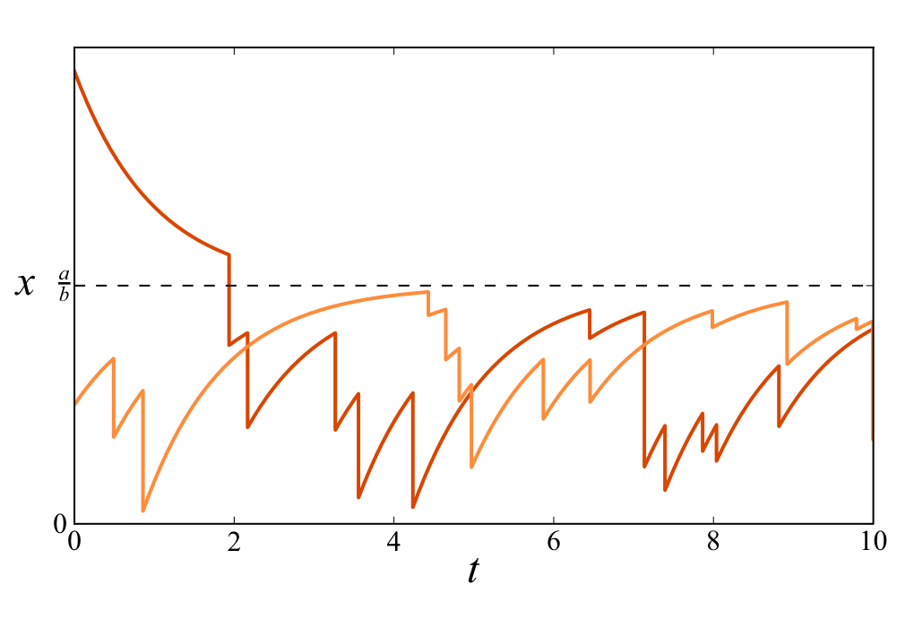
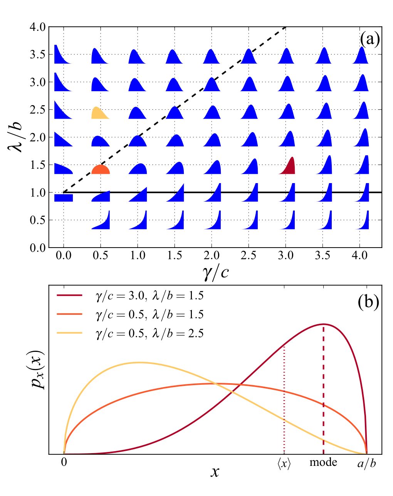
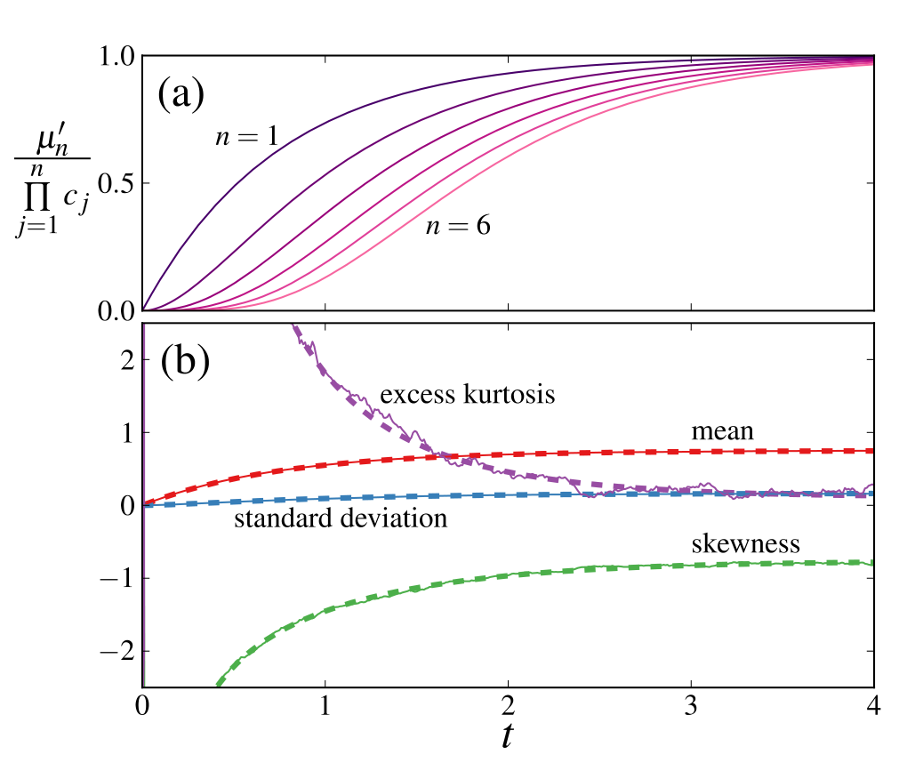
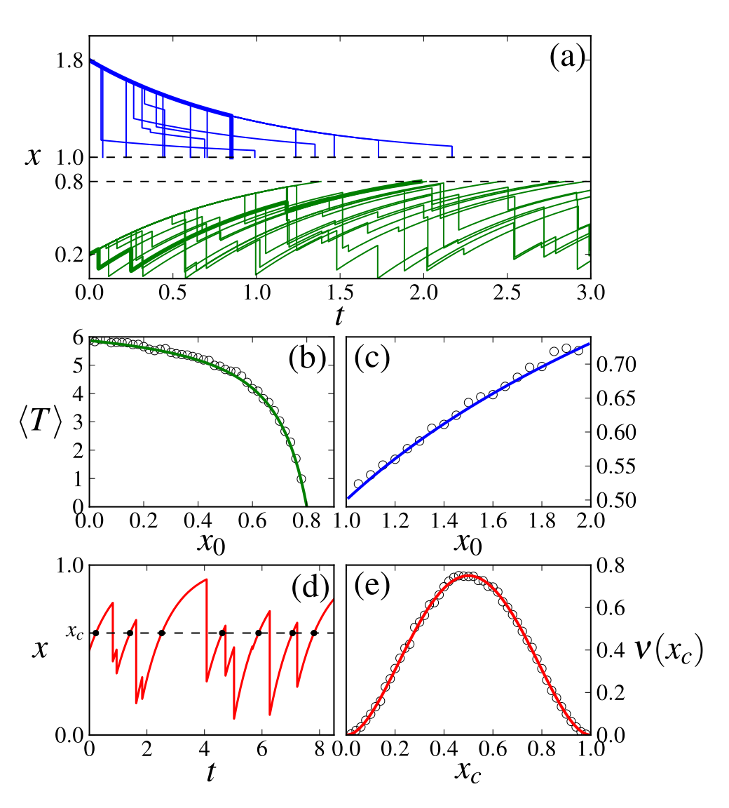
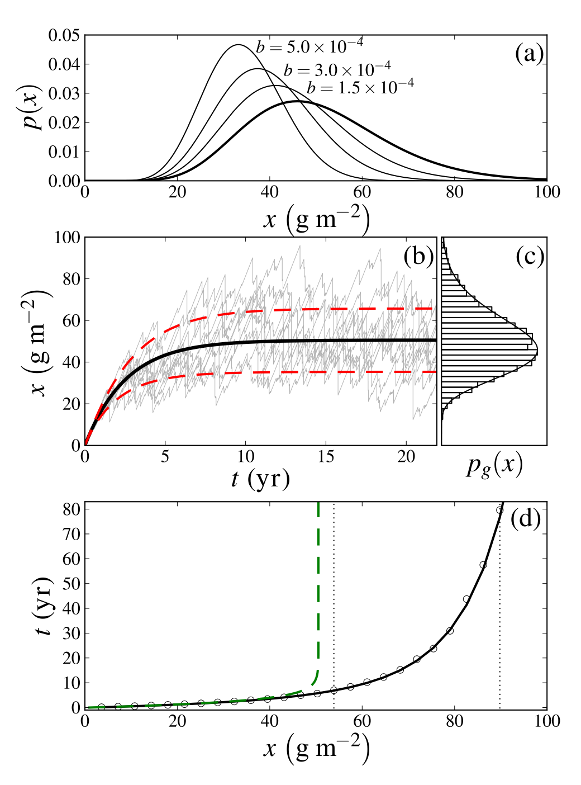

::: {.paper-authors}
Yair Mau^\*^, Xue Feng, Amilcare Porporato^&dagger;^
:::

::: {.paper-affil}
Department of Civil and Environmental Engineering, Duke University, Durham, North Carolina 27708, USA
:::

---

::: {.paper-meta}
Physical Review E 90, 052128 &middot; 2014 &middot; doi: [10.1103/PhysRevE.90.052128](https://doi.org/10.1103/PhysRevE.90.052128)

Received 23 July 2014; published 14 November 2014
:::

> **How to cite:** Mau, Y., Feng, X. and Porporato, A. (2014). Multiplicative Jump Processes and Applications to Leaching of Salt and Contaminants in the Soil. Physical Review E, 90, 052128. https://doi.org/10.1103/PhysRevE.90.052128

---

#### Abstract

We consider simple systems driven multiplicatively by white shot noise, which appear in the modeling of the dynamics of soil nutrients and contaminants. The dynamics of these systems is analyzed in two ways: solving a hierarchy of linear ordinary differential equations for the moments, which gives a time scale of convergence of the stationary probability density function; and characterizing the crossing properties, such as the mean first-passage time and the mean frequency of level crossing. These results are readily applicable to the study of geophysical systems, such as the problem of accumulation of salt in the root zone, i.e., soil salinization.

## I. Introduction

Stochastic differential equations (SDEs) are used to model a diverse range of systems subjected to random fluctuations, including particle fluctuations in statistical physics ([1](#ref-1)), birth and death processes in population dynamics ([2](#ref-2)), and hydroclimatic variability in environmental sciences ([3](#ref-3)). The most popular type of stochastic process incorporated into SDEs is a continuous white noise with zero mean and unit variance, which characterizes the Wiener process. This gives rise to diffusion-type processes that have been extensively studied ([4](#ref-4)&ndash;[6](#ref-6)). However, there is a plethora of problems in physics, engineering, and environmental sciences ([7](#ref-7)&ndash;[9](#ref-9)), where the fluctuations are intense and concentrated in time. In such cases the stochastic forcing term is better represented as a jump process, most commonly by a marked Poisson process. The resulting generalized Langevin equation (GLE) is an SDE with white jump noise $\xi(t)$,

$$
\frac{dx}{dt} = f(x) + g(x)\xi(t), \tag{1}
$$

where $f(x)$ and $g(x)$ are deterministic functions.

While the additive jump case $g(x)=1$ has been investigated in the context of virtual waiting-time processes ([10](#ref-10)&ndash;[12](#ref-12)), ecohydrology ([13](#ref-13)&ndash;[15](#ref-15)), and actuarial sciences ([16](#ref-16),[17](#ref-17)), the case of multiplicative (state-dependent) jumps, i.e., when $g$ depends on $x$, has been less studied (see, however, [18](#ref-18)&ndash;[22](#ref-22)). In particular, Eq. (1) does not define a stochastic process $x(t)$ unless an interpretation for the stochastic term $g(x)\xi(t)$ is given ([23](#ref-23)). According to the Itô interpretation, the value of $x$ just before the jump should be used in the function $g(x)$, while the Stratonovich interpretation takes the mean of the values of $x$ before and after the jump. This midpoint selection rule of the Stratonovich interpretation is related to the approximation of a colored noise with finite autocorrelation time by a white noise ([22](#ref-22)). Because the real noise relevant to the applications in this work has a typical time scale much shorter than the time scales associated with the dynamics determined by $f(x)$, we interpret Eq. (1) in the Stratonovich sense, with the advantage that the usual rules of calculus are maintained.

The white shot noise

$$
\xi_{\lambda,\gamma}(t) = \sum_i^{N(t)} h_i\,\delta(t-t_i) \tag{2}
$$

is the formal derivative of a marked Poisson process, whose random marks $h_i$ are chosen to be drawn from an exponential distribution $\rho(h) = \gamma\exp(-\gamma h)$, where $\gamma^{-1}$ is the mean of the marks and $N(t)$ is a Poisson counting process with mean frequency $\lambda$. The master equation, which describes the evolution of the probability density function (PDF), associated with Eq. (1), is given by ([20](#ref-20),[21](#ref-21))

$$
\frac{\partial p(x,t)}{\partial t} = -\frac{\partial}{\partial x}\left[f(x)p(x,t)\right] - \lambda p(x,t) + \lambda\gamma\int_{-\infty}^{\infty} \exp\left[-\gamma(\eta(x)-\eta(u))\right]\frac{p(u,t)}{|g(x)|}\,du, \tag{3}
$$

where $\eta(x) = \int^x du/g(u)$.

Even in steady state, it is difficult to solve Eq. (3) in general. The goal of this paper is to give a probabilistic description of Eq. (1), for linear deterministic functions $f$ and $g$. Here, in addition to a steady-state description of the PDF, we derive a hierarchy of linear ordinary differential equations for the transient dynamics of the moments, which yields a typical time scale for the convergence of the PDF. We also characterize the crossing properties of critical thresholds, both the mean first-passage time and the mean frequency of level crossing.

The results of this paper can be readily applied. Our motivation is the problem of primary salinization, namely, the natural accumulation of salt in the soil root zone. Three main processes contribute to this phenomenon: the approximately constant input of salt by dry deposition, whose rate can vary by an order of magnitude depending on the proximity to the sea; plant uptake of salt dissolved in soil water; and intense rainfall events that can cause the leakage of water to deeper layers of the soil, leaching salt out of the root zone. Because of their short duration compared to the time scales related to dry deposition and plant uptake, the leaching events can be approximated by multiplicative negative jumps because the amount of salt leached is proportional to its concentration in the soil water. Understanding the dynamics of primary salinization is key in choosing suitable crops in rainfed agriculture and especially relevant to the desertification process in drylands in the face of climate change. More generally, the model presented below can describe the dynamics of other important soil nutrients, such as nitrates and sulfates, as well as contaminants.

The paper is structured as follows. Section II presents a minimal SDE that describes the salt mass balance in the root zone. Section III shows steady-state solutions for the PDF of the model, Sec. IV derives dynamical equations for the moments of the state variable, Sec. V discusses crossing properties of the random variable $x$, and Sec. VI considers applications of the results to the problem of primary salinization. Finally, we present a summary and conclusions in Sec. VII.

## II. Model

A minimal model to describe the salt mass balance in the root zone is ([24](#ref-24),[25](#ref-25))

$$
\frac{dx}{dt} = a - bx - cx\,\xi_{\lambda,\gamma}(t), \tag{4}
$$

where $x$ is the salt mass (in g/m²), $a$ represents a constant input flux of salt by dry deposition (in g/m²/d), $bx$ denotes the uptake of salt by plants ($b$ in d⁻¹), and the parameter $c$ (cm⁻¹ d⁻¹) is linked to the physical properties of the soil, such as porosity and hydraulic conductivity. The dimensions of $\lambda$ and $\gamma$ are d⁻¹ and cm⁻¹, respectively. This model, whose application will be described in Sec. VI, does not take into account secondary salinization, caused by human intervention, most commonly through irrigation.

The deterministic part of Eq. (4), namely, $dx/dt = a-bx$, has one stable fixed point $x^\star = a/b$. Because of the negative sign of the stochastic term, the dynamics of a trajectory that starts at $x_0 > x^\star$ is strictly decaying and once it crosses $x^\star$ through a jump event it stays confined in the range $0<x<a/b$. Figure 1 shows two typical trajectories, starting from above and below $x^\star$.

**FIG. 1 | Two trajectories of Eq. (4), with initial conditions above and below $x^\star = a/b$.** The parameters are $a=b=c=1$, $\lambda=1.5$, and $\gamma=2.0$.

Transforming (4) according to

$$
x = \frac{a}{b}\chi, \qquad t = \frac{1}{b}\tau, \qquad \tilde\gamma = c\gamma, \qquad \tilde\lambda = b\lambda \tag{5}
$$

yields the dimensionless equation

$$
\frac{d\chi}{d\tau} = 1 - \chi - \chi\,\xi_{\tilde\lambda,\tilde\gamma}(\tau), \tag{6}
$$

which is more amenable to analysis. The corresponding master equation is

$$
\frac{\partial p_\chi(\chi,t)}{\partial\tau} = -\frac{\partial}{\partial\chi}\left[(1-\chi)p_\chi(\chi,\tau)\right] - \tilde\lambda p_\chi(\chi,\tau) + \tilde\lambda\tilde\gamma\chi^{\tilde\gamma-1}\int_\chi^\infty u^{-\tilde\gamma}p_\chi(u,\tau)\,du. \tag{7}
$$

In the next three sections we will characterize Eqs. (6) and (7), showing the steady-state solution, the dynamics of the moments and the crossing properties of $x$.

The numerical results presented throughout this paper were implemented using the Monte Carlo method for calculating the height $h$ of the random jump $\xi(t)$, as described in Eq. (2), drawn from the exponential distribution $\rho(h)$. The multiplicative impulse size $x\xi(t)$, in the Stratonovich interpretation, then reads $x\xi(t) = \eta^{-1}[\eta(x)+h]-x$ [see [21](#ref-21), Eq. (14)]. Time was discretized using small $\Delta t$ and approximating the probability of a jump event at each time step as $\lambda\Delta t$. Finally, the Euler method was used for numeric integration.

## III. Steady-State Solution

Using the fact that the Stratonovich interpretation of the GLE maintains the normal rules of calculus ([2](#ref-2)), we transform the state variable according to $\chi=e^y$ so that Eq. (6) becomes an SDE with an additive jump term

$$
\frac{dy}{d\tau} = e^{-y} - 1 - \xi_{\tilde\lambda,\tilde\gamma}(\tau). \tag{8}
$$

The steady-state PDF $p_y(y)$ of the process above is the beta exponential distribution ([26](#ref-26),[27](#ref-27)) and its derivation is shown in Appendix A. Using the derived distribution for $\chi$,

$$
p_\chi(\chi) = p_y(y)\left|\frac{dy}{d\chi}\right| = \frac{p_y(y)}{\chi}, \tag{9}
$$

we find

$$
p_\chi(\chi) = \frac{\chi^{\tilde\gamma}(1-\chi)^{\tilde\lambda-1}}{B(\tilde\gamma+1,\tilde\lambda)}, \tag{10}
$$

where $B$ is the Beta function with shape parameters $\tilde\gamma+1$ and $\tilde\lambda$.

Returning to the physical variables and parameters, we have

$$
p_x(x) = \frac{a^{-\gamma/c-\lambda/b}b^{\gamma/c+1}}{B\left(\frac{\gamma}{c}+1,\frac{\lambda}{b}\right)}\,x^{\gamma/c}(a-bx)^{\lambda/b-1} \tag{11}
$$

and the $k$th raw moment of $x$ is given by

$$
\langle x^k\rangle = \prod_{j=0}^{k-1}\frac{a[\gamma+c(1+j)]}{\lambda c + b[\gamma+c(1+j)]} \tag{12}
$$

or in a recursive form

$$
\langle x^k\rangle = \frac{a(\gamma+kc)}{\lambda c + b(\gamma+kc)}\langle x^{k-1}\rangle. \tag{13}
$$

The distribution has a mode $\mathcal{M}$ if $\frac{\gamma}{c}>0$ and $\lambda>b$, given by

$$
\mathcal{M}[p_x(x)] = \frac{\gamma b}{\lambda c + b(\gamma-c)}. \tag{14}
$$

Figure 2 summarizes the findings above. Figure 2(a) shows the parameter space $\lambda/b$ versus $\gamma/c$, where the solid shapes depict the probability density function $p_x(x)$ calculated at the grid points. Above the black solid line $\lambda/b=1$ all distributions are unimodal, i.e., they have a finite maximum, whereas the distributions below it have no mode, because the PDF diverges for $\chi=1$. The black dashed line represents the curve $\lambda/b = \gamma/c+1$. Along this line distributions have their mean at $x=0.5$. To the right (left) of the dashed line, the mean of the distributions is at the right (left) of the center. Figure 2(b) shows the probability density function $p_x(x)$ calculated for three points in the parameter space. The dashed and dotted lines show the location of the mode and mean for one of the PDFs, respectively. In the limit $a\to0$ the PDF $p_x(x)$ becomes a Dirac delta function and in the limit $b\to0$ it becomes a gamma distribution (which in turn becomes a Gaussian distribution for large $\gamma/c$).

**FIG. 2 | Probability distribution function of $x$, according to Eq. (11).** (a) Colored shapes represent $p_x(x)$ calculated at the grid points of parameter space $\lambda/b$ versus $\gamma/c$. (b) Blowup of $p_x(x)$ calculated for three values of $(\gamma/c,\lambda/b)$: $(3.0,1.5)$ in red (black), $(0.5,1.5)$ in orange (dark gray), and $(0.5,2.5)$ in yellow (light gray). The red (black) dashed and dotted lines show the location of the mode and the mean, respectively, for $(\gamma/c=3.0,\lambda/b=1.5)$.

## IV. Dynamics of the Moments

It is possible to obtain a system of equations that hierarchically describes the temporal dynamics of the moments of the state variable $x$. Appendix B shows the detailed derivation of the recursive relation

$$
\frac{\partial\mu'_k}{\partial\tau} = k\mu'_{k-1} - k\frac{1}{c_k}\mu'_k, \tag{15}
$$

where the raw moments $\mu'_k$ are defined as

$$
\mu'_k = \int \chi^k p_\chi\, d\chi \tag{16}
$$

and

$$
c_k = \frac{\tilde\gamma+k}{\tilde\gamma+\tilde\lambda+k}. \tag{17}
$$

In the steady state, Eq. (15) yields the same recursion formula shown in Eq. (13) after a rescaling according to Eq. (5). Using the fact that $\mu'_0=1$, we can calculate iteratively the solution of Eq. (15) for the raw moment of order $n$ as

$$
\mu'_n(\tau) = \prod_{j=1}^n c_j + \sum_{j=1}^n d_{n,j}\,e^{-\tau/(c_j/j)}. \tag{18}
$$

The first three moments read

$$
\begin{aligned}
\mu'_1(\tau) &= c_1 + d_{1,1}e^{-\tau/c_1}, \tag{19a}\\
\mu'_2(\tau) &= c_1c_2 + d_{2,1}e^{-\tau/c_1} + d_{2,2}e^{-\tau/(c_2/2)}, \tag{19b}\\
\mu'_3(\tau) &= c_1c_2c_3 + d_{3,1}e^{-\tau/c_1} + d_{3,2}e^{-\tau/(c_2/2)} + d_{3,3}e^{-\tau/(c_3/3)}, \tag{19c}
\end{aligned}
$$

where

$$
\begin{aligned}
d_{1,1} &= m_1-c_1, \qquad d_{2,1} = \frac{2c_1c_2(m_1-c_1)}{2c_1-c_2}, \\
d_{2,2} &= \frac{c_1c_2(c_2-2m_1)}{2c_1-c_2} + m_2, \qquad d_{3,1} = \frac{6c_1^2c_2c_3(m_1-c_1)}{(2c_1-c_2)(3c_1-c_3)}, \\
d_{3,2} &= \frac{3c_2c_3\left[c_1(-2c_2m_1+c_2^2+2m_2)-c_2m_2\right]}{(2c_1-c_2)(3c_2-2c_3)}, \\
d_{3,3} &= \frac{c_2c_3\left\{c_1\left[2c_3(c_3-3m_1)+9m_2\right]-3c_3m_2\right\}}{(3c_2-2c_3)(c_3-3c_1)} + m_3,
\end{aligned}
$$

and $m_i$ denotes the initial condition of $\mu'_i$. The successive terms added in Eq. (18) have decreasing time scales because $c_{j+1}/(j+1) < c_j/j$. Their effect on the dynamics is shown in Fig. 3(a), where all normalized raw moments saturate in comparable time scales, but higher moments grow slower for relatively small times. This means that for time scales of about 4 or 5 times $c_1$ (the largest time scale), all the moments are only a few percent off their steady-state values. Figure 3(b) shows solutions for the mean, standard deviation, skewness, and excess kurtosis, where analytical and numerical solutions agree well.

**FIG. 3 | (a) Evolution of the first six normalized raw moments of $\chi$.** The curves for $n=1,2,3$ are according to Eqs. (19). (b) Evolution of the mean, standard deviation, skewness, and excess kurtosis. Dashed lines denote analytical solutions and solid lines denote numerical solutions, calculated from an ensemble of 10 000 simulations. The parameters are $a=b=c=1$, $\gamma=3.5$, $\lambda=1.5$, and $m_i=0$.

## V. Crossing Properties

Physical systems can have critical thresholds that, when crossed for the first time, produce qualitative changes in the system's behavior. In the context of salinization, the crossing of a threshold could mean that the salt concentration has risen to a critical value for which plants have their yield severely impaired ([28](#ref-28),[29](#ref-29)) or conversely that remediation processes were successful in bringing the salinity below acceptable levels ([24](#ref-24)).

The mean first-passage time (MFPT) of processes driven by a marked Poisson noise has been analyzed before ([30](#ref-30)&ndash;[33](#ref-33)). For our purposes here, we will use Masoliver's procedure (see [30](#ref-30), Eqs. (5.8)–(5.11)) to calculate the mean time it takes for the random variable $x$ to cross a certain threshold $x_c$, starting from $x_0$. For that we first transform (6) according to $\chi=e^{-z}$ to obtain an SDE with positive additive jumps:

$$
\frac{dz}{d\tau} = 1 - e^z + \xi_{\tilde\lambda,\tilde\gamma}(\tau). \tag{20}
$$

Since there is no rescaling of time $\tau$, the mean first-passage time $\langle T\rangle_{z_0,z_c}$ for the random variable $z$ is equal to the mean first-passage time $\langle T\rangle_{\chi_0,\chi_c}$ for the random variable $\chi$, where $z_i = -\ln(\chi_i)$.

We consider two possible scenarios in terms of the physical variable $x$, as depicted in Fig. 4. The first is shown in the lower part of Fig. 4(a): Starting at $x_0 < x^\star = a/b$, all trajectories are bounded between $0<x<x^\star$ and they are calculated until they cross an upper boundary at $x_c$. The second scenario is shown in the upper part: Starting at $x_0>x^\star$, all trajectories decay in time and they are calculated until they cross the lower boundary at $x_c=x^\star$. Figures 4(b) and 4(c) show both the analytical and numerical MFPT as a function of $x_0$, for the first and second scenarios, respectively. The integrals involved in the calculation were computed numerically.

The mean first-passage time can be easily verified when the starting point tends to the threshold value. In the first scenario, the MFPT tends to zero when $x_0\to x_c^-$ and in the second scenario, when $x_0\to x_c^+ = x^\star$, the MFPT tends to the inverse of the mean frequency, i.e., $\lambda^{-1}$, because crossings can only occur through jump events.

Another crossing problem of interest is the level crossing of the same threshold in steady-state conditions. In the steady state, $p_x(x_c)dx$ can be understood both as the probability of finding the system in the range $r=[x_c,x_c+dx]$ and as the proportion of time the system spends in this same range. Because negative jumps in Eq. (4) are instantaneous, the infinitesimal time $dt$ spent around $x_c$ is due only to upcrossings, which are governed by the deterministic equation $dx/dt = f(x) = a-bx$, yielding $dt = dx/f(x_c)$. Assume now that all consecutive crossing intervals can be represented by a mean time $T$ [see Fig. 4(d) for an illustration]. Then the infinitesimal time $dt$ divided by $T$ is the proportion of time the system spends to cross range $r$, namely, $p_x(x_c)dx$. In other words, the inverse of $T$, or the mean frequency of crossing $x_c$, is

$$
\nu(x_c) = p_x(x_c)f(x_c). \tag{21}
$$

The reasoning used to derive the above expression assumes only that the stochastic process is in the steady state. It has been used for a process with additive noise ([14](#ref-14),[34](#ref-34),[35](#ref-35)), but is equally applicable to that with multiplicative noise. Figure 4(d) shows a typical scenario of upcrossings of a threshold $x_c$ and Fig. 4(e) shows the analytical result in Eq. (21) compared with the numerical results.

**FIG. 4 | (a) Simulations of trajectories as a function of time, according to Eq. (4).** In green (blue), all trajectories start at $x_0=0.2$ ($x_0=1.8$) and are calculated until they reach the upper (lower) threshold $x_c=0.8$ ($x_c=1.0$). (b) and (c) Mean first-passage time as a function of starting point $x_0$, for processes with crossing thresholds $x_c=0.8$ and 1.0, respectively. Solid lines denote analytical results and open circles denote numerical simulations carried out for ensembles of 10 000 runs. (d) Successive upcrossings of the threshold $x_c$. (e) Mean frequency of upcrossing $\nu$ as a function of the critical crossing threshold $x_c$. The solid line denotes the analytical result shown in Eq. (21) and open circles denote numerical simulations carried out for ensembles of 5000 runs. The parameters are $a=b=c=1$ and (a)–(c) $\gamma=1.0$ and $\lambda=2.0$ and (d) and (e) $\gamma=2.0$ and $\lambda=2.0$.

## VI. Applications

A description of soil nutrients or contaminants (salt in our case) in the root zone should involve the coupled balance equations for the soil water and solute. However, under suitable assumptions, valid when focusing on long time scales, one can eliminate the soil water equation ([24](#ref-24)) and embed the soil water controls into the parameters of Eq. (4).

The parameters $a$, $b$, $c$, $\lambda$, and $\gamma$ contain several of the system's physical properties. The parameter $c$, for instance, has an inverse dependence on the soil moisture threshold for deep leakage. A low threshold (high values of $c$) means that the soil is easily saturated by water and most rain events will produce deep leakage, which takes the solute from the root zone to deeper layers. On the other hand, $\gamma^{-1}$ represents the mean depth of water leakage as result of rain events. Higher mean depths (lower values of $\gamma$) mean that most rain events will induce deep leakage. It is reasonable, therefore, that $c$ and $\gamma$ should have an inverse influence on the steady-state equation (11), which can be seen in Fig. 2(a): Both low values of $\gamma$ and high values of $c$ bring down the solute's mean mass.

We consider now one possible application of Eq. (4). The case of primary salinization without plant uptake of salt can be modeled by taking the limit $b\to0$ in Eq. (4). The steady-state solution was obtained by Suweis et al. ([25](#ref-25)), in the form of a gamma distribution. Using the transformations $x=a\chi$, $t=\tau$, $\gamma=c\tilde\gamma$, and $\lambda=\tilde\lambda$, we obtain the dimensionless equation $d\chi/d\tau = f(\chi)+g(\chi)\xi_{\tilde\lambda,\tilde\gamma}(\tau)$, where $f(\chi)=1$ and $g(\chi)=-\chi$. The results obtained in Secs. III–V are readily applicable to this system. In order to obtain the steady-state PDF we take the limit $b\to0$ in Eq. (11). First we rewrite Eq. (11) as

$$
p_x(x) = a^{-\gamma/c-1}\frac{\Gamma\left(\frac{\lambda}{b}+\frac{\gamma}{c}+1\right)}{\Gamma\left(\frac{\gamma}{c}+1\right)\Gamma\left(\frac{\lambda}{b}\right)}\left(\frac{\lambda}{b}\right)^{\lambda/b}\,x^{\gamma/c}\left(1-\frac{x}{a/b}\right)^{\lambda/b-1}, \tag{22}
$$

where $\Gamma$ is the gamma function. Using the known limits

$$
\lim_{z\to\infty}\frac{\Gamma(z+\alpha)}{\Gamma(z)z^\alpha} = 1, \qquad \lim_{z\to\infty}\left(1-\frac{\alpha x}{z}\right)^z = e^{-\alpha x}, \tag{23}
$$

it is easy to see that

$$
\lim_{b\to0} p_x(x) = p_g(x) = \frac{(\lambda/a)^{\gamma/c+1}}{\Gamma\left(\frac{\gamma}{c}+1\right)}\,x^{\gamma/c}\,e^{-\frac{\lambda}{a}x}, \tag{24}
$$

which is the gamma distribution with shape $\gamma/c+1$ and rate $\lambda/a$. Figure 5(a) shows three beta distributions $p_x(x)$ as in Eq. (11) for decreasing values of $b$ (thin lines) and the gamma distribution $p_g(x)$ as in Eq. (24) (thick line).

The dynamics of the moments can be calculated as done in Sec. IV using $f(\chi)=1$. This yields the same results as in Eqs. (15) and (18), but with the iteration constant $c_k$ redefined as $c_k \to g_k = (\tilde\gamma+k)/\tilde\lambda$. The results shown in Fig. 5(b) provide a characterization of the time scales involved in soil salinity buildup.

**FIG. 5 | (a) The PDF $p_x(x)$ for decreasing values of the parameter $b$ (d⁻¹) and the PDF $p_g(x)$ (thick line).** (b) The thin gray lines denote the simulated dynamics of the salt mass, while the analytical dynamics for the mean salinity is shown in black, enclosed by one standard deviation in red dashed lines. (c) The steady-state PDF $p_g(x)$ is denoted by the black line and the histogram shows numerical results. (d) Crossing time as function of salinity threshold. The black line and circles correspond to analytical and numerical calculations of the MFPT, the green dashed line denotes the time $t_c$ for the mean to cross the threshold, according to Eq. (25), and the vertical dotted lines indicate the two salinity threshold levels considered, for pepper and tomato. The parameters are $a=0.054$ g m⁻² d⁻¹, $c=9.26\times10^{-2}$ cm⁻¹ d⁻¹, $\gamma=0.93$ cm⁻¹, and $\lambda=1.18\times10^{-2}$ d⁻¹.

We took the same physical parameters used by Suweis et al. ([25](#ref-25)) in order to model the dynamics of salt in a sandy-loam soil, in a semiarid climate (yearly precipitation of about 650 mm), subjected to dry (aerosol) deposition of salt. Figure 5(b) shows several realizations of the dynamics of the salt mass, starting from zero salinization. The thick black line denotes the dynamics of the mean soil salinity, according to Eq. (19a), and the two red dashed lines delimit the distance of one standard deviation from the mean. According to the parameters used, the largest typical time scale for the dynamics of the moments is $g_1 \simeq 2.56$ yr, which means that for $t\sim10$ yr the mean differs from its steady-state value by only 2%. The steady-state PDF of the process is shown in Fig. 5(c), the line denotes the analytical solution $p_g(x)$, and the histogram represents simulations.

Using the crossing properties and transient moments we can now investigate the constraints that the salt dynamics described in Fig. 5(b) can pose on the growth of crops. Because plants are sensitive to salt concentration and not to salt mass, we need to know the amount of water in the soil in order to convert the root zone salinity to its equivalent salt mass. This was computed using a soil moisture minimalist model ([15](#ref-15)), resulting in a mean soil moisture $\bar{s} = 56$ l/m² for this type of climate and soil.

We calculated the MFPT as a function of critical salinity thresholds, from an initial mass of 0.718 g/m². Analytical and numerical results are shown in Fig. 5(d) by the black line and circles, respectively. For example, the salinity threshold level ([36](#ref-36)) for pepper (*Capsicum annuum*) and sweet potato (*Ipomoea batatas*) is 54 g/m⁻², while for tomato (*Lycopersicon esculentum*) and cucumber (*Cucumis sativus*) it is 90 g/m⁻² ([37](#ref-37)). For these values the MFPT is approximately 7 and 80 yr, respectively, suggesting the time frames when these crops can be grown with little risk of salinization, before remediating measures need to be taken in order to reduce the soil salinity or a less sensitive crop needs to be chosen.

From Eq. (19a) the time $t_c$ for the mean to cross a given threshold $x_c$ reads

$$
t_c = g_1\ln\left(\frac{g_1-m_1}{g_1-\chi_c}\right) = \frac{\gamma/c+1}{\lambda}\ln\left(\frac{1-\frac{c\lambda x_0}{a(c+\gamma)}}{1-\frac{c\lambda x_c}{a(c+\gamma)}}\right), \tag{25}
$$

where $x_0$ is the mean's initial value and $x_c$ and $x_0$ are required to be both above or below the mean's steady-state value $\bar{x} = a(\gamma/c+1)/\lambda$. The dashed green line in Fig. 5(d) denotes $t_c$, also from an initial mass of 0.718 g/m². First $t_c$ is very close to the MFPT, but as the threshold approaches the mean's steady-state value it diverges. For salinity levels below $\bar{x}$, $t_c$ is a good approximation of the MFPT and it is much easier to calculate.

## VII. Conclusion

We presented here a stochastic differential equation driven by multiplicative Poisson noise with exponentially distributed jumps. This equation is applicable in the problem of leaching of soil nutrients and contaminants.

The long-term dynamics of $x$ is confined between zero and $x^\star$, described by a Beta distribution. The study of the dynamics of the moments revealed a time scale for the convergence of the PDF, while the analysis of crossing properties yielded time scales associated with the crossing of critical thresholds. The characterization of these time scales is the main result of this paper: They are readily applicable to various geophysical systems and provide useful information about processes such as the accumulation of salt in the root zone.

The model presented here could be refined in order to produce a more realistic description of leaching of soil nutrients and contaminants. One extension would be including the solute's influence on the soil water dynamics, which would mean that the parameter $c$ is a function of $x$. For instance, a high relative concentration of sodium cations in the soil (condition called sodicity) alters the soil physical properties, greatly decreasing its hydraulic conductivity ([38](#ref-38)). Another modification would be the expansion of the model to include the effects of human intervention through irrigation, especially with regard to the use of saline water and the risks of secondary salinization. This modification would require an additional equation for the water dynamics, coupled to that of the salt mass dynamics. Future research should address these points by developing a stochastic model for the integrated dynamics of water and solutes in the soil.

## Acknowledgments

The authors would like to thank F. Laio for useful suggestions. Y.M. acknowledges support from BARD, the United States–Israel Binational Agricultural Research and Development Fund, Vaadia-BARD Postdoctoral Fellowship Award No. FI-517-14. X.F. acknowledges funding from the NSF Graduate Research Fellowship Program. A.P. acknowledges NSF Grants No. CBET 1033467, No. EAR 1331846, No. EAR 1316258, and No. FESD 1338694 as well as the US DOE through the Office of Biological and Environmental Research, Terrestrial Carbon Processes (Program No. de-sc0006967), the Agriculture and Food Research Initiative from the USDA National Institute of Food and Agriculture (Grant No. 2011-67003-30222).

## Appendix A: Steady-State PDF

The master equation associated with Eq. (8) can be derived using Eq. (3) with $f_y(y) = e^{-y}-1$ and $g_y(y)=-1$. Assuming a steady state, we are left with

$$
-\frac{d}{dy}\left[f_y(y)p_y(y)\right] - \tilde\lambda p_y(y) + \tilde\lambda\tilde\gamma e^{\tilde\gamma y}\int_y^\infty e^{-\tilde\gamma u}p_y(u)\,du = 0. \tag{A1}
$$

Multiplying the equation above by $e^{-\tilde\gamma y}$, then differentiating it with respect to $y$, and finally integrating once gives

$$
\gamma f_y(y)p_y(y) - \frac{d}{dy}\left[f_y(y)p_y(y)\right] - \tilde\lambda p_y(y) = \text{const.} \tag{A2}
$$

Taking the limit $y\to\infty$, the whole left-hand side of the equation above vanishes, therefore the integration constant is also zero. Integrating Eq. (A2) and substituting $f_y(y) = e^{-y}-1$ gives after some manipulation

$$
p_y(y) = C\,e^{y(\tilde\gamma+1)}(1-e^y)^{\tilde\lambda-1}. \tag{A3}
$$

The PDF $p_y(y)$ is called the beta exponential distribution ([26](#ref-26),[27](#ref-27)) and upon transformation back to the variable $\chi$, according to $\chi=e^y$, we have

$$
p_\chi(\chi) = C\,\chi^{\tilde\gamma}(1-\chi)^{\tilde\lambda-1}, \tag{A4}
$$

which is the beta distribution. By requiring that $\int p_\chi(\chi)d\chi = 1$ we have that $C = 1/B(1+\tilde\gamma,\tilde\lambda)$, where $B$ is the Beta function.

## Appendix B: Moments Dynamics

Applying the operator

$$
\mathcal{L}[f(\chi)] \equiv \int_0^\infty \chi^k f(\chi)\,d\chi \tag{B1}
$$

to Eq. (7), we can achieve an expression for the evolution of the raw moment of order $k$, defined as $\mu'_k = \int\chi^k p_\chi\,d\chi$. The left-hand side gives

$$
\int_0^\infty \chi^k\frac{\partial p_\chi(\chi,t)}{\partial\tau}\,d\chi = \frac{\partial\mu'_k}{\partial\tau}, \tag{B2}
$$

while the first term on the right-hand side becomes

$$
-\int_0^\infty \chi^k\frac{\partial}{\partial\chi}\left[(1-\chi)p_\chi(\chi,\tau)\right]d\chi = -\int_0^\infty\left[\chi^k\frac{\partial p_\chi(\chi,\tau)}{\partial\chi} - \chi^k p_\chi(\chi,\tau) - \chi^{k+1}\frac{\partial p_\chi(\chi,\tau)}{\partial\chi}\right]d\chi, \tag{B3}
$$

which upon integration by parts yields

$$
-\int_0^\infty \chi^k\frac{\partial}{\partial\chi}\left[(1-\chi)p_\chi(\chi,\tau)\right]d\chi = k\mu'_{k-1} - k\mu'_k. \tag{B4}
$$

The second term on the right-hand side of Eq. (7) becomes simply $-\tilde\lambda\mu'_k$. In order to calculate the last term we start by defining

$$
F(\chi) = \tilde\lambda\tilde\gamma\chi^{\tilde\gamma+k}\int_\chi^\infty u^{-\tilde\gamma}p_\chi(u,\tau)\,du, \tag{B5}
$$

which differentiated gives

$$
\frac{dF}{d\chi} = \tilde\lambda\tilde\gamma(\tilde\gamma+k)\chi^{\tilde\gamma+k-1}\int_\chi^\infty u^{-\tilde\gamma}p_\chi(u,\tau)\,du - \tilde\lambda\tilde\gamma\chi^{\tilde\gamma+k}\chi^{-\tilde\gamma}p_\chi(\chi,\tau). \tag{B6}
$$

Multiplying the equation above by $(\tilde\gamma+k)^{-1}$ and then integrating with respect to $\chi$ gives

$$
\int_0^\infty d\chi\,\tilde\lambda\tilde\gamma\chi^{\tilde\gamma+k-1}\int_\chi^\infty u^{-\tilde\gamma}p_\chi(u,\tau)\,du = \frac{\tilde\lambda\tilde\gamma}{\tilde\gamma+k}\mu'_k. \tag{B7}
$$

Finally, putting all the terms together, a recursive relation for the dynamics of the moment of order $k$ can be obtained as

$$
\frac{\partial\mu'_k}{\partial\tau} = k\mu'_{k-1} - k\frac{1}{c_k}\mu'_k, \tag{B8}
$$

where

$$
c_k = \frac{\tilde\gamma+k}{\tilde\gamma+\tilde\lambda+k}. \tag{B9}
$$

## References

[1]{#ref-1} C. W. Gardiner, *Handbook of Stochastic Methods* (Springer, Berlin, 1985), Vol. 3.

[2]{#ref-2} N. G. van Kampen, *Stochastic Processes in Physics and Chemistry* (Elsevier, Amsterdam, 1992), Vol. 1.

[3]{#ref-3} L. Ridolfi, P. D'Odorico, and F. Laio, *Noise-Induced Phenomena in the Environmental Sciences* (Cambridge University Press, Cambridge, 2011).

[4]{#ref-4} H. Risken, *The Fokker-Planck Equation: Methods of Solution and Applications*, Lecture Notes in Mathematics (Springer, Berlin, 1996).

[5]{#ref-5} W. Coffey, Y. Kalmykov, and J. Waldron, *The Langevin Equation: With Applications to Stochastic Problems in Physics, Chemistry, and Electrical Engineering* (World Scientific, Singapore, 2004).

[6]{#ref-6} B. Øksendal, *Stochastic Differential Equations: An Introduction with Applications* (Springer, Berlin, 2010).

[7]{#ref-7} Y. M. Blanter and M. Büttiker, Phys. Rep. **336**, 1 (2000).

[8]{#ref-8} B. K. Øksendal and A. Sulem, *Applied Stochastic Control of Jump Diffusions* (Springer, Berlin, 2005), Vol. 498.

[9]{#ref-9} P. D'Odorico, F. Laio, and L. Ridolfi, Proc. Natl. Acad. Sci. USA **102**, 10819 (2005).

[10]{#ref-10} L. Takács, Acta Math. Hung. **6**, 101 (1955).

[11]{#ref-11} D. Cox and V. Isham, Adv. Appl. Probab. **18**, 558 (1986).

[12]{#ref-12} P. Brill, *Level Crossing Methods in Stochastic Models* (Springer, Berlin, 2008).

[13]{#ref-13} I. Rodríguez-Iturbe, A. Porporato, L. Ridolfi, V. Isham, and D. Cox, Proc. R. Soc. London Ser. A **455**, 3789 (1999).

[14]{#ref-14} I. Rodríguez-Iturbe and A. Porporato, *Ecohydrology of Water-Controlled Ecosystems: Soil Moisture and Plant Dynamics* (Cambridge University Press, Cambridge, 2004).

[15]{#ref-15} A. Porporato, E. Daly, and I. Rodriguez-Iturbe, Am. Nat. **164**, 625 (2004).

[16]{#ref-16} A. Dassios and J.-W. Jang, Finance Stoch. **7**, 73 (2003).

[17]{#ref-17} A. Dassios and J.-W. Jang, J. Appl. Probab. **42**, 93 (2005).

[18]{#ref-18} C. Van Den Broeck, J. Stat. Phys. **31**, 467 (1983).

[19]{#ref-19} J. Sancho, M. San Miguel, L. Pesquera, and M. Rodriguez, Physica A **142**, 532 (1987).

[20]{#ref-20} S. Denisov, W. Horsthemke, and P. Hänggi, Eur. Phys. J. B **68**, 567 (2009).

[21]{#ref-21} S. Suweis, A. Porporato, A. Rinaldo, and A. Maritan, Phys. Rev. E **83**, 061119 (2011).

[22]{#ref-22} W. Moon and J. S. Wettlaufer, New J. Phys. **16**, 055017 (2014).

[23]{#ref-23} N. G. van Kampen, J. Stat. Phys. **24**, 175 (1981).

[24]{#ref-24} S. Manzoni, A. Molini, and A. Porporato, Proc. R. Soc. London Ser. A **467**, 3188 (2011).

[25]{#ref-25} S. Suweis, A. Rinaldo, S. E. A. T. M. Van der Zee, E. Daly, A. Maritan, and A. Porporato, Geophys. Res. Lett. **37**, L07404 (2010).

[26]{#ref-26} S. Nadarajah and S. Kotz, Reliab. Eng. Syst. Safe. **91**, 689 (2006).

[27]{#ref-27} W. Barreto-Souza, A. H. Santos, and G. M. Cordeiro, J. Stat. Comput. Simul. **80**, 159 (2010).

[28]{#ref-28} E. V. Maas and G. J. Hoffman, J. Irrig. Drain. Div. **103**, 115 (1977).

[29]{#ref-29} H. Steppuhn, M. T. Van Genuchten, and C. Grieve, Crop Sci. **45**, 209 (2005).

[30]{#ref-30} J. Masoliver, Phys. Rev. A **35**, 3918 (1987).

[31]{#ref-31} E. Hernandez-Garcia, L. Pesquera, M. A. Rodriguez, and M. San Miguel, Phys. Rev. A **36**, 5774 (1987).

[32]{#ref-32} J. M. Porrà and J. Masoliver, Phys. Rev. E **47**, 1633 (1993).

[33]{#ref-33} F. Laio, A. Porporato, L. Ridolfi, and I. Rodriguez-Iturbe, Phys. Rev. E **63**, 036105 (2001).

[34]{#ref-34} A. Porporato, F. Laio, L. Ridolfi, and I. Rodriguez-Iturbe, Adv. Water Resour. **24**, 725 (2001).

[35]{#ref-35} E. Daly and A. Porporato, Phys. Rev. E **81**, 061133 (2010).

[36]{#ref-36} Usually, root zone salinity is measured by the electrical conductivity $\kappa$, reported in dS/m. For dilute solutions we have the conversion formula ([38](#ref-38)) between $\kappa$ and the total dissolved solutes $\mathscr{T}$ (in mg/l): $640\kappa = \mathscr{T}$. The salinity threshold levels for pepper and tomato are 1.5 and 2.5 dS/m, respectively.

[37]{#ref-37} R. Ayers and D. Westcot, *Water Quality for Agriculture* (Food and Agriculture Organization of the United Nations, Rome, 1985).

[38]{#ref-38} D. Hillel, *Salinity Management for Sustainable Irrigation: Integrating Science, Environment, and Economics* (World Bank, Washington, DC, 2000).
