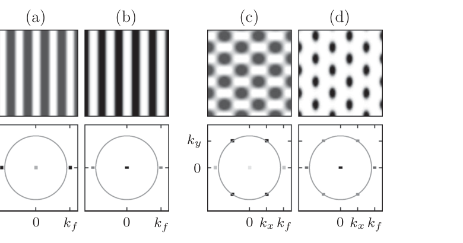
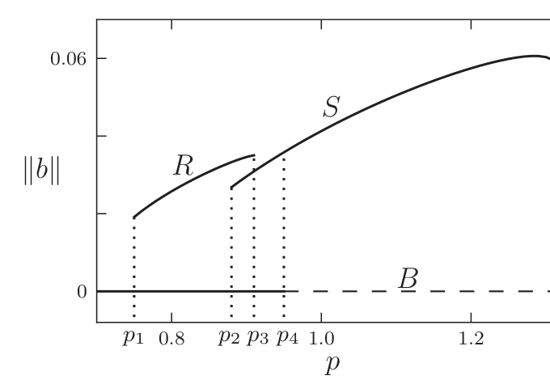
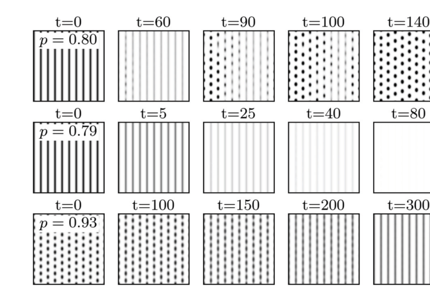
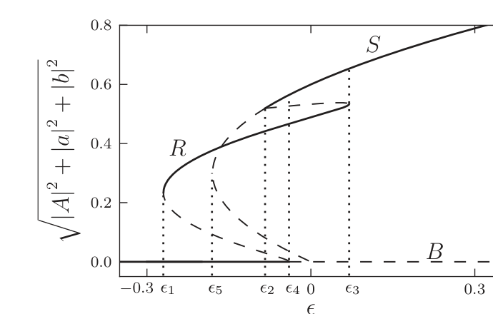
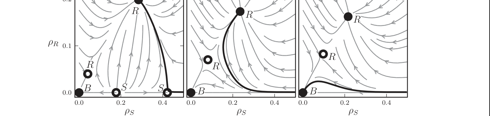
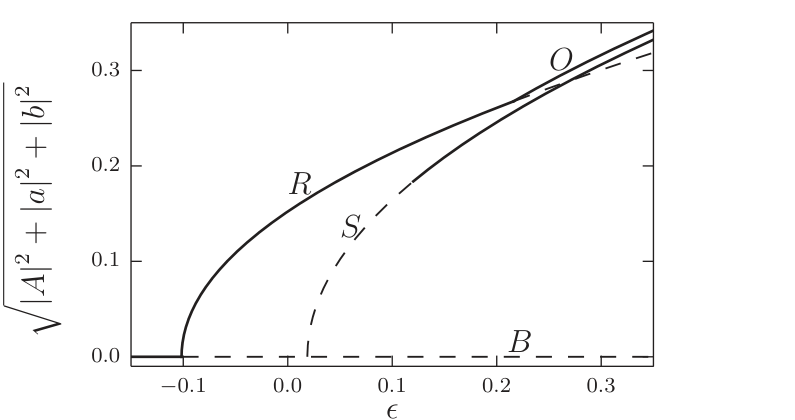
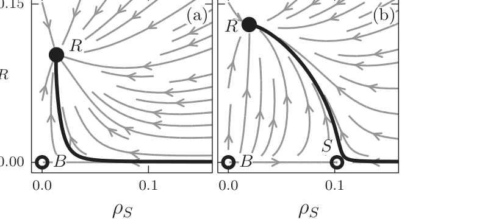

::: {.paper-authors}
Yair Mau^1,2,\*,&dagger;^, Lev Haim^1,3,\*^, Ehud Meron^1,4^
:::

::: {.paper-affil}
^1^ Department of Physics, Ben-Gurion University of the Negev, Beer Sheva, Israel &nbsp;&middot;&nbsp; ^2^ Department of Civil and Environmental Engineering, Duke University, Durham, North Carolina, USA &nbsp;&middot;&nbsp; ^3^ Department of Oncology, Soroka University Medical Center, Beer Sheva, Israel &nbsp;&middot;&nbsp; ^4^ Department of Solar Energy and Environmental Physics, Blaustein Institutes for Desert Research, Ben-Gurion University of the Negev, Sede Boqer Campus, Israel

^\*^ These authors contributed equally to this work. &nbsp;&middot;&nbsp; ^&dagger;^ Corresponding author
:::

---

::: {.paper-meta}
Physical Review E 91, 012903 &middot; 2015 &middot; doi: [10.1103/PhysRevE.91.012903](https://doi.org/10.1103/PhysRevE.91.012903)

Received 7 August 2014; published 5 January 2015
:::

> **How to cite:** Mau, Y., Haim, L. and Meron, E. (2015). Reversing Desertification as a Spatial Resonance Problem. Physical Review E, 91, 012903. https://doi.org/10.1103/PhysRevE.91.012903

---

#### Abstract

An important environmental application of pattern control by periodic spatial forcing is the restoration of vegetation patterns in water-limited ecosystems that went through desertification. Vegetation restoration is often based on periodic landscape modulations that intercept overland water flow and form favorable conditions for vegetation growth. Viewing this method as a spatial resonance problem, we show that plain realizations of this method, assuming a complete vegetation response to the imposed modulation pattern, suffer from poor resilience to rainfall variability. By contrast, less intuitive realizations, based on the inherent spatial modes of vegetation growth and involving partial vegetation implantation, can be highly resilient and equally productive. We derive these results using two complementary models, a realistic vegetation model, and a simple pattern formation model that lends itself to mathematical analysis and highlights the universal aspects of the behaviors found with the vegetation model. We focus on reversing desertification as an outstanding environmental problem, but the main conclusions hold for any spatially forced system near the onset of a finite-wave-number instability that is subjected to noisy conditions.

## I. Introduction

Resonant response of spatially extended systems to periodic forcing has been the subject of numerous studies as a means of pattern control, mostly in the context of temporal forcing of oscillatory systems ([1](#ref-1)). Periodic forcing provides a means of creating uniform and patterned oscillatory states below their onset, stabilizing unstable states, controlling their amplitudes and frequencies, and inducing new oscillatory patterns ([2](#ref-2)&ndash;[4](#ref-4)). The spatial counterpart of this problem, resonant response of pattern-forming systems to periodic spatial forcing ([5](#ref-5)&ndash;[8](#ref-8)), is attracting increasing attention recently in various physical contexts, including thermal convection ([9](#ref-9)&ndash;[12](#ref-12)), magnetohydrodynamics ([13](#ref-13)), and chemical reactions ([14](#ref-14)) and has been the subject of general mathematical analysis ([2](#ref-2),[4](#ref-4),[15](#ref-15)). It shows all response forms that forced oscillations show but also essentially different responses that stem from the higher dimensionality of the physical space, as compared with the one-dimensional (1D) time axis.

The freedom of a 2D pattern-forming system to respond to a 1D periodic forcing in a direction orthogonal to the forcing direction can lead to new 2D resonant patterns, e.g., rectangular and oblique, that span forcing-wave-number ranges much wider than the narrow Arnold tongues of 1D resonant stripe patterns ([2](#ref-2),[3](#ref-3)). As a consequence, the existence range of resonant 2D patterns overlaps with those of resonant 1D patterns, including the basic 1:1 resonance tongue, where the system follows the forcing pattern in a precise manner. In this overlap range resonant 2D patterns compete with resonant 1D patterns and reduce their stability range ([15](#ref-15)). Yet, a bistability range of the two pattern types generally exists, which offers a choice of which pattern to induce and control by the forcing.

While this choice is likely to have applications in various physical contexts, there exists an outstanding context—reversing desertification by restoring degraded vegetation patterns—for which this choice can be crucial. Desertification is defined as an irreversible loss of biological productivity as a result of environmental changes or disturbances. It occurs mostly in water-limited systems, or drylands, which occupy about two-fifths of the terrestrial earth area and are home to more than one-third of the world population ([16](#ref-16)). The wide scope of potential desertification, along with the apparent global climate change and the projections for stronger weather fluctuations ([17](#ref-17)), make desertification a major threat for ecosystem function and services.

Despite the likelihood of desertification, little is known about means of reversing it ([18](#ref-18)). The common approach is water harvesting by spatially periodic ground modulations, often in the form of parallel linear embankments, that intercept overland water flow and along which vegetation is planted ([19](#ref-19)). Implicit in this approach is the intuitive assumption that vegetation growth is likely to follow the template of favorable growth conditions dictated by the periodic ground modulations, and form, in the case of parallel linear embankments, a 1:1 resonant pattern.

In this paper we show that adopting the common and intuitive 1:1 restoration approach in fluctuating environments can lead to a long process of vegetation degradation or even to complete mortality. By contrast, an approach that is based on partial vegetation implantation to form an initial 2D resonant pattern along the inherent spatial modes of vegetation growth is highly resilient and is likely to result in sustainable ecosystem restoration. These results are based on general considerations, related to the destabilization of 1:1 resonant stripe patterns by resonant rhombic patterns in their coexistence range, and should therefore apply to other physical contexts where pattern control under noisy condition is needed.

We derive these results using mathematical and numerical analyzes of two complementary models. The first is a simple pattern formation model—the Swift-Hohenberg equation subjected to spatial periodic forcing (hereafter the FSH equation), which lends itself to mathematical analysis and captures universal aspects that hold for a variety of other physical contexts. The second model is a detailed vegetation model that allows us to relate the results to measurable physical and ecological parameters and to assess the functioning of the restored ecosystem in terms of resilience to droughts and biomass production.

## II. The Models

### A. Spatially Forced Swift-Hohenberg Equation

The FSH equation that we study includes parametric forcing and reads:

$$
\partial_t u = \epsilon u + \lambda u^2 - u^3 - \left(\nabla^2+k_0^2\right)^2 u + \gamma u \cos(k_f x), \tag{1}
$$

where $\gamma$ and $k_f$ are the strength and wave number of the stripelike forcing pattern and the parameter $\epsilon$ controls the stability of the zero state $u=0$. In the absence of periodic forcing ($\gamma=0$), an increase of $\epsilon$ past zero leads to an instability of the uniform zero state to the growth of spatially periodic modes with wave number $k_0$ and to the formation of hexagonal patterns. These patterns result from the simultaneous growth of three symmetric modes with wave vectors satisfying the resonance condition $\mathbf{k}_1+\mathbf{k}_2+\mathbf{k}_3=0$ (along with the complex conjugate modes that have wave vectors $-\mathbf{k}_i$, $i=1,2,3$) ([20](#ref-20)).

The FSH equation is a minimal pattern-formation model that will be used here to gain deeper insights into the dynamic responses of pattern-forming systems to stripelike forcing. Earlier studies of the FSH equation have either been restricted to one spatial dimension ([21](#ref-21)) or considered the special case $\lambda=0$ in which the model has an inversion symmetry $u\to-u$ ([4](#ref-4),[15](#ref-15)). In the presence of the inversion symmetry the forcing induces the growth of two oblique modes represented by the wave vectors, $\mathbf{k}_\mp = (-k_x,\mp k_y)$, and their complex conjugates, $-\mathbf{k}_\mp$, where $k_x$ is locked to the forcing in a 2:1 resonance, $k_x = k_f/2$, and $k_y$ is determined such that the wave vectors lie on the circle, $k_x^2+k_y^2=k_0^2$. When the amplitudes of the two oblique modes are equal in absolute value their simultaneous growth results in rectangular patterns, and when the amplitudes are not equal the growing modes lead to oblique patterns ([4](#ref-4),[15](#ref-15)). In the following we will see that breaking the inversion symmetry results in the growth of an additional pair of modes, $\pm\mathbf{k}_f$, which resonate with the two oblique modes (and their complex conjugates), so $\mathbf{k}_++\mathbf{k}_-+\mathbf{k}_f=0$, and leads to rhombic patterns.

### B. Vegetation Model

The model we study is a modified version of a vegetation model introduced by Gilad et al. ([22](#ref-22),[23](#ref-23)). The model describes the evolution of three dynamical variables: $B(\mathbf{X},T)$, the areal density of the above-ground vegetation biomass; $W(\mathbf{X},T)$, the areal density of the soil-water content available to the plants; and $H(\mathbf{X},T)$, the surface-water areal density (or, equivalently, the height of the surface water layer above ground level). Vegetation pattern formation is captured by modeling a positive feedback between local biomass growth and water transport towards the growth location. In the original form of the model three water transport mechanisms contribute to this feedback: overland water flow, water conduction by laterally spread roots, and soil-water diffusion ([24](#ref-24)). Here we keep only the feedback associated with overland flow, which is the most relevant for vegetation restoration by water harvesting. The other two are eliminated by assuming confined root zones and weak, biomass-independent water uptake rates. We refer the reader to Refs. ([23](#ref-23),[25](#ref-25)) for a detailed account of the original model. The simplified model version we study is

$$
\begin{aligned}
B_T &= \Lambda W B(1-B/K) - MB + D_B\hat\nabla^2 B, \tag{2a}\\
W_T &= \mathcal{I}H - NW - \Gamma BW + D_W\hat\nabla^2 W, \tag{2b}\\
H_T &= P - \mathcal{I}H + 2D_H\hat\nabla\cdot\left[H\hat\nabla(H+Z)\right], \tag{2c}
\end{aligned}
$$

where the dynamical variables, $B$, $W$, and $H$, are measured in units of kg/m²; the space coordinates, $\mathbf{X}=(X,Y)$, in units of meters; and the time coordinate, $T$, in units of years and $\hat\nabla = \hat{x}\partial_X + \hat{y}\partial_Y$. In Eq. (2a), $\Lambda$ is the biomass growth rate per unit amount of soil water, $K$ is the maximum standing biomass, $M$ is the mortality rate, and $D_B$ is the seed dispersal rate. In Eq. (2b), $\mathcal{I}$ is the infiltration rate, $N$ is the evaporation rate, $\Gamma$ is the soil-water consumption rate per unit biomass, and $D_W$ is the soil-water diffusion rate. In Eq. (2c), $P$ is the mean annual precipitation rate, and the last term describes overland flow on a ground surface described by a topography function $Z(\mathbf{X})$. Note that the topography function has units of kg/m², like $H$, but can also be measured in units of mm by dividing it by the water density, $\rho_W = 1$ g/cm³.

Rescaling the dynamical variables and the space and time coordinates according to $b=B/K$, $w=W\Lambda/N$, $h=H\Lambda/N$, $x=X/\sqrt{D_B/M}$, and $t=MT$ and defining the nondimensional topography function as $z=Z\Lambda/N$, we obtain the nondimensional form of Eqs. (2):

$$
\begin{aligned}
\partial_t b &= \nu wb(1-b) - b + \nabla^2 b, \\
\partial_t w &= Ih - \nu w - \gamma bw + \delta_w\nabla^2 w, \tag{3}\\
\partial_t h &= p - Ih + 2\delta_h\nabla\cdot\left[h\nabla(h+z)\right].
\end{aligned}
$$

The overland flow is induced by water infiltration contrasts that develop between sparsely vegetated patches (low infiltration) and densely vegetated patches (high infiltration) and lead to overland-water gradients. The infiltration contrast is often related to the development of biogenic soil crusts in sparsely vegetated areas, which reduce the infiltration rate. The periodic landscape modulations are modeled using the infiltration rate, $I$, rather than the topography function $z=z(x,y)$, which is taken to be uniform. Modulating the infiltration rate amounts in practice to periodic soil-crust removal, which imitates the effect of vegetation in preventing crust growth. The modulated infiltration rate is given by

$$
I(b) = a\frac{b+qf}{b+q}, \qquad f = f_0\left[1+\frac{\gamma_f}{2}\left(1+\cos(k_fx)\right)\right], \tag{4}
$$

where $f$, the infiltration contrast, is periodically modulated along the $x$ axis.

**Table I | Definitions of the nondimensional parameters in Eqs. (3) and their numerical values.**

| Nondimensional parameter | Value |
|---|---|
| $\nu = N/M$ | 10/3 |
| $a = A/M$ | 100/3 |
| $q = Q/K$ | 0.05 |
| $f_0$ | 0.1 |
| $\gamma = \Gamma K/M$ | 50/3 |
| $p = P\Lambda/(MN)$ | $P/150$ |
| $\delta_w = D_W/D_B$ | 100 |
| $\delta_h = D_H N/(D_B\Lambda)$ | 10 000 |
| $z = Z\Lambda/N$ | Constant |

## III. Common Aspects of the Two Models

To justify the use of the FSH equation to study universal aspects of spatial resonances that are applicable to the vegetation context we first show that the fairly complex vegetation model shares with the FSH equation the same resonant responses. Figures 1(a) and 1(b) show a comparison of stripe patterns obtained by numerical solutions of (1) and (3) using forcing wave numbers, $k_f$, that differ from the wave numbers that the unforced systems show, $k_0$. The pairs of peaks located at $(\pm k_f,0)$ in the power spectra, and the absence of peaks with wave numbers $k_0$ indicate that in both models resonant 1:1 patterns were formed. This behavior is limited to small mismatches between $k_f$ and $k_0$, which defines the 1:1 resonance range.

The two models also share another, more robust, resonant response—the formation of resonant rhombic patterns, as Figs. 1(c) and 1(d) show. The patterns are resonant because the wave-vector component in the forcing direction is locked to half the forcing wave number, $k_x=k_f/2$. Note the two oblique modes, represented by the wave vectors $\mathbf{k}_\mp = (-k_x,\mp k_y)$, and their complex conjugates, represented by $-\mathbf{k}_\mp$, that lie on the circle $k_x^2+k_y^2=k_0^2$ in both models. Note also the existence of a stripe mode $\mathbf{k}_f=(\pm k_f,0)$ that resonates with the oblique modes, $\mathbf{k}_++\mathbf{k}_-+\mathbf{k}_f=0$. This resonance condition is responsible for the enhancement of any mode in this triad by the other two modes and for the formation of robust resonant rhombic patterns ([26](#ref-26)).

The numerical simulations of Eqs. (1) and (3) were conducted using periodic boundary conditions. In integrating the FSH equation we used a semispectral method to calculate space derivatives and the Euler method to advance time. In integrating the vegetation model we used finite differences for calculating space derivatives and the Euler method to advance time.

**FIG. 1 | Comparison of resonant responses in the two models.** Shown are the responses of the FSH equation [(a) and (c)] and of the vegetation model [(b) and (d)] to parametric periodic forcing with wave vector $\mathbf{k}_f=(k_f,0)$. The top panels show the patterns in the $x$ (horizontal) and $y$ plane (biomass patterns for solutions of the vegetation model). The bottom panels show the corresponding power spectra relative to the circle $|\mathbf{k}|=k_0$, where darker dots denote higher power. Panels (a) and (b) show a comparison of stripe patterns in the two models. The peaks at $\pm\mathbf{k}_f$ and the absence of peaks on the circle of radius $k_0$ indicate that the stripes in both models are in 1:1 resonance with the forcing. Panels (c) and (d) show a comparison of rhombic patterns. In both models there are four peaks on the circle of radius $k_0$ representing two oblique modes, $\mathbf{k}_\mp=(-k_x,\mp k_y)$, and their complex conjugates, $-\mathbf{k}_\mp$. The value $k_x=k_f/2$ indicates that the 2D patterns in both models are resonant. Parameters for panels (a) and (c): $\epsilon=0.2$, $\lambda=\gamma=0.4$, $k_f=1.1k_0$, $k_0=1.0$, and the domain size is $57\times60$. Parameters for panels (b) and (d) are as in Table I and $k_f=1.1k_0$, $p=0.8$, and the domain size is $398\times525$. The wave number $k_0$ has been found numerically to be $k_0=0.143$.

## IV. Collapse of Vegetation Stripe Patterns

We use the vegetation model (3) to study the inherent vegetation states that prevail at relatively low precipitation values $p$ and the resilience of these states to rainfall fluctuations. Figure 2 shows a bifurcation diagram obtained by numerically integrating (3) in time. The diagram shows that resonant rhombic patterns persist at significantly lower precipitation values, as compared with resonant 1:1 stripe patterns. It further shows that there are bistability ranges of rhombic patterns and bare soil and of stripe patterns and bare soil and that there is a tristability range, $p_2<p<p_3$, of rhombic patterns, stripe patterns, and bare soil.

Which of the two types of patterns, rhombic or stripe, are preferable for restoration? To answer this question we studied the response of stripe patterns within the tristability range ($p_2<p<p_3$) to precipitation downshifts, bearing in mind that the unproductive bare-soil state is stable and is therefore a possible attractor of the dynamics. As Fig. 3 demonstrates, a moderate downshift to the bistability range of rhombic patterns and bare soil ($p_1<p<p_2$) can lead to a significant degradation of the stripe pattern before the system recovers to a rhombic pattern (top row), while a stronger downshift can lead to a complete collapse of the stripe pattern to the bare-soil state (middle row). The same precipitation downshifts, when applied to an initial rhombic pattern, do not affect the system state in any significant way as the system remains on the rhombic-pattern branch. By contrast, an upshift to the bistability range of stripes and bare soil from an initial rectangular pattern occurs smoothly with continuous biomass gain (bottom row). These results remain valid outside the tristability range with sufficiently large precipitation upshifts and downshifts.

**FIG. 2 | Bifurcation diagram obtained by numerical integration of the vegetation model (3).** The vertical axis is the $L^2$ norm of the biomass field ($\|b\| \propto \int b^2 d\mathbf{x}$) while the horizontal axis represents the precipitation parameter. Shown are the bare soil solution ($B$), which is stable (unstable) for $p<p_4$ ($p>p_4$); the stable part of the solution that represents resonant rhombic pattern ($R$), $p_1<p<p_3$; and the stable part of the solution that represents resonant stripe patterns ($S$), $p>p_2$. Note the existence of a tristability range, $p_2<p<p_3$. Other parameters are as in Figs. 1(b) and 1(d). Both the $R$ and $S$ branches were calculated by numerical continuation of periodic rhombic and stripe solutions, respectively.

**FIG. 3 | Responses of stripe and rhombic patterns to precipitation shifts.** The two top rows show numerical simulations of (3) at two precipitation values in the range $p_1<p<p_2$ starting with stripe patterns computed at $p>p_2$ (see Fig. 2). Decreasing precipitation to $p=0.80$ involves a substantial biomass decrease before the pattern recuperates to a rhombic form, whereas decreasing precipitation to $p=0.79$ results in a quick collapse to the bare soil state. The bottom row shows that increasing precipitation above $p_3$, starting with a rhombic pattern computed at $p<p_3$, results in a smooth transition from a rhombic to a stripe pattern. Other parameters are as in Figs. 1(b) and 1(d).

## V. Coupled-Modes Dynamics

In order to gain a deeper insight into the collapse problem of vegetation stripes under precipitation downshifts, we study the interactions between the two oblique modes and the stripe mode. To this end we use the FSH equation to derive coupled equations for the amplitudes of these modes. That is, we approximate $u$ in Eq. (1) as

$$
u = Ae^{i\mathbf{k}_f\cdot\mathbf{x}} + ae^{i\mathbf{k}_-\cdot\mathbf{x}} + be^{i\mathbf{k}_+\cdot\mathbf{x}} + \text{c.c.} + \text{h.o.t.}, \tag{5}
$$

where $A$, $a$, and $b$ are the modes' amplitudes; c.c. denotes complex conjugate terms; and h.o.t. represents higher-order terms, and we use multiple scale analysis to derive equations for $A$, $a$, and $b$, assuming they are small in absolute value and vary slowly in time and uniform in space. The analysis, which we describe in detail in the appendix, leads to the following amplitude equations:

$$
\begin{aligned}
\frac{dA}{dt} &= \left[\epsilon+\epsilon_s-\eta|A|^2-\beta_1|a|^2-\beta_1|b|^2\right]A + \gamma_sA^* + \Lambda a^*b^* + A^2\zeta_1 + \zeta_2|A|^2 + \zeta_3(|a|^2+|b|^2), \\
\frac{da}{dt} &= \left[\epsilon+\epsilon_r-\beta_1|A|^2-\eta|a|^2-\beta_2|b|^2\right]a + \gamma_rb^* + \Lambda A^*b^* + \zeta_4A^*a + \zeta_5Aa, \tag{6}\\
\frac{db}{dt} &= \left[\epsilon+\epsilon_r-\beta_1|A|^2-\beta_2|a|^2-\eta|b|^2\right]b + \gamma_ra^* + \Lambda A^*a^* + \zeta_4A^*b + \zeta_5Ab.
\end{aligned}
$$

Constant solutions of these equations of the form $(A,a,b) = (A_S,0,0)$, describe 1:1 resonant stripe patterns, i.e., patterns with wave number $k$ that is locked to the forcing wave number $k_f$ in a 1:1 ratio, as Fig. 1(a) shows. Constant solutions of the form $(A_R,a_R,b_R)$ describe resonant rhombic patterns when $|a_R|=|b_R|$ and resonant oblique patterns when $|a_R|\neq|b_R|$. As the solution (5) implies and Fig. 1(c) shows, these are 2:1 resonant patterns, since the period of the pattern in the forcing direction $x$ is double the period of the forcing (this is because the solution is a superposition of oblique modes with $k_x=k_f/2$, a second harmonic stripe mode with $k=k_x=k_f$, and higher harmonics). Note the difference between rhombic patterns, $(A_R,a_R,b_R)$, and rectangular patterns, $(0,a_R,b_R)$, that do not contain a stripe mode ([2](#ref-2)); the latter do not exist in systems with broken inversion symmetry ($\lambda\neq0$). A bifurcation diagram showing the existence and stability ranges of these solutions is shown in Fig. 6 in the appendix.

Because of their universal nature, the amplitude equations (6), albeit with different coefficients, apply to the vegetation context, too. Thus, approximating a solution of the vegetation model (3) as

$$
U(\mathbf{x},t) = U_0 + U_1 A\, e^{ik_fx} + U_2 a\, e^{i\mathbf{k}_-\cdot\mathbf{r}} + U_3 b\, e^{i\mathbf{k}_+\cdot\mathbf{r}} + \text{c.c.}, \tag{7}
$$

where $U=(b,w,h)$; $U_0,U_1,U_2,U_3$ are constant vectors in $\mathbb{C}^3$; $k_x=k_f/2$; and $k_y=\sqrt{k_0^2-k_x^2}$, we expect the amplitudes $A$, $a$, and $b$ of the stripe mode and the two oblique modes to satisfy Eqs. (6). In this context, the parameter $\epsilon$ is a control parameter analogous to the precipitation parameter in the vegetation model, while the other parameters are calibrated such that Eqs. (6) reproduce a bifurcation diagram similar to the numerical bifurcation diagram shown in Fig. 2.

## VI. The Role of Unstable Stripe Solutions

The bifurcation diagram obtained from (6) is shown in Fig. 4. It has stable solution branches similar to those appearing in Fig. 2 and complements the latter with unstable solution branches. This additional information is crucial for understanding the vegetation collapse that follows precipitation downshifts (see Fig. 3). Consider the tristability range, $\epsilon_2<\epsilon<\epsilon_4$, of bare soil, rhombic patterns, and stripe patterns. Starting with an initial stripe pattern within this range, we ask what makes the system converge to bare soil rather than to rhombic patterns following a downshift to the bistability range, $\epsilon_1<\epsilon<\epsilon_2$, of these two states? Figure 5 shows the stationary states (fixed points) and the vector field of (6) for three different $\epsilon$ values. The first value is in the range $\epsilon_5<\epsilon<\epsilon_2$ [Fig. 5(a)], where a pair of large-amplitude and small-amplitude stripe solutions exist but are unstable, and the other two values are in the range $\epsilon_1<\epsilon<\epsilon_5$, where the stripe solutions do not exist (have disappeared in the fold bifurcation at $\epsilon=\epsilon_5$). Also shown in Fig. 5 are phase trajectories of numerical solutions of (6) (using the Dormand-Prince method), starting with a slightly perturbed stripe solution that was computed at $\epsilon>\epsilon_2$ as an initial condition. These trajectories represent the responses of stripe patterns to $\epsilon$ downshifts of increasing strengths.

**FIG. 4 | Bifurcation diagram derived from the amplitude equations (6).** Shown are stationary solutions and their stability properties as obtained by linear stability analysis, where stable (unstable) solutions are represented by solid (dashed) lines. Included in the diagram are solution branches representing bare soil ($B$), rhombic patterns ($R$), and stripe patterns ($S$). Note the existence of a tri-stability range, $\epsilon_2<\epsilon<\epsilon_4$. Parameters: $\gamma_s=\gamma_r=\epsilon_r=-\epsilon_s=0.02$, $\eta=\Lambda=2$, $\beta_j=6$ ($j=1,2$), $\zeta_j=0.6$ ($j=1,\ldots,5$).

A downshift of $\epsilon$ to the range $\epsilon_5<\epsilon<\epsilon_2$ results in a smooth transition to a rhombic pattern as Fig. 5(a) shows. The unstable large-amplitude stripe solution plays a crucial role in this response; its unstable manifold, which represents the growth of the two oblique modes, acts as a separatrix that prevents convergence to the stable bare-soil state. Downshifts to the range $\epsilon_1<\epsilon<\epsilon_5$, where the unstable stripe solutions no longer exist, can be divided into two groups. A moderate downshift results in an initial condition that still lies in the basin of attraction of the rhombic pattern; the system initially degrades towards the bare-soil state but then recovers, as Fig. 5(b) shows. A stronger downshift places the initial condition in the basin of attraction of the bare-soil state and leads to a complete vegetation collapse, as Fig. 5(c) shows.

Note the important role *unstable* stripe solutions play in shaping the phase-space dynamics; collapse becomes possible when these solutions disappear in a fold bifurcation. Note also that complete collapse becomes feasible only when the bifurcation of the bare-soil state to rhombic patterns is subcritical.

**FIG. 5 | Phase-space dynamics of the amplitude equations (6).** Shown are projections of the phase-space dynamics of (6) onto the phase plane spanned by $\rho_S=|A|$ and $\rho_R=|a|=|b|$ at (a) $\epsilon=-0.15$, which lies in the range $\epsilon_5<\epsilon<\epsilon_2$ where a pair of unstable stripe solutions exist; (b) $\epsilon=-0.22$, which lies in the range $\epsilon_1<\epsilon<\epsilon_5$ where the unstable stripe solutions no longer exist; and (c) $\epsilon=-0.24$, which lies in the same range as in (b). The solid (hollow) circles denote stable (unstable) stationary states. The labels $B$, $S$, and $R$ denote the zero state (bare soil), the stripe patterns, and the rhombic patterns, respectively. The arrows denote the projection of the vector field of (6). The responses of a stable resonant stripe pattern obtained slightly above $\epsilon=\epsilon_2$ to $\epsilon$ downshifts is shown by the thick black phase portraits: (a) a small downshift to a range where unstable stripe solutions still exist, results in a smooth transition to a rhombic pattern; (b) a moderate downshift beyond the existence range of unstable stripe solutions involves temporary approach to the zero state followed by convergence to a rhombic pattern; (c) a yet stronger downshift places the initial stripe condition in the attraction basin of the zero state and leads to a complete collapse. Parameters: same as in Fig. 4.

## VII. Conclusion

The analysis presented here shows that the common intuitive restoration approach in 1:1 stripe patterns suffers from poor resilience to precipitation downshifts (droughts). Restoration in a rhombic pattern, which facilitates the growth of the inherent oblique modes, circumvents this difficulty and does not suffer from precipitation upshifts; as Fig. 3 indicates, the transition from rhombic patterns to stripes is smooth. Restoration in a rhombic pattern therefore leads to a more sustainable recovery, and, despite the lower (and more economic) vegetation coverage, no compromise in the total bioproductivity is made; as Fig. 2 indicates, the $L^2$ norm of a rhombic pattern is about the same as that of a stripe pattern and the same result also holds for the total biomass.

While reversing desertification is the most important application we are currently aware of, the results of this study are also relevant to other physical contexts, especially when pattern control by periodic forcing is needed under noisy or fluctuating conditions. The main finding—pattern collapse as a result of the disappearance of a pair of unstable stripe solutions—is generic because it is based on universal amplitude equations. It is expected to apply to many other spatially forced systems that show a subcritical bifurcation to rhombic patterns and thus a bistability range of rhombic patterns and zero state. Even when the bifurcation is supercritical, as in Fig. 6 in the appendix, a prolonged pattern collapse can occur before rhombic patterns recover, making the collapse phenomenon even more general. This is because a downshift fluctuation that takes a stripe pattern below its existence range, lies very close to the stable manifold of the unstable zero state. As a result, the system spends a long period in the vicinity of the zero state before it starts following the direction of the unstable manifold that leads to rhombic patterns, as the phase trajectories in Fig. 7 in the appendix demonstrate.

Controlling rhombic patterns is advantageous over controlling stripe patterns not only because rhombic patterns do not suffer from fluctuations that induce collapse, as stripe patterns do, but also because rhombic patterns are expected to remain wave-number locked to the forcing ($k_x=k_f/2$) under stronger wave-number fluctuations. This is because of the wide wave-number-locking range of rhombic patterns compared to the narrow locking range of stripe patterns ([2](#ref-2),[15](#ref-15)) and the channeling of wave-number fluctuations to the $k_y$ component of the rhombic patterns, keeping the $k_x$ component locked to the forcing.

## Acknowledgments

The support of the United States-Israel Binational Science Foundation (Grant No. 2008241) and of the Israel Science Foundation (Grant No. 305/13) is gratefully acknowledged. Y.M. acknowledges support from BARD, the United States-Israel Binational Agricultural Research and Development Fund, Vaadia-BARD Postdoctoral Fellowship Award No. FI-517-14.

## Appendix: Coupled-Mode Dynamics in the FSH Equation

### 1. Derivation of the Amplitude Equations

We use the FSH equation that includes a parametric forcing term to derive the equations for the amplitudes of the stripe and the two oblique modes. The FSH equation is given by

$$
\partial_t u = \epsilon u + \lambda u^2 - u^3 - \left(\nabla^2+k_0^2\right)^2 u + \gamma u\cos(k_fx). \tag{A1}
$$

We assume weak forcing ($\gamma\ll1$) and proximity to the instability of the zero solution ($|\epsilon|\ll1$). The periodic solutions that appear beyond the instability point have small amplitudes that vary slowly in time and space. Using $\epsilon$ as the small parameter, we expand solutions of Eq. (1) as

$$
u = \sum_{i=1}^{\infty}|\epsilon|^{i/2}u_i(x_0,y_0,x_1,y_1,t_1,x_2,y_2,t_2,\ldots), \tag{A2}
$$

where $\chi_i = |\epsilon|^{i/2}\chi$ and $\chi$ stands for $x$, $y$, or $t$. The variables $\chi_i$ represent "slow" space and time variables for $i>0$ and "fast" variables for $i=0$. With these choices of space and time variables the derivatives in Eq. (1) transform according to:

$$
\partial_\chi = \sum_{i=0}^{\infty}|\epsilon|^{i/2}\partial_{\chi_i}. \tag{A3}
$$

We assume that the forcing strength scales with $\epsilon$ like

$$
\gamma = |\epsilon|^{1/2}\gamma_1, \qquad \gamma_1\sim O(1), \tag{A4}
$$

and that the forcing wave number is close to $k_0$, that is, $k_f\approx k_0$, where the proximity to exact resonance is introduced by a small detuning parameter $\nu$:

$$
\nu = k_0-k_f = |\epsilon|^{1/2}\nu_1, \qquad \nu_1\sim O(1). \tag{A5}
$$

The parameter $\lambda$ is of order unity.

Substituting Eqs. (A2)–(A4) into Eq. (1) we obtain the following linear equations at successive orders of $|\epsilon|^{1/2}$:

$$
\begin{aligned}
|\epsilon|^{1/2}: \quad &\mathcal{L}^2u_1 = 0, \tag{A6a}\\
|\epsilon|^{2/2}: \quad &\mathcal{L}^2u_2 = -\partial_{t_1}u_1 - 4\mathcal{L}\mathcal{M}_{0,1}u_1 + \lambda u_1^2 + \Gamma_1 u_1\cos(x_0k_f), \tag{A6b}\\
|\epsilon|^{3/2}: \quad &\mathcal{L}^2u_3 = u_1 + 2\lambda u_1u_2 - u_1^3 + \Gamma_1u_2\cos(x_0k_f) - 4\mathcal{M}_{0,1}^2u_1 - \partial_{t_2}u_1 - \partial_{t_1}u_2 \\
&\qquad - 2\mathcal{L}(2\mathcal{M}_{0,2}u_1 + \mathcal{M}_{1,1}u_1 + 2\mathcal{M}_{0,1}u_2), \tag{A6c}
\end{aligned}
$$

where $\mathcal{L} = \mathcal{M}_{0,0}+k_0^2$ and $\mathcal{M}_{i,j} = \partial_{x_i}\partial_{x_j}+\partial_{y_i}\partial_{y_j}$. The solution of Eq. (A6a), which provides the leading-order approximation, reads

$$
u_1 = E_1 + E_2 + E_3 + \text{c.c.}, \tag{A7}
$$

where c.c. stands for the complex conjugate,

$$
\begin{aligned}
E_1 &= A(t_1,t_2)e^{i\nu_1x_1}e^{ik_0x_0}, \\
E_2 &= a(t_1,t_2)e^{-ik_xx_0+ik_yy_0}, \tag{A8}\\
E_3 &= b(t_1,t_2)e^{-ik_xx_0-ik_yy_0},
\end{aligned}
$$

$k_x$ and $k_y$ satisfy $k_x^2+k_y^2=k_0^2$, and we have assumed that the amplitudes are spatially uniform, i.e., depend only on slow time variables.

The next order contribution, $u_2$, satisfies Eq. (A6b). The right-hand side of this equation contains secular terms that need to be eliminated, thus, applying the solvability condition, we find

$$
\begin{aligned}
\partial_{t_1}A &= 2\lambda a^*b^*, \\
\partial_{t_1}a &= 2\lambda A^*b^* + \frac{\gamma_1}{2}b^*, \tag{A9}\\
\partial_{t_1}b &= 2\lambda A^*a^* + \frac{\gamma_1}{2}a^*,
\end{aligned}
$$

Using Eq. (A7), the solution of Eq. (A6b) can be written as

$$
\begin{aligned}
u_2 &= \frac{\gamma_1}{2}E_1(d_-E_f^* + d_+E_f) + 2\lambda p_2E_2E_3^* \\
&\quad + \left(\frac{\gamma_1}{2}d_2E_f + 2\lambda p_1E_1\right)(E_2^*+E_3^*) \\
&\quad + \frac{\lambda}{k_0^4}\left(|E_1|^2+|E_2|^2+|E_3|^2\right) \\
&\quad + \frac{\lambda}{9k_0^4}\left(E_1^2+E_2^2+E_3^2\right) + \text{c.c.}, \tag{A10}
\end{aligned}
$$

where $E_f = e^{ik_fx_0}$ and

$$
d_\pm = \left[k_f(2k_0\pm k_f)\right]^{-2}, \qquad d_2 = \left[2k_f^2\right]^{-2}, \qquad p_1 = \left[k_0(k_0+k_f)\right]^{-2}, \qquad p_2 = \left[3k_0^2-k_f^2\right]^{-2}. \tag{A11}
$$

The highest-order contribution to be considered here, $u_3$, satisfies Eq. (A6c). Substituting Eqs. (A7) and (A10) into Eq. (A6c) and eliminating secular terms, we find a second solvability condition. The final form of the amplitude equations can be now obtained by combining both solvability conditions using the chain rule. Rescaling back to fast variables we obtain

$$
\begin{aligned}
\frac{dA}{dt} &= \left[\epsilon+\epsilon_s-\eta|A|^2-\beta_1|a|^2-\beta_1|b|^2\right]A + \gamma_sA^* + \Lambda a^*b^* + A^2\zeta_1 + \zeta_2|A|^2 + \zeta_3(|a|^2+|b|^2), \\
\frac{da}{dt} &= \left[\epsilon+\epsilon_r-\beta_1|A|^2-\eta|a|^2-\beta_2|b|^2\right]a + \gamma_rb^* + \Lambda A^*b^* + \zeta_4A^*a + \zeta_5Aa, \tag{A12}\\
\frac{db}{dt} &= \left[\epsilon+\epsilon_r-\beta_1|A|^2-\beta_2|a|^2-\eta|b|^2\right]b + \gamma_ra^* + \Lambda A^*a^* + \zeta_4A^*b + \zeta_5Ab,
\end{aligned}
$$

where

$$
\begin{aligned}
\epsilon_s &= \frac{1}{4}\gamma^2(d_-+d_+) - 4k_0^2\nu^2, \qquad \epsilon_r = \frac{\gamma^2}{4}d_2, \qquad \gamma_s = \frac{\gamma^2}{4}d_-, \qquad \gamma_r = \frac{\gamma}{2}, \qquad \Lambda = 2\lambda, \\
\eta &= 3 - \frac{38\lambda^2}{9k_0^4}, \qquad \beta_i = 6 - 4\lambda^2\left(\frac{1}{k_0^4}+p_i\right), \tag{A13}\\
\zeta_1 &= \gamma\lambda\left(d_-+\frac{1}{18k_0^4}\right), \qquad \zeta_4 = \gamma\lambda(d_-+p_1), \\
\zeta_2 &= \gamma\lambda\left(d_-+d_++k_0^{-4}\right), \qquad \zeta_5 = \gamma\lambda(d_-+d_2), \\
\zeta_3 &= \gamma\lambda\left(d_2+k_0^{-4}\right).
\end{aligned}
$$

Because of their universal nature we expect Eqs. (6) to hold for the vegetation problem, too, although with different coefficients. Deriving these equations using the vegetation model (2) is a formidable task. Instead, we treat the coefficients in these amplitude equations as phenomenological and calibrate them to give a bifurcation diagram that captures the main features of the numerical diagram found with the vegetation model. The latter is insufficient for our purpose because it does not contain information about unstable solutions, which are crucial for understanding the vegetation collapse mechanism.

### 2. Bifurcation Diagram and Phase-Space Dynamics

A linear stability analysis of the amplitude equations (A12) for the FSH equation, i.e., using the expressions (A13) for the coefficients in (A12), gives the typical bifurcation diagram shown in Fig. 6. Unlike the bifurcation diagram in Fig. 4, the bifurcation to rhombic patterns is supercritical. The bifurcation diagram also shows the oblique pattern branch that bifurcates from the rhombic pattern branch.

**FIG. 6 | Bifurcation diagram derived from the amplitude equations (A12) and the coefficients (A13).** Shown are stationary solutions and their stability properties as obtained by linear stability analysis, where stable (unstable) solutions are represented by solid (dashed) lines. Included in the diagram are solution branches representing bare soil ($B$), stripe patterns ($S$), rhombic patterns ($R$), and oblique solutions ($O$). Parameters: $\lambda=0.1$, $k_f=1.1$, $\gamma=0.2$, and $k_0=1$.

Figure 7 shows the stationary states and the vector field of (A12) for the FSH equation, for two $\epsilon$ values, below the bifurcation point of the stripe solution (a), i.e., when this solution does not exist, and above it (b), where it exists but is unstable to the growth of oblique modes. The phase portraits show the response of a perturbed stripe pattern calculated at a higher $\epsilon$ value to the corresponding $\epsilon$ downshifts. A downshift below the bifurcation point to the unstable stripe solution results in a long temporal collapse. The collapse problem is therefore relevant even to systems that show supercritical bifurcations to rhombic patterns.

**FIG. 7 | Phase-space dynamics of the amplitude equations (A12) with (A13).** Shown are projections of the dynamics of (A12) onto the phase plane spanned by $\rho_S=|A|$ and $\rho_R=|a|=|b|$. Solid (hollow) circles denote stable (unstable) stationary states. The labels $B$, $S$, and $R$ denote the zero state, the stripe pattern, and the rhombic pattern, respectively. The arrows denote the projection of the vector field of (A12), and the thick black phase trajectories show the responses of stripe patterns to $\epsilon$ downshifts. Parameters: same as in Fig. 6 and (a) $\epsilon=-0.01$ and (b) $\epsilon=0.05$.

## References

[1]{#ref-1} A. S. Mikhailov and K. Showalter, Phys. Rep. **425**, 79 (2006).

[2]{#ref-2} R. Manor, A. Hagberg, and E. Meron, Europhys. Lett. **83**, 10005 (2008).

[3]{#ref-3} R. Manor, A. Hagberg, and E. Meron, New J. Phys. **11**, 063016 (2009).

[4]{#ref-4} Y. Mau, L. Haim, A. Hagberg, and E. Meron, Phys. Rev. E **88**, 032917 (2013).

[5]{#ref-5} R. E. Kelly and D. Pal, J. Fluid Mech. **86**, 433 (1978).

[6]{#ref-6} Mary Lowe, Jerry P. Gollub, and T. C. Lubensky, Phys. Rev. Lett. **51**, 786 (1983).

[7]{#ref-7} Mary Lowe and Jerry P. Gollub, Phys. Rev. A **31**, 3893 (1985).

[8]{#ref-8} P. Coullet, Phys. Rev. Lett. **56**, 724 (1986).

[9]{#ref-9} G. Seiden, S. Weiss, J. H. McCoy, W. Pesch, and E. Bodenschatz, Phys. Rev. Lett. **101**, 214503 (2008).

[10]{#ref-10} G. Freund, W. Pesch, and W. Zimmermann, J. Fluid Mech. **673**, 318 (2011).

[11]{#ref-11} M. Z. Hossain and J. M. Floryan, J. Fluid Mech. **733**, 33 (2013).

[12]{#ref-12} S. Weiss, G. Seiden, and E. Bodenschatz, J. Fluid Mech. **756**, 293 (2014).

[13]{#ref-13} Th. Friedrich, A. Lange, I. Rehberg, and R. Richter, Magnetohydrodynamics **47**, 167 (2011).

[14]{#ref-14} M. Dolnik, T. Bánsági, Jr., S. Ansari, I. Valent, and I. R. Epstein, Phys. Chem. Chem. Phys. **13**, 12578 (2011).

[15]{#ref-15} Y. Mau, A. Hagberg, and E. Meron, Phys. Rev. Lett. **109**, 034102 (2012).

[16]{#ref-16} J. F. Reynolds, D. M. S. Smith, E. F. Lambin, B. L. Turner, M. Mortimore, S. P. J. Batterbury, T. E. Downing, H. Dowlatabadi, R. J. Fernandez, J. E. Herrick, E. Huber-Sannwald, H. Jiang, R. Leemans, T. Lynam, F. T. Maestre, M. Ayarza, and B. Walker, Science **316**, 847 (2007).

[17]{#ref-17} C. B. Field, V. Barros, T. F. Stocker, D. Qin, D. J. Dokken, L. L. Ebi, M. D. Mastrandrea, K. J. Mach, G.-K. Plattner, S. K. Allen, M. Tignor, and P. M. Midgley, *Managing the Risks of Extreme Events and Disasters to Advance Climate Change Adaptation: A Special Report of the Intergovernmental Panel on Climate Change*, Technical Report (Cambridge University Press, Cambridge, UK, 2013).

[18]{#ref-18} K. N. Suding, K. L. Gross, and G. R. Houseman, Trends Ecol. Evol. **19**, 46 (2004).

[19]{#ref-19} D. Machiwal, Madan K. Jha, P. K. Singh, S. C. Mahnot, and A. Gupta, Water Resourc. Manage. **18**, 219 (2004).

[20]{#ref-20} M. C. Cross and H. Greenside, *Pattern Formation and Dynamics in Nonequilibrium Systems* (Cambridge University Press, Cambridge, UK, 2009).

[21]{#ref-21} L. Haim, Y. Mau, and E. Meron, Phys. Rev. E **90**, 022904 (2014).

[22]{#ref-22} E. Gilad, J. Von Hardenberg, A. Provenzale, M. Shachak, and E. Meron, Phys. Rev. Lett. **93**, 098105 (2004).

[23]{#ref-23} E. Gilad, J. Von Hardenberg, A. Provenzale, M. Shachak, and E. Meron, J. Theor. Biol. **244**, 680 (2007).

[24]{#ref-24} S. Kinast, Y. R. Zelnik, G. Bel, and E. Meron, Phys. Rev. Lett. **112**, 078701 (2014).

[25]{#ref-25} E. Meron, Math. Model. Nat. Phenom. **6**, 163 (2011).

[26]{#ref-26} Q. Ouyang, G. H. Gunaratne, and H. L. Swinney, Chaos **3**, 707 (1993).
