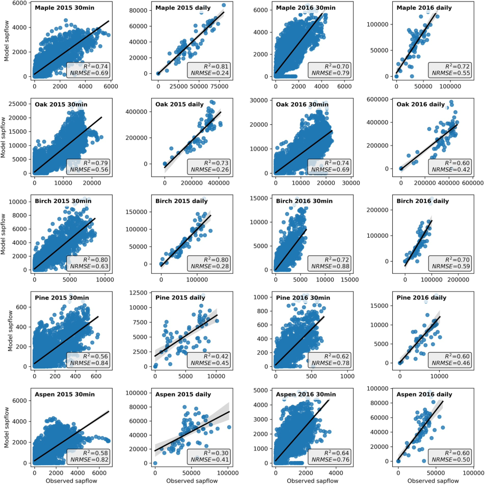
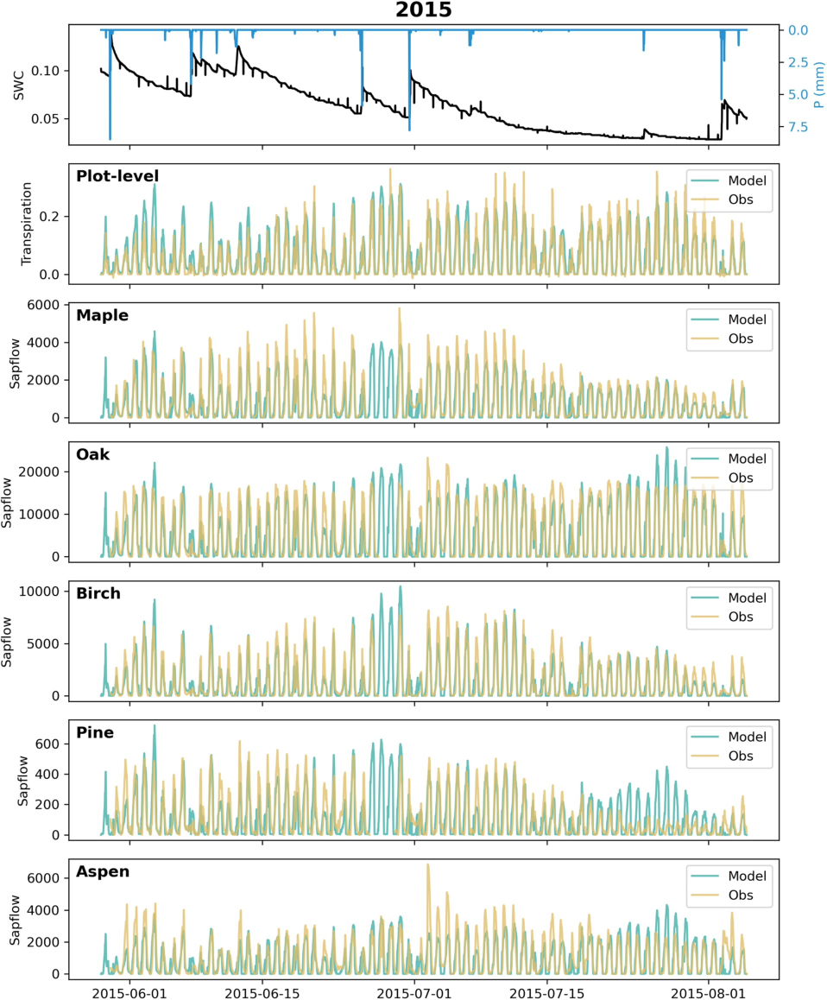
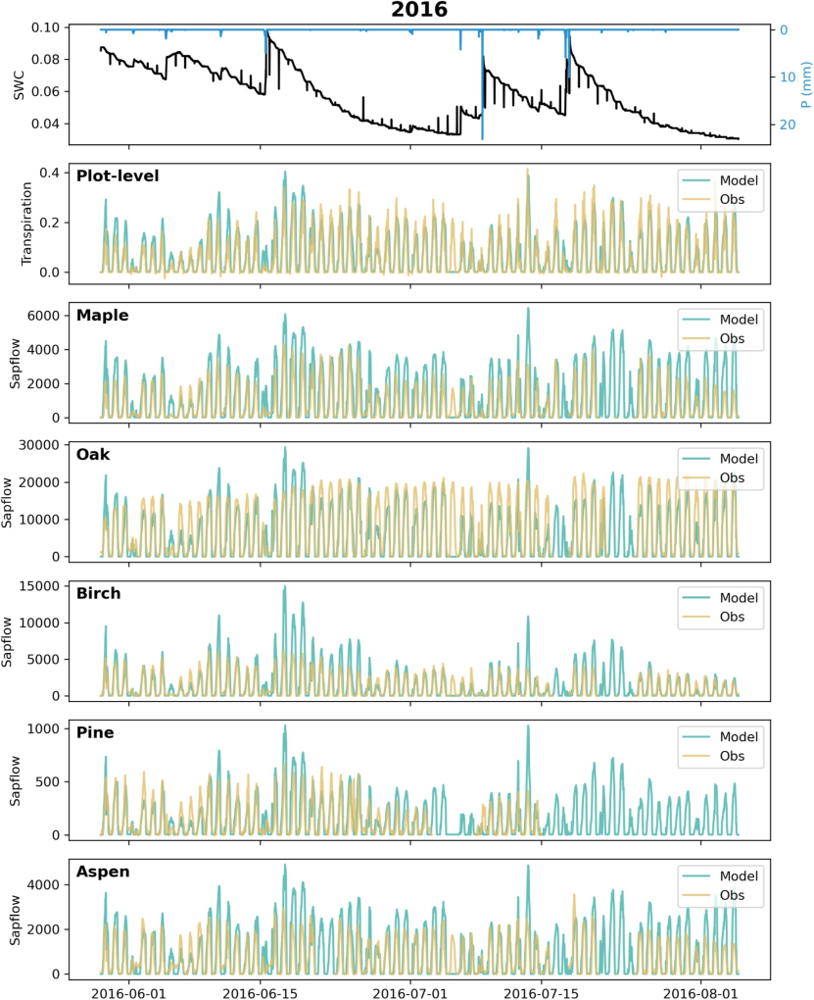
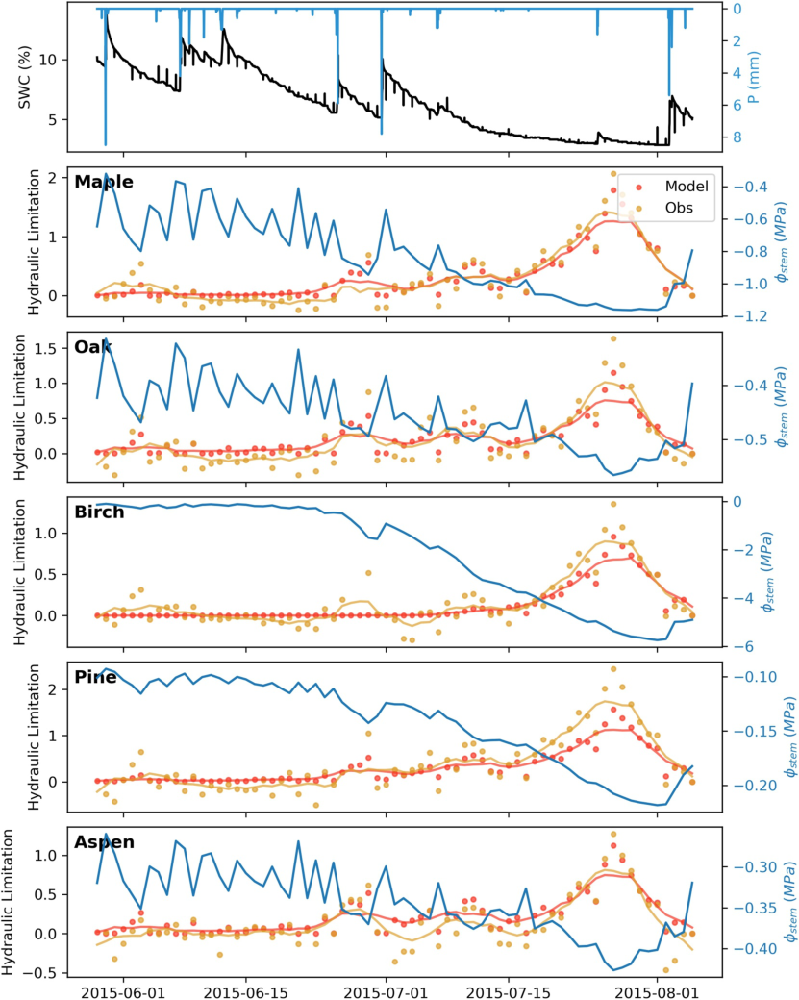
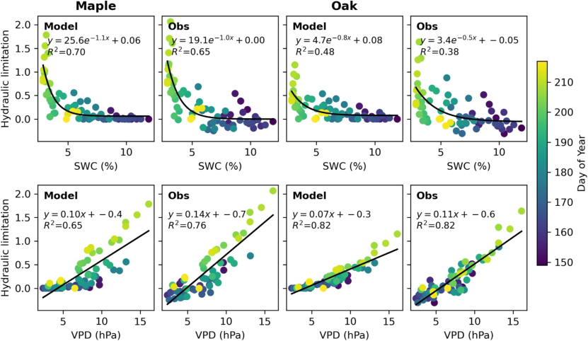
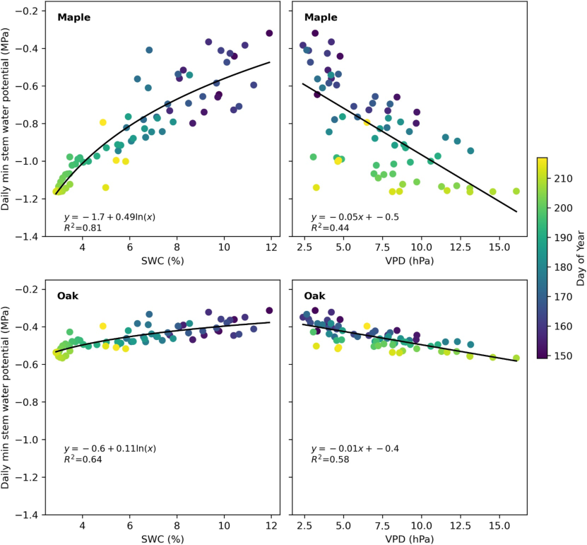
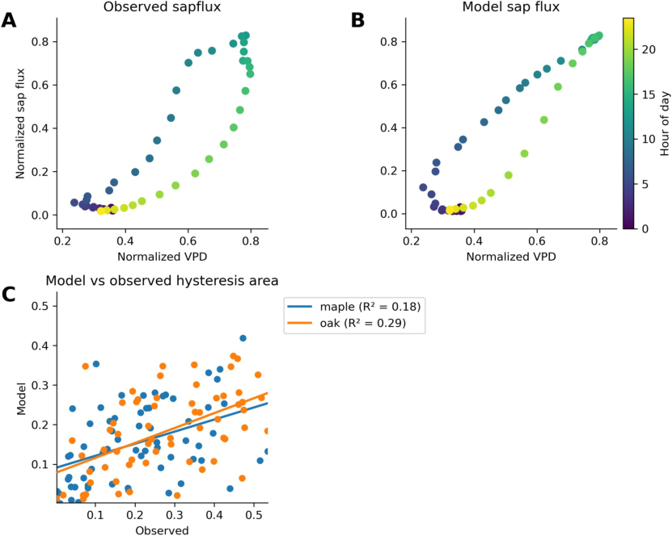

::: {.paper-authors}
Justine E. C. Missik^1^, Gil Bohrer^1^, Madeline E. Scyphers^1,2^, Ashley M. Matheny^3^, Ana Maria Restrepo Acevedo^4,5^, Marcela Silva^6^, Golnazalsadat Mirfenderesgi^7^, Yair Mau^8^
:::

::: {.paper-affil}
^1^ Department of Civil, Environmental & Geodetic Engineering, The Ohio State University, Columbus, OH, USA &nbsp;&middot;&nbsp; ^2^ Soil and Crop Sciences, Colorado State University, Fort Collins, CO, USA &nbsp;&middot;&nbsp; ^3^ Department of Earth and Planetary Sciences, Jackson School of Geosciences, The University of Texas at Austin, Austin, TX, USA &nbsp;&middot;&nbsp; ^4^ O'Neill School of Public & Environmental Affairs, Indiana University Bloomington, Bloomington, IN, USA &nbsp;&middot;&nbsp; ^5^ Department of Biology, West Virginia University, Morgantown, WV, USA &nbsp;&middot;&nbsp; ^6^ Department of Civil Engineering, Monash University, Clayton, VIC, Australia &nbsp;&middot;&nbsp; ^7^ Department of Mechanical and Aerospace Engineering, The Ohio State University, Columbus, OH, USA &nbsp;&middot;&nbsp; ^8^ The Robert H. Smith Faculty of Agriculture, Food and Environment, Institute of Environmental Sciences, The Hebrew University of Jerusalem, Rehovot, Israel
:::

---

::: {.paper-meta}
Journal of Geophysical Research: Biogeosciences 130, e2024JG008198 &middot; 2025 &middot; doi: [10.1029/2024JG008198](https://doi.org/10.1029/2024JG008198)

Received 12 April 2024; accepted 17 March 2025

Correspondence: Justine E. C. Missik (missik.2@osu.edu)
:::

> **How to cite:** Missik, J.E.C., Bohrer, G., Scyphers, M.E., Matheny, A.M., Restrepo Acevedo, A.M., Silva, M., Mirfenderesgi, G. and Mau, Y. (2025). Using a plant hydrodynamic model, FETCH4, to supplement measurements and characterize hydraulic traits in a mixed temperate forest. Journal of Geophysical Research: Biogeosciences, 130, e2024JG008198. https://doi.org/10.1029/2024JG008198

---

#### Key Points

- FETCH4 improves hydraulic trait representation in a vertically resolved, multiscale hydrodynamic model
- We used sapflow data and a Bayesian optimization framework to determine species-specific hydraulic parameters
- The model performed well in simulating sapflow of species with contrasting hydraulic strategies and captured higher-level emergent traits

#### Abstract

Species-specific hydraulic traits play an important role in ecosystem response to water stress; however, representation of biodiverse forest canopies remains a challenge in land surface models. We introduce FETCH4, a multispecies, canopy-level, hydrodynamic model, which builds upon previous versions of the finite-difference ecosystem-scale tree crown hydrodynamics model (FETCH). FETCH4 simulates water transport through the soil, roots, and stem as porous media flow. Stomatal conductance is controlled by xylem water potential, which is resolved along the vertical dimension. A key feature of FETCH4 is a multispecies canopy formulation, which uses crown and stem dimensional characteristics to allow the model to produce both tree-level and plot-level outputs and improves the representation of hydraulic traits and their variation among trees and species. We demonstrate the model's performance in a mixed temperate forest in Michigan with species of contrasting hydraulic strategies. We optimize species-specific hydraulic parameters using a Bayesian optimization framework incorporating sapflow measurements. FETCH4 performed well in simulating sapflow of species with contrasting hydraulic strategies under conditions of water stress. In addition, the model was able to capture higher-level emergent traits, such as drought sensitivity. Using FETCH4 in combination with available observations can provide unique insights about difficult to measure hydraulic traits and plant hydrodynamics.

#### Plain Language Summary

Different species of trees have different strategies for how they respond to drought. However, most models have poor representation of the diversity in traits that control drought response. In this work, we developed FETCH4, a model for simulating plant water use, which allows for more detailed representation of the diversity among species in traits that control plant water use. We used field measurements of transpiration of multiple tree species in a temperate forest in Michigan to train and validate the model. Key findings underscore the model's ability to capture the nuanced responses of different tree species to drought and highlight the fact that different tree species have very different responses to the same environmental conditions. Our results demonstrate that the model can provide useful insights about the traits that control these varied responses to environmental conditions, which are difficult to measure directly.

## 1. Introduction

Stomatal conductance is a key control of evapotranspiration (ET) in terrestrial ecosystems and plays a crucial role in determining the surface energy balance between long-wave emitted radiation, sensible heat flux, and water vapor (latent) heat flux ([Seneviratne et al., 2010](#ref-seneviratne2010)). Canopy resistance to water flux is governed by stomata, which can amplify or buffer the soil moisture feedback during periods of water limitations ([D'Odorico et al., 2007](#ref-dodorico2007); [Fatichi et al., 2016](#ref-fatichi2016); [Green et al., 2017](#ref-green2017)). Stomatal conductance couples the processes of transpiration and photosynthesis and thus controls CO2 uptake by vegetation and water use efficiency ([Anderegg et al., 2019](#ref-anderegg2019)). As a dynamic response to environmental cues, stomatal conductance exhibits variability across biomes, ecosystems, species, and even individual plants. This variability arises from diverse water-use strategies and environmental sensitivities, governed by hydraulic traits ([Anderegg, 2015](#ref-anderegg2015)). Understanding and quantifying these hydraulic traits is vital for predicting ecosystem responses particularly under changing climate conditions, which impact stomatal conductance and subsequently ecosystem carbon uptake, transpiration, and drought-induced tree mortality ([Anderegg et al., 2016](#ref-anderegg2016); [Barros et al., 2019](#ref-barros2019); [Brodribb et al., 2020](#ref-brodribb2020); [Detto & Pacala, 2022](#ref-detto2022); [Matheny, Mirfenderesgi, & Bohrer, 2017](#ref-mathenymirfenderesgi2017)). Thus, it is imperative for atmospheric, ecosystem, land surface, and earth system models to predict stomatal conductance accurately in order to reliably forecast the surface energy budget, the water cycle, and ecosystem carbon dynamics. Trait-based ecosystem modeling adopts a functional trait-based approach, categorizing plants into functional types based on their traits rather than species identity ([Zakharova et al., 2019](#ref-zakharova2019)). The hydrodynamic approach allows models to explicitly resolve the effects of multiple leaf, xylem, and root traits on transpiration and stomatal conductance. This approach has gained traction in the last decade with many land surface models (some incorporated into Earth system models) utilizing a hydrodynamic approach for resolving transpiration. Notable examples include ELM-FATES-HYDRO ([C. Xu et al., 2023](#ref-xu2023)); TFS ([Christoffersen et al., 2016](#ref-christoffersen2016)); CLM5-PHS ([Kennedy et al., 2019](#ref-kennedy2019)); ED2-hydro ([X. Xu et al., 2016](#ref-xu2016)); STAC ([Massoud et al., 2019](#ref-massoud2019)); SPAC ([Gentine et al., 2016](#ref-gentine2016)); and Thetys-Chloris ([Fatichi et al., 2012](#ref-fatichi2012); [Paschalis et al., 2024](#ref-paschalis2024)).

The hydrodynamic approach is based on the following hypotheses: (a) water moves through the plant (roots, stems, and leaves) in a continuous pathway known as the hydraulic continuum; (b) water potential within plant tissues plays a significant and dynamic role as water moves through the hydraulic continuum; and (c) stomata respond to changes in water potential within the plant (leaf or stem xylem) rather than directly responding to soil moisture. Hydrodynamic models resolve plant water storage (in the leaves, stem, and/or roots) as a diagnostic variable. They can, therefore, resolve the role hydraulic capacitance plays in buffering transpiration against water stress. Hydrodynamic models represent different plant traits that control the dynamics of the transpiration response to water shortage through parameters in different equations that describe water and stomatal dynamics at the leaf, xylem, and roots ([Mirfenderesgi et al., 2019](#ref-mirfenderesgi2019)).

It has been demonstrated that for hydrodynamic modeling plants should be classified along hydraulic functional traits that do not always follow the common plant functional type conventions currently used by land surface models ([Matheny, Fiorella, et al., 2017](#ref-mathenyfiorella2017)). Although the exact formulation and resolution varies among models, some of the most common trait representations across all models include parameters describing tree structural characteristics and response curves of the plant hydraulic system ([Chen et al., 2022](#ref-chen2022)). Common examples for structural parameters include rooting depth and vertical distribution, ratio of leaf area to xylem area, leaf area index (LAI), crown diameter, stem diameter, vertical distribution of leaf density, and xylem taper with height. Parameters describing the hydrodynamic response of the conductive system include root xylem resistance, stem xylem resistance, the shape of the percent loss of conductivity (PLC) curve describing the xylem response to decreased water potential, xylem capacitance (static or dynamic), and the shape of the stomata response curve to water potential. The stomatal response to water potential is described as the degree of isohydricity and differentiates relatively isohydric plants, which tend to maintain constant xylem water potential by closing stomata early with a relatively small loss of xylem pressure versus more anisohydric plants that allow continued transpiration despite a drop in xylem water potential ([Martínez-Vilalta & Garcia-Forner, 2017](#ref-martinezvilalta2017); [McDowell et al., 2008](#ref-mcdowell2008)). Site-level and species-level variations in hydraulic traits are common worldwide, including in temperate and boreal ecosystems ([Anderegg et al., 2018](#ref-anderegg2018)) and tropical forests ([Smith-Martin et al., 2023](#ref-smithmartin2023)). Recent observations provide ample examples of the importance of plant hydraulic traits: diversity in hydraulic traits determines drought resilience and drought mortality patterns ([Johnson et al., 2018](#ref-johnson2018)), buffers variation in ecosystem fluxes during dry periods ([Anderegg et al., 2018](#ref-anderegg2018)), and affects the response to short-term dry conditions ([Matheny, Fiorella, et al., 2017](#ref-mathenyfiorella2017)). Multiple hydraulic traits determine the climate change response of forests ([Madsen-Hepp et al., 2023](#ref-madsenhepp2023); [Mastrotheodoros et al., 2017](#ref-mastrotheodoros2017)).

Not all models employ identical equations or simulate the same subcomponents of the plant hydraulic system. Furthermore, for the system components they do simulate, various models may utilize different levels of resolution. For example, ED2-Hydro ([X. Xu et al., 2016](#ref-xu2016)) uses a single stem xylem conductive element, whereas ELM-FATES-Hydro ([Fang et al., 2022](#ref-fang2022)) uses vertically resolved xylem. Some models explicitly represent fine roots (e.g., [Siqueira et al., 2008](#ref-siqueira2008)), others do not; some models resolve leaf water storage (e.g., ELM-FATES-Hydro), others neglect that and only resolve xylem water storage. Numerous uncertainties impacting model predictions have been identified, serving as key areas of interest for ongoing and future model refinement.

In this work, we describe a new model version designed particularly to:

- *Improve the multilayer canopy representation.* The importance of multilayer canopy representation versus a big-leaf representation was demonstrated by [Bonan et al. (2021)](#ref-bonan2021). The significance of a multilayer canopy representation becomes particularly pronounced in models considering plant hydraulics, whereas the impact of multilayer representation might be less pronounced in models employing simplified stomatal regulation linked to soil moisture ([Wozniak et al., 2020](#ref-wozniak2020)).
- *Represent functional diversity of hydraulic traits within a forest.* Representing functional diversity in hydraulic traits within forest ecosystems entails capturing the spectrum of species with varying hydraulic characteristics within mixed canopies. Although plant functional types (PFTs) currently serve as the common resolution level at which species composition is represented in most models, they often fail to adequately represent hydraulic behaviors and traits. They are classified based on biome (tropical, temperate, and arctic), photosynthesis (C3 vs. C4), leaf form (grass vs. trees, needleleaf vs. broadleaf), and phenology (evergreen vs. deciduous). However, plants in the same PFT can have significantly different hydraulic traits and behavior, and this functional diversity is important in determining ecosystem-scale drought response ([Chitra-Tarak et al., 2021](#ref-chitratarak2021)). For instance, within the PFT for temperate broadleaf deciduous trees, there exist both deep-rooted and shallow-rooted trees exhibiting extreme isohydric and anisohydric behaviors ([Matheny, Fiorella, et al., 2017](#ref-mathenyfiorella2017)). Several studies have highlighted substantial diversity in hydraulic functional traits across tropical ([Smith-Martin et al., 2023](#ref-smithmartin2023)), temperate, and boreal forests ([Anderegg et al., 2018](#ref-anderegg2018)). Moreover, substantial intraspecific variation in hydraulic traits, both spatially among individuals and temporally within the same individual, underscores the complexity of hydraulic trait dynamics ([Anderegg, 2015](#ref-anderegg2015)).

Here, we introduce the newest version of the FETCH model, FETCH4, which is focused on improving hydraulic trait variation representation in a vertically resolved, multiscale (individual, species, and whole canopy) hydrodynamic model. We demonstrate its performance in a mixed temperate forest at the University of Michigan Biological Station (UMBS) in Northern Michigan to gain insights into how hydraulic traits influence the emergent patterns of hydrodynamic responses to transpiration drivers.

## 2. Methods

### 2.1. Model Description

FETCH4 is the latest version of the FETCH model. The development of FETCH4 is guided by the need to improve the representation of hydraulic traits and their variation among trees and species. FETCH was introduced by [Bohrer et al. (2005)](#ref-bohrer2005) as a conceptual single-tree branch-level hydrodynamic model. Previous advanced versions include FETCH2 ([Mirfenderesgi et al., 2016](#ref-mirfenderesgi2016)), which reduced the resolution from branch to single stem, added a root system, and converted the numerical solver approach from finite elements to finite difference, and FETCH3 ([Silva & Missik, 2021](#ref-silva2021); [Silva et al., 2022](#ref-silva2022)), which translated FETCH2 from MATLAB to Python, added a dynamic soil column, and further improved the numerical solver. Major advancements in FETCH4 include: (a) an added capability to simulate multispecies canopies and scaling from individual trees to species to whole canopy, (b) an improved vertically resolved transpiration model, (c) an integrated parameter optimization module, and (d) improvements to computational performance and usability of the model. We explicitly chose a simple approach for representing the tree structure. We do not explicitly represent the leaves or branches. We only consider vertical variation of hydraulic properties between the roots and the stem (above ground) xylem, the stem taper, and the leaf area density. We chose to focus on these as an effort to limit the number of parameters given observations available to constrain these. As such, direct observations of vertical variation of leaf area density and taper functions exist, whereas other hydraulic parameters are constrained by the end result of the sap flux and transpiration the model predicts and fitted through optimization. In our approach that guided the development of FETCH4, we utilize hydraulic plant functional types (H-PFTs), which can be flexibly defined to broad or narrow categories depending on the level of detail required. Trees of the same H-PFT share the same hydraulic parameters but can vary in structure (e.g., tree height and stem diameter). Here, we define the H-PFT at the species level, though this is not required by the model and could be generalized at a higher phylogenetic or ecological/functional level. FETCH4 produces tree-level (individual), species-level (functional type), and plot-level outputs of transpiration, sap flow, stem water content, and soil moisture and resolves the intra- and inter-daily dynamics of these variables. Furthermore, FETCH4 can resolve emergent hydraulic dynamics, such as hysteresis between transpiration and vapor pressure deficit (VPD) and photosynthetically active radiation (PAR) ([Matheny, Bohrer, Stoy, et al., 2014](#ref-mathenystoy2014)) and stress response and recovery.

The full formulation of the model was described with previous versions of FETCH ([Bohrer et al., 2005](#ref-bohrer2005); [Mirfenderesgi et al., 2016](#ref-mirfenderesgi2016); [Silva et al., 2022](#ref-silva2022)) but we will repeat the core governing equations here. The model calculates the dynamics of water potential following the Richardson-Richards formulation in three connected columns: the soil, the root, and the stem. The soil and root columns occupy the same vertical space and share the same vertical layers. The stem is vertically connected above the top layer of the root column. Each column has no flow boundary conditions and interacts with other columns and the atmosphere through prescribed sink and source terms. The soil top layer has a source term equal to the net water flux (precipitation − evaporation). The soil and the roots exchange flow through the root water uptake (can be negative), which is applied at each common vertical layer. The root and the stem columns are numerically directly connected (a continuum of xylem water potential). The stem column loses water to the air through transpiration, prescribed at each vertical layer.

The soil column governing equation:

$$
C_s \frac{\partial \Phi_s}{\partial t} = \frac{\partial}{\partial z}\left[K_s \left(\frac{\partial \Phi_s}{\partial z} + \rho g\right)\right] - S_r + S_a\big|_{z=0}, \tag{1}
$$

where $C_s$ (Pa^−1^) is the soil capacitance, $\Phi_s$ (Pa) is the soil water potential, $K_s$ (m² s^−1^ Pa^−1^) is the effective soil hydraulic conductivity, $\rho$ (kg m^−3^) is the water density, $g$ (m s^−2^) is the gravitational acceleration, $t$ (s) is time, and $z$ (m) is distance along the vertical direction (positive upward, zero at the surface). $S_a$ (s^−1^) is the atmospheric water supply (precipitation − evaporation) and applies only at the top boundary of the soil column ($z = 0$). It is provided as forcing. Note that the model applies to tree canopies; thus, by definition, the soil evaporation term refers only to the direct evaporation from the soil under the forest canopy, which under most conditions is a very small term. The relationships between $K_s$, $\Phi_s$ and the soil volumetric water content, $\theta_s$, are modeled according to [van Genuchten (1980)](#ref-vangenuchten1980). $S_r$ (s^−1^) is the root water uptake ([Gardner, 1960](#ref-gardner1960)):

$$
S_r = k_{s,\text{rad}} f(\theta_s) A_{\text{ind}} \frac{r_z}{r_{\text{tot}}} (\Phi_s - \Phi_x), \tag{2}
$$

where $k_{s,\text{rad}}$ (m s^−1^ Pa^−1^) is the soil-to-root radial conductance per unit of root surface area, $f(\theta)$ is a dimensionless reduction function due to soil moisture, $A_{\text{ind}}$ (m² root m^−2^ ground) is an index defining the lateral root surface area per area of ground, $r_z$ is the root mass at each vertical layer, and $r_{\text{tot}}$ is total root mass. $\Phi_x$ (Pa) is the xylem water potential.

The root column governing equation:

$$
C_r \frac{\partial \Phi_r}{\partial t} = \frac{\partial}{\partial z}\left[K_r \frac{A_r}{A_s} \left(\frac{\partial \Phi_x}{\partial z} + \rho g\right)\right] + S_r, \tag{3}
$$

where $A_r/A_s$ is the root cross-sectional area index. Subscript $r$ for $C_r$ and $K_r$ indicates the capacitance and conductance for the root xylem.

The stem column governing equation:

$$
C_x \frac{\partial \Phi_x}{\partial t} = \frac{\partial}{\partial z}\left[K_x \frac{A_x}{A_s} \left(\frac{\partial \Phi_x}{\partial z} + \rho g\right)\right] - E_l \left(\text{NHL}_{\text{leaf}} \times \text{LAD} \times \Delta z\right), \tag{4}
$$

where $A_x/A_s = \text{LAD} \times \Delta z$, is the leaf area index at each vertical layer, and LAD is leaf area density (m²/m³). Subscript $x$ for $C_x$ and $K_x$ indicates the capacitance and conductance for the stem xylem. NHL~leaf~ is the nonhydraulically limited transpiration per leaf area (explained in Section 2.1.2). The hydrodynamic regulation of transpiration is enforced by the hydrodynamic limitation factor $E_l$ (unitless), defined as:

$$
E_l = \exp\left[-\left(\frac{\Phi_x}{\Phi_{50}}\right)^{c_3}\right], \tag{5}
$$

where $\Phi_{50}$ is an empirical shape parameter describing the inflection point of the stomata response curve. The sensitivity of the response function of transpirational water loss (as defined by the shape parameters $\Phi_{50}$ and $c_3$) represents the plant's leaf hydraulic strategy (i.e., the degree of (an)isohydric behavior).

The response curve describing root conductivity as a function of water potential (often called the "xylem vulnerability curve") is of the form:

$$
K_r = K_{r,\text{max}} \exp\left[-\left(\frac{\Phi_x}{c_{r1}}\right)^{c_{r2}}\right], \tag{6}
$$

where $K_{r,\text{max}}$ is the maximal conductivity (when xylem is saturated), and $c_{r1}$ and $c_{r2}$ are shape parameters, describing the PLC curve for the root xylem. Identical formulation is applied for the conductivity of the stem xylem $K_x$ but with different values for the shape parameters, $c_{x1}$ and $c_{x2}$.

The capacitance varies with water content following ([Bohrer et al., 2005](#ref-bohrer2005)):

$$
C_r = \frac{p\,\theta_{r,\text{sat}}}{\Phi_0}\left(\frac{\Phi_{r,0} - \Phi_x}{\Phi_{r,0}}\right)^{-(p+1)}, \tag{7}
$$

where $\theta_{r,\text{sat}}$ is the saturated water content of the root xylem, $\Phi_{r,0}$ is the water potential at saturation, and $p$ is a shape parameter. Similar formulation is applied to $C_x$ but using a different set of parameters representing the stem xylem, $\theta_{x,\text{sat}}$ and $\Phi_{x,0}$.

### 2.1.1. Simulation of Multispecies Canopies

The previous version, FETCH3, was designed to simulate canopy transpiration at the plot to ecosystem scale using the assumption of a homogenous canopy (i.e., assuming all trees within the simulated area have similar structural characteristics and hydraulic traits). A key advancement in FETCH4 is the implementation of a multitype canopy formulation, including representation of type-specific hydraulic parameters. FETCH4 provides the flexibility to specify different hydraulic and/or structural parameters for different types of trees within a mixed forest. The model implements the scaling approach described by [Bohrer and Missik (2022)](#ref-bohrer2022) to scale from individual trees to the plot or ecosystem scale. Using this approach, FETCH4 simulates individual representative trees each with their distinct structural and hydraulic traits. Each of these representative trees represents a functional group of trees of the same functional type and size-age range. The combined results for all representative trees (typically a small number of types per site, around 3–10) can be scaled to the plot level based on the composition of the canopy in the site. This formulation takes both canopy-scale and type-specific individual-scale properties into account when determining meteorological forcing. Plot-level canopy structure (e.g., mean LAI) is used to determine forcing related to canopy turbulence, such as wind speed, friction velocity, and CO2 concentration. Following [Bohrer and Missik (2022)](#ref-bohrer2022), radiation and precipitation forcing are prescribed as homogenous fluxes, directly from above, thus, each type has the same above canopy flux rate and precipitation water input and there is no direct competition for light or water. Light attenuation for each representative tree is based on crown size and type-specific vertical leaf area distribution. Wind and CO2 concentrations, which tend to be horizontally mixed by turbulence at scales larger than individual tree-crowns, are forced as a plot level mean and vary vertically throughout the canopy based on the mean plot level leaf area density. Simulations of individual model trees within the canopy are parallelized.

A challenge for any hydrodynamic simulation is that atmospheric fluxes (evaporation, PAR, transpiration, and precipitation) are typically prescribed and implemented per unit ground area, whereas sap flow serves a discrete tree with a narrow stem and a wide crown (each with a distinct dimension, different than unit area). Water storage in the tree represents the tree-level water budget, and given multiple trees of different sizes, the tree crown dimensions must be accounted for when scaling from per tree to per canopy and per ground area fluxes. FETCH explicitly represents the crown by resolving flux from the leaves per leaf area, $F^{\text{leaf}}_{\text{tp,tp}}$ (kg m^−2^ leaf s^−1^). It scales to the tree level flow, $F^{\text{tree}}_{\text{tp}}$ (kg s^−1^), as

$$
F^{\text{tree}}_{\text{tp}} = F^{\text{leaf}}_{\text{tp}} \times (\text{LAI}_{c\,\text{tp}} \times A_{c\,\text{tp}}), \tag{8}
$$

where $A_c$ is the area of the ground projection of the tree crown, and a subscript $\text{tp}$ represents dimensions of the individual representative trees (also representing the mean characteristics of a type-size group). Note that the plot-level species specific LAI, LAI~sp~ (a relatively well reported canopy characteristic, which could be conveniently used in even aged plots by assuming that the "functional type" is represented by each, or sub-groups of the species) and the mean plot-level LAI, LAI~p~ (the most commonly reported canopy characteristic, for example from coarse satellite observations) are each different and relate to each other as

$$
\text{LAI}_p = \sum_{tp} (\text{LAI}_{sp\,tp}) = \sum_{tp} (\text{LAI}_{c\,tp} \times A_{c\,tp} \times 0.0001\, n_{tp}), \tag{9}
$$

where $n_{tp}$ is the type-specific stand density (trees/hectare). The tree-level flow, $F^{\text{tree}}_{\text{tp}}$, can be represented as a flux per ground area, $F_{c\,tp}$ (kg s^−1^ m^−2^), for each functional type, as

$$
F_{c\,tp} = \frac{F^{\text{tree}}_{\text{tp}}}{A_{c\,tp}} = F^{\text{leaf}}_{\text{tp}} \times \text{LAI}_{c\,tp}. \tag{10}
$$

This representation of transpiration in terms of $F_{c\,tp}$ is convenient since LAI~c tp~ and $A_{c\,tp}$ must already be known in order to calculate flux drivers that are specified at the crown scale (e.g., radiation). In its most general form, scaling from each type-specific flux to the whole-plot flux to the atmosphere per unit ground area, $F_p$, is represented as

$$
F_p = \sum_{tp} \left(F^{\text{tree}}_{\text{tp}} \times 0.0001\, n_{tp}\right). \tag{11}
$$

When representing the tree-level flow in terms of $F_{c\,tp}$, the above equation becomes

$$
F_p = \sum_{tp} \left(F_{c\,tp} \times A_{c\,tp} \times 0.0001\, n_{tp}\right). \tag{12}
$$

This scaling approach provides flexibility regarding how "hydraulic functional types" are defined. For example, "types" could refer to different species, different age classes within a species, or groups of species with similar hydraulic traits. Since the model produces both tree-level and plot-level outputs, it can be calibrated and evaluated using multiple data sources. Tree-level model outputs can be compared to tree-level measurements of sap flow, stem water content, and stem water potential. Plot-scale outputs can be compared to eddy covariance measurements of ET. One limitation of this approach is that trees do not use water from a shared pool, that is, each tree occupies its own "bucket," and the model does not account for the influence of a tree's neighbors on soil water availability. Thus, the current version does not simulate dynamic competition for water.

### 2.1.2. Transpiration Module

Transpiration in FETCH4 is simulated using a response function, which reduces the nonhydrodynamically limited (NHL) transpirational demand. NHL transpirational demand is multiplied by hydrodynamic limitation factor, $E_l$ as a function of the water potential in the stem xylem, $\Phi_x(z,t)$ (see Equation 5). $E_l$ represents the degree of closure of stomata due to the hydrodynamic stress. In reality, it is driven by the water potential at the guard cells. Here, we make a simplifying assumption and only resolve water potential through the root-stem system, neglecting fine roots, branches, leaves, and further smaller structures within leaves and stems. We assume that given a continuous water potential cascade from the xylem to the leaves, the stomata regulation behavior could be simulated using xylem water potential as a driver, assuming calibration of the stomata response-shape parameters. Here, NHL transpirational demand refers to transpiration that would occur in the absence of hydraulic limitations. It predicts stomatal conductance as a function of photosynthetic capacity and atmospheric demand, assuming soil water is not limiting. It is vertically detailed, estimating the potential transpiration per unit leaf area ([Ewers & Oren, 2000](#ref-ewers2000)) at each vertical layer assuming boundary layer resistance formulation from [Monteith and Unsworth (2013)](#ref-monteith2013) based on vertical profiles of within-canopy wind and PAR attenuation given a vertical profile of LAD.

NHL transpiration is driven by half-hourly observations of PAR, air temperature ($T_a$), wind speed, and VPD. NHL stomatal conductance is represented using the [Leuning (1995)](#ref-leuning1995) model. Additional details describing the NHL formulation can be found in Supporting Information S1. The code of FETCH4 includes an option to utilize the Penman-Monteith (P-M) formulation, with transpiration distributed vertically through the canopy based on the leaf area distribution, as done in FETCH3 and described by [Silva et al. (2022)](#ref-silva2022), though the default in FETCH4 and the simulations in this work are set to the Leuning NHL. The FETCH4 formulation for NHL is similar to that in FETCH2 ([Mirfenderesgi et al., 2016](#ref-mirfenderesgi2016)) with a key difference being that FETCH2 uses stem water potential from the preceding time step to calculate the stomatal regulation effect, whereas FETCH4 uses an explicit solution at the current time step. Another difference is that the term within the Leuning NHL that limits stomata based on VPD, $\text{VPD}/D_0$, where $D_0$ is a fixed reference optimal vapor pressure, was replaced by $\text{VPD}_{\text{opt}}/D_0$ and since $\text{VPD}_{\text{opt}} = D_0$, this term will always be = 1 and will not limit stomatal conductance. That is explicitly required for a fully nonhydrologically limited transpiration model (see complete formulation in Supporting Information S1).

### 2.1.3. Parameter Optimization

Parameter optimization in FETCH4 is performed using Bayesian Optimization for Anything (BOA), a newly developed software package for Bayesian optimization ([Scyphers et al., 2023a](#ref-scyphers2023a), [2024](#ref-scyphers2024)). FETCH4 includes a model wrapper that fully integrates BOA into the model workflow for parameter optimization. All information needed to set up an optimization run of the model can be specified through the model configuration file, including which parameters to optimize, parameter bounds, metrics and variables that should be used for the objective function (e.g., Root Mean Squared Error (RMSE) of sap flow and/or stem water content), number of trials to run, and acquisition functions used to generate the trials.

### 2.1.4. Improvements to Usability and Performance

FETCH4 incorporates several enhancements aimed at improving the model's usability, making it more adaptable to various study sites and user-friendly for individuals without programming expertise.

- *Code performance.* FETCH4 made substantial improvements to computational efficiency, reducing the model's run time by around 75% compared to the FETCH3.
- *Documentation.* The model documentation and user guide are available at https://fetch3-nhl.readthedocs.io/en/latest/index.html.
- *Model configuration.* All parameter definitions have been moved from the model source code to a separate configuration file, so that the model can be run without requiring interaction with the source code. Details regarding the configuration file can be found in the model documentation.
- *Model outputs.* The model produces comprehensive outputs including both vertically detailed and vertically integrated transpiration, stem water content, and stem water potential in netCDF format. These output files can be analyzed using any programming language. Additionally, FETCH4 includes a built-in module for examining and visualizing model outputs and analyzing the results of parameter optimization runs.
- *Maintainability of the model code.* The model source code has been restructured in a more modular format, allowing for easier implementation of new features (e.g., different transpiration schemes). In addition, automated tests have been added to improve the stability and maintainability of the model code.

### 2.2. Model Runs

#### 2.2.1. Site Description and Data Sets

For this study, we used FETCH4 to simulate transpiration in a deciduous forest at the University of Michigan Biological Station (UMBS), located in northern lower Michigan, USA (N 45°33′35″, W 84°42′48″). The site experiences a mean annual precipitation of 766 mm and a mean annual temperature of 5.5°C ([Matheny, Fiorella, et al., 2017](#ref-mathenyfiorella2017)). The soil at UMBS consists of well-drained Haplorthods of the Rubicon, Blue Lake, or Cheboygan series with a composition of 92.2% sand, 6.5% silt, and 0.6% clay ([Nave et al., 2011](#ref-nave2011)). The forest is characterized by a mix of early and mid-successional tree species, transitioning from predominantly bigtooth aspen (*Populus grandidentata*) and paper birch (*Betula papyrifera*) to increasingly dominated by red maple (*Acer rubrum*), red oak (*Quercus rubra*), and white pine (*Pinus strobus*). The mean canopy height is about 22 m and maximum tree heights are 30 m. The canopy reaches an LAI of around 4.0 m² m^−2^ during the peak of the growing season.

UMBS is home to AmeriFlux site US-UMB, where eddy covariance measurements of CO2 and water vapor fluxes have been collected since 1998 ([Gough et al., 2013](#ref-gough2013); [Schmid, 2000](#ref-schmid2000)). For this study, measurements of ET, CO2 concentration, wind speed, friction velocity, precipitation, incoming shortwave radiation, PAR, air temperature, VPD, atmospheric pressure, and soil water content were obtained from the AmeriFlux database ([Gough et al., 2023](#ref-gough2023)). Eddy covariance measurements of ET were partitioned into evaporation and transpiration using the Transpiration Estimation Algorithm (TEA) method ([Nelson et al., 2018](#ref-nelson2018), [2020](#ref-nelson2020)).

Sap flow was measured using Granier-style sap flux sensors in five species at the site: *Quercus rubra* (oak), *Acer rubrum* (maple), *Betula papyrifera* (birch), *Populus grandidentata* (aspen), and *Pinus strobus* (pine) as described by [Matheny, Bohrer, Vogel, et al. (2014)](#ref-mathenyvogel2014). The sap flow data were obtained through the SAPFLUXNET database ([Poyatos et al., 2021](#ref-poyatos2021)). Intensive forest inventory data have been collected periodically at the site, providing detailed information about canopy characteristics and species composition. Optical measurements of mean canopy LAI are conducted throughout the growing season, and species-specific LAI is measured using leaf litter traps. In addition, tree structural measurements (height, crown area, diameter at breast height, and sapwood depth) have been collected for the trees instrumented with sap flux sensors.

#### 2.2.2. Description of Model Runs

For this experiment, we selected one representative tree of each of the five primary species at the site (oak, maple, birch, aspen, and pine) based on the availability and quality of sap flow measurements. The model also produced an estimate of total canopy transpiration by scaling these representative trees to the plot scale based on the species composition of the site. We ran the model for the growing seasons of 2015 and 2016 with 2015 used for parameterization and 2016 data used for validation.

The structural parameters include: number of simulated representative trees of different types, active xylem diameters, stem height, xylem taper, crown diameter, leaf area index, vertical profile of leaf density, rooting depth, and vertical area distribution. These were prescribed based on observations and kept constant throughout the simulation. Meteorological forcing included temperature, humidity, friction velocity, and wind speed above the canopy, incoming PAR, and precipitation. These were updated every model timestep based on half-hourly observations and interpolated linearly. Vertical distribution of soil water potential at the time of the simulation start was prescribed as initial conditions. Initial conditions for xylem water potential were assumed hydrostatic at equilibrium with soil water potential.

The soil column was resolved in 10 cm increments up to 6 m. The soil conductivity and porosity were based on observations ([He et al., 2014](#ref-he2014)) and represented a very sandy soil. To create a simulated lake aquifer, which is typical for this site, though deeper than our soil column, the bottom 50 cm of the soil were assumed to be of clay, and a saturated boundary condition was prescribed at the bottom of the soil column. Rooting depths were set to 0.6 m for maple, birch, and pine, 6.0 m for oak, and 5.4 m for aspen based (very loosely, with large degree of approximation) on the findings of [Matheny, Fiorella, et al. (2017)](#ref-mathenyfiorella2017), [Matheny, Garrity, and Bohrer (2017)](#ref-mathenygarrity2017), and [Matheny, Mirfenderesgi, and Bohrer (2017)](#ref-mathenymirfenderesgi2017). Combined with the way the soil column was defined, this arrangement of rooting depth created a realistic aquifer-water access pattern and kept maple, birch, and pine to the unsaturated shallow layers of the soil, whereas oak could access a mostly saturated layer, and aspen could always access the aquifer water. Other structural parameters were specific to each individual tree in which sap flow was measured. Each of the five species was parameterized individually using sap flow measurements from the 2015 growing season.

We used a two-stage approach for optimizing other model parameters in which we optimized the nonhydraulic and hydraulic parameters in separate stages. This two-stage approach reduces the number of free parameters, helping to minimize equifinality concerns and leading to a more constrained and manageable optimization problem. Additionally, this approach greatly reduces the overall computational cost by reducing the number of runs of the full FETCH4 model that are needed for parameterization.

*Optimization of non-hydraulic parameters.* In the first stage, nonhydraulic parameters are optimized by utilizing the NHL transpiration module as a standalone model for a period during which site conditions were not hydraulically limiting. For this, we selected the period from 29 May 2015 to 20 June 2015 based on the criteria of relatively high soil moisture and being early in the growing season to avoid any stress legacy effects that might occur later in the season. We optimize the following parameters using RMSE of model sap flow scaled to the plot level versus observations of transpiration as the objective function:

1. Maximum carboxylation rate at 25°C ($V_{\text{cmax}}$). Although in reality, hydraulic stress can reduce photosynthetic capacity ([Duursma et al., 2014](#ref-duursma2014); [Nadal-Sala et al., 2021](#ref-nadalsala2021)), $V_{\text{cmax}}$ is currently treated as a static parameter in FETCH4 and is parameterized with observations from the nonstressed periods, and it is therefore independent of hydraulic limitation. We used the TRY Database ([Kattge et al., 2020](#ref-kattge2020)) for the observed interquartile range for $V_{\text{cmax}}$ values for each species in our simulation. This observed range was imposed as the min-max limit for the parameterization.
2. Scaling factor for NHL transpiration. There are many factors that can cause bias in sap flow measurements, and the accuracy of the magnitude of the measurements from an individual sap flow sensor are very uncertain ([Flo et al., 2019](#ref-flo2019)). In our sap flow observations, there was large variation in the overall magnitude of sap flow measurements even among trees of the same species and size. To adjust for the large variation in overall bias of different sap flow sensors as well as other factors such as uncertainty in single tree-crown leaf area, ground projection area, and active xylem area, FETCH4 includes a linear scaling factor used to adjust the overall magnitude of NHL transpiration. This scaling factor addresses the mismatch between scaled sap flow measurements and plot-level transpiration; it should not have a substantial impact on determining hydraulic traits, since these traits are discerned based on relative changes in sap flow of an individual tree rather than the overall magnitude of the sap flow measurements.

*Optimization of hydraulic parameters*: After the nonhydraulic parameters ($V_{\text{cmax}}$ and NHL scaling factor) are optimized in the first step, they are treated as fixed parameters for the subsequent optimization of the hydraulic parameters. To reduce the number of free parameters in the optimization, we chose to optimize a subset of the available hydraulic parameters in FETCH4 and fix the remaining parameters to reasonable values reported in the literature. We chose the following parameters of interest for optimization:

1. Stomatal response parameters. We optimized two parameters controlling the shape and sensitivity of the stomatal response to stem water potential ($\Phi_{50}$ and $c_3$). These parameters are used to represent the tree's stomatal regulation strategy along the isohydric-anisohydric continuum.
2. Xylem hydraulic parameters. We optimized $K_{\text{max}}$ (maximum conductivity of the stem xylem) and $b_p$ (shape parameter describing the xylem vulnerability curve).

BOA was used to optimize these parameters by running the full FETCH4 model over the full growing season (May 29–August 5, 2015). Optimized parameter values can be found in Table 1. RMSE of normalized model sap flow versus observations was used as the objective function. Sap flow observations were not gap-filled; periods with missing observations were not included when calculating RMSE. For each optimization run, we ran 100 trials of the model as follows: (a) 30 trials with parameters sampled quasi-randomly within the search space using the Sobol algorithm and (b) 70 trials using a Gaussian process expected improvement (GPEI) acquisition function. This 30–70 split for Sobol-GPEI is based on sensitivity analysis by [Scyphers et al. (2024)](#ref-scyphers2024).

We ran the parameterized model for the 2016 growing season as validation. Model performance for the calibration (2015) and validation (2016) runs was evaluated using the RMSE and $R^2$ of modeled versus observed sap flow. We evaluated performance using both 30-min and daily total sap flow.

**Table 1 | Optimized Parameter Values.**

| Tree type | $V_{\text{cmax}}$ (μmol m^−2^ s^−1^) | $c_3$ (−) | $\Phi_{50}$ (Pa) | $K_{x,\text{max}}$ (m² s^−1^ Pa^−1^) | $c_{x1}$ (Pa) |
|---|---|---|---|---|---|
| Maple | 29.0 | 13.6 | −1.08×10⁶ | 1.32×10^−9^ | −9.47×10⁶ |
| Oak | 33.5 | 16.7 | −5.91×10⁵ | 2.36×10^−9^ | −1.50×10⁷ |
| Birch | 26.1 | 4.0 | −5.00×10⁶ | 6.22×10^−9^ | −4.40×10⁶ |
| Pine | 37.7 | 11.1 | −1.73×10⁵ | 5.44×10^−9^ | −8.14×10⁶ |
| Aspen | 36.2 | 17.8 | −4.39×10⁵ | 3.53×10^−9^ | −1.52×10⁵ |

## 3. Results and Discussion

### 3.1. Model Performance

FETCH4 produces a detailed set of outputs for each species, including vertically resolved transpiration, stem water potential, hydraulic conductivity, and capacitance as well as tree-level sap flow and stem water storage. For this experiment, sap flow measurements were used for evaluating model performance.

**Fig. 1 | Modeled versus observed 30-min (cm³ hr^−1^) and daily total (cm³ d^−1^) sap flow for each species for the 2015 and 2016 growing seasons.** Bold line and gray shade represent the linear fit and confidence range in modeled versus observed regression.

The model effectively simulated sap flow across the five species. We evaluated the $R^2$ values for modeled versus observed sap flow in each of the five species, for both the calibration year (2015) and validation year (2016), at both 30-min and daily time steps (Fig. 1). Overall, the model exhibited consistent performance across both the calibration and validation years. The $R^2$ values remained largely comparable for both the 30-min and daily timescales with only exceptions in the case of aspen in 2015. In 2015, the 30-min data $R^2$ values ranged from 0.80 for birch to 0.56 for pine. In 2016, oak had the highest $R^2$ value at 0.74, whereas pine had the lowest at 0.62.

Figs. 2 and 3 show the time series of 30-min modeled and observed sap flow in each of the species for 2015 and 2016. The growing seasons of 2015 and 2016 both experienced substantial dry-down periods characterized by a marked reduction in available soil moisture. During 2015, a pronounced dry-down period occurred in July, where soil water content decreased by 70% from June 30 to August 2, 2015 (from 0.10 m³ m^−3^ to 0.03 m³ m^−3^). In contrast, there were multiple substantial dry-down periods during the 2016, which began earlier in the season.

**Fig. 2 | Modeled (blue lines) and observed (yellow lines) plot-level transpiration (mm 30 min^−1^) and sap flow (cm³ hr^−1^) for each species during the 2015 growing season.** Observed precipitation (blue line) and volumetric soil water content (SWC; black line) are shown in the top panel. Species hydraulic parameters in the model were calibrated using the 2015 growing season data.

During the period from June 15 to July 6, 2016, soil water content declined by 70% (from 0.10 m³ m^−3^ to 0.03 m³ m^−3^). A similar reduction also occurred later in the season with soil water content decreasing from 0.09 m³ m^−3^ on 18 July 2016 to 0.03 m³ m^−3^ by 2 August 2016.

**Fig. 3 | Modeled (blue lines) and observed (yellow lines) plot-level transpiration (mm 30 min^−1^) and sap flow (cm³ hr^−1^) for each species during the 2015 growing season.** Observed precipitation (blue line) and volumetric soil water content (SWC; black line) are shown in the top panel. Model parameters were calibrated using data from the 2015 growing season, and the 2016 growing season data were used for validation.

The response of sap flow to reduced soil water content during the dry-down periods varied substantially among the five species. For example, during the July 2015 dry-down period, sap flow was markedly reduced in all species except oak with daily maximum sap flow decreasing by >60% from the beginning to the end of the dry-down period (Fig. 2). Pine exhibited the strongest reduction in sap flow during this time with daily maximum sap flow declining by 80%. In contrast, sap flow in oak remained relatively stable throughout the dry-down period. Notably, the model was able to effectively capture these observed interspecies differences in sap flow during dry-down periods. For example, during the July 2015 dry-down period, the model captures the marked reduction in sap flow in maple, birch, pine, and aspen, whereas sap flow in oak remains relatively stable.

### 3.2. Characterization of Hydraulic Limitation

A key focus of FETCH4 is the ability to capture species differences in hydraulic behavior. A first line of hydraulic behavior characterization is through quantitative definition of hydraulic traits. These are difficult to measure directly in the field, but if we accept the model representation, the model parameters define the functional hydraulic traits. Our resulting optimized model parameters demonstrate a model-aided approach to derive hydraulic traits from sap flow observations. Table 1 provides the parameter/trait values we observed, as determined by the model optimization results.

Since transpiration is strongly influenced by various environmental variables that contribute to atmospheric demand, our aim was to quantify the portion attributable to hydraulic limitation. To discern the reduction in sap flow due to hydraulic limitation (as opposed to changes in atmospheric demand or PAR levels), we calculated hydraulic limitation in sap flow as the difference between potential sap flow (as determined by the NHL transpiration model) and actual sap flow normalized by the seasonal maximum value of sap flow. We consider this normalized hydraulic limitation of sap flow a measure of expressed hydraulic stress and its sensitivity to soil water content and VPD an *emergent hydraulic trait*. We define an emergent trait as the aggregate behavior of multiple explicitly described traits. The complex feedback loops between these traits and the environmental conditions are what characterizes the emergence, that is, the emergent trait cannot be broken down into smaller pieces. Fig. 4 illustrates the time series of both modeled and observed hydraulic limitations for each species during the 2015 growing season along with modeled stem water potential. Higher values of hydraulic limitation mean that actual sap flow more strongly underperforms its potential and are thus interpreted as a relative higher hydraulic stress. Overall, the model successfully captured the observed dynamics in hydraulic stress across different species. However, in some instances, notably in maple and pine, the model tended to overestimate sap flow and underestimate hydraulic limitation particularly during the later stages of the July 2015 dry-down period. This underestimation of hydraulic stress was especially evident in the model's prediction of sap flow recovery following the rainfall event at the end of the July 2015 dry-down, a phenomenon most pronounced in pine, where observations indicated much slower sap flow recovery toward the end of July 2015.

**Fig. 4 | Modeled (orange) and observed (yellow) hydraulic limitation in sap flow and modeled stem water potential (blue) for each species during the 2015 growing season.** Hydraulic limitation was calculated as the difference between the daily total potential sap flow (modeled by the NHL transpiration module) and actual sap flow and normalized by the maximum value of sap flow. Points represent the daily values, and lines represent the 7-day centered rolling average. Observed soil water content (SWC; black) and precipitation (P; blue) are shown in the top panel.

To examine the model's representation of hydraulic behavior across different species, we examined the relationships between hydraulic limitation in sap flow (expressed hydraulic stress), soil water content, and VPD. Fig. 5 shows these relationships for both modeled and observed maple and oak. Notably, the model effectively captures the emergent relationships between soil water content or VPD and expressed hydraulic stress as well as species differences in these relationships. Observations of sap flow demonstrate pronounced differences between oak and maple. In oak, hydraulic limitation is most tightly coupled with VPD, whereas the relationship with soil water content is more scattered as expressed by the lower observed $R^2$ of the SWC relationship than the VPD relationship (Fig. 5). In maple, the relationship between hydraulic limitation and soil water content is tighter than oak (much higher $R^2$ for maple) with slightly less predictive relationship between VPD and water stress than oak (slightly lower $R^2$) (Fig. 5). In all cases, the modeled correlations between SWC or VPD and water stress in maple or oak were stronger than in observations, indicating that the variability in the observations is larger than in the model. Furthermore, days during the dry-down period in the later part of the growing season appear to have a distinct relationship from the earlier part of the growing season. Notably, although hydraulic reduction of xylem conductivity in the model is solely a function of stem water potential, the model successfully captured these distinct patterns.

**Fig. 5 | Relationships between hydraulic limitation in sap flow and soil water content (SWC, top row) and vapor pressure deficit (VPD, bottom row) in oak and maple for the model and observations in 2015.**

We also examined the relationships between modeled daily minimum stem-water potential, soil-water content, and VPD (Fig. 6). Stem water potential in maple is more tightly (and significantly) correlated with soil-water content as compared to oak. On average, oak exhibits more negative stem water potential than maple, and its stem water potential is not as strongly affected by soil water content or VPD (Fig. 6). These patterns are consistent with previous observations of the hydraulic behavior of oak and maple in UMBS. [Matheny, Fiorella, et al. (2017)](#ref-mathenyfiorella2017) examined the relationship between leaf water potential and VPD in oak and maple at UMBS based on pressure chamber measurements of leaf water potential. Their observations demonstrated that daytime leaf water potential in oak was generally more negative, though unlike our results, they observed that xylem water potential in oak was more strongly correlated with VPD compared to that in maple. We hypothesize that the cause of this difference is that their xylem water potential observations were conducted in leaves, which show much stronger fluctuation and are more directly affected by VPD, while we define stomatal conductance sensitivity to the stem xylem water potential. They also found that transpiration in maples was strongly reduced during periods of soil water limitation, whereas oaks were able to maintain higher transpiration. The emergent hydraulic strategies are a result of a combination of different hydraulic traits, including rooting depth, xylem architecture, and stomatal regulation. Oaks have deeper roots than maples and are not as dependent on shallow soil moisture. Oaks have ring-porous xylem architecture with a higher maximum conductivity, whereas maples have diffuse-porous xylem with a lower maximum conductivity. Oaks have an anisohydric hydraulic strategy, where high stomatal conductance and transpiration are maintained at highly negative plant water potential. In contrast, maples have an isohydric hydraulic strategy, preventing excessively negative water potentials and restricting transpiration during periods of water limitation.

**Fig. 6 | Relationships between modeled daily minimum stem water potential and soil water content (SWC) and vapor pressure deficit (VPD) for oak and maple in 2015.** The relationship between daily minimum stem water potential was fit using a natural log function for SWC and a linear function for VPD.

In this experiment, the key parameters describing these hydraulic traits, including the stomatal response parameters (e.g., describing the degree of iso/anisohydry, or more/less conservative stomatal regulation), the maximum xylem conductivity, and the shape parameters describing the xylem vulnerability curve, were included in the parameter optimization. Rooting depth was prescribed with oaks having deeper roots than maple. Parameter optimization was performed using only sap flow data, since observations of other variables (e.g., leaf or stem water potential, plant water storage) were not available. Species-specific representation of these key hydraulic traits in FETCH4 allowed the model to capture the emergent species-specific hydraulic behaviors.

### 3.3. Hysteresis

Plants typically transpire more in the morning compared to the afternoon forming a daily transpiration-VPD hysteresis loop. This loop's magnitude, influenced by factors such as the VPD-PAR time lag and internal water storage, reflects plant water dynamics and stress levels ([Matheny, Bohrer, Stoy, et al., 2014](#ref-mathenystoy2014); [Zhang et al., 2014](#ref-zhang2014)). In our sap flow data, we observed this general hysteresis pattern across species in which morning transpiration rates surpass those in the afternoon at identical VPD (see Fig. 7a for a representative example of this hysteresis pattern in maple). Overall, FETCH4 was able to capture the general pattern of hysteresis in transpiration with respect to VPD albeit with some minor differences in the shape of the hysteresis loop (Fig. 7b). We also evaluated the model's ability to capture the temporal variation in the magnitude of daily hysteresis by calculating the area enclosed by the daily transpiration-VPD hysteresis loop. The model was able to capture some of the temporal variability in hysteresis (maple $R^2 = 0.18$, oak $R^2 = 0.29$; Fig. 7c). Accurate representation of the transpiration-VPD hysteresis loop is an area of difficulty for many ecosystem and land-surface models, with many models underestimating transpiration during the morning and overestimating transpiration during the afternoon, possibly due to a lack of representation of hydrodynamic processes ([Matheny, Bohrer, Stoy, et al., 2014](#ref-mathenystoy2014)).

**Fig. 7 | (a, b) Hysteresis between diurnal average observed (a) and modeled (b) sap flow and VPD in maple.** Both sap flow and VPD have been normalized by their daily maximum values. (c) Modeled versus observed daily hysteresis area for maple (blue) and oak (orange) in 2015.

### 3.4. Using FETCH4 With Additional Data Sets

In our numerical experiment, we parameterized FETCH4 using only sap flow data, since species-level measurements of other variables were not available for this site. However, FETCH4 outputs several other variables (e.g., transpiration, stem water potential, stem water storage, and hydraulic conductivity) and has the capability to incorporate additional measurements into the parameterization if they are available. The integration of FETCH4 with BOA provides flexible options for utilizing multiscale, multivariate observations for model parameterization using multiobjective optimization approaches. Historically, the field of tree hydrodynamics has been data-poor ([Griffith et al., 2020](#ref-griffith2020)); however, the availability of relevant data sets is increasing due to advances in measurement techniques and efforts to create centralized data repositories. Stem water content can be measured continuously by repurposing capacitance sensors typically used to measure soil water content ([Matheny, Garrity, & Bohrer, 2017](#ref-mathenygarrity2017); [Matheny et al., 2015](#ref-matheny2015)) or using high-resolution dendrometers ([Zweifel et al., 2021](#ref-zweifel2021)). Although there is a dearth of available plant and soil water potential measurements ([Novick et al., 2022](#ref-novick2022)), these measurements should become increasingly more available in the future. Stem psychrometers and microtensiometers have been successfully used to monitor stem water potential continuously for days to weeks at a time, providing detailed information about plant hydraulic behavior ([Blanco & Kalcsits, 2021](#ref-blanco2021); [Guo et al., 2020](#ref-guo2020)), and efforts are underway to aggregate plant and soil water potential measurements into a centralized database (PSInet, https://psinetrcn.github.io/). If additional measurements such as these are available, they can be readily incorporated into FETCH4's optimization framework. Other databases of plant traits such as TRY ([Kattge et al., 2011](#ref-kattge2011), [2020](#ref-kattge2020)) and the Xylem Functional Traits database (https://xylemfunctionaltraits.org/) ([Choat et al., 2012](#ref-choat2012)) can be used to constrain model parameters.

### 3.5. Limitations and Future Improvements

Overall, FETCH4 showed good performance in simulating sap flow and captured the observed dynamics in hydraulic stress across different species. We have identified the following limitations, which will be targeted for improvements in subsequent development of the model.

*Soil moisture.* In the current version of the model, SWC is simulated by calculating infiltration of precipitation through the soil layers, and there is not an option to prescribe soil moisture conditions. This approach can make it difficult for the model to represent SWC accurately, since simulated SWC is very sensitive to the specified soil parameters (particularly the van Genuchten parameters and hydraulic conductivity), which usually have a high degree of uncertainty. In our test cases, the errors in model predictions of sap flow were strongly related to errors in modeled SWC (see Supporting Information S1). In particular, the model overestimated SWC during the latter part of the growing season in both 2015 and 2016, and this corresponded with overestimated sap flow. In addition, the larger overestimation of sap flow during late season dry-down periods in 2016 also corresponded to larger overestimation of SWC. In a future version of the model, an option will be added to allow SWC to be forced based on available observations of SWC or soil water potential. In cases where these data sets are available, this option should improve the sap flow simulations.

*Competition and growth.* In the current version, each tree is resolved as an independent column with its own light forcing and soil. Trees do not directly and dynamically compete for light or water. Numerically, it is rather simple to model a common soil column for multiple parallel xylem columns, each representing a different model tree; however, that will increase the dimension of the solution matrix by an order of the number of trees and slow down the solution. Implementing such a solution will also require some strong assumptions about the degree of root overlap and exploration of soil volume beyond the lateral extent of the tree crown (see sensitivity analysis for that effect in [Agee et al. (2021)](#ref-agee2021)). The effects of soil water and light competition may accumulate to affect long-term growth and mortality of trees. FETCH4 is currently designed as a short-term model, set to resolve days and seasons, and does not handle annual or long-term tree growth. Other dynamic vegetation models, such as ED2 ([Medvigy et al., 2009](#ref-medvigy2009)) or Tethys-Chloris ([Fatichi et al., 2012](#ref-fatichi2012)) include formulation that relate growth to seasonal photosynthesis and changes in the carbon pools, and such formulation could be adopted in future version.

*Drought legacy effects.* The current version of the model does not include mechanisms to represent legacy effects of water stress, which causes trees to recover too readily after water stress. In our experiments, this was particularly evident in the model's prediction of sap flow recovery following the rainfall event in late July 2015. The model responds to increased water availability following stress events by increasing transpiration, whereas observations indicate that trees continue to have reduced transpiration during this recovery period. Xylem hydraulic conductivity in the model is simply a function of water potential, which is driven by water potential in the soil; there is not currently a mechanism in the model that causes any lasting reduction in conductivity following periods of low stem water potential. Currently, the model is designed for short-term simulations (days-season) and does not include growth related changes to the initially prescribed tree structure, including suppression of growth due to persistent hydraulic stress. The model also does not include mechanisms to represent stress-induced nonstomatal downregulation of transpiration (i.e., changes to photosynthetic capacity) or other structural changes such as leaf shedding ([Nadal-Sala et al., 2021](#ref-nadalsala2021); [Yang et al., 2019](#ref-yang2019)). In future versions, such responses could be prescribed or modeled and added to a resolved growth function that will update the tree structure over a long (annual) timescale. Although the exact mechanisms governing stress legacy are not well-understood, representation of stress legacy effects is necessary to improve model performance during stress recovery periods. Future developments in the model will focus on incorporating mechanisms to account for stress legacy effects.

## 4. Conclusions

We used an advanced plant hydrodynamic model, FETCH4, to simulate the xylem water flow and storage and transpiration dynamics of multiple tree species. The model was forced by observed meteorological conditions at a site where detailed tree-level observations of sap flow are available for tens of trees, coupled with plot-level eddy covariance observations of carbon flux and evapotranspiration and well-characterized species-specific tree structure (stand density, crown diameter and height, species-specific leaf area, leaf area vertical distribution, stem diameter, and active xylem depth). We used an advanced Bayesian optimization framework (BOA) to determine the species-specific parameter values of the model equations that describe the tree hydrodynamics. The model provides resolved hydrodynamics at multiple scales: individual trees, species, and whole plot. The model was able to replicate the observed patterns of sap flow and transpiration very well. We argue that the model equations and the parameters they include provide a very narrow and specific definition for hydraulic traits. Although these parameters do not directly translate to genetic or physiological traits, they are critical in describing the different hydraulic behavior of different tree species. We demonstrated that the model captured higher-level emergent traits, such as "drought sensitivity." These traits are often discussed but their definitions are also often highly debated. Here, we show that the model results capture the clear tradeoff between VPD or SWC and the degree of stomata closure due water limitation (i.e., "hydraulic limitation"). We argue that model-augmented observations can provide a unique source of insight into plant hydrodynamics and the variation in the traits that control it among individuals, species, and biomes.

## Data Availability Statement

FETCH4 ([Missik et al., 2023](#ref-missik2023)) is preserved at https://doi.org/10.5281/zenodo.7655405 available under MIT license and developed openly at https://github.com/jemissik/fetch3_nhl. Simulations in this study were performed using FETCH4 version 0.2.0 ([Missik et al., 2024](#ref-missik2024)), which is preserved at https://doi.org/10.5281/zenodo.14297311. Parameter optimization in this study was performed using BOA version 0.10.2 ([Scyphers et al., 2023b](#ref-scyphers2023b)), which is preserved at https://doi.org/10.5281/zenodo.10067681, available under MIT license and developed openly at https://github.com/madeline-scyphers/boa. Flux and meteorological data sets from US-UMB were accessed through the AmeriFlux database for site ID US-UMB ([Gough et al., 2023](#ref-gough2023)). Sap flow data were accessed through the SAPFLUXNET database ([Poyatos et al., 2021](#ref-poyatos2021)). Model configurations and outputs used in this study are available at https://doi.org/10.5281/zenodo.14296990 ([Missik, 2024](#ref-missik2024b)).

## Acknowledgments

This work was funded by NSF-Hydrological Science award 1521238 and the United States-Israel Binational Agricultural Research and Development Fund (BARD) (IS-5304-20). Funding for observations at the US-UMB AmeriFlux core site was provided by the U.S. Department of Energy's Office of Science. BOA development was funded in part by NSF-CBET award 2036982. Simulations were performed at the Ohio Supercomputer Center.

::: {.callout-note}
Supporting Information S1 (full NHL transpiration formulation and soil-moisture error analysis) was not available to include inline on this page — only the main article PDF was on file. See the publisher's version for the Supporting Information.
:::

## References

[Agee et al., 2021]{#ref-agee2021} Agee, E., He, L., Bisht, G., Couvreur, V., Shahbaz, P., Meunier, F., et al. (2021). Root lateral interactions drive water uptake patterns under water limitation. *Advances in Water Resources*, *151*, 103896. https://doi.org/10.1016/j.advwatres.2021.103896

[Anderegg, 2015]{#ref-anderegg2015} Anderegg, W. R. L. (2015). Spatial and temporal variation in plant hydraulic traits and their relevance for climate change impacts on vegetation. *New Phytologist*, *205*(3), 1008–1014. https://doi.org/10.1111/nph.12907

[Anderegg et al., 2016]{#ref-anderegg2016} Anderegg, W. R. L., Klein, T., Bartlett, M., Sack, L., Pellegrini, A. F. A., Choat, B., & Jansen, S. (2016). Meta-analysis reveals that hydraulic traits explain cross-species patterns of drought-induced tree mortality across the globe. *Proceedings of the National Academy of Sciences of the United States of America*, *113*(18), 5024–5029. https://doi.org/10.1073/pnas.1525678113

[Anderegg et al., 2018]{#ref-anderegg2018} Anderegg, W. R. L., Konings, A. G., Trugman, A. T., Yu, K., Bowling, D. R., Gabbitas, R., et al. (2018). Hydraulic diversity of forests regulates ecosystem resilience during drought. *Nature*, *561*(7724), 538–541. https://doi.org/10.1038/s41586-018-0539-7

[Anderegg et al., 2019]{#ref-anderegg2019} Anderegg, W. R. L., Trugman, A. T., Bowling, D. R., Salvucci, G., & Tuttle, S. E. (2019). Plant functional traits and climate influence drought intensification and land–atmosphere feedbacks. *Proceedings of the National Academy of Sciences of the United States of America*, *116*(28), 14071–14076. https://doi.org/10.1073/pnas.1904747116

[Barros et al., 2019]{#ref-barros2019} Barros, F., Bittencourt, P. R. L., Brum, M., Restrepo-Coupe, N., Pereira, L., Teodoro, G. S., et al. (2019). Hydraulic traits explain differential responses of Amazonian forests to the 2015 El Niño-induced drought. *New Phytologist*, *223*(3), 1253–1266. https://doi.org/10.1111/nph.15909

[Blanco and Kalcsits, 2021]{#ref-blanco2021} Blanco, V., & Kalcsits, L. (2021). Microtensiometers accurately measure stem water potential in woody perennials. *Plants*, *10*(12), 2780. https://doi.org/10.3390/plants10122780

[Bohrer and Missik, 2022]{#ref-bohrer2022} Bohrer, G., & Missik, J. E. C. (2022). Formulation of a consistent multi-species canopy description for hydrodynamic models embedded in large-scale land-surface representations of mixed-forests. *Journal of Geophysical Research: Biogeosciences*, *127*(7). https://doi.org/10.1029/2022JG006982

[Bohrer et al., 2005]{#ref-bohrer2005} Bohrer, G., Mourad, H., Laursen, T. A., Drewry, D., Avissar, R., Poggi, D., et al. (2005). Finite element tree crown hydrodynamics model (FETCH) using porous media flow within branching elements: A new representation of tree hydrodynamics. *Water Resources Research*, *41*(11). https://doi.org/10.1029/2005WR004181

[Bonan et al., 2021]{#ref-bonan2021} Bonan, G. B., Patton, E. G., Finnigan, J. J., Baldocchi, D. D., & Harman, I. N. (2021). Moving beyond the incorrect but useful paradigm: Reevaluating big-leaf and multilayer plant canopies to model biosphere-atmosphere fluxes—A review. *Agricultural and Forest Meteorology*, *306*, 108435. https://doi.org/10.1016/j.agrformet.2021.108435

[Brodribb et al., 2020]{#ref-brodribb2020} Brodribb, T. J., Powers, J., Cochard, H., & Choat, B. (2020). Hanging by a thread? Forests and drought. *Science*, *368*(6488), 261–266. https://doi.org/10.1126/science.aat7631

[Chen et al., 2022]{#ref-chen2022} Chen, Z., Li, S., Wan, X., & Liu, S. (2022). Strategies of tree species to adapt to drought from leaf stomatal regulation and stem embolism resistance to root properties. *Frontiers in Plant Science*, *13*. https://doi.org/10.3389/fpls.2022.926535

[Chitra-Tarak et al., 2021]{#ref-chitratarak2021} Chitra-Tarak, R., Xu, C., Aguilar, S., Anderson-Teixeira, K. J., Chambers, J., Detto, M., et al. (2021). Hydraulically-vulnerable trees survive on deep-water access during droughts in a tropical forest. *New Phytologist*, *231*(5), 1798–1813. https://doi.org/10.1111/nph.17464

[Choat et al., 2012]{#ref-choat2012} Choat, B., Jansen, S., Brodribb, T. J., Cochard, H., Delzon, S., Bhaskar, R., et al. (2012). Global convergence in the vulnerability of forests to drought. *Nature*, *491*(7426), 752–756. https://doi.org/10.1038/nature11688

[Christoffersen et al., 2016]{#ref-christoffersen2016} Christoffersen, B. O., Gloor, M., Fauset, S., Fyllas, N. M., Galbraith, D. R., Baker, T. R., et al. (2016). Linking hydraulic traits to tropical forest function in a size-structured and trait-driven model (TFS v.1-Hydro). *Geoscientific Model Development*, *9*(11), 4227–4255. https://doi.org/10.5194/gmd-9-4227-2016

[Detto and Pacala, 2022]{#ref-detto2022} Detto, M., & Pacala, S. W. (2022). Plant hydraulics, stomatal control, and the response of a tropical forest to water stress over multiple temporal scales. *Global Change Biology*, *28*(14), 4359–4376. https://doi.org/10.1111/gcb.16179

[D'Odorico et al., 2007]{#ref-dodorico2007} D'Odorico, P., Caylor, K., Okin, G. S., & Scanlon, T. M. (2007). On soil moisture–vegetation feedbacks and their possible effects on the dynamics of dryland ecosystems. *Journal of Geophysical Research*, *112*(G4). https://doi.org/10.1029/2006JG000379

[Duursma et al., 2014]{#ref-duursma2014} Duursma, R. A., Barton, C. V. M., Lin, Y.-S., Medlyn, B. E., Eamus, D., Tissue, D. T., et al. (2014). The peaked response of transpiration rate to vapour pressure deficit in field conditions can be explained by the temperature optimum of photosynthesis. *Agricultural and Forest Meteorology*, *189–190*, 2–10. https://doi.org/10.1016/j.agrformet.2013.12.007

[Ewers and Oren, 2000]{#ref-ewers2000} Ewers, B. E., & Oren, R. (2000). Analyses of assumptions and errors in the calculation of stomatal conductance from sap flux measurements. *Tree Physiology*, *20*(9), 579–589. https://doi.org/10.1093/treephys/20.9.579

[Fang et al., 2022]{#ref-fang2022} Fang, Y., Leung, L. R., Knox, R., Koven, C., & Bond-Lamberty, B. (2022). Impact of the numerical solution approach of a plant hydrodynamic model (v0.1) on vegetation dynamics. *Geoscientific Model Development*, *15*(16), 6385–6398. https://doi.org/10.5194/gmd-15-6385-2022

[Fatichi et al., 2012]{#ref-fatichi2012} Fatichi, S., Ivanov, V. Y., & Caporali, E. (2012). A mechanistic ecohydrological model to investigate complex interactions in cold and warm water-controlled environments: 1. Theoretical framework and plot-scale analysis. *Journal of Advances in Modeling Earth Systems*, *4*(2). https://doi.org/10.1029/2011MS000086

[Fatichi et al., 2016]{#ref-fatichi2016} Fatichi, S., Pappas, C., & Ivanov, V. Y. (2016). Modeling plant–water interactions: An ecohydrological overview from the cell to the global scale. *WIREs Water*, *3*, 327–368. https://doi.org/10.1002/wat2.1125

[Flo et al., 2019]{#ref-flo2019} Flo, V., Martinez-Vilalta, J., Steppe, K., Schuldt, B., & Poyatos, R. (2019). A synthesis of bias and uncertainty in sap flow methods. *Agricultural and Forest Meteorology*, *271*, 362–374. https://doi.org/10.1016/j.agrformet.2019.03.012

[Gardner, 1960]{#ref-gardner1960} Gardner, W. R. (1960). Dynamic aspects of water availability to plants. *Soil Science*, *89*(2), 63–73. https://doi.org/10.1097/00010694-196002000-00001

[Gentine et al., 2016]{#ref-gentine2016} Gentine, P., Guérin, M., Uriarte, M., McDowell, N. G., & Pockman, W. T. (2016). An allometry-based model of the survival strategies of hydraulic failure and carbon starvation. *Ecohydrology*, *9*(3), 529–546. https://doi.org/10.1002/eco.1654

[Gough et al., 2023]{#ref-gough2023} Gough, C. M., Bohrer, G., & Curtis, P. (2023). AmeriFlux FLUXNET-1F US-UMB Univ. of Mich [Dataset]. *Biological Station*. https://doi.org/10.17190/AMF/2204882

[Gough et al., 2013]{#ref-gough2013} Gough, C. M., Hardiman, B. S., Nave, L. E., Bohrer, G., Maurer, K. D., Vogel, C. S., et al. (2013). Sustained carbon uptake and storage following moderate disturbance in a Great Lakes forest. *Ecological Applications*, *23*(5), 1202–1215. https://doi.org/10.1890/12-1554.1

[Green et al., 2017]{#ref-green2017} Green, J. K., Konings, A. G., Alemohammad, S. H., Berry, J., Entekhabi, D., Kolassa, J., et al. (2017). Regionally strong feedbacks between the atmosphere and terrestrial biosphere. *Nature Geoscience*, *10*(6), 410–414. https://doi.org/10.1038/ngeo2957

[Griffith et al., 2020]{#ref-griffith2020} Griffith, D. M., Osborne, C. P., Edwards, E. J., Bachle, S., Beerling, D. J., Bond, W. J., et al. (2020). Lineage-based functional types: Characterising functional diversity to enhance the representation of ecological behaviour in land surface models. *New Phytologist*, *228*(1), 15–23. https://doi.org/10.1111/nph.16773

[Guo et al., 2020]{#ref-guo2020} Guo, J. S., Hultine, K. R., Koch, G. W., Kropp, H., & Ogle, K. (2020). Temporal shifts in iso/anisohydry revealed from daily observations of plant water potential in a dominant desert shrub. *New Phytologist*, *225*(2), 713–726. https://doi.org/10.1111/nph.16196

[He et al., 2014]{#ref-he2014} He, L., Ivanov, V. Y., Bohrer, G., Maurer, K. D., Vogel, C. S., & Moghaddam, M. (2014). Effects of fine-scale soil moisture and canopy heterogeneity on energy and water fluxes in a northern temperate mixed forest. *Agricultural and Forest Meteorology*, *184*, 243–256. https://doi.org/10.1016/j.agrformet.2013.10.006

[Johnson et al., 2018]{#ref-johnson2018} Johnson, D. M., Domec, J.-C., Carter Berry, Z., Schwantes, A. M., McCulloh, K. A., Woodruff, D. R., et al. (2018). Co-occurring woody species have diverse hydraulic strategies and mortality rates during an extreme drought. *Plant, Cell and Environment*, *41*(3), 576–588. https://doi.org/10.1111/pce.13121

[Kattge et al., 2020]{#ref-kattge2020} Kattge, J., Bönisch, G., Díaz, S., Lavorel, S., Prentice, I. C., Leadley, P., et al. (2020). TRY plant trait database—Enhanced coverage and open access. *Global Change Biology*, *26*, 119–188. https://doi.org/10.1111/gcb.14904

[Kattge et al., 2011]{#ref-kattge2011} Kattge, J., Díaz, S., Lavorel, S., Prentice, I. C., Leadley, P., Bönisch, G., et al. (2011). TRY—A global database of plant traits. *Global Change Biology*, *17*, 2905–2935. https://doi.org/10.1111/j.1365-2486.2011.02451.x

[Kennedy et al., 2019]{#ref-kennedy2019} Kennedy, D., Swenson, S., Oleson, K. W., Lawrence, D. M., Fisher, R., Lola da Costa, A. C., & Gentine, P. (2019). Implementing plant hydraulics in the community land model, version 5. *Journal of Advances in Modeling Earth Systems*, *11*(2), 485–513. https://doi.org/10.1029/2018MS001500

[Leuning, 1995]{#ref-leuning1995} Leuning, R. (1995). A critical appraisal of a combined stomatal-photosynthesis model for C3 plants. *Plant, Cell and Environment*, *18*(4), 339–355. https://doi.org/10.1111/j.1365-3040.1995.tb00370.x

[Madsen-Hepp et al., 2023]{#ref-madsenhepp2023} Madsen-Hepp, T. R., Franklin, J., McFaul, S., Schauer, L., & Spasojevic, M. J. (2023). Plant functional traits predict heterogeneous distributional shifts in response to climate change. *Functional Ecology*, *37*(5), 1449–1462. https://doi.org/10.1111/1365-2435.14308

[Martínez-Vilalta and Garcia-Forner, 2017]{#ref-martinezvilalta2017} Martínez-Vilalta, J., & Garcia-Forner, N. (2017). Water potential regulation, stomatal behaviour and hydraulic transport under drought: Deconstructing the iso/anisohydric concept. *Plant, Cell and Environment*, *40*, 962–976. https://doi.org/10.1111/pce.12846

[Massoud et al., 2019]{#ref-massoud2019} Massoud, E. C., Purdy, A. J., Christoffersen, B. O., Santiago, L. S., & Xu, C. (2019). Bayesian inference of hydraulic properties in and around a white fir using a process-based ecohydrologic model. *Environmental Modelling & Software*, *115*, 76–85. https://doi.org/10.1016/j.envsoft.2019.01.022

[Mastrotheodoros et al., 2017]{#ref-mastrotheodoros2017} Mastrotheodoros, T., Pappas, C., Molnar, P., Burlando, P., Keenan, T. F., Gentine, P., et al. (2017). Linking plant functional trait plasticity and the large increase in forest water use efficiency. *Journal of Geophysical Research: Biogeosciences*, *122*(9), 2393–2408. https://doi.org/10.1002/2017JG003890

[Matheny et al., 2015]{#ref-matheny2015} Matheny, A. M., Bohrer, G., Garrity, S. R., Morin, T. H., Howard, C. J., & Vogel, C. S. (2015). Observations of stem water storage in trees of opposing hydraulic strategies. *Ecosphere*, *6*(9), 1–13. https://doi.org/10.1890/ES15-00170.1

[Matheny, Bohrer, Stoy, et al., 2014]{#ref-mathenystoy2014} Matheny, A. M., Bohrer, G., Stoy, P. C., Baker, I. T., Black, A. T., Desai, A. R., et al. (2014). Characterizing the diurnal patterns of errors in the prediction of evapotranspiration by several land-surface models: An NACP analysis. *Journal of Geophysical Research: Biogeosciences*, *119*(7), 1458–1473. https://doi.org/10.1002/2014JG002623

[Matheny, Bohrer, Vogel, et al., 2014]{#ref-mathenyvogel2014} Matheny, A. M., Bohrer, G., Vogel, C. S., Morin, T. H., He, L., Frasson, R. P., et al. (2014). Species-specific transpiration responses to intermediate disturbance in a northern hardwood forest. *Journal of Geophysical Research: Biogeosciences*, *119*(12), 2292–2311. https://doi.org/10.1002/2014JG002804

[Matheny, Fiorella, et al., 2017]{#ref-mathenyfiorella2017} Matheny, A. M., Fiorella, R. P., Bohrer, G., Poulsen, C. J., Morin, T. H., Wunderlich, A., et al. (2017). Contrasting strategies of hydraulic control in two codominant temperate tree species. *Ecohydrology*, *10*(3), e1815. https://doi.org/10.1002/eco.1815

[Matheny, Garrity, and Bohrer, 2017]{#ref-mathenygarrity2017} Matheny, A. M., Garrity, S. R., & Bohrer, G. (2017). The calibration and use of capacitance sensors to monitor stem water content in trees. *Journal of Visualized Experiments*, *130*, 57062. https://doi.org/10.3791/57062

[Matheny, Mirfenderesgi, and Bohrer, 2017]{#ref-mathenymirfenderesgi2017} Matheny, A. M., Mirfenderesgi, G., & Bohrer, G. (2017). Trait-based representation of hydrological functional properties of plants in weather and ecosystem models. *Plant Diversity*, *39*, 1–12. https://doi.org/10.1016/j.pld.2016.10.001

[McDowell et al., 2008]{#ref-mcdowell2008} McDowell, N., Pockman, W. T., Allen, C. D., Breshears, D. D., Cobb, N., Kolb, T., et al. (2008). Mechanisms of plant survival and mortality during drought: Why do some plants survive while others succumb to drought? *New Phytologist*, *178*(4), 719–739. https://doi.org/10.1111/j.1469-8137.2008.02436.x

[Medvigy et al., 2009]{#ref-medvigy2009} Medvigy, D., Wofsy, S. C., Munger, J. W., Hollinger, D. Y., & Moorcroft, P. R. (2009). Mechanistic scaling of ecosystem function and dynamics in space and time: Ecosystem Demography model version 2. *Journal of Geophysical Research*, *114*(G1), 2008JG000812. https://doi.org/10.1029/2008JG000812

[Mirfenderesgi et al., 2016]{#ref-mirfenderesgi2016} Mirfenderesgi, G., Bohrer, G., Matheny, A. M., Fatichi, S., Frasson, R. P., & Schäfer, K. V. R. (2016). Tree level hydrodynamic approach for resolving aboveground water storage and stomatal conductance and modeling the effects of tree hydraulic strategy. *Journal of Geophysical Research: Biogeosciences*, *121*(7), 1792–1813. https://doi.org/10.1002/2016JG003467

[Mirfenderesgi et al., 2019]{#ref-mirfenderesgi2019} Mirfenderesgi, G., Matheny, A. M., & Bohrer, G. (2019). Hydrodynamic trait coordination and cost-benefit trade-offs throughout the isohydric-anisohydric continuum in trees. *Ecohydrology*, *12*(1), e2041. https://doi.org/10.1002/eco.2041

[Missik, 2024]{#ref-missik2024b} Missik, J. (2024). FETCH4 simulation datasets [Dataset]. https://doi.org/10.5281/zenodo.14296990

[Missik et al., 2023]{#ref-missik2023} Missik, J., Bohrer, G., Silva, M., & Scyphers, M. (2023). FETCH4 hydrodynamic canopy transpiration model (all versions) [Software]. https://doi.org/10.5281/zenodo.7655405

[Missik et al., 2024]{#ref-missik2024} Missik, J., Bohrer, G., Silva, M., & Scyphers, M. (2024). FETCH4 hydrodynamic canopy transpiration model v0.2.0 [Software]. https://doi.org/10.5281/zenodo.14297311

[Monteith and Unsworth, 2013]{#ref-monteith2013} Monteith, J. L., & Unsworth, M. H. (2013). *Principles of environmental physics: Plants, animals, and the atmosphere* (4th ed.). Elsevier/Academic Press.

[Nadal-Sala et al., 2021]{#ref-nadalsala2021} Nadal-Sala, D., Grote, R., Birami, B., Knüver, T., Rehschuh, R., Schwarz, S., & Ruehr, N. K. (2021). Leaf shedding and non-stomatal limitations of photosynthesis mitigate hydraulic conductance losses in scots pine saplings during severe drought stress. *Frontiers in Plant Science*, *12*, 715127. https://doi.org/10.3389/fpls.2021.715127

[Nave et al., 2011]{#ref-nave2011} Nave, L. E., Gough, C. M., Maurer, K. D., Bohrer, G., Hardiman, B. S., Le Moine, J., et al. (2011). Disturbance and the resilience of coupled carbon and nitrogen cycling in a north temperate forest. *Journal of Geophysical Research*, *116*(G4), G04016. https://doi.org/10.1029/2011JG001758

[Nelson et al., 2018]{#ref-nelson2018} Nelson, J. A., Carvalhais, N., Cuntz, M., Delpierre, N., Knauer, J., Ogée, J., et al. (2018). Coupling water and carbon fluxes to constrain estimates of transpiration: The TEA algorithm. *Journal of Geophysical Research: Biogeosciences*, *123*(12), 3617–3632. https://doi.org/10.1029/2018JG004727

[Nelson et al., 2020]{#ref-nelson2020} Nelson, J. A., Pérez-Priego, O., Zhou, S., Poyatos, R., Zhang, Y., Blanken, P. D., et al. (2020). Ecosystem transpiration and evaporation: Insights from three water flux partitioning methods across FLUXNET sites. *Global Change Biology*, *26*, 6916–6930. https://doi.org/10.1111/gcb.15314

[Novick et al., 2022]{#ref-novick2022} Novick, K. A., Ficklin, D. L., Baldocchi, D., Davis, K. J., Ghezzehei, T. A., Konings, A. G., et al. (2022). Confronting the water potential information gap. *Nature Geoscience*, *15*(3), 158–164. https://doi.org/10.1038/s41561-022-00909-2

[Paschalis et al., 2024]{#ref-paschalis2024} Paschalis, A., De Kauwe, M. G., Sabot, M., & Fatichi, S. (2024). When do plant hydraulics matter in terrestrial biosphere modelling? *Global Change Biology*, *30*(1), e17022. https://doi.org/10.1111/gcb.17022

[Poyatos et al., 2021]{#ref-poyatos2021} Poyatos, R., Granda, V., Flo, V., Adams, M. A., Adorján, B., Aguadé, D., et al. (2021). Global transpiration data from sap flow measurements: The SAPFLUXNET database. *Earth System Science Data*, *13*(6), 2607–2649. https://doi.org/10.5194/essd-13-2607-2021

[Schmid, 2000]{#ref-schmid2000} Schmid, H. (2000). Measurements of CO2 and energy fluxes over a mixed hardwood forest in the mid-western United States. *Agricultural and Forest Meteorology*, *103*(4), 357–374. https://doi.org/10.1016/S0168-1923(00)00140-4

[Scyphers et al., 2023a]{#ref-scyphers2023a} Scyphers, M. E., Missik, J., Paulson, J., & Bohrer, G. (2023a). Bayesian optimization for anything (BOA) (all versions) [Software]. https://doi.org/10.5281/zenodo.7655353

[Scyphers et al., 2023b]{#ref-scyphers2023b} Scyphers, M. E., Missik, J., Paulson, J., & Bohrer, G. (2023b). Bayesian optimization for anything (BOA) (0.10.2) [Software]. https://doi.org/10.5281/zenodo.10067681

[Scyphers et al., 2024]{#ref-scyphers2024} Scyphers, M. E., Missik, J. E. C., Kujawa, H., Paulson, J. A., & Bohrer, G. (2024). Bayesian optimization for anything (BOA): An open-source framework for accessible, user-friendly Bayesian optimization. *Environmental Modelling & Software*, *182*, 106191. https://doi.org/10.1016/j.envsoft.2024.106191

[Seneviratne et al., 2010]{#ref-seneviratne2010} Seneviratne, S. I., Corti, T., Davin, E. L., Hirschi, M., Jaeger, E. B., Lehner, I., et al. (2010). Investigating soil moisture–climate interactions in a changing climate: A review. *Earth-Science Reviews*, *99*(3–4), 125–161. https://doi.org/10.1016/j.earscirev.2010.02.004

[Silva et al., 2022]{#ref-silva2022} Silva, M., Matheny, A. M., Pauwels, V. R. N., Triadis, D., Missik, J. E., Bohrer, G., & Daly, E. (2022). Tree hydrodynamic modelling of the soil–plant–atmosphere continuum using FETCH3. *Geoscientific Model Development*, *15*(6), 2619–2634. https://doi.org/10.5194/gmd-15-2619-2022

[Silva and Missik, 2021]{#ref-silva2021} Silva, M., & Missik, J. E. (2021). mdef0001/FETCH3_modular_NHL: FETCH3_modular_NHL. https://doi.org/10.5281/zenodo.5775300

[Siqueira et al., 2008]{#ref-siqueira2008} Siqueira, M., Katul, G., & Porporato, A. (2008). Onset of water stress, hysteresis in plant conductance, and hydraulic lift: Scaling soil water dynamics from millimeters to meters. *Water Resources Research*, *44*(1). https://doi.org/10.1029/2007WR006094

[Smith-Martin et al., 2023]{#ref-smithmartin2023} Smith-Martin, C. M., Muscarella, R., Hammond, W. M., Jansen, S., Brodribb, T. J., Choat, B., et al. (2023). Hydraulic variability of tropical forests is largely independent of water availability. *Ecology Letters*, *26*(11), 1829–1839. https://doi.org/10.1111/ele.14314

[van Genuchten, 1980]{#ref-vangenuchten1980} Van Genuchten, M. T. (1980). A closed-form equation for predicting the hydraulic conductivity of unsaturated soils. *Soil Science Society of America Journal*, *44*(5), 892–898. https://doi.org/10.2136/sssaj1980.03615995004400050002x

[Wozniak et al., 2020]{#ref-wozniak2020} Wozniak, M. C., Bonan, G. B., Keppel-Aleks, G., & Steiner, A. L. (2020). Influence of vertical heterogeneities in the canopy microenvironment on interannual variability of carbon uptake in temperate deciduous forests. *Journal of Geophysical Research: Biogeosciences*, *125*(8), e2020JG005658. https://doi.org/10.1029/2020JG005658

[C. Xu et al., 2023]{#ref-xu2023} Xu, C., Christoffersen, B., Robbins, Z., Knox, R., Fisher, R. A., Chitra-Tarak, R., et al. (2023). Quantification of hydraulic trait control on plant hydrodynamics and risk of hydraulic failure within a demographic structured vegetation model in a tropical forest (FATES–HYDRO V1.0). *Geoscientific Model Development*, *16*(21), 6267–6283. https://doi.org/10.5194/gmd-16-6267-2023

[X. Xu et al., 2016]{#ref-xu2016} Xu, X., Medvigy, D., Powers, J. S., Becknell, J. M., & Guan, K. (2016). Diversity in plant hydraulic traits explains seasonal and inter-annual variations of vegetation dynamics in seasonally dry tropical forests. *New Phytologist*, *212*(1), 80–95. https://doi.org/10.1111/nph.14009

[Yang et al., 2019]{#ref-yang2019} Yang, J., Duursma, R. A., De Kauwe, M. G., Kumarathunge, D., Jiang, M., Mahmud, K., et al. (2019). Incorporating non-stomatal limitation improves the performance of leaf and canopy models at high vapour pressure deficit. *Tree Physiology*, tpz103. https://doi.org/10.1093/treephys/tpz103

[Zakharova et al., 2019]{#ref-zakharova2019} Zakharova, L., Meyer, K. M., & Seifan, M. (2019). Trait-based modelling in ecology: A review of two decades of research. *Ecological Modelling*, *407*, 108703. https://doi.org/10.1016/j.ecolmodel.2019.05.008

[Zhang et al., 2014]{#ref-zhang2014} Zhang, Q., Manzoni, S., Katul, G., Porporato, A., & Yang, D. W. (2014). The hysteretic evapotranspiration–vapor pressure deficit relation. *Journal of Geophysical Research: Biogeosciences*, *119*(2), 125–140. https://doi.org/10.1002/2013jg002484

[Zweifel et al., 2021]{#ref-zweifel2021} Zweifel, R., Etzold, S., Basler, D., Bischoff, R., Braun, S., Buchmann, N., et al. (2021). TreeNet–The biological drought and growth indicator network. *Frontiers in Forests and Global Change*, *4*. https://doi.org/10.3389/ffgc.2021.776905
