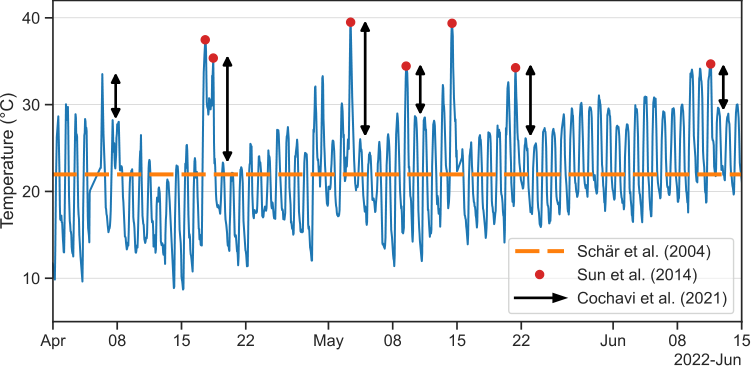
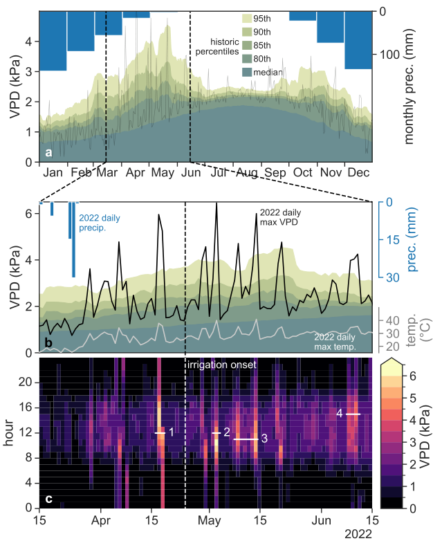
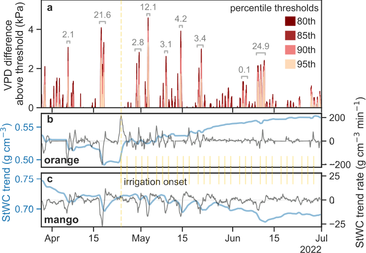
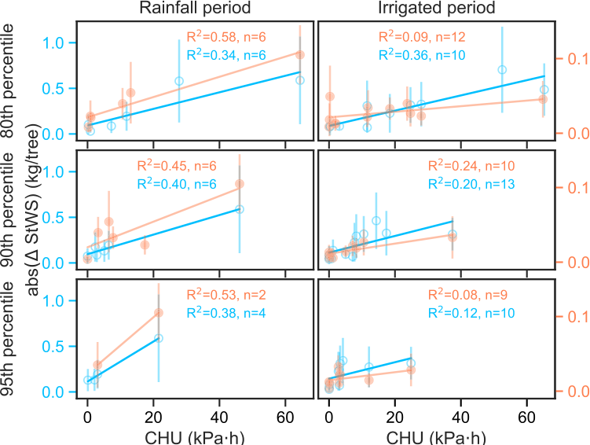
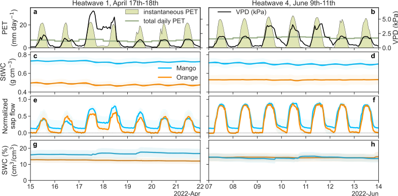

::: {.paper-authors}
Laura Rez^a^, Justine E.C. Missik^b^, Gil Bohrer^b^, Yair Mau^a,\*^
:::

::: {.paper-affil}
^a^ Institute of Environmental Sciences, The Robert H. Smith Faculty of Agriculture, Food and Environment, The Hebrew University of Jerusalem, Rehovot 7610001, Israel &nbsp;&middot;&nbsp; ^b^ Department of Civil, Environmental and Geodetic Engineering, The Ohio State University, Columbus 43210, OH, USA
:::

---

::: {.paper-meta}
Agricultural and Forest Meteorology 387, 111278 &middot; 2026 &middot; doi: [10.1016/j.agrformet.2026.111278](https://doi.org/10.1016/j.agrformet.2026.111278)

Received 9 February 2026; revised 21 April 2026; accepted 26 May 2026

Correspondence: Yair Mau (yair.mau@mail.huji.ac.il)
:::

> **How to cite:** Rez, L., Missik, J.E.C., Bohrer, G. and Mau, Y. (2026). Stem water content is crucial to support fruit tree functioning during heatwaves in a Mediterranean climate. Agricultural and Forest Meteorology, 387, 111278. https://doi.org/10.1016/j.agrformet.2026.111278

---

**Keywords:** Heatwave, Stem water storage, VPD, Variability, Extreme event

#### Abstract

Droughts are expected to intensify in the Mediterranean region due to climate change, yet their effects on local trees remain largely unknown. To study the effect of heatwaves in irrigated orchards, where soil drought can be mitigated, we propose a heatwave definition that focuses on atmospheric stress and its consequences by relating the intensity of high VPD events to losses in tree stem-water storage (StWS). Unlike common threshold-based heatwave definitions, this approach combines sub-daily VPD percentiles with a physiological filter based on declines in stem water content, ensuring that identified events are both meteorologically extreme and relevant to the tree. We show that the sensitivity and resilience of StWS to heatwaves are species specific and differ between contrasting water-management strategies (isohydric orange versus anisohydric mango). Navel orange trees were sensitive to heatwaves starting at the 80th VPD percentile in early spring. After irrigation began, stem water content (StWC) increased slightly over the dry season, despite harsh Mediterranean temperatures. In contrast, Shelly mango trees showed a net seasonal reduction in StWC, accompanied by an increase in heatwave sensitivity from the 90th to the 80th percentile. Across events, absolute StWS losses increased with the Cumulative Heatwave Unit (CHU), a metric that integrates the intensity and duration of statistically high VPD, with a much steeper slope in mango than in orange. Using CHU to quantify heatwaves allowed us to characterize each species' sensitivity according to event rarity and their resilience over key seasons. Although our experiment was performed in a Mediterranean climate, hotter droughts are rising globally, and the framework developed here for quantifying and measuring heatwave effects can be broadly applied across geographic locations.

## 1. Introduction

Climate change is intensifying the global water cycle ([Christian et al., 2021](#ref-christian2021); [Huntington, 2006](#ref-huntington2006)), driving more frequent and severe droughts ([Yuan et al., 2019](#ref-yuan2019); [Rauscher et al., 2008](#ref-rauscher2008); [Sung et al., 2023](#ref-sung2023)). This trend, documented from Asia to the Americas, includes a rising recurrence of dry heatwaves whose impacts on trees — across both natural and managed landscapes — remain poorly understood. In the Mediterranean region, a lengthening dry season, more intense heatwaves, and increasing pest pressure are already pushing forests toward shrub- and grass-dominated states ([Lloret and Batllori, 2021](#ref-lloret2021)), with projections indicating continued decline this century ([Hammond et al., 2022](#ref-hammond2022)). Even irrigated Mediterranean orchards are vulnerable: heatwaves, often driven by high vapor pressure deficit (VPD), can compromise tree water status, productivity, and fruit quality in both long-established species and recently introduced tropical cultivars ([Quiller et al., 2017](#ref-quiller2017); [De Ollas et al., 2019](#ref-deollas2019); [Fraga et al., 2020](#ref-fraga2020); [Lorite et al., 2020](#ref-lorite2020); [Scuderi et al., 2022](#ref-scuderi2022)). Although many cultivars show drought tolerance under deficit irrigation — sustaining yield despite reduced water supply ([García-Tejero et al., 2011](#ref-garciatejero2011); [Panigrahi et al., 2014](#ref-panigrahi2014); [Pleguezuelo et al., 2018](#ref-pleguezuelo2018)) — their response to intensifying atmospheric drought, especially under temperatures exceeding 40°C, remains unknown.

To study tree sensitivity to dry heatwaves, we follow [Smith (2011)](#ref-smith2011) in tying an extreme weather event (EWE) to statistical rarity in both the driver and the response—here, the response being a distinct physiological change in the tree. In our context, an appropriate heatwave definition must therefore capture rare values of the relevant atmospheric drivers (e.g., temperature or VPD) alongside the corresponding rare physiological responses in the tree (e.g., reductions in water status or productivity). This distinction enables a statistically grounded and physiologically meaningful heatwave definition for tree studies. Yet EWE definitions have historically varied widely across studies, often relying on arbitrary or inconsistent thresholds and lacking statistical significance ([De Boeck et al., 2010](#ref-deboeck2010); [Slette et al., 2019](#ref-slette2019)).

While a heatwave definition tied to both driver and response may not yet exist, the underlying phenomena and their physiological impacts have been well documented. Heatwaves influence tree productivity, xylem conductivity, internal water storage, and overall water-use efficiency ([Teskey et al., 2015](#ref-teskey2015); [Tatarinov et al., 2016](#ref-tatarinov2016); [Urban et al., 2017](#ref-urban2017); [Birami et al., 2018](#ref-birami2018); [Drake et al., 2018](#ref-drake2018); [Salomón et al., 2022](#ref-salomon2022); [Neuwirth et al., 2021](#ref-neuwirth2021)).

In central Israel's Mediterranean climate, dry heatwaves occur year-round but are most frequent during the six-month dry season from spring through autumn ([Shachak et al., 1998](#ref-shachak1998); [Qin et al., 2006](#ref-qin2006)). These events are often characterized by short-duration (1–3 days), high-intensity synoptic conditions known locally as *sharav* or *hamsin*. Despite their brevity, these VPD-driven heatwaves exert significant physiological stress on both natural and agricultural systems ([Tatarinov et al., 2016](#ref-tatarinov2016); [Lazare et al., 2022](#ref-lazare2022)). Standard meteorological definitions, which often require five or more consecutive days of extreme temperature, risk overlooking these shorter but impactful events. Recent work in this region shows that trees prevent potentially lethal drops in leaf-water potential by buffering early-morning to afternoon transpiration with internal water storage — drawn from both foliage and stem — which responds rapidly to rising VPD ([Preisler et al., 2022](#ref-preisler2022)).

Stem water storage (StWS) likely plays a central buffering role—stems contain most of a tree's internal water reserves ([Köcher et al., 2013](#ref-kocher2013); [Waring and Running, 1978](#ref-waring1978)) and thus directly reflect transpiration stress during high-VPD heatwaves ([Merilo et al., 2018](#ref-merilo2018)). However, current heatwave definitions limit our ability to quantify this relationship. Most existing approaches classify heatwaves as binary events when a climate driver exceeds a fixed threshold ([Schär et al., 2004](#ref-schar2004); [Urban et al., 2017](#ref-urban2017); [Drake et al., 2018](#ref-drake2018); [Sun et al., 2014](#ref-sun2014); [Cochavi et al., 2021](#ref-cochavi2021)), while others that include a rolling statistical approach become less meaningful when applied to regions, such as the Mediterranean, with highly variable climate spanning longer than the rolling window ([Perkins and Alexander, 2013](#ref-perkins2013)). Fig. 1 illustrates three such absolute-threshold methods. In contrast to these binary definitions, treating heatwave magnitude as a continuous variable allows us to relate incremental changes in StWS to heatwave intensity, thereby characterizing a tree's sensitivity and resilience across the full spectrum of extreme weather events. These limitations motivate a framework that links atmospheric extremity to the magnitude of the physiological response.

In this study, we first derive a theoretical relationship between VPD-driven heatwaves — defined here as periods of statistically high VPD, hereafter "heatwaves" — and the associated changes in stem-water storage (StWS). We specifically characterize these events as "dry" because VPD integrates both air temperature and relative humidity, capturing the combined atmospheric drivers of water stress more effectively than temperature alone. While high temperatures can independently impose physiological stress ([Still et al., 2023](#ref-still2023)), VPD directly dictates the atmospheric demand for water, making it the primary driver of the tree water budget in this context. Consequently, we quantify heatwave magnitude as the product of intensity (VPD above a chosen percentile threshold) and duration, yielding a new metric: the Cumulative Heatwave Unit (CHU, in kilopascal hours). We hypothesize that CHU is proportional to the StWS depletion induced by the heatwave beyond the typical diurnal baseline. Finally, we test this framework using continuous meteorological and StWS measurements from two co-located species with contrasting water-use strategies: the relatively isohydric, region-adapted Navel orange, and the relatively anisohydric, recently introduced Shelly mango.

**Fig. 1 | Absolute-threshold heatwave definitions applied to air temperature at the research site during the study period.** Each styling corresponds to a distinct literature-based definition of a heatwave. The dashed orange line marks the mean air temperature over the period; exceeding this mean by a specified number of degrees Celsius constitutes a heatwave ([Schär et al., 2004](#ref-schar2004)). Red circles indicate days when maximum daily temperature surpasses a fixed threshold of 35°C ([Sun et al., 2014](#ref-sun2014)). Black arrows mark instances where the day-to-day decrease in air temperature exceeds 5°C (after an initial day-to-day increase of at least 1.0 kPa) ([Cochavi et al., 2021](#ref-cochavi2021)).

## 2. Materials and methods

### 2.1. Research site

The study was conducted at the Joseph Marguleas Experimental and Demonstration Farm of the Hebrew University's Faculty of Agriculture, Food and Environment in Rehovot, Israel (34.795361 N, 31.904139 E). Our measurement period ran from 22 March to 30 June 2022, covering the transition from the rain-fed spring to the onset of the dry season; irrigation commenced on 26 April. The 2021–2022 wet season delivered approximately 602 mm of precipitation, compared to a historical mean of 473 ± 198 mm.

Sixteen trees per species were selected from the inner rows of two adjacent orchards: a 10-year-old Navel orange orchard and a 15-year-old Shelly mango orchard. Trees were chosen based on external appearance and internal health assessments: core samples were examined for disease, and individuals with multiple stems or trunk diameters below 10 cm (orange) or 30 cm (mango) were excluded. No other experiments were conducted on these trees or in the surrounding orchard, which serves primarily as a farm income source. Orange trees were spaced at 4 × 4 m (≈62 trees dunam^−1^) and mango trees at 6 × 6 m (≈27 trees dunam^−1^), each irrigated by drip lines (1.6 L h^−1^) from mid-spring to late autumn in 2–3 doses per week, following Ministry of Agriculture guidelines: 80, 95, 105 m³ dunam^−1^ in orange trees and 90, 100, 120 m³ dunam^−1^ in mango trees in April, May, and June, respectively. Soil moisture never fell below recommended levels, and no deficit irrigation was applied. The orchards grow on a gently east-sloping (≈2%) red loamy Hamra soil, with the mango orchard benefiting from a decade of annual tree-clipping compost additions that have darkened the topsoil.

Both orchards share a similar start to their respective phenological cycles. The Navel orange trees typically advance from flowering to fruit-set between March and May, with harvest in January–February of the following year, which is similar to the cycle in the sweet orange varieties in [Pons et al. (2012)](#ref-pons2012) (under similar Mediterranean-climate conditions). Shelly mango also advances from flowering to fruit set approximately within the same months as the Navel orange, but with harvest occurring between August–October of the same year; its phenological cycle is similar to that of the locally studied Keitt variety ([Levin et al., 2013](#ref-levin2013)). See the figure in Supplementary Information S1 for the status of fruit-set in both orchards in May 2022.

### 2.2. Tree and soil sensors

Prior to sensor installation, core samples were taken from candidate trees to screen for disease and to characterize cross-sectional hydraulic architecture. All selected trees were healthy, and sensors were placed in regions estimated to contain active xylem and sapwood. In each orchard, we installed East-30 two-directional sap flow sensors (Pullman, WA, USA) on 16 trees, positioning them at approximately 30 cm above ground and below the first branch junction. The sensors have a 35 mm needle length with an innermost thermistor at 25 mm, which has been demonstrated to account for roughly 80% of the total sap flow gradient across the radius of tree stems ([Cohen et al., 2008](#ref-cohen2008)), though there is still some azimuthal variability ([Cohen et al., 2011](#ref-cohen2011)). For this reason and to prevent temperature effects, all sensors were installed on the north-facing side of the stems.

Eight of the 16 trees in each orchard were additionally instrumented with Teros-12 dielectric sensors (Meter Group, Pullman, WA, USA) adapted for stem measurements to quantify stem-water content (StWC). Following [Matheny et al. (2017)](#ref-matheny2017), we collected approximately a dozen stem samples per species to derive species-specific calibration curves relating StWC to raw electrical potential (see Supplementary Information S2 for details). All sensors were mounted on the north-facing side of each tree, offset from the sap-flow sensors, and shielded with two layers of reflective insulation to block direct solar radiation and prevent sensor heating.

Nine soil-moisture sensors (Acclima TDR-315H, Meridian, ID, USA) were installed in each orchard, with three sensors placed in three rows at three distinct depths. Based on an initial excavation, root density in the orange orchard was similar to depths reported by [Wagner et al. (2021)](#ref-wagner2021) and [Cohen and Cohen (1983)](#ref-cohen1983), with the highest density in the upper 30 cm. Accordingly, the three chosen depths for the orange orchard were 20, 40, and 80 cm. Mango trees, in contrast, possess fewer superficial fine roots and a deeper taproot system with lateral extensions. Our excavation results were consistent with [Santos et al. (2014)](#ref-santos2014), which reported root density distributed between 30 and 90 cm depth, so sensors were placed at 30, 60, and 90 cm. Because of excavation constraints using a Little Beaver auger, sensors were installed 1.6 m (orange) and 1.4 m (mango) from the trunk, but still under the canopy and within the active root zone. Soil-water content was monitored at all depths to verify that no deficits occurred. Sensor readings were recorded every two minutes and wirelessly transmitted in 30-minute batches to our server.

### 2.3. Meteorological data

We deployed a meteorological station on a 3 m tower within the Navel orange orchard to record air temperature and relative humidity (HMP155, Vaisala, Vantaa, Finland), incoming and outgoing shortwave and longwave radiation (NR01, Hukseflux, Delft, The Netherlands), and photosynthetically active radiation (RY-GH, Hebei, China). A second station on a 2 m tower in the adjacent mango orchard recorded air temperature and relative humidity (HMP155, Vaisala, Vantaa, Finland).

For historical context, we obtained 3-hourly and daily air-temperature and relative-humidity data from the Israel Meteorological Service station in Beit Dagan (Station 2520; approximately 10 km from the study site; [IMS, 2024](#ref-ims2024)), filling minor gaps with data from Station 2523 in the same city. Seventy years of daily precipitation data were also sourced from Station 2520. During our study period, daily precipitation records from October 2021 to January 2022 were obtained from Station 2520, whereas sub-hourly precipitation data from January to April 2022 were provided by an on-farm monitoring station.

### 2.4. Data analysis

#### 2.4.1. Calculating VPD percentile thresholds

As the first step in our data processing, we characterized extreme VPD events as those exceeding historically and statistically high VPD values. We began by calculating VPD from 3-hourly historical temperature and relative-humidity records (1964–2020) using the Pynotes in Agriscience VPD function ([Patrignani, 2020](#ref-patrignani2020)). These 3-hourly VPD values were then aggregated into daily medians — rather than means — because VPD is not normally distributed. Next, we grouped the daily median values by day of year (pooling all years) and applied a 14-day rolling window to capture seasonal variability. Within this window, we computed the 50th (median), 80th, 85th, 90th, and 95th VPD percentiles. Fig. 2, panel a, shows historic monthly rainfall averages alongside the computed VPD percentiles. Panel b focuses on spring 2022, overlaying daily maximum VPD on those historic percentiles, while panel c presents an hourly VPD heatmap for the same period.

#### 2.4.2. Smoothing

We applied SciPy's Savitzky–Golay filter ([Virtanen et al., 2020](#ref-virtanen2020)) to smooth all time series. Unlike simple moving averages, which blunt peaks and fill valleys, the Savitzky–Golay approach fits a local polynomial to each window. This approach preserves sharp transitions and fine-scale dynamics while reducing high-frequency noise.

#### 2.4.3. Daily trend and its derivative

We used the seasonal-decompose tool from Python's statsmodels package ([Seabold and Perktold, 2010](#ref-seabold2010)) to separate stem-water-content (StWC) signals into trend, seasonal, and residual components. This decomposition isolates the underlying daily trend in StWC—removing expected diurnal fluctuations (seasonality) and high-frequency noise (residuals). The trend component is computed via a one-day running-average window, representing net StWC changes independent of short-term buffering. To obtain the rate of change of this trend, we applied a Savitzky–Golay filter (second-degree polynomial) over the same window, yielding a smoothed linear estimate of the daily derivative.

**Fig. 2 | VPD is widely variable in spring and fall, while median VPD is greatest in summer but with less than half the spread.** Panel a: Historic monthly precipitation averages (blue) highlight Mediterranean seasonality, and historic VPD percentiles (green shading) reveal a bimodal pattern of VPD variability. Daily maximum VPD for 2022 for the Bet Dagan Station 2520 is shown with a thin gray line. Panel b: Daily precipitation (blue bars) and daily maximum VPD (black line) for spring 2022 are overlaid on the historic percentiles, with daily maximum air temperature (gray line) below for profile comparison. Panel c: Hourly VPD for the same period is shown as a heatmap; the four white-outlined intervals mark heatwave candidates where hourly VPD exceeds specified historic percentile thresholds. Events 1 and 2 are short 95th-percentile events, with event 1 remaining high overnight and event 2 reaching the highest VPD of the study period. Event 3 is the longest event, an eight-day heatwave at the 80th percentile, and event 4 is the longest 95th-percentile event (three days). The dashed vertical line in panels b and c indicates the first day of irrigation.

### 2.5. Quantifying the stem water storage and the cumulative heat unit

To obtain the mass of stem-water storage (StWS) in each tree, we first calculated the sapwood area $A_{sw}$ [cm²] for each individual. Assuming circular cross sections, the sapwood area is the area of a ring whose outer radius is $D/2$ and its inner radius $D/2 - h$, where $D$ is the stem diameter [cm] and $h$ is the sapwood thickness [cm], yielding $A_{sw} = \pi(Dh - h^2)$. Sapwood thickness was determined from core samples and represents the mean depth of active xylem for each species. Based on these measurements, thickness was approximated as 2 cm in Navel orange trees and 6 cm in Shelly mango trees.

To calculate StWS [g], StWC [g cm^−3^] was multiplied by the tree's sapwood volume, yielding

$$
\text{StWS} = \text{StWC} \cdot A_{sw} \cdot H, \tag{1}
$$

where $H$ [cm] is the stem height. The stems were less than 1.5 m in height before branching (with a canopy height of approximately three meters), resulting in a conservative estimation of sapwood water loss.

The Cumulative Heatwave Unit (CHU, [kPa h]) for a single event was calculated as

$$
CHU = \int_{t_0}^{t_{\text{final}}} \text{VPD}^{\text{above}}_t \, dt, \tag{2a}
$$

$$
= \sum_{t=t_0}^{t_{\text{final}}} \text{VPD}^{\text{above}}_t \times 2\,[\text{min}] \times \frac{1}{60}\left[\frac{\text{min}}{\text{h}}\right]. \tag{2b}
$$

The integral expression in (2a) is the general definition of CHU, giving the area of VPD above a given threshold (VPD^above^~t~) between $t_0$ and $t_{\text{final}}$. The expression in (2b) shows the discrete version we applied to our time series, where all measurements come in a 2-minute frequency, and the factor 1/60 converts minutes to hours. The quantity VPD^above^~t~ can be seen in Fig. 2b, where the black line denoting VPD surpasses a given VPD percentile threshold. In reality, the VPD above threshold is computed using hourly VPD values (see Fig. 2c), and we chose to plot daily maximum values in panel b to enhance the graph's readability.

### 2.6. Derivation of relationship between StWS and CHU

We start with the common relationship between transpiration $E$ [mmol m^−2^ s^−1^] and VPD [kPa],

$$
E = \frac{g_c \cdot \text{VPD}}{P}, \tag{3}
$$

where $g_c$ [mmol m^−2^ s^−1^] is the canopy conductance, and $P$ [kPa] is atmospheric pressure. $g_c$ can be approximated to vary linearly (slope provided by coefficient, $a_1$) with whole-plant leaf-specific hydraulic conductivity $K_L$ [mmol m^−2^ s^−1^ MPa^−1^] ([Hubbard et al., 2001](#ref-hubbard2001)) as

$$
g_c = a_1 K_L. \tag{4}
$$

By substituting Eq. (4) into (3), integrating over time, expanding the volume of transpired water into a linear combination of water donated from storage pools (mainly stem and roots), and linking the use of these pools to various VPD conditions, we were able to obtain the following relationship for a change in StWS driven by statistically high VPD (VPD above percentile threshold):

$$
|\Delta \text{StWS}| = a_1 \cdot K_L \int \text{VPD}^{\text{above}}_t \, dt. \tag{5}
$$

We show the full derivation in section S3 of Supplementary Information.

The magnitude of the heatwave can be quantified by the final term in the previous equation, identified in Eq. (2a) as CHU, and it incorporates both the intensity and duration of the extreme VPD event. Finally, we find the relationship between the absolute changes in stem water content and the heatwave magnitude:

$$
|\Delta \text{StWS}| = a_1 \cdot K_L \cdot CHU. \tag{6}
$$

### 2.7. Defining a heatwave

To define a heatwave in physiological terms, we related periods of high VPD (above percentile thresholds) to the corresponding changes in the trend and trend-derivative of stem-water content (StWC) in each species. A statistically based heatwave definition could alternatively be constructed using air temperature rather than VPD, but temperature-based thresholds were not used in this study. Fig. 3 shows VPD exceeding these percentiles (panel a) and the dynamics of trend StWC and its derivative for both orange and mango trees (panels b and c) over a three-month period. Both species exhibit reductions in trend StWC (thick solid blue lines) when VPD reaches or exceeds the 80th percentile. When the trend in StWC declines, its rate of change is negative (thin gray lines). Trend in StWC has a delayed recharge (tied to physical conductivity ([Ewers and Cruziat, 1990](#ref-ewers1990)) and the lag between sap flow and transpiration ([Preisler et al., 2022](#ref-preisler2022)), however, the negative rate quickly returns to zero or becomes positive once the event is over. Based on this consistent pattern in both species, we defined heatwave events as periods during which VPD exceeded the percentile thresholds and the derivative of trend StWC was simultaneously negative. The total reduction in StWC during a heatwave event was calculated as the difference between the maximum and minimum values of the trend StWC, analogous to the maximum daily stem shrinkage described by [Dietrich et al. (2018)](#ref-dietrich2018) but applied to multi-day events. Analysis revealed a clear shift in stem-water regulation between the rainfall period and the subsequent irrigation period in both species (see Results), leading us to quantify the relationship between StWS and CHU separately for these two distinct hydrological phases.

Occasionally, the StWC trend derivative becomes negative even in the absence of a heatwave event. This can occur when changes in StWC are not driven by transpiration ([Preisler et al., 2022](#ref-preisler2022)), or when the fluctuations in StWC only slightly exceed typical diurnal variability. In these cases, the associated change in trend StWC is minimal.

## 3. Results

### 3.1. Climate and variability

The 2021 wet season (October 2021–April 2022) received 602 mm of precipitation, which falls within historical norms (474 ± 198 mm). Winter air temperatures were likewise typical for the region, with only a few days exceeding long-term averages. Fig. 2a shows historic monthly rainfall averages together with the computed historic VPD percentiles. Panel b focuses on spring 2022, overlaying daily maximum VPD on those historic percentiles, while panel c displays a heatmap of hourly VPD for the same period.

Within the study period, although there were numerous days with very high temperature and VPD (see Figs. 1 and 2c), none were record-breaking. Overall, the mean climate during both the study period and the preceding wet season can be considered typical for the region.

To quantify a heatwave in CHU, we first calculated the magnitude of daily variability in VPD for four high percentile thresholds: the 80th, 85th, 90th, and 95th percentiles. The results are summarized in Fig. 2a, see green shading. Variability in VPD is highest in spring (interquartile range, IQR = 0.65 kPa) and fall (IQR = 0.59 kPa), while the median is relatively low but rising in spring. In summer, median daily VPD is greater than throughout the rest of the year (>1.5 kPa), yet there is far less variability (IQR = 0.28 kPa). In other words, VPD in spring is more than twice as scattered as VPD in summer, which historically has a record peak of 3.88 kPa versus 6.71 kPa in spring. In the Eastern Mediterranean climate, this arises from consistently high and converging daily maximum and minimum temperatures in summer, together with relatively constant daily humidity, which produces a narrow range of summer daily VPD values. This pattern in VPD percentile scatter is similar to the temporal pattern of recorded *hamsin* events in the same region found by [Tatarinov et al. (2016)](#ref-tatarinov2016).

We conducted a preliminary check for heatwaves during the study period by applying the range of definitions listed in Table 1. When statistical variability (one standard deviation in air temperature) was included, none of the candidate definitions produced any heatwave events. When variability was excluded, as in the original formulations of these definitions, the resulting heatwaves were identified and are shown in Table 1, where applicable.

**Table 1 | Heatwave definitions spanning a variety of formulations and their occurrences during the study period.** The definitions by [Schär et al. (2004)](#ref-schar2004), [Sun et al. (2014)](#ref-sun2014), and [Cochavi et al. (2021)](#ref-cochavi2021) were developed for Europe, China, and the Mediterranean, respectively, whereas the World Meteorological Organization (WMO) definition is global. Respective heatwaves in the study period are shown in Fig. 1.

| Source | Heatwave definition | Dates (DD/MM) in 2022 study period |
|---|---|---|
| Schär et al. (2004) | Mean summer (June–August) temperature ≥3°C above the historical mean. | None. [historical: 25.5°C, 2022: 27.5°C] |
| Sun et al. (2014) | Daily maximum temperature ≥35°C. | 17–18/04, 03/05, 14/05, 21/05, 11/06 |
| [World Meteorological Organization (WMO) (2022)](#ref-wmo2022) | At least five days with a sustained daily maximum temperature >5°C above the historical daily maximum temperature. | None. Longest event only three days. |
| Cochavi et al. (2021) | Beginning: daily VPD average >0.8 kPa above previous day. End: daily VPD average >1.0 kPa and daily temperature average >5°C above the following day. | 28/03–01/04, 17–19/04, 02–04/05, 09–10/05, 20–22/05, 09–12/06 |

### 3.2. Characterizing heatwave intensity and duration at sub-daily resolution

The intensity and duration of VPD at a fine (sub-daily) timescale were found to be highly relevant for describing a heatwave, in contrast to common daily-maximum methods. Fig. 2 shows VPD values between 15 March and 15 June 2022, where panel 2b gives daily VPD maxima and panel 2c gives a heatmap of hourly VPD averages. Maximum daily VPD reaches numerous peaks above 4 kPa, signifying values greater than the 95th percentile in spring.

We found that the intensity and duration of statistically rare VPD events can vary greatly both between events of the same percentile (intra-percentile events) and between events at different percentiles (inter-percentile events). For example, the most intense VPD event in the study period (event 2 in Fig. 2c) reached a maximum daily VPD of 6.46 kPa and remained above the 95th percentile for 6 h, while event 1 reached a lower peak VPD of 5.96 kPa but remained above the 95th percentile for 12 h, with significantly high nighttime VPD. Both events 1 and 2 contrast with event 4, which remained above the 95th percentile for 33 h during a three-day event, but only reached a peak VPD of 4.10 kPa. Each of these events (1, 2, and 4) can be categorized together as intra-percentile events due to the shared rarity of their VPD intensity (95th percentile).

When comparing inter-percentile events, we found that the duration of high VPD becomes even more significant, as events in lower percentiles tended to persist longer. Event 3, which reached a maximum VPD of 5.43 kPa (remaining above the 95th percentile for only 6 h on two non-consecutive days), surpassed the 80th percentile for 71 h over eight days. Since intensity and duration of a climate driver commonly carry equal weight in heatwave definitions, it is evident from this analysis that sub-daily percentile-based quantification better characterizes events by capturing changing dynamics between these factors across intra- and inter-percentile events. Moreover, because there are notable differences in intensity and duration among inter-percentile events, there is scope to assess at which percentile threshold events have the most significant effect on each tree species.

### 3.3. Change in StWS and CHU, and net change in StWC

CHU and |Δ StWS| were calculated according to Sections 2.5 and 2.7, respectively. A more intuitive depiction of these calculations is shown in Fig. 3. Panel a shows the VPD that exceeds each of the percentiles, where CHU can be understood as the shaded area for each event. As an illustration of this, see the annotations in gray, denoting the CHU values (kPa·h) of some of the events that surpassed the 95th percentile, which are proportional to the area of lightest shade during the bracketed periods. Panels b and c show the StWC trend (in blue) and its time derivative (gray) for each of the tree species. |Δ StWS| is simply the net reduction in StWC during an event, accounting for tree diameter and height. The vertical yellow lines between panels b and c denote irrigation days, to provide context for the dynamics of StWC and its derivative.

**Fig. 3 | VPD above high percentile thresholds is associated with reductions in trend StWC in both species, particularly in Navel orange trees during the rainfall period.** Panel a: Δ VPD above percentile thresholds (80th, 85th, 90th, and 95th). The annotated brackets in gray indicate CHU values (kPa·h) for events that surpassed the 95th percentile. Panels b and c: trend StWC (light blue, g cm^−3^) and its derivative (gray, g cm^−3^ min^−1^) for Navel orange and Shelly mango trees. Vertical yellow lines between panels b and c indicate irrigation days.

Three percentile thresholds were used to compute CHU: 80th, 90th, and 95th (the 80th and 85th percentiles were very similar). Fig. 4 shows the relationship observed between |Δ StWS| and CHU for each percentile threshold, split into rainfall and irrigated periods (before and after irrigation onset), and all dates, CHU values and related changes in StWS for each orchard is reported in S4 of the Supplementary Information.

Some notes about the dynamics of CHU are in order. First, CHU does not necessarily increase with percentile threshold. This can be explained by (1) VPD^above^~t~ (Section 2.5) and the measured VPD not being strictly coupled, and (2) VPD events at higher percentile thresholds tending to be shorter in duration than events of lower intensity (see Fig. 2c). Second, CHU magnitude is species dependent, since it is based on the co-occurrence of high VPD with a negative StWC trend rate (which itself is species dependent). As a result, the number of events ($n$) is also species dependent and does not necessarily increase or decrease monotonically with percentile. This can be seen, for example, in mango trees, where the largest number of events in the irrigated period occurs at the 90th percentile (n = 13). No significant difference was found between heatwave events at the 80th and 90th percentiles ($p = 0.277$), while the response by period and between species was significant ($p = 0.051$ and $p < 10^{-3}$, respectively). The slope of the StWS response to heatwaves in orange trees was much lower than the response in mango trees (0.003 and 0.115, respectively; statistics are summarized in S4. Note that in Fig. 4 each species has its own vertical scale; had we chosen the same for both, the orange lines would look horizontal, due to the slope disparity.) Therefore, the best relationship between |Δ StWS| and CHU for a given species and period was defined as the one with the greatest significance according to $R^2$ and $n$. For each relationship, the level of agreement *ag* between Δ VPD and negative StWC trend rate (see Section 2.7) is also given (explained in Section S5 of the Supplementary Information). It should be emphasized that these are observed relationships and their predictive strengths have not been tested.

**Fig. 4 | Change in StWS [kg tree^−1^] as a function of CHU [kPa h] in orange and mango trees (colored orange and blue, respectively).** Plots are organized in columns according to rainfall and irrigated periods, and in rows by percentile thresholds (80th, 90th, and 95th).

In orange trees during the rain-fed period, the best-fit relationship between |Δ StWS| and CHU occurs at the 80th percentile ($R^2 = 0.58$, $n = 6$; *ag* = 64.7%), whereas no statistically significant relationship exists in the irrigated period ($R^2 < 0.25$). For mango trees, the relationship between |Δ StWS| and CHU is best described by events at the 90th percentile ($R^2 = 0.40$, $n = 6$; *ag* = 98.5%) in the rain-fed period and at the 80th percentile ($R^2 = 0.36$, $n = 10$; *ag* = 88.7%) in the irrigated period. We expect the statistical significance of VPD events by percentile to improve in experiments with longer study periods, where more events can be captured by season, since the relatively low number of events and input variables to the simple regression and mixed linear model likely affects the output.

Regarding change in StWS as a result of heatwaves, there was a peak mean loss in StWS of 105 g (STD = 36.7 g; CHU = 64.4 kPa h) per orange tree on 17–18 April (see Fig. 3b). This amount is reasonable, considering the peak total daily water uptake reported by [Mishra et al. (2021)](#ref-mishra2021) for 5- and 15-year-old orange trees (1.1 to 5.0 kg day^−1^), given that more than 95% of this uptake is lost daily to transpiration ([McElrone et al., 2013](#ref-mcelrone2013)). For a 10-year-old tree, the remaining portion of uptake, which normally contributes to cell expansion and growth ([McElrone et al., 2013](#ref-mcelrone2013)), would, with the given parameters, equate to a mean 150 g day^−1^. In mango trees, the same event in the rainfall period (17–18 April, Fig. 3c) resulted in a mean loss of 588 g StWS (STD = 439 g; CHU = 46.1 kPa h), whereas the period-peak mean loss of 703 g StWS tree^−1^ (STD = 431 g; CHU = 52.5 kPa h) occurred in the irrigation period. These amounts are comparable to an estimated 830 g day^−1^ of water up-taken but not transpired in 11-year-old *Palmer* mango (which has a similar sapwood area to Shelly mango), based on the measured 16.6 kg day^−1^ of water transported in sap flow on bright sunny days ([Oguntunde et al., 2011](#ref-oguntunde2011)). Given these peak losses, it appears that a heatwave of roughly 50–65 kPa h will consume nearly the entire daily water uptake of a well-watered tree, based on the relative percentile in orange and mango trees.

We found that this "price" — nearly the entire daily water uptake being transpired, leaving little to no water for stem storage replenishment — varied by species. Orange trees, which began the study period with a peak StWC of 0.55 g cm^−3^, were most sensitive to heatwaves in early spring, during which time StWS was not immediately replenished after a heatwave. This changed in May, as daily temperatures continued to rise and likely regulated stomatal conductance and transpiration, resulting in a portion of the daily uptake being allocated to replenish StWS; by the end of the study period, StWC slightly exceeded its initial density (reaching 0.57 g cm^−3^; Fig. 3). In mango trees, however, the trend in StWC decreased over the study period from 0.75 g cm^−3^ to 0.69 g cm^−3^ (Fig. 3). In total, given the spacing of orange and mango trees as 62 and 27 trees dunam^−1^, respectively, and the mean tree StWS loss for each event in the best-fit periods, the extra water demand from all heatwaves in this study period was 15.5 L dunam^−1^ in orange trees and 106.4 L dunam^−1^ in mango trees.

These differing responses between species can also be seen in measurements of their respective diurnal sap flow during a heatwave. This is shown in Fig. 5, which focuses on heatwaves number 1 and 4. Panels a and b show instantaneous and total daily Potential Evapotranspiration (PET, shaded green and solid green line), together with VPD (black). During the heatwaves, VPD sustained high values during nighttime, but PET registered only small increases, because of solar radiation's much greater importance than VPD in its computation. Panels c and d show the dynamics of StWC for both tree species, where the thick lines accentuate the daily fluctuations, and the thin lines represent StWC trend. We found that the more negative StWC trend rate in orange than in mango trees (Fig. 3) is consistent with the more negative "depletion rate" reported in isohydric relative to anisohydric species ([Dietrich et al., 2018](#ref-dietrich2018)). Because of the higher temporal resolution, the same drops in StWC seen in Figs. 3b,c now look less pronounced. Sap flow dynamics, shown in panels e and f tell an interesting story, that corroborates our assessment that stem water storage is used to maintain transpiration during heatwaves. Sap flow in orange trees reached a midday plateau on the 17 April heatwave (likely associated with reduced stomatal conductance ([Ortuno et al., 2006](#ref-ortuno2006))), whereas sap flow in mango trees increased to a pronounced midday peak (likely due to continued transpiration ([Lu and Chacko, 1996](#ref-lu1996))). Both orange and mango trees register higher nighttime sap flow during heatwave 1 (panel e), compared with the days that precede and follow it. The internal water reserves, being partially depleted during the heatwave, need extra time for recharging. During heatwave 4 (panel f), enhanced nighttime sapflow is enough to prevent StWC from going down for orange, but not for mango. Analysis of soil water content (SWC) dynamics (panels g and h) did not show a clear picture. Our initial expectation, before the experiment was conducted, was to find signs of root water uptake in the SWC signal, but the measurements show approximately constant values over time.

**Fig. 5 | Direct response in StWC and sap flow to increased transpiration demand.** Panels a,b: Potential evapotranspiration (PET, both instantaneous and total daily, calculated following [Allen et al. (1998)](#ref-allen1998) and [Vremec and Collenteur (2021)](#ref-vremec2021)), together with VPD, for heatwaves 1 and 4 (according to the numbering in Fig. 2c). Panels c,d: StWC decreases for both species during heatwave 1 (before irrigation onset), but much less during heatwave 4. Panels e,f: sap flow increases, especially overnight, in both species during high transpiration demand. Thick lines indicate averages, while shaded regions denote the standard deviation of mean volumetric sap flow, calculated by integrating the outermost and middle thermistor measurements over the estimated sapwood area (see Section 2.5) for each tree. Panels g,h: Soil water content (SWC) averaged over all depths stays relatively constant over the study periods where irrigation had already been introduced.

## 4. Discussion

### 4.1. Change in StWS in a heatwave

In the Mediterranean climate, StWS is known to help buffer morning-to-midday transpiration demand in the time before water uptake from the soil can reach the canopy ([Preisler et al., 2022](#ref-preisler2022)). Here, we have demonstrated that beyond this diurnal flux, StWS further supports the additional transpiration demand during a heatwave (Fig. 3). This additional loss was found to be up to 105 g (STD = 36.7 g) and 703 g (STD = 431 g) per event and per tree in orange and mango trees, respectively, which is similar in value to the estimated remaining daily water uptake from the soil that is not transpired for each respective species (150 g and 830 g ([McElrone et al., 2013](#ref-mcelrone2013))) for similar cultivars ([Oguntunde et al., 2011](#ref-oguntunde2011); [Mishra et al., 2021](#ref-mishra2021)). The response in StWS was sensitive to continual high atmospheric demand, with a more gradual change as compared to sap flow, that did not respond in any direct manner to the timing of irrigation.

Some of these high VPD events were particularly significant, as they resulted in a lasting effect on the trees observed from persistent overnight sap flow to refill storage throughout the tree, and stem water content that only recovers to a similar level nearly a week after the event, if at all (Figs. 3b,c). As heat waves or heat spikes become more intense and frequent with climate change, this result suggests that a similar event occurring within the StWC recovery period — but not necessarily on a consecutive day — can continue to deplete the tree's internal water resources, thereby increasing the tree's vulnerability to water stress.

To further explore the value of the StWC measurements — obtained from a relatively recent technique in which a modified soil sensor is installed directly within the sapwood area of the stem ([Matheny et al., 2017](#ref-matheny2017)) — we estimated two values from our data and compared them to literature values. First, we compared the theoretical change in stem diameter due to water-volume reduction to the inferred shrinkage from tree water deficit ($\Delta W$) ([Zweifel et al., 2005](#ref-zweifel2005)) and maximum daily shrinkage (MDS) ([Dietrich et al., 2018](#ref-dietrich2018)) for species with similar water-management strategies under heat and high-VPD exposure. Given each study tree's stem diameter and height, as well as its respective volumetric change in StWC during a heatwave, we calculated a ballpark estimate for the theoretical mean peak change in stem diameter, resulting in 0.53 and 0.96 mm in mango and orange trees, respectively. Broadly comparing these values to studies on other anisohydric and isohydric species, we found that they were greater than shrinkage observed in trees under non-heatwave conditions (MDS = 0.075 and 0.2 mm, respectively, derived from [Hahn and García, 2022](#ref-hahn2022); [García-Tejero et al., 2012](#ref-garciatejero2012)) and more comparable to trees experiencing heat treatment or high VPD ($\Delta W$ of 0.25–1.0 and 0.3–0.4 mm for measured anisohydric and isohydric species, respectively ([Zweifel et al., 2005](#ref-zweifel2005); [Ruehr et al., 2016](#ref-ruehr2016))). Although our calculated changes in diameter are ballpark estimates, their magnitudes compare reasonably well (MDS differences of less than 1 mm) to species with similar water-management strategies, especially when under heat and VPD stress.

Second, we sought to estimate and compare stem hydraulic conductivity ($K_{\text{stem}}$) for each species, given the relationship derived in Eq. (6) between Δ StWS and CHU. According to that relationship, $K_{\text{stem}}$ should be proportional to the slopes of the regression curves (Fig. 4) by a factor $a_1$. As $a_1$ has been demonstrated to be less than 10 (within a single order of magnitude) in trees with both isohydric and anisohydric water management ([Hubbard et al., 2001](#ref-hubbard2001)), we compared the magnitudes $\log_{10} K_{\text{stem}}$ derived from our results with those from the literature (Table 3 in Appendix). Notably, $\log_{10} K_{\text{stem}}$ in Shelly mango did not change between rain and irrigated seasons and ranged between 0.92 and 1.34, aligning well with reported values for mango cultivars (0.69–1.16, [Normand et al., 2008](#ref-normand2008)). In Navel orange, $\log_{10} K_{\text{stem}}$ was only positive in the rain season, ranging from 0.13 to 0.58, whereas values for a similar cultivar in the same region were somewhat higher (1.08–1.15, [Cohen et al., 1987](#ref-cohen1987)). The estimated $\log_{10} K_{\text{stem}}$ for both cultivars in this study were within less than an order of magnitude of literature ranges, suggesting that the relationship derived in Section 2.6 relating Δ StWS and CHU is physically reasonable. Further details on this analysis are provided in the Supplementary Information S6.

### 4.2. Heatwave definition

Given the complex interplay between VPD intensity and duration outlined in Section 3.2, we evaluated the definitions from Table 1 (those that yielded heatwave dates) for their ability to determine significant events affecting StWS. Comparing the dates obtained from each definition in Table 1 to those obtained by applying our method in Section 2.7, we found that the dates from [Sun et al. (2014)](#ref-sun2014) correspond well to events at the 95th percentile for both species, while dates from [Cochavi et al. (2021)](#ref-cochavi2021) match best with events within the 80th percentile (also for both species). All events defined by these authors were also obtained by our method; however, for each species–percentile–season combination, our framework identified additional events.

To quantify what was missed by the existing definitions, we computed the minimum change in StWS (Δ StWSmin) associated with their identified events and then listed all additional events exceeding this threshold (Table 2). For [Sun et al. (2014)](#ref-sun2014), three events significantly affecting Navel orange trees were not captured. Two of these events exhibited daily maximum temperatures of 33.8°C and 32.6°C (29–30/04 and 27–30/06, respectively); the third had a milder maximum (25°C) but occurred earlier in the season (29/03). The first two events show that imposing a maximum daily temperature threshold can exclude events that are equally or more significant for tree water status than those above the threshold (likely due to the duration component). The third event highlights the importance of statistical variability in a seasonal climate, as temperature (and VPD) exceeds the 95th percentile in early spring at lower absolute values than in late spring and summer (Fig. 2a). Given our definition of a heatwave, another way to describe this is that the Sun definition misses events at the 95th percentile with CHU between 2.80 and 3.20 kPa h.

**Table 2 | Events that should have been considered heatwaves according to Δ StWSmin from each definition, relative to their best-matched percentile thresholds.**

| | Heatwave dates in 2022 study period (DD/MM) | Percentile threshold of defined events (Navel orange & Shelly mango) | Δ StWSmin [g] for Navel orange & Shelly mango | Events in percentile with Δ StWS > Δ StWSmin (DD/MM) |
|---|---|---|---|---|
| Sun et al. 2014 | 17–18/04, 03/05, 14/05, 21/05, 11/06 | 95th (both) | 15 & 273 | Orange: 29/03, 29–30/04, 27–30/06. Mango: NA |
| Cochavi et al. 2021 | 28/03–01/04, 17–19/04, 02–04/05, 09–10/05, 20–22/05, 09–12/06 | 80th (both) | 23 & 194 | Orange: 07–08/04, 25–27/04, 29–30/04, 24–31/05. Mango: 29–30/04, 26–31/05 |

As the heatwaves identified using [Sun et al. (2014)](#ref-sun2014) are best described by the 95th percentile, and StWS in orange and mango was found to be sensitive to heatwaves at at least the 80th and 90th percentiles, respectively, this definition underestimates the total number of events by three in orange and twelve in mango. The definition from [Cochavi et al. (2021)](#ref-cochavi2021) better agrees with our findings, since its dates correspond to the 80th percentile—the same percentile that best describes Navel orange and Shelly mango in the rainfall and irrigation periods, respectively. However, it still missed four events in orange and two in mango. These omitted events commonly met the criterion Δ VPD~day final−day final+1~ > 1 kPa, but temperature differences were not greater than 5°C. Moreover, the events were characterized by relatively low peak VPD (< 3.62 kPa) yet lasted an average of 3.8 days. Again, a binary threshold-based definition struggles to capture the full variety of events arising from the interplay of intensity, duration, and seasonal statistical rarity. In terms of CHU, the Cochavi definition misses events at the 80th percentile ranging between 10.30 and 18.40 kPa h.

It is intuitive, and also clear from CHU plotted in Fig. 4, that heatwaves (and their resulting impact on tree water status) increase continuously in magnitude as VPD intensity and duration increase. We found, however, that definitions which do not incorporate the nuanced interplay between intensity and duration on a continuous scale can miss meaningful events within this overall range. Moreover, when statistical rarity is incorporated into these definitions (as 1 STD for each climate variable), no heatwave events are recorded, despite VPD exceeding 5 kPa in numerous events.

Our framework for characterizing heatwave events from the tree's perspective succeeds in relating statistically rare VPD events to trend changes in StWS primarily by working at a finer (sub-daily) timescale, within which we accurately combine both VPD intensity and duration. While traditional meteorological standards prioritize multi-day temperature thresholds, our results demonstrate that short-duration synoptic events (VPD-driven heatwaves) can be equally or more impactful on tree water status. This framework relies on historical data for computing percentiles in a given region, but it does not impose fixed thresholds (as in [Schär et al., 2004](#ref-schar2004); [Urban et al., 2017](#ref-urban2017); [Drake et al., 2018](#ref-drake2018); [Sun et al., 2014](#ref-sun2014); [Cochavi et al., 2021](#ref-cochavi2021)). As such, the framework for computing heatwave magnitudes can be widely employed across geographic locations, since no component is tied to a single climate regime. As far as we are aware, ours is the only heatwave definition that assigns a magnitude with physical units, computed from statistically high VPD and duration, and that is explicitly defined based on a significant response in the tree species experiencing the event.

## 5. Conclusion

In this work, we provided a definition for the magnitude of a heatwave based on its statistical rarity as a VPD event integrated over its duration, and the significance of the tree's response in terms of StWC. This approach is used to quantify sensitivity, allowing us to relate atmospheric demand to additional internal water use. With soil water content remaining stable during the study period and heatwaves from supplemental irrigation, we now have a clearer and quantified understanding of the trees' response to VPD. We found that there is a statistically significant and opposing response between isohydric Navel orange and anisohydric Shelly mango trees, where mango trees lose a significantly greater factor of StWS than orange trees during a heatwave (0.115 versus 0.003, respectively), and overall see a decline in StWC between the wet and the irrigated dry season (from 0.75 to 0.69 g cm^−3^) while StWC in orange trees slightly increases (from 0.55 to 0.57 g cm^−3^). We found that mango trees increased in sensitivity to heatwaves, while orange trees demonstrated resilience to StWS losses between the wet and irrigated dry season. By quantifying a heatwave, we were also able to compare the magnitudes of heatwave events and show that both the duration and intensity are significant factors, and, importantly—that the intensity of a heatwave is relative to the species experiencing it. The relationship developed here between the additional loss in StWS during a heatwave can be used, for example, to understand additional irrigation demand and the period of vulnerability in an orchard during a heatwave, or as well to account as a baseline for SWC in future deficit irrigation studies. Additionally, the method can be employed in any geographic region with a reasonable historical climate-record.

## Abbreviations

CHU — Cumulative heatwave unit (kPa h) &nbsp;&middot;&nbsp; EWE — Extreme weather event &nbsp;&middot;&nbsp; IQR — Interquartile range &nbsp;&middot;&nbsp; MDS — Maximum daily shrinkage &nbsp;&middot;&nbsp; STD — Standard deviation &nbsp;&middot;&nbsp; StWC — Stem water content (g cm^−3^) &nbsp;&middot;&nbsp; StWS — Stem water storage (kg) &nbsp;&middot;&nbsp; WS — Water storage &nbsp;&middot;&nbsp; VPD — Vapor-pressure deficit (kPa)

## Acknowledgments

We would like to thank the following researchers, technicians, staff and outside consultants for their unique contributions to the quality of the research: Dr. Ilana Shtein, Ariel University, for her guidance in obtaining and analyzing core samples; Dr. Ashley Matheny, University of Texas at Austin, for assistance in applying her published method for measuring StWC; Gil Lerner, the Hebrew University of Jerusalem, for his assistance in assembling the climate towers and in preparing the Teros sensors; the consultants from EnviroManager, who were readily available for assistance with datalogger and tower communication issues; and the many farm staff who monitored and quickly repaired the punctures to irrigation from thirsty birds, and maintained the Ministry's prescribed protocol.

## CRediT authorship contribution statement

**Laura Rez:** Writing – original draft, Visualization, Methodology, Formal analysis, Data curation, Conceptualization. **Justine E.C. Missik:** Writing – review & editing, Software. **Gil Bohrer:** Writing – review & editing, Supervision, Methodology, Funding acquisition, Conceptualization. **Yair Mau:** Writing – original draft, Visualization, Supervision, Project administration, Methodology, Investigation, Funding acquisition, Conceptualization.

## Funding sources

This research was supported by Research Grant Award No. IS5304-20 from BARD, The United States-Israel Binational Agricultural Research and Development Fund. This work was also supported by the Center for Sustainability, and by the Research Center for Agriculture, Environment and Natural Resources, both of the Hebrew University of Jerusalem.

## Appendix. log₁₀ *K*~stem~

Essentially, we wish to check whether our estimates of Kstem vary by less than a factor of 10 from literature values, whereby, for reference, a magnitude of 1 and 2 equate to actual values of 10 and 100 (10¹ and 10²). In Shelly mango, log10Kstem is relatively similar between the 90th (1.03) and the 80th (0.92) percentile in the rainfall and irrigation period, respectively. This is consistent with the magnitude of Ks [kg s^−1^ MPa^−1^] in Cogshall (1.16), Irwin (1.10), and Kensington Pride (1.01) varieties, and slightly greater than José (0.61) (derived from [Normand et al., 2008](#ref-normand2008)). In Navel orange, log10Kstem has an order of magnitude of 0.13 in the 80th percentile rainfall period, which is close to an order of magnitude difference from Ks of 1.08–1.15 reported for well-watered Shamouti oranges grown in the same region as this study ([Cohen et al., 1987](#ref-cohen1987)). While $K_{\text{stem}}$ could not be directly calculated as factor $a_1$ is not known, we found that log10Kstem remains closely within an order of magnitude to literature values of $K_{\text{stem}}$ for each species; this, in addition to the relatively close estimates in reductions in stem diameter to previously estimated MDS and Δ W in similar species and trees experiencing heatwaves, we conclude that the measurements for StWC and changes in StWS due to a heatwave seem reasonable.

**Table 3 | The magnitude of *K*~stem~ in mango relative to percentile threshold and period.** The magnitude is calculated from the slope of the regression curves in Fig. 4 (log(slope/a1)).

| Mango | 80th, rain | 90th, rain | 95th, rain | 80th, irr. | 90th, irr. | 95th, irr. |
|---|---|---|---|---|---|---|
| log₁₀*K*~stem~ (kg s^−1^ MPa^−1^) | 0.96 | 1.03 | 1.34 | 0.92 | 0.96 | 0.96 |
| *R*² | 0.34 | 0.40 | 0.38 | 0.36 | 0.20 | 0.12 |

| Orange | 80th, rain | 90th, rain | 95th, rain | 80th, irr. | 90th, irr. | 95th, irr. |
|---|---|---|---|---|---|---|
| log₁₀*K*~stem~ (kg s^−1^ MPa^−1^) | 0.13 | 0.23 | 0.58 | −0.43 | −0.17 | −0.27 |
| *R*² | 0.58 | 0.45 | 0.53 | 0.09 | 0.24 | 0.08 |

## Appendix B. Supplementary data

Supplementary material related to this article can be found online at [https://doi.org/10.1016/j.agrformet.2026.111278](https://doi.org/10.1016/j.agrformet.2026.111278).

::: {.callout-note}
The Supplementary Information document itself was not available to include inline on this page — only the main article PDF was on file. See the link above for the publisher's version.
:::

## Declaration of competing interest

The authors declare that they have no known competing financial interests or personal relationships that could have appeared to influence the work reported in this paper.

## Data availability

The data used in this paper can be found at doi.org/10.6084/m9.figshare.32533143.

## References

[Allen et al., 1998]{#ref-allen1998} Allen, R.G., Pereira, L.S., Raes, D., Smith, M., et al., 1998. FAO irrigation and drainage paper no. 56. Rome: Food Agric. Organ. U. N. 56 (97), e156.

[Birami et al., 2018]{#ref-birami2018} Birami, B., Gattmann, M., Heyer, A.G., Grote, R., Arneth, A., Ruehr, N.K., 2018. Heat waves alter carbon allocation and increase mortality of aleppo pine under dry conditions. Front. For. Glob. Chang. 1, 8.

[Christian et al., 2021]{#ref-christian2021} Christian, J.I., Basara, J.B., Hunt, E.D., Otkin, J.A., Furtado, J.C., Mishra, V., Xiao, X., Randall, R.M., 2021. Global distribution, trends, and drivers of flash drought occurrence. Nat. Commun. 12 (1), 6330.

[Cochavi et al., 2021]{#ref-cochavi2021} Cochavi, A., Amer, M., Stern, R., Tatarinov, F., Migliavacca, M., Yakir, D., 2021. Differential responses to two heatwave intensities in a mediterranean citrus orchard are identified by combining measurements of fluorescence and carbonyl sulfide (COS) and CO2 uptake. New Phytol. 230 (4), 1394–1406.

[Cohen and Cohen, 1983]{#ref-cohen1983} Cohen, S., Cohen, Y., 1983. Field studies of leaf conductance response to environmental variables in citrus. J. Appl. Ecol. 561–570.

[Cohen et al., 2008]{#ref-cohen2008} Cohen, Y., Cohen, S., Cantuarias-Aviles, T., Schiller, G., 2008. Variations in the radial gradient of sap velocity in trunks of forest and fruit trees. Plant Soil 305 (1), 49–59.

[Cohen et al., 1987]{#ref-cohen1987} Cohen, Y., Moreshet, S., Fuchs, M., 1987. Changes in hydraulic conductance of citrus trees following a reduction in wetted soil volume. Plant, Cell Environ. 10 (1), 53–57.

[Cohen et al., 2011]{#ref-cohen2011} Cohen, S., Wheeler, J., Holbrook, N., 2011. The radial and azimuthal (or tangential) distribution of sap velocity in tree stems-why and can we predict it? In: VIII International Symposium on Sap Flow 951. pp. 131–137.

[De Boeck et al., 2010]{#ref-deboeck2010} De Boeck, H.J., Dreesen, F.E., Janssens, I.A., Nijs, I., 2010. Climatic characteristics of heat waves and their simulation in plant experiments. Global Change Biol. 16 (7), 1992–2000.

[De Ollas et al., 2019]{#ref-deollas2019} De Ollas, C., Morillón, R., Fotopoulos, V., Puértolas, J., Ollitrault, P., Gómez-Cadenas, A., Arbona, V., 2019. Facing climate change: biotechnology of iconic mediterranean woody crops. Front. Plant Sci. 427.

[Dietrich et al., 2018]{#ref-dietrich2018} Dietrich, L., Zweifel, R., Kahmen, A., 2018. Daily stem diameter variations can predict the canopy water status of mature temperate trees. Tree Physiol. 38 (7), 941–952.

[Drake et al., 2018]{#ref-drake2018} Drake, J.E., Tjoelker, M.G., Vårhammar, A., Medlyn, B.E., Reich, P.B., Leigh, A., Pfautsch, S., Blackman, C.J., López, R., Aspinwall, M.J., et al., 2018. Trees tolerate an extreme heatwave via sustained transpirational cooling and increased leaf thermal tolerance. Global Change Biol. 24 (6), 2390–2402.

[Ewers and Cruziat, 1990]{#ref-ewers1990} Ewers, F., Cruziat, P., 1990. Measuring water transport and storage. Tech. Approaches For. Tree Ecophysiol. (Ed. By J. P. Lassoie & T. M. Hinckley) 91–115.

[Fraga et al., 2020]{#ref-fraga2020} Fraga, H., Moriondo, M., Leolini, L., Santos, J.A., 2020. Mediterranean olive orchards under climate change: A review of future impacts and adaptation strategies. Agronomy 11 (1), 56.

[García-Tejero et al., 2012]{#ref-garciatejero2012} García-Tejero, I.F., Durán-Zuazo, V.H., Arriaga, J., Muriel-Fernández, J.L., 2012. Relationships between trunk-and fruit-diameter growths under deficit-irrigation programmes in orange trees. Sci. Hort. 133, 64–71.

[García-Tejero et al., 2011]{#ref-garciatejero2011} García-Tejero, I., Durán-Zuazo, V.H., Muriel-Fernández, J.L., Martínez-García, G., Jiménez-Bocanegra, J.A., 2011. Benefits of low-frequency irrigation in citrus orchards. Agron. Sustain. Dev. 31 (4), 779–791.

[Hahn and García, 2022]{#ref-hahn2022} Hahn, F., García, J.A., 2022. Mango stem response under different irrigation regimes. Int. J. Fruit Sci. 22 (1), 35–56.

[Hammond et al., 2022]{#ref-hammond2022} Hammond, W.M., Williams, A.P., Abatzoglou, J.T., Adams, H.D., Klein, T., López, R., Sáenz-Romero, C., Hartmann, H., Breshears, D.D., Allen, C.D., 2022. Global field observations of tree die-off reveal hotter-drought fingerprint for earth's forests. Nat. Commun. 13 (1), 1–11.

[Hubbard et al., 2001]{#ref-hubbard2001} Hubbard, R., Ryan, M., Stiller, V., Sperry, J., 2001. Stomatal conductance and photosynthesis vary linearly with plant hydraulic conductance in ponderosa pine. Plant, Cell Environ. 24 (1), 113–121.

[Huntington, 2006]{#ref-huntington2006} Huntington, T.G., 2006. Evidence for intensification of the global water cycle: Review and synthesis. J. Hydrol. 319 (1–4), 83–95.

[IMS, 2024]{#ref-ims2024} IMS, 2024. Meteorological database. https://ims.gov.il/en/data_gov. (Accessed 07 September 2024).

[Köcher et al., 2013]{#ref-kocher2013} Köcher, P., Horna, V., Leuschner, C., 2013. Stem water storage in five coexisting temperate broad-leaved tree species: significance, temporal dynamics and dependence on tree functional traits. Tree Physiol. 33 (8), 817–832.

[Lazare et al., 2022]{#ref-lazare2022} Lazare, S., Vitoshkin, H., Alchanatis, V., Reshef, G., Ziv, D., Simenski, E., Dag, A., 2022. Canopy-cooling systems applied on avocado trees to mitigate heatwaves damages. Sci. Rep. 12 (1), 12563.

[Levin et al., 2013]{#ref-levin2013} Levin, A., Naor, A., Noy, M., Love, C., Gal, Y., Peres, M., 2013. Mango response to deficit irrigation at different phenological periods. In: X International Mango Symposium 1075. pp. 103–113.

[Lloret and Batllori, 2021]{#ref-lloret2021} Lloret, F., Batllori, E., 2021. Climate-induced global forest shifts due to heatwave-drought. Ecosyst. Collapse Clim. Chang. 155–186.

[Lorite et al., 2020]{#ref-lorite2020} Lorite, I., Cabezas-Luque, J., Arquero, O., Gabaldón-Leal, C., Santos, C., Rodríguez, A., Ruiz-Ramos, M., Lovera, M., 2020. The role of phenology in the climate change impacts and adaptation strategies for tree crops: a case study on almond orchards in southern europe. Agricult. Forest. Meterol. 294, 108142.

[Lu and Chacko, 1996]{#ref-lu1996} Lu, P., Chacko, E.K., 1996. Xylem sap flow measurements in mango trees. In: V International Mango Symposium 455. pp. 339–350.

[Matheny et al., 2017]{#ref-matheny2017} Matheny, A.M., Garrity, S.R., Bohrer, G., 2017. The calibration and use of capacitance sensors to monitor stem water content in trees. JoVE (Journal Vis. Experiments) – (130), e57062.

[McElrone et al., 2013]{#ref-mcelrone2013} McElrone, A.J., Choat, B., Gambetta, G.A., Brodersen, C.R., 2013. Water uptake and transport in vascular plants. Nat. Educ. Knowl. 4 (5), 6.

[Merilo et al., 2018]{#ref-merilo2018} Merilo, E., Yarmolinsky, D., Jalakas, P., Parik, H., Tulva, I., Rasulov, B., Kilk, K., Kollist, H., 2018. Stomatal VPD response: there is more to the story than ABA. Plant Physiol. 176 (1), 851–864.

[Mishra et al., 2021]{#ref-mishra2021} Mishra, A.K., Pujari, P.R., Dhyani, S., Verma, P., Janipella, R., Balwant, P., Purkayastha, S.D., Quamar, R., Veligeti, J., 2021. Assessing water requirement of orange trees using sap flow measurements in narkhed-pandhurna critical zone observatory (CZO) in central India. J. Agrometeorol. 23 (1), 14–20.

[Neuwirth et al., 2021]{#ref-neuwirth2021} Neuwirth, B., Rabbel, I., Bendix, J., Bogena, H.R., Thies, B., 2021. The european heat wave 2018: The dendroecological response of oak and spruce in western germany. Forests 12 (3), 283.

[Normand et al., 2008]{#ref-normand2008} Normand, F., Bissery, C., Damour, G., Lauri, P.-É., 2008. Hydraulic and mechanical stem properties affect leaf–stem allometry in mango cultivars. New Phytol. 178 (3), 590–602.

[Oguntunde et al., 2011]{#ref-oguntunde2011} Oguntunde, P.G., Fasinmirin, J.T., van de Giesen, N., 2011. Influence of tree age and variety on allometric characteristics and water use of mangifera indica l. growing in plantation. J. Bot. 2011.

[Ortuno et al., 2006]{#ref-ortuno2006} Ortuno, M.F., García-Orellana, Y., Conejero, W., Ruiz-Sánchez, M.C., Alarcón, J.J., Torrecillas, A., 2006. Stem and leaf water potentials, gas exchange, sap flow, and trunk diameter fluctuations for detecting water stress in lemon trees. Trees 20 (1), 1–8.

[Panigrahi et al., 2014]{#ref-panigrahi2014} Panigrahi, P., Sharma, R., Hasan, M., Parihar, S., 2014. Deficit irrigation scheduling and yield prediction of 'kinnow' mandarin (citrus reticulate blanco) in a semiarid region. Agricult. Water. Manag. 140, 48–60.

[Patrignani, 2020]{#ref-patrignani2020} Patrignani, A., 2020. Pynotes for environmental scientists. http://dx.doi.org/10.5281/zenodo.3731390, v1.0. Zenodo.

[Perkins and Alexander, 2013]{#ref-perkins2013} Perkins, S.E., Alexander, L.V., 2013. On the measurement of heat waves. J. Clim. 26 (13), 4500–4517.

[Pleguezuelo et al., 2018]{#ref-pleguezuelo2018} Pleguezuelo, C.R.R., Rodríguez, B.C., Tejero, I.F.G., Ruíz, B.G., Tarifa, D.F., Martínez, J.R.F., Zuazo, V.H.D., 2018. Irrigation strategies for mango (mangifera indica l.) under water-scarcity scenario in the mediterranean subtropical environment. In: Water Scarcity and Sustainable Agriculture in Semiarid Environment. Elsevier, pp. 299–316.

[Pons et al., 2012]{#ref-pons2012} Pons, E., Peris, J.E., Peña, L., 2012. Field performance of transgenic citrus trees: assessment of the long-term expression of uida and nptii transgenes and its impact on relevant agronomic and phenotypic characteristics. BMC Biotechnol. 12 (1), 41.

[Preisler et al., 2022]{#ref-preisler2022} Preisler, Y., Hölttä, T., Grünzweig, J.M., Oz, I., Tatarinov, F., Ruehr, N.K., Rotenberg, E., Yakir, D., 2022. The importance of tree internal water storage under drought conditions. Tree Physiol. 42 (4), 771–783.

[Qin et al., 2006]{#ref-qin2006} Qin, Z., Li, W., Burgheimer, J., Karnieli, A., 2006. Quantitative estimation of land cover structure in an arid region across the Israel–Egypt border using remote sensing data. J. Arid. Environ. 66 (2), 336–352.

[Quiller et al., 2017]{#ref-quiller2017} Quiller, G., Krenz, J., Ebi, K., Hess, J.J., Fenske, R.A., Sampson, P.D., Pan, M., Spector, J.T., 2017. Heat exposure and productivity in orchards: Implications for climate change research. Arch. Environ. Occup. Health 72 (6), 313–316.

[Rauscher et al., 2008]{#ref-rauscher2008} Rauscher, S.A., Giorgi, F., Diffenbaugh, N.S., Seth, A., 2008. Extension and intensification of the meso-American mid-summer drought in the twenty-first century. Clim. Dyn. 31, 551–571.

[Ruehr et al., 2016]{#ref-ruehr2016} Ruehr, N.K., Gast, A., Weber, C., Daub, B., Arneth, A., 2016. Water availability as dominant control of heat stress responses in two contrasting tree species. Tree Physiol. 36 (2), 164–178.

[Salomón et al., 2022]{#ref-salomon2022} Salomón, R.L., Peters, R.L., Zweifel, R., Sass-Klaassen, U.G., Stegehuis, A.I., Smiljanic, M., Poyatos, R., Babst, F., Cienciala, E., Fonti, P., et al., 2022. The 2018 European heatwave led to stem dehydration but not to consistent growth reductions in forests. Nat. Commun. 13 (1), 28.

[Santos et al., 2014]{#ref-santos2014} Santos, M.R.d., Martinez, M.A., Donato, S.L., Coelho, E.F., 2014. Fruit yield and root system distribution of 'tommy atkins' mango under different irrigation regimes. Rev. Bras. de Eng. AgríCola E Ambient. 18, 362–369.

[Schär et al., 2004]{#ref-schar2004} Schär, C., Vidale, P.L., Lüthi, D., Frei, C., Häberli, C., Liniger, M.A., Appenzeller, C., 2004. The role of increasing temperature variability in European summer heatwaves. Nature 427 (6972), 332–336.

[Scuderi et al., 2022]{#ref-scuderi2022} Scuderi, D., Gugliuzza, G., Di Salvo, G., Priola, F., Passafiume, R., Farina, V., 2022. Shading net and partial covering plastic film do not affect phenology, photosynthetic activity or fruit quality traits of kensington pride mango. Plants 11 (24), 3510.

[Seabold and Perktold, 2010]{#ref-seabold2010} Seabold, S., Perktold, J., 2010. Statsmodels: Econometric and statistical modeling with python. In: 9th Python in Science Conference.

[Shachak et al., 1998]{#ref-shachak1998} Shachak, M., Sachs, M., Moshe, I., 1998. Ecosystem management of desertified shrublands in Israel. Ecosystems 1 (5), 475–483.

[Slette et al., 2019]{#ref-slette2019} Slette, I.J., Post, A.K., Awad, M., Even, T., Punzalan, A., Williams, S., Smith, M.D., Knapp, A.K., 2019. How ecologists define drought, and why we should do better. Global Change Biol. 25 (10), 3193–3200.

[Smith, 2011]{#ref-smith2011} Smith, M.D., 2011. An ecological perspective on extreme climatic events: a synthetic definition and framework to guide future research. J. Ecol. 99 (3), 656–663.

[Still et al., 2023]{#ref-still2023} Still, C.J., Sibley, A., DePinte, D., Busby, P., Harrington, C., Schulze, M., Shaw, D., Woodruff, D., Rupp, D., Daly, C., et al., 2023. Causes of widespread foliar damage from the june 2021 Pacific northwest heat dome: more heat than drought. Tree Physiol. 43 (2), 203–209.

[Sun et al., 2014]{#ref-sun2014} Sun, Y., Zhang, X., Zwiers, F.W., Song, L., Wan, H., Hu, T., Yin, H., Ren, G., 2014. Rapid increase in the risk of extreme summer heat in eastern China. Nat. Clim. Chang. 4 (12), 1082–1085.

[Sung et al., 2023]{#ref-sung2023} Sung, K., Bohrer, G., Stagge, J.H., 2023. Centennial-scale intensification of wet and dry extremes in north america. Authorea Prepr..

[Tatarinov et al., 2016]{#ref-tatarinov2016} Tatarinov, F., Rotenberg, E., Maseyk, K., Ogée, J., Klein, T., Yakir, D., 2016. Resilience to seasonal heat wave episodes in a mediterranean pine forest. New Phytol. 210 (2), 485–496.

[Teskey et al., 2015]{#ref-teskey2015} Teskey, R., Wertin, T., Bauweraerts, I., Ameye, M., McGuire, M.A., Steppe, K., 2015. Responses of tree species to heat waves and extreme heat events. Plant, Cell Environ. 38 (9), 1699–1712.

[Urban et al., 2017]{#ref-urban2017} Urban, J., Ingwers, M., McGuire, M.A., Teskey, R.O., 2017. Stomatal conductance increases with rising temperature. Plant Signal. Behav. 12 (8), e1356534.

[Virtanen et al., 2020]{#ref-virtanen2020} Virtanen, P., Gommers, R., Oliphant, T.E., Haberland, M., Reddy, T., Cournapeau, D., Burovski, E., Peterson, P., Weckesser, W., Bright, J., van der Walt, S.J., Brett, M., Wilson, J., Millman, K.J., Mayorov, N., Nelson, A.R.J., Jones, E., Kern, R., Larson, E., Carey, C.J., Polat, İ., Feng, Y., Moore, E.W., VanderPlas, J., Laxalde, D., Perktold, J., Cimrman, R., Henriksen, I., Quintero, E.A., Harris, C.R., Archibald, A.M., Ribeiro, A.H., Pedregosa, F., van Mulbregt, P., SciPy 1.0 Contributors, 2020. SciPy 1.0: Fundamental Algorithms for Scientific Computing in Python. Nature Methods 17, 261–272. http://dx.doi.org/10.1038/s41592-019-0686-2.

[Vremec and Collenteur, 2021]{#ref-vremec2021} Vremec, M., Collenteur, R., 2021. PyEt-a python package to estimate potential and reference evapotranspiration. In: EGU General Assembly Conference Abstracts. http://dx.doi.org/10.5194/egusphere-egu21-15008, EGU21–15008.

[Wagner et al., 2021]{#ref-wagner2021} Wagner, Y., Pozner, E., Bar-On, P., Ramon, U., Raveh, E., Neuhaus, E., Cohen, S., Grünzweig, J., Klein, T., 2021. Rapid stomatal response in lemon saves trees and their fruit yields under summer desiccation, but fails under recurring droughts. Agricult. Forest. Meterol. 307, 108487.

[Waring and Running, 1978]{#ref-waring1978} Waring, R.H., Running, S.W., 1978. Sapwood water storage: its contribution to transpiration and effect upon water conductance through the stems of old-growth douglas-fir. Plant, Cell Environ. 1 (2), 131–140.

[WMO, 2022]{#ref-wmo2022} World Meteorological Organization (WMO), 2022. WMO has no immediate plans to name heatwaves. https://public.wmo.int/en/media/news/wmo-has-no-immediate-plans-name-heatwaves. (Accessed 27 July 2022).

[Yuan et al., 2019]{#ref-yuan2019} Yuan, X., Wang, L., Wu, P., Ji, P., Sheffield, J., Zhang, M., 2019. Anthropogenic shift towards higher risk of flash drought over China. Nat. Commun. 10 (1), 4661.

[Zweifel et al., 2005]{#ref-zweifel2005} Zweifel, R., Zimmermann, L., Newbery, D., 2005. Modeling tree water deficit from microclimate: an approach to quantifying drought stress. Tree Physiol. 25 (2), 147–156.
