<!-- learn more about fenced divs here:
https://bookdown.org/yihui/rmarkdown-cookbook/multi-column.html -->

<!-- Each person is a .person block: text first, then the photo.
Styles live in custom.scss. Photos should be square. -->

:::: {.person}
::: {.person-text}
## Yair Mau
### Principal Investigator
> *Problems worthy of attack prove their worth by fighting back.*  
> --- **Piet Hein**
:::
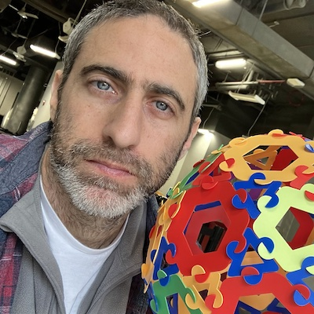
::::

<!-- ------------ -->

:::: {.person}
::: {.person-text}
## Erez Feuer
### PhD student

plant responses to drought and heatwaves
:::
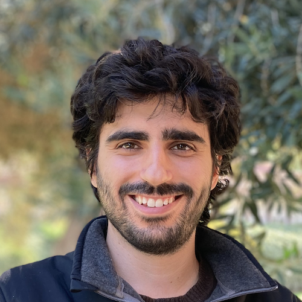
::::

<!-- ------------ -->

:::: {.person}
::: {.person-text}
## Yonatan Schwartz
### MSc student

Temperature heterogeneity in crop canopies

Co-advisor: [David Helman](https://davidhelman.weebly.com/)
:::
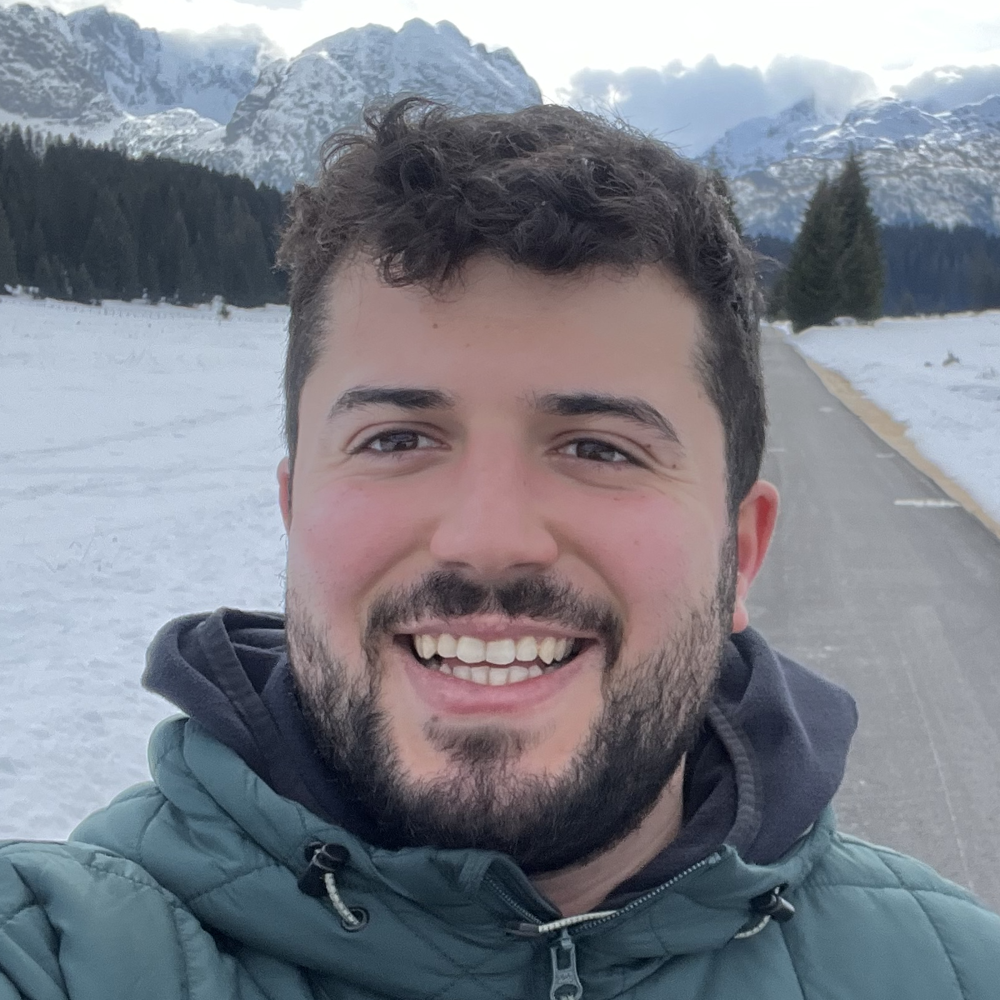
::::

<!-- ------------ -->

:::: {.person}
::: {.person-text}
## Dolev Arav
### MSc student

Urban tree resilience across the globe

Co-advisor: [Yakir Preisler](https://urbanforestlab.wordpress.com/)
:::
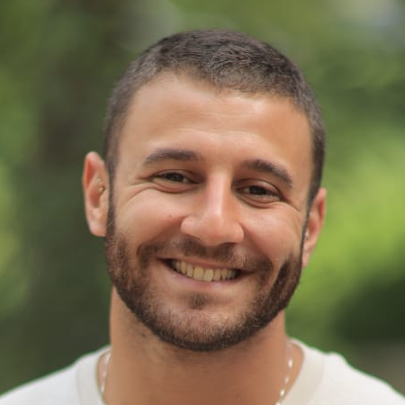
::::

<!-- ------------ -->

:::: {.person}
::: {.person-text}
## Michael Ruggill
### MSc student

Urban tree monitoring and early-warning stress indices

Co-advisor: [Yakir Preisler](https://urbanforestlab.wordpress.com/)
:::
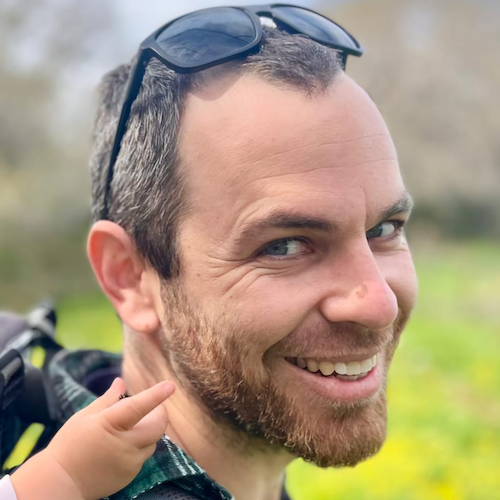
::::

<!-- ------------ -->

:::: {.person}
::: {.person-text}
## Omer Tzuk
### Postdoc

Water-plant relations in drylands, active inference regarding plant behavior and decision-making
:::

::::

<!-- ------------ -->

:::: {.person}
::: {.person-text}
## Ziv Peleg
### MSc student

Separating Physical Shading from Transpiration to Quantify Tree Cooling in Urban Environments

Co-advisor: [Yakir Preisler](https://urbanforestlab.wordpress.com/)
:::
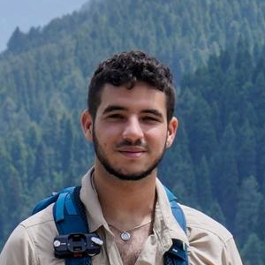
::::
<!-- ------------ -->

# Former members

::::: {.former-grid}

:::: {.former}
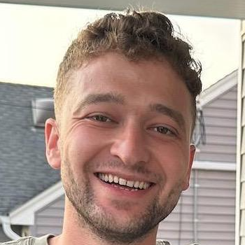

##### Oded Hollander
**2024--2026**, MSc student  
Plant-plant interactions in a consumer-resource framework  
Co-advisor: [Niv DeMalach](https://plantscience.agri.huji.ac.il/people/niv-de-malach)
::::

:::: {.former}
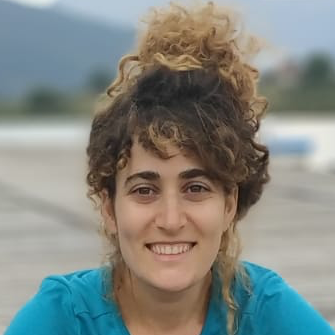

##### Nurit Goldberg
**2020--2024**, PhD student  
soil compaction, soil salinization
::::

:::: {.former}
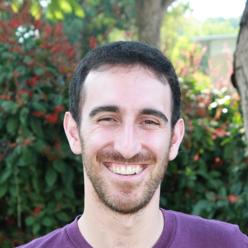

##### Isaac Kramer
**2018--2022**, PhD student  
soil salinization, irreversible soil degradation processes, sustainable resource use  
[website](https://github.com/isaackramer)
::::

:::: {.former}
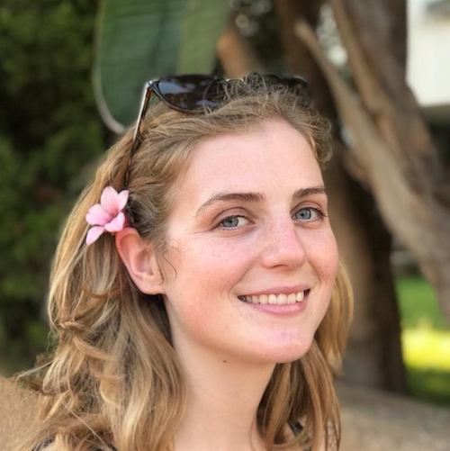

##### Laura Rez
**2020--2022**, MSc student  
plant water fluxes, heatwave impact on fruit trees
::::

:::: {.former}
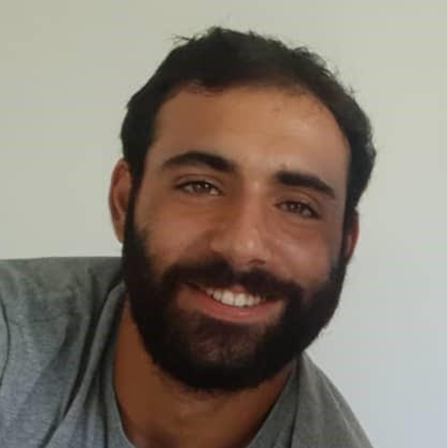

##### Yuval Bayer
**2020--2022**, BSc Amirim project  
Optimal stomatal control
::::

:::: {.former}
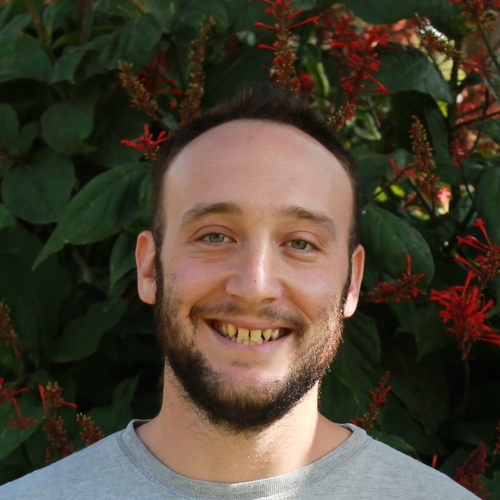

##### Avi Gross
**2018--2020**, MSc student  
Plant water storage dynamics
::::

:::: {.former}
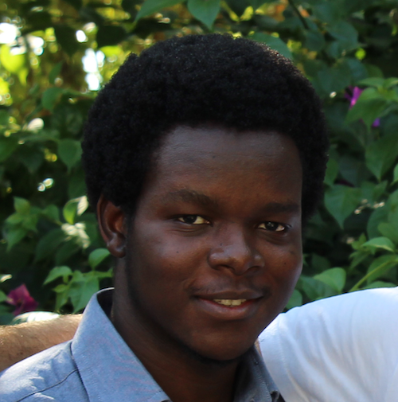

##### Taiwo Adeyemo
**2018--2020**, MSc student  
Irreversible soil degradation
::::

:::: {.former}
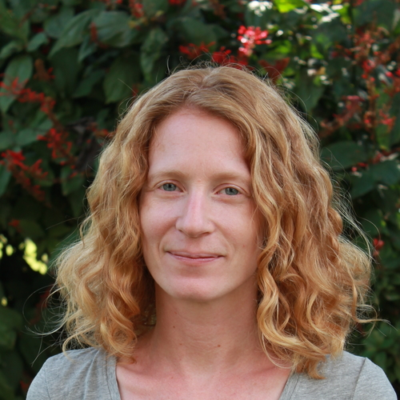

##### Avigail Kaner
**2017--2021**, Research Specialist
::::

:::::

> Theory is when you know everything but nothing works. Praxis is when everything works but no one knows why. In our lab, theory and praxis are combined: nothing works and no one knows why.  
> **— Unknown**
